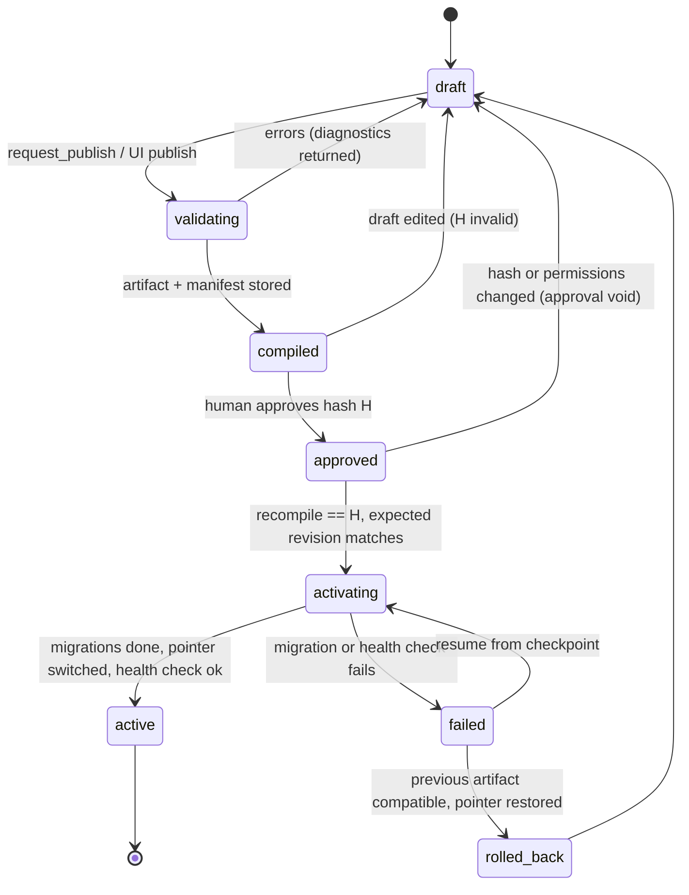

# ADR 0003: Configuration artifact and overlay format

## Context and problem statement

Tenants customize first-party modules through overlays, by hand or through the AI builder. Modules ship new releases underneath those overlays. The master spec ("Configuration composition and deployment") requires typed operations against stable IDs, deterministic composition, three-way upgrade comparison, an immutable content-addressed artifact, approval bound to that artifact, optimistic concurrency on publish, and safe activation and rollback. It lists the deliverables this ADR provides: overlay schema, conflict examples, compile/publish state machine, artifact manifest, concurrent-publish example and a failed-activation walkthrough.

## Decision drivers

- Upgrades must never silently drop or overwrite a tenant change.
- Human and AI edits are the same Commands (undo, diff, audit).
- What a human approves is exactly what activates.
- Activation is safe to retry and safe to roll back, or it says why rollback is unsafe.

## Considered options

1. **Ordered list of typed ops with expected prior values** (chosen).
2. JSON Merge Patch / JSON Patch over the module spec.
3. Full copy of the customized spec per tenant (fork).

## Decision outcome

### Overlay operations

An overlay is an ordered JSON array. Each op has a discriminator `op` and addresses stable IDs. The C# model is [`OverlayOps.cs`](../../packages/Esmbler.Sdk/Overlay/OverlayOps.cs) (23 ops: `field.*`, `choice_list.add`, `choice.*`, `rule.*`, `node.*`, `permission.field_access`, `element.reset`, and since G2-M2 `catalog_item.*` and `workflow.*` for service catalog items and workflows, see [ADR 0015](0015-requests-catalog-fulfillment-and-workflow-versions.md)).

```json
[
  { "op": "field.add", "entity": "core.tickets.ticket",
    "field": { "key": "tenant__vendor", "type": "short_text", "label": "Vendor", "maxLength": 120 } },
  { "op": "field.update", "entity": "core.tickets.ticket", "field": "estimated_effort",
    "set": { "help": "Hours, max one decimal" },
    "expected": { "help": "Hours, e.g. 4 or 2.5" } },
  { "op": "node.insert", "view": "core.tickets.record", "parent": "core.tickets.record.card_classification",
    "anchor": { "after": "core.tickets.record.f_category" },
    "node": { "id": "tenant__n_7f3a91c2de", "type": "field", "props": { "field": "tenant__vendor" }, "children": [] } }
]
```

- **Namespaces** ([`Namespaces.cs`](../../packages/Esmbler.Sdk/Overlay/Namespaces.cs)): base IDs `core.<module>.*`; tenant keys and IDs `tenant__*`; publisher field keys `<publisher>__*` and IDs `<publisher>.<module>.*`. A new tenant element without the prefix fails with `overlay.namespace` and a suggested ID.
- **Anchors**, not positions: `before`/`after` a sibling ID, or `position: start|end`. A missing anchor places the item at the end and emits `overlay.anchor_missing`.
- **Base is immutable:** base fields and nodes can be hidden or relabeled, never removed (`field.remove`/`node.remove` on base elements hide instead or fail).
- **Permission-affecting ops** (`AffectsPermissions`, e.g. `permission.field_access`) also need `permissions.admin` ([ADR 0004](0004-authorization-engine.md)).
- **Reset to default** (`element.reset`, `ResetElement`, REQ-CFG-011): `{ "op": "element.reset", "target": "core.tickets.ticket/category" }` makes every earlier op that touches the target (or its children, such as a choice list's options) stop applying; those ops get the composer status `reset`, and a reset with nothing to undo is `redundant`. Elements the tenant added disappear, so rules or nodes that still use them show up as validation errors in the draft's impact preview. Because it is an op, a reset is a draft step: previewed, undoable, published and audited like any other change. `GET /api/config/customizations` lists what a workspace has customized, and the MCP tool `reset_to_default` appends the op. Covered by `Configuration.ResetToDefaultTests`.

### Composition and three-way upgrade

[`Composer`](../../packages/Esmbler.Kernel/Configuration/Composer.cs) composes base modules sorted by module ID, then applies ops in order, recording provenance per element. For each op it compares the op's `expected` value with the current base value:

| Base value now | Result | Status |
|---|---|---|
| Equals `expected` | Apply the op | `applied` |
| Equals the op's new value | Nothing to do; keep op for history | `redundant` (warning) |
| Something else | Do not apply; report | `conflict` (blocks publish) |

Example: Tickets 1.0.0 → 1.1.0 changes `estimated_effort.help` to "Replaced by Effort (hours)…", but the tenant's op above expected the 1.0.0 text.

```json
{ "index": 1, "op": "field.update", "status": "conflict",
  "diagnostics": [{ "severity": "error", "code": "overlay.conflict",
    "target": "core.tickets.ticket/estimated_effort",
    "message": "core.tickets.ticket/estimated_effort: 'help' was \"Hours, e.g. 4 or 2.5\" when this change was made but is now \"Replaced by Effort (hours). Kept read-only for history.\" (core.tickets@1.1.0).",
    "suggestion": "Keep your value (\"Hours, max one decimal\") or accept the new default (\"Replaced by Effort (hours). Kept read-only for history.\")." }] }
```

The upgrade is held until an admin chooses, and the choice becomes a new op with an updated `expected`. Covered by unit tests `Configuration.UpgradeTests.Relabel_conflicts_when_base_changed_the_same_property` and `Configuration.UpgradeTests.Base_adopting_the_tenant_value_is_compatible`.

### Artifact and manifest

[`ConfigCompiler`](../../packages/Esmbler.Kernel/Configuration/ConfigCompiler.cs) validates the composed config ([`ConfigValidator`](../../packages/Esmbler.Kernel/Configuration/ConfigValidator.cs), [`DependencyGraph`](../../packages/Esmbler.Kernel/Configuration/DependencyGraph.cs)) and emits `EffectiveConfig` JSON plus a manifest. `contentHash` is SHA-256 over canonical JSON (sorted keys) with `provenance` and `customized` removed.

```json
{
  "contentHash": "sha256:4be1…9c0d",
  "lockfile": [{ "id": "core.platform", "version": "1.0.0", "specHash": "sha256:11aa…" },
               { "id": "core.tickets",  "version": "1.1.0", "specHash": "sha256:73f2…" }],
  "overlayHash": "sha256:a0c4…", "overlayOperations": 14,
  "renderer": "esmbler-renderer@^1.0", "sdk": "esmbler-sdk@1.0.0",
  "warnings": [{ "severity": "warning", "code": "overlay.anchor_missing", "target": "tenant__n_7f3a91c2de" }],
  "permissionImpact": { "changed": false, "changes": [] },
  "migrations": ["core.tickets@1.1.0:backfill_impact", "core.tickets@1.1.0:convert_effort"]
}
```

Artifacts are immutable rows in `kernel.config_artifacts (tenant_id, environment_id, revision, content_hash, manifest, config, overlay, status, source, created_by, approved_by, created_at)`; the runtime role cannot delete them. `kernel.active_config (tenant_id, environment_id, revision, previous_revision, activated_at, activated_by)` is the pointer. Both tables are in migration `0001_kernel.sql`. `DraftService`, `PublishService`, `ConfigActivator` and `UpgradeService` (`packages/Esmbler.Kernel.Infrastructure/Configuration/`) implement the flow below.

### Compile/publish state machine



A publish request (`kernel.publish_requests`, created by `request_publish` or the UI) records `draft_id`, `draft_version`, `artifact_hash`, `summary`, requester (and agent), `status` (`pending`, `approved`, `rejected`, `stale`) and the decider. A person publishes with `POST /api/config/publish` `{artifactHash, expectedRevision}`. At that moment the service recompiles the draft and requires: the same content hash (`409 approval_stale` otherwise), the expected published revision (`409 publish_conflict`), `config.publish` from fresh authorization facts, and `permissions.admin` when `permissionImpact.changed`. Agents are refused. Pending requests for the draft become `approved` (same hash) or `stale`. Not built yet: the 24 h expiry of publish requests ([ASM-027](../decisions/assumptions.md)).

### Drafts and the command log

- One open draft per tenant environment (Gate 1), enforced by the partial unique index `drafts_one_open` on `kernel.drafts (tenant_id, environment_id) WHERE status = 'open'`. Each edit appends to `kernel.draft_commands (draft_id, seq, op, summary, targets, actor, agent, source, undone, created_at)` and increments `drafts.version`.
- The draft config = active overlay + non-undone commands in `seq` order, composed on demand.
- **Undo** step N sets `undone = true` (itself a command, so it bumps the version and is audited); **redo** clears it. If later steps depend on step N (a node shows the field step N added), undo fails with `draft.undo_has_dependents` naming those steps.
- Every edit carries the expected draft version (`expectedVersion` in the API, `expected_version` in MCP tools).

### Concurrent edits and publish (REQ-ACC-02)

The AI adds a field at draft version 12 while Alex drags a node in the UI, also based on version 12. The AI's command commits first (version 13). Alex's request returns:

```json
HTTP/1.1 409 Conflict
Content-Type: application/problem+json

{ "type": "https://docs.esmbler.dev/errors/draft_conflict",
  "title": "The draft changed while you were editing (version 12 → 13). Review the latest steps and try again.",
  "status": 409, "code": "draft_conflict",
  "suggestion": "Reload the draft and re-apply your change.",
  "details": { "expectedVersion": 12, "currentVersion": 13,
               "steps": [{ "seq": 13, "summary": "Add short text field \"Vendor\" (tenant__vendor) to core.tickets.ticket",
                           "undone": false, "agent": "9b3e…" }] },
  "traceId": "0HN…" }
```

Publish-level conflict: Alex publishes expecting published revision 7, but a second admin session activated the Tickets 1.1.0 upgrade as revision 8 first. Activation returns `409 publish_conflict` with `details: { expectedRevision: 7, currentRevision: 8 }`. The draft recomposes on revision 8, and Alex reviews and publishes again (`Configuration.ConfigLifecycleTests.Competing_edits_and_stale_publishes_are_rejected_with_details`).

### Failed activation and recovery

Publishes and rollbacks activate in one transaction (`ConfigActivator.ActivateAsync`): check the expected revision, insert the artifact, move the `active_config` pointer, write a `config.published` outbox event, then run `ActivationHealthCheck` inside the same transaction. The health check loads the stored artifact back and evaluates every enabled rule on a sample of up to 25 live records per entity. Any problem throws `422 activation_unhealthy`, the transaction rolls back, and the previous revision stays live (`Configuration.ActivationHealthTests`).

Module upgrades with data migrations (Tickets 1.0.0 → 1.1.0, `convert_effort` text → decimal) run as an `upgrade.run` job (`UpgradeService`):

1. **Plan:** `POST /api/modules/{module}/upgrade-plan` composes the candidate base under the tenant overlay and reports compatible, redundant and conflicting changes with their impact; conflicts block the upgrade.
2. **Migrate:** the upgrade runs the migrations of every release after the installed one up to the target, in release order (`ModuleCatalog.MigrationsBetween`), so skipping a release never skips its migrations. `MigrationExecutor` converts records in checkpointed batches; each batch commits its record updates, audit entries, events and checkpoint together. Values that do not parse stay in the old field and go to the migration report; they are never dropped. The active pointer is untouched, so users see no change.
3. **Failure:** a failed batch marks the run and the upgrade `failed`; work committed so far is invisible to the old revision (expand phase).
4. **Resume:** `POST /api/upgrades/{id}/resume` continues from the last checkpoint; conversion is idempotent.
5. **Switch:** after every migration completes, the activator moves the pointer (with the health check above) and records the new module version.
6. **Rollback:** `POST /api/config/rollback` restores an earlier configuration as a new revision. It is refused with `409 rollback_unsafe` when module versions differ (data migrations ran in between) and suggests a forward fix instead.

Covered by `Configuration.UpgradeTests.Upgrade_preserves_customizations_and_recovers_from_a_partial_migration_failure`, `Configuration.UpgradeTests.Conflicting_customization_blocks_the_upgrade_with_an_impact_report` and `Configuration.ConfigLifecycleTests.Rollback_restores_an_earlier_configuration_as_a_new_revision`.

### Request pinning

Each request resolves one config revision. Record writes may send `configRevision` (the revision the form was rendered with). A write under an older revision whose entity definition differs returns `409 config_conflict` with `clientRevision`, `currentRevision` and reload instructions; compatible older revisions are accepted (`Configuration.ConfigLifecycleTests.Form_submitted_under_an_incompatible_older_revision_gets_a_conflict`).

### Consequences

- Good: conflicts are precise and explainable; the AI and the UI share one edit path; approvals cannot be swapped.
- Bad: overlays grow over time; a compaction step (replay and rewrite redundant ops) is needed later.
- Bad: one builder at a time per environment until Gate 4.

## Pros and cons of the options

| Option | Pros | Cons |
|---|---|---|
| Typed ops + expected values | Three-way conflicts; per-op audit and undo; validates per op | More code per op type |
| JSON (Merge) Patch | Generic | Array indices break on upgrade; no intent, so no conflict detection |
| Fork per tenant | Simple runtime | Upgrades impossible without manual merge |

## More information

- Revisit triggers: overlays above 1,000 ops (add compaction); demand for parallel builders (Gate 4 operation merge model).
- Related: [ADR 0005](0005-job-and-workflow-execution.md) (migration jobs), [ADR 0008](0008-realtime-channel-for-live-editing.md) (draft events).
