# ADR 0007: MCP server design

## Context and problem statement

The AI builder customizes a tenant through Esmbler's own MCP server: both the in-app assistant ([ADR 0013](0013-ai-assistant-model-adapter.md)) and external MCP clients use it. The master spec ("AI-native builder via MCP", "AI execution safeguards") requires discovery, build, review and lifecycle tools, precise errors, tenant/environment bound by authentication with no override, audience-validated tokens without passthrough, bounded tool use, and human approval before publish.

## Decision drivers

- The AI never has more authority than the user, intersected with delegated scopes.
- The AI can never publish by itself.
- Tool errors must let the model self-correct.
- The same authorization and validation code as the REST API, no second implementation.

## Considered options

1. **Separate ASP.NET Core service `apps/Esmbler.Mcp`** using the official C# SDK (`ModelContextProtocol.AspNetCore` 2.2.0), streamable HTTP at `/mcp`, calling kernel application services in-process.
2. MCP endpoints inside `apps/Esmbler.Api`.
3. MCP server as a thin proxy calling the REST API with the user's API token.

## Decision outcome

**Chosen option 1.** Separate deployable (own image, own scaling and rate limits), same kernel libraries, same PDP. Status: implemented (G1-M9) in `apps/Esmbler.Mcp` with the official `ModelContextProtocol.AspNetCore` SDK, Streamable HTTP at `/mcp`. Tools live in `apps/Esmbler.Mcp/Tools/` and all run through `ToolRunner`.

### Authentication and context

JWT bearer, audience `esmbler-mcp` only; API tokens (`esmbler-api`) are rejected, and the server never forwards its inbound token anywhere. Tokens are minted by `POST /api/auth/agent-token` or by the in-app assistant ([ADR 0011](0011-identity-and-development-authentication.md), [ADR 0013](0013-ai-assistant-model-adapter.md)).

```json
{
  "iss": "esmbler", "aud": "esmbler-mcp",
  "sub": "6a0f…", "name": "Alex", "tid": "6f1c…", "eid": "a7d2…",
  "act": "9b3e…",
  "scp": "config:read config:edit config:publish:request access:explain",
  "jti": "0192f3…", "iat": 1791640000, "exp": 1791641800
}
```

No tool takes a tenant or environment argument. Each call resolves the `RequestContext` from `tid`/`eid`, checks the scope the tool needs, and evaluates `user permission ∩ scp` in the PDP; the PDP also checks that the agent principal is enabled and acts for the user ([ADR 0004](0004-authorization-engine.md)).

### Tools (Gate 1)

| Family | Tool | Input (summary) | Output (summary) | Scope |
|---|---|---|---|---|
| Discovery | `list_elements` | `category?` | element types with one-line AI descriptions | config:read |
| | `describe_element` | `type` | props schema, allowed parents/children, examples | config:read |
| | `list_entities` / `describe_entity` | `entity?` | fields (readable to the user only), choice lists, relationships, rules | config:read |
| | `get_view` | `view` | layout tree with node IDs (draft if open) | config:read |
| | `get_customizations` | none | elements the workspace customized, with the default to compare | config:read |
| | `sample_records` | `entity`, `limit ≤ 10` | records the user may read, wrapped as `untrusted_data` | records:read |
| Build | `open_draft` | none | draft ID and version (opens or resumes the single draft) | config:edit |
| | `add_field`, `update_field`, `hide_field`, `add_choice_option` | entity, field spec or patch, `expected_version` | steps (`step`, `summary`, `targets`), new version, diagnostics | config:edit |
| | `add_card`, `insert_node`, `update_node`, `move_node`, `remove_node` | view, parent/node, anchor, spec, `expected_version` | same | config:edit |
| | `add_rule`, `set_rule_enabled`, `remove_rule` | rule spec or ID, `expected_version` | same + plain-English restatement and scope | config:edit |
| | `reset_to_default` | `element`, `expected_version` | same; appends `element.reset` ([ADR 0003](0003-configuration-artifact-and-overlay-format.md)) | config:edit |
| | `undo_step` | `step`, `expected_version` | new version | config:edit |
| Review | `get_draft` | none | steps, version, status | config:read |
| | `validate_draft` | none | errors/warnings with targets and suggestions | config:read |
| | `simulate_rule` | entity, sample record values | which rules fire, required/hidden fields; no side effects | config:read |
| | `diff_draft` | none | op list and element diff vs published | config:read |
| | `preview_url` | `view` | app route of the draft page on synthetic data | config:read |
| Lifecycle | `request_publish` | none | publish request ID, status, artifact hash, readiness checklist | config:publish:request |
| | `discard_draft` | none | confirmation | config:edit |
| Explain | `explain_access` | `entity`, `record?`, `principal?`, `field?` | decision with reasons | access:explain (+ `permissions.admin` or `audit.read` to ask about someone else) |

### Tools added in Gate 2

Service catalog and workflow tools (G2-M2, [ADR 0015](0015-requests-catalog-fulfillment-and-workflow-versions.md)). Build tools append the matching typed overlay op.

| Family | Tool | Input (summary) | Overlay op | Scope |
|---|---|---|---|---|
| Discovery | `list_catalog_items` | none | none; catalog items in the open draft with variables, tasks, dependencies, conditions and `customized` | config:read |
| Build | `add_catalog_item` | `label`, `variables`, `tasks`, `description?`, `category?`, `request_entity?`, `expected_version` | `catalog_item.add` (plus `choice_list.add` for choice questions) | config:edit |
| | `update_catalog_item` | `item`, `label?`, `description?`, `category?`, `active?`, `expected_version` | `catalog_item.update` | config:edit |
| | `add_workflow_state` | `workflow`, `label`, `category`, `expected_version` | `workflow.add_state` | config:edit |
| | `add_transition` | `workflow`, `label`, `from`, `to`, `roles?`, `required_fields?`, `guard?`, `guard_message?`, `tone?`, `expected_version` | `workflow.add_transition` | config:edit |
| | `update_transition` | `workflow`, `transition`, `label?`, `enabled?`, `guard_message?`, `tone?`, `from?`, `to?`, `guard?`, `expected_version` | `workflow.update_transition` | config:edit |
| | `set_workflow_policy` | `workflow`, `policy` (pin, migrate, cancel), `state_map?`, `cancel_state?`, `expected_version` | `workflow.set_active_instances` | config:edit |

Most build tools append one draft command; composite tools (`add_field` with placement, `add_card` with fields) append one per op and report each step ([ADR 0003](0003-configuration-artifact-and-overlay-format.md)). Every step pushes a live update ([ADR 0008](0008-realtime-channel-for-live-editing.md)). Point-and-prompt selections arrive as chat context (node IDs, type, label) and are passed as ordinary tool arguments.

Resources: `esmbler://registry/elements`, `esmbler://design-system/tokens`, `esmbler://app/graph` (the workspace's modules, entities with the fields the user can see, relationships and views, as currently drafted). The graph resource runs through `ToolRunner` like a tool (scope `config:read`, budget, audit) and omits hidden fields.

### Errors

Tool errors are MCP results with `isError: true` and a structured body:

```json
{ "error": {
    "code": "overlay.not_found",
    "message": "Ticket has no field 'catgory'. Did you mean 'category'?",
    "target": "core.tickets.ticket/catgory",
    "suggestion": "category" } }
```

Codes reuse kernel diagnostics (`overlay.*`, `expr.*`, `config.*`) plus `draft_conflict` (with current version and the steps since), `forbidden` (names the missing permission, never restricted data), `scope_missing`, `rate_limited` and `budget_exhausted`.

### Approval flow for `request_publish`

```mermaid
sequenceDiagram
    participant AI as AI agent (MCP)
    participant MCP as Esmbler.Mcp
    participant K as Kernel
    participant UI as Web UI (human)
    AI->>MCP: request_publish()
    MCP->>K: compile draft -> artifact hash H, readiness checklist
    K-->>MCP: publish request PR-17 (H), pending
    MCP-->>AI: PR-17 pending human review
    UI->>K: Alex reviews diff + preview, POST /api/config/publish {H, expectedRevision 7}
    K->>K: recompile == H? fresh config.publish (+permissions.admin if needed)? revision still 7?
    K-->>UI: activated revision 8 (or 409 approval_stale / publish_conflict)
```



Publishing exists only in the API, requires an `esmbler-api` token, and refuses agent contexts. No MCP tool or scope maps to `config.publish`.

### Audit and limits

Every call (including denied ones) writes `kernel.audit_log` as `mcp.<tool>`: actor, agent, target, outcome (`success`, `denied`, `failed`) and the error code or missing scope. Arguments and record content are not stored.

| Limit (Gate 1 governor) | Value | Error |
|---|---|---|
| Tool calls per agent token (session) | 200 | `budget_exhausted` |
| Tool calls per agent token per minute | 60 | `rate_limited` |
| Ops per draft | 300 | `draft_too_large` |
| Tool result size | 64,000 characters (truncated with a note) | none |
| Agent token lifetime | 30 min | token rejected |

### Consequences

- Good: one PDP and one validator for REST, UI and MCP; MCP can be rate-limited and scaled separately.
- Bad: a second ASP.NET Core host to deploy; shared libraries must stay host-agnostic (architecture tests, [ADR 0012](0012-repository-layout-and-module-boundaries.md)).

## Pros and cons of the options

| Option | Pros | Cons |
|---|---|---|
| Separate service, in-process kernel | Isolation of audience, limits, scaling; no token passthrough | Two hosts |
| Inside the API | One deployable | Mixed audiences on one host; MCP load affects users |
| Proxy to REST API | Thin | Requires token passthrough or exchange, which the spec prohibits |

## More information

- Revisit triggers: external MCP clients need OAuth 2.1 dynamic registration (Gate 3 partner beta); the SDK lags the MCP spec version we need.
- Verification: `Mcp.McpServerTests` (`Server_lists_the_builder_tools_and_no_publish_tool`, `Agent_customizes_through_mcp_and_a_person_publishes`, `Api_tokens_are_rejected_by_the_mcp_server`, `Tool_calls_are_rate_limited_per_agent_session`, `Disabling_the_agent_stops_its_next_call`, `Explain_access_tool_says_why_a_field_is_hidden`, `Scopes_limit_the_agent_and_errors_are_structured`, `Embedded_instructions_in_records_cannot_widen_authority`); `Configuration.ConfigLifecycleTests.Agents_request_publish_but_only_humans_publish_and_permissions_need_admin`. A schema check that no tool accepts a tenant argument is not built yet.
