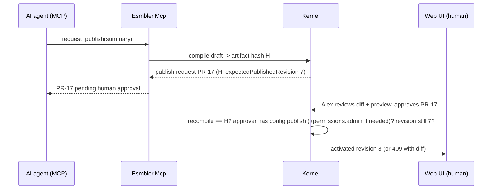

# ADR 0007: MCP server design

## Context and problem statement

The AI builder customizes a tenant through Esmbler's own MCP server: both the in-app assistant ([ADR 0013](0013-ai-assistant-model-adapter.md)) and external MCP clients use it. The master spec ("AI-native builder via MCP", "AI execution safeguards") requires discovery, build, review and lifecycle tools, precise errors, tenant/environment bound by authentication with no override, audience-validated tokens without passthrough, bounded tool use, and human approval before publish.

## Decision drivers

- The AI never has more authority than the user, intersected with delegated scopes.
- The AI can never publish by itself.
- Tool errors must let the model self-correct.
- The same authorization and validation code as the REST API, no second implementation.

## Considered options

1. **Separate ASP.NET Core service `apps/Esmbler.Mcp`** using the official C# SDK (`ModelContextProtocol.AspNetCore` 2.2.0), streamable HTTP at `/mcp`, calling kernel application services in-process.
2. MCP endpoints inside `apps/Esmbler.Api`.
3. MCP server as a thin proxy calling the REST API with the user's API token.

## Decision outcome

**Chosen option 1.** Separate deployable (own image, own scaling and rate limits), same kernel libraries, same PDP.

### Authentication and context

JWT bearer, audience `esmbler-mcp` only; API tokens (`esmbler-api`) are rejected, and the server never forwards its inbound token anywhere. Tokens are minted by `POST /api/auth/agent-token` ([ADR 0011](0011-identity-and-development-authentication.md)).

```json
{
  "iss": "esmbler", "aud": "esmbler-mcp",
  "sub": "user:6a0f…", "tid": "tenant:acme-uuid", "eid": "env:sandbox-uuid",
  "act": { "sub": "agent:assistant-alex" },
  "scp": "config:read config:edit config:publish:request records:read",
  "jti": "0192f3…", "iat": 1791640000, "exp": 1791641800
}
```

No tool takes a tenant or environment argument. Each call resolves the `RequestContext` from `tid`/`eid`, checks the agent principal is enabled, and evaluates `user permission ∩ scp ∩ acts_for` in the PDP ([ADR 0004](0004-authorization-engine.md)).

### Tools (Gate 1)

| Family | Tool | Input (summary) | Output (summary) | Scope |
|---|---|---|---|---|
| Discovery | `list_elements` | `category?` | element types with one-line AI descriptions | config:read |
| | `describe_element` | `type` | props schema, allowed parents/children, rule hooks, examples | config:read |
| | `list_entities` / `describe_entity` | `entity?` | fields (readable to the user only), choice lists, relationships | config:read |
| | `get_view` | `view` | layout tree with node IDs (draft if open) | config:read |
| | `list_rules` | `entity` | rules with plain-English restatement | config:read |
| | `get_customizations` | `entity?` | tenant-owned and changed elements vs default | config:read |
| Build | `open_draft` | none | `draftId`, `version` (opens or resumes the single draft) | config:edit |
| | `add_field`, `update_field`, `hide_field`, `add_choice_option` | entity, field spec or patch, `expectedDraftVersion` | `seq`, new `version`, targets, diagnostics | config:edit |
| | `insert_node`, `update_node`, `move_node`, `remove_node` | view, parent/node, anchor, spec, `expectedDraftVersion` | same | config:edit |
| | `add_rule`, `update_rule`, `remove_rule` | rule spec or ID, `expectedDraftVersion` | same + plain-English restatement and scope | config:edit |
| | `undo_step` | `seq` | new `version` | config:edit |
| Review | `validate_draft` | none | errors/warnings with targets and suggestions | config:read |
| | `simulate_rule` | `rule` or draft, sample record values | which rules fire, required/hidden fields; no side effects | config:read |
| | `diff_draft` | none | op list and element diff vs published | config:read |
| | `preview_url` | `view` | URL of the draft page on synthetic data | config:read |
| Lifecycle | `request_publish` | `summary` | `publishRequestId`, artifact hash, readiness checklist | config:publish:request |
| | `discard_draft` | none | confirmation | config:edit |
| Explain | `explain_access` | `user`, `record` or `field`, `action` | decision with explain trace | records:read + permissions.admin or self |

Each build tool appends exactly one draft command ([ADR 0003](0003-configuration-artifact-and-overlay-format.md)), which pushes a live update ([ADR 0008](0008-realtime-channel-for-live-editing.md)). Point-and-prompt selections arrive as chat context (node IDs, type, path) and are passed as ordinary tool arguments.

Resources: `esmbler://registry/elements`, `esmbler://design-system/tokens`, `esmbler://app/graph` (the tenant's entities, views, rules and dependency graph, filtered by the user's permissions).

### Errors

Tool errors are MCP results with `isError: true` and a structured body:

```json
{ "code": "overlay.not_found",
  "message": "Ticket has no field 'catgory'. Did you mean 'category'?",
  "target": "core.tickets.ticket/catgory",
  "suggestion": "category" }
```

Codes reuse kernel diagnostics (`overlay.*`, `expr.*`, `config.*`) plus `draft_conflict` (with current version), `forbidden` (names the missing scope or permission, never restricted data), and `limit_exceeded`.

### Approval flow for `request_publish`



The approve endpoint exists only in the API, requires an `esmbler-api` token with a human session, and rejects tokens carrying `act`. No MCP scope maps to `config.publish`.

### Audit and limits

Every call writes `kernel.audit_log`: actor, agent, tool, target IDs, config revision, draft version, outcome, duration. Arguments are stored minus free-text record content.

| Limit (Gate 1 governor) | Value |
|---|---|
| Tool calls per MCP session | 200 |
| Tool calls per agent token per minute | 60 |
| Ops per draft | 300 |
| Tool result size | 64 KB (lists paginate) |
| Agent token lifetime | 30 min |

Exceeding a limit returns `limit_exceeded` with the limit name and reset time.

### Consequences

- Good: one PDP and one validator for REST, UI and MCP; MCP can be rate-limited and scaled separately.
- Bad: a second ASP.NET Core host to deploy; shared libraries must stay host-agnostic (architecture tests, [ADR 0012](0012-repository-layout-and-module-boundaries.md)).

## Pros and cons of the options

| Option | Pros | Cons |
|---|---|---|
| Separate service, in-process kernel | Isolation of audience, limits, scaling; no token passthrough | Two hosts |
| Inside the API | One deployable | Mixed audiences on one host; MCP load affects users |
| Proxy to REST API | Thin | Requires token passthrough or exchange, which the spec prohibits |

## More information

- Revisit triggers: external MCP clients need OAuth 2.1 dynamic registration (Gate 3 partner beta); the SDK lags the MCP spec version we need.
- Verification (planned): `Mcp.Auth.Api_audience_token_is_rejected`, `Mcp.Auth.No_tool_accepts_tenant_argument`, `Mcp.Lifecycle.Agent_cannot_approve_publish`, `Mcp.Limits.Rate_limit_returns_limit_exceeded`.
