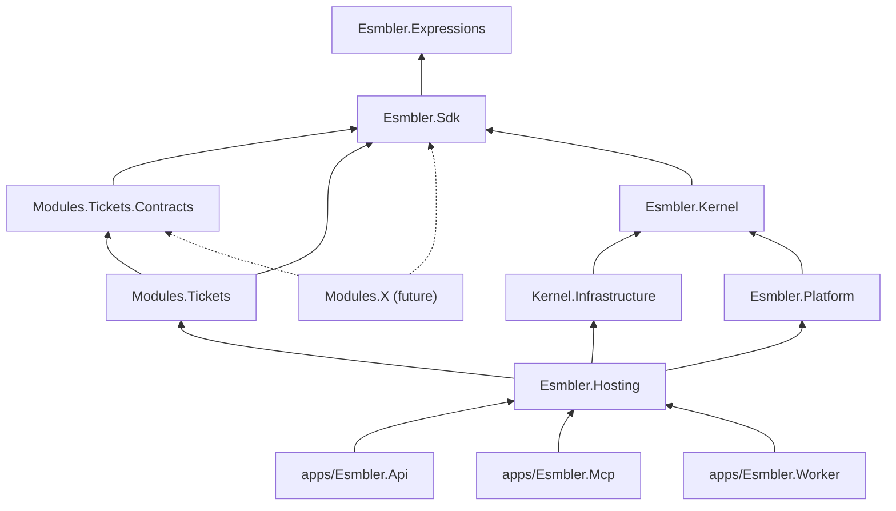

# ADR 0012: Repository layout and module boundaries

## Context and problem statement

The master spec ("Architecture model") asks for a modular monolith with enforced module boundaries, a kernel that knows no business-module internals, module communication only through events, versioned contracts and the relationship service, and first-party modules built only on the public SDK (dogfooding). The execution brief requires one repository, each module as its own set of .NET projects with only its contracts project referenceable, enforced by architecture tests in CI. How is the repository laid out, and what exactly may reference what?

## Decision drivers

- Boundaries enforced by tooling, not prose.
- The Tickets module must be buildable by a third party with only the public SDK.
- Kernel stays free of infrastructure (EF Core, Npgsql, OpenFGA) so it is testable in memory.
- Hosts (API, MCP, Worker) share one composition root.

## Considered options

1. **One repository; projects per layer and per module; NetArchTest plus project-reference checks.**
2. Separate repositories per module with NuGet packages.
3. One big project with folder conventions and analyzers.

## Decision outcome

**Chosen option 1.**

| Path | Role | Public? |
|---|---|---|
| `packages/Esmbler.Expressions` | CEL-subset language ([ADR 0009](0009-rule-expression-language.md)) | Yes |
| `packages/Esmbler.Sdk` | Specs, overlay ops, element registry, module API, event envelope | Yes (the public SDK) |
| `packages/Esmbler.Kernel` | Configuration compiler, tenancy, records, PDP, drafts, audit, outbox, ports | No |
| `packages/Esmbler.Kernel.Infrastructure` | PostgreSQL (EF Core, Npgsql, RLS session, SQL migrations), OpenFGA adapter | No |
| `packages/Esmbler.Platform` | Rules, workflow, assignment, notifications services | No |
| `packages/Esmbler.Hosting` | Composition root shared by hosts | No |
| `modules/<name>/Esmbler.Modules.<Name>` (+ `.Contracts`) | Business module; declarative releases in `Releases/<version>/module.json` | Contracts only |
| `apps/Esmbler.Api`, `apps/Esmbler.Mcp`, `apps/Esmbler.Worker`, `apps/web` | Deployables (one container image each) | n/a |
| `tests/Esmbler.UnitTests`, `.IntegrationTests`, `.ArchitectureTests`, `tests/e2e` | Tests | n/a |
| `spikes/*` | Throwaway spike code behind ADRs | n/a |

### Allowed dependency graph

Only `Esmbler.Hosting` knows concrete modules; it registers each `IModuleDefinition` at startup. The kernel loads module specs through the SDK's module API, never by referencing a module.

### Architecture test rules

Implemented in [`tests/Esmbler.ArchitectureTests/BoundaryTests.cs`](../../tests/Esmbler.ArchitectureTests/BoundaryTests.cs), run in CI on every push:

| Test | Rule |
|---|---|
| `Modules_do_not_depend_on_kernel_platform_or_hosts` | Module assemblies have no type dependency on Kernel, Kernel.Infrastructure, Platform, Hosting, Api, Mcp, Worker |
| `Module_project_references_are_restricted_to_public_projects` | A module's `.csproj` references only `Esmbler.Sdk`, `Esmbler.Expressions`, its own projects, and other modules' `*.Contracts`; no `PackageReference` at all |
| `Sdk_depends_on_nothing_internal` | Sdk references no internal assembly and no module |
| `Kernel_does_not_depend_on_platform_modules_infrastructure_or_hosts` | Kernel has no dependency on Platform, Modules, Infrastructure, Hosting, hosts, `Npgsql`, `Microsoft.EntityFrameworkCore`, `OpenFga` |
| `Platform_does_not_depend_on_modules_or_infrastructure` | Platform has no dependency on Modules, Infrastructure, Hosting, `Npgsql`, `OpenFga` |

Planned additions as code lands: only `Kernel.Infrastructure` references `OpenFga.Sdk` ([ADR 0004](0004-authorization-engine.md)); only `apps/Esmbler.Api` references `Anthropic` ([ADR 0013](0013-ai-assistant-model-adapter.md)); `apps/Esmbler.Mcp` exposes no tool parameter named `tenant` or `environment` ([ADR 0007](0007-mcp-server-design.md)).

### Data boundaries

- All record data lives in `kernel.records`, owned by the record engine; a module's data is addressed by entity ID (`core.tickets.*`), and the record engine refuses writes to entities a module does not own except through public contracts (events, APIs, relationships).
- Modules ship no SQL and no migrations of their own; data changes are declarative `MigrationSpec`s executed by the kernel ([ADR 0003](0003-configuration-artifact-and-overlay-format.md)).

### Frontend

`apps/web` is one Angular 22 workspace (standalone components, signals, zoneless). The renderer maps registry element types to components; feature folders mirror modules. Lint rules (ESLint `no-restricted-imports`) keep feature folders from importing each other's internals.

### Consequences

- Good: Tickets demonstrably uses only the SDK; any violation fails CI with the offending type names.
- Good: Kernel unit tests need no database.
- Bad: one repository builds everything; CI time grows with modules (mitigated by test filtering per path later).
- Bad: NetArchTest checks type dependencies, not runtime reflection; reflection-based access is prohibited by review rule.

## Pros and cons of the options

| Option | Pros | Cons |
|---|---|---|
| Mono-repo, projects + architecture tests | Atomic changes; enforced boundaries | Larger builds |
| Repos per module | Hard boundaries | Version juggling across 6+ repos during Gate 1; slow atomic changes |
| One project + conventions | Simplest | Boundaries unenforceable; dogfooding unprovable |

## More information

- Revisit triggers: a module needs extraction into a service (its Contracts become the network API); CI duration above 15 minutes.
