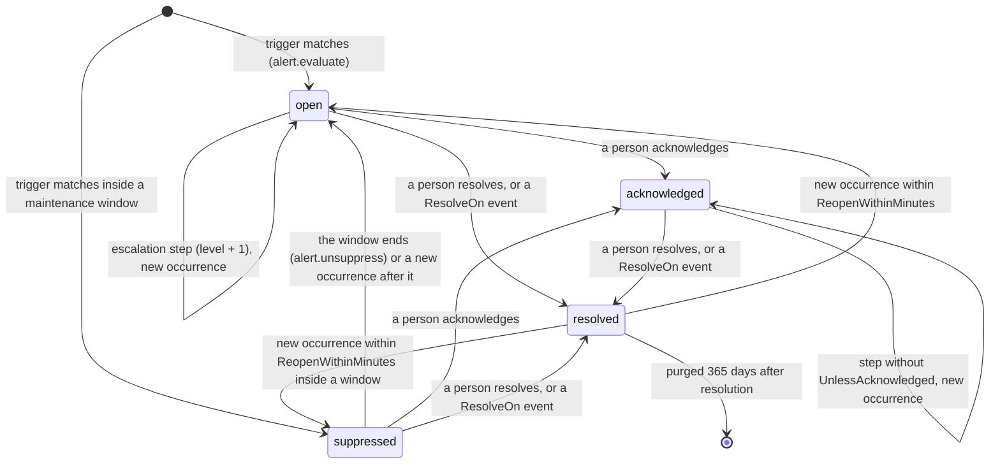
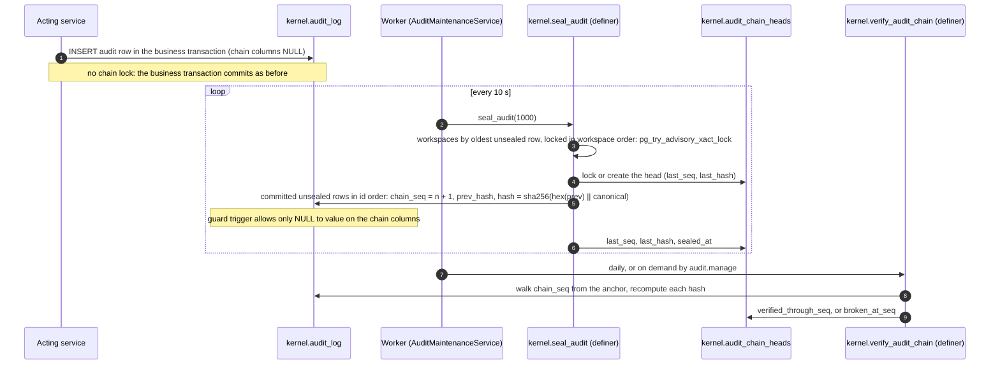

# ADR 0022: Alerts and audit policy

## Context and problem statement

[ADR 0017](0017-event-audit-alert-notification-services.md) asked for two more services on top of the event platform:

- **Alerts.** A service separate from notifications, with rules, deduplication, acknowledgment, escalation timers, auto-resolve and suppression. Alerts publish `platform.alert.*` events and never send messages themselves.
- **Audit policy.** Audit stays synchronous in the acting service's transaction. It gains a retention policy with legal hold, an export API and a per-tenant hash chain for tamper evidence.

G2-M18 built subscriptions with the `notify` target and the notification routes that alert events need ([ADR 0021](0021-notification-routing-and-delivery.md)). G2-M19 builds the alert service and the audit policy. It also closes the retention gap of notification deliveries and the inbox ([KI-024](../known-issues.md)).

Before G2-M19:

- Nothing grouped repeated problems or followed up when nobody reacted.
- `kernel.audit_log` was protected only by the runtime role having no `UPDATE` or `DELETE`. It had no retention, no export, no read API beyond record history, and nothing could tell whether a row had been changed by someone with database access.
- Notification deliveries, attempts and inbox rows grew without bound.

This ADR settles what ADR 0017 left open:

- How do alert rules fit the configuration model, and how do they connect to notifications?
- When are two events the same alert, when does an alert escalate, and when does it end?
- Who sees an alert and who may act on it, including AI agents?
- How is the audit chain built without slowing down or deadlocking business transactions?
- What is kept for how long, how does a legal hold stop deletion, and how is the log exported safely?

## Decision drivers

- Alerts and notifications stay independent: an alert never knows who is told or how (REQ-ALR-001, ADR 0017).
- Alert rules are validated configuration with overlay ops, drafts, publish, upgrades and MCP tools, like every other spec object.
- One problem is one alert, however often it is reported, also under concurrent events.
- Nobody silences a mandatory alert route without permission administration, and agents never act on alerts (REQ-AUTHZ-008, REQ-AISAFE-001).
- Alert titles and keys never reveal a value a viewer could not read.
- Audit capture never depends on notifications, alerts or background work, and audit never makes business transactions slower or riskier (REQ-AUD-001).
- Tampering with sealed audit rows is detectable and located; deletion follows a policy and is itself audited.
- Every new table is isolated by tenant (and environment where it applies) with FORCE RLS; cross-tenant work goes only through narrow definer functions (REQ-TEN-001).

## Considered options

1. **Alert rules as their own spec object, raised and resolved through subscriptions with target `alert`; alerts publish events that routes deliver. Audit chain sealed asynchronously by a privileged worker function, with a guard trigger, retention by sealed prefix and tenant-wide legal holds.**
2. Alert rules that embed their trigger and per-step `notify` lists (the sketch in the design document, section 5).
3. Hash chain computed synchronously in the business transaction (a trigger that locks the tenant's chain head).
4. Tamper evidence through an external append-only store (WORM object storage or a ledger database) instead of an in-database chain.

## Decision outcome

**Chosen option 1.**

### Alert rules as configuration

`AlertRuleSpec` (`packages/Esmbler.Sdk/Specs/Alerts.cs`) is a public spec object in module releases and the tenant overlay (`SpecCatalog.AlertRules`):

| Property | Meaning |
| --- | --- |
| `Trigger` | A subscription with `Target = "alert"` whose events raise the alert |
| `MinSeverity`, `Severity` | Only events at least this severe raise it; a fixed alert severity, or null to take the event's |
| `DedupKey` | Expression over `event` and `record` giving the key; null keys by the event's record, or by the event when it has none |
| `Title` | Plain text with `{{record.<field>}}`, `{{record.number}}` and `{{event.<field>}}`, at most 200 characters |
| `Owner` | `group` (a group key), `field` (a user, group or principals field of the record) or `user` (a principal ID) |
| `Escalation` | Up to 10 steps: `AfterMinutes`, `UnlessAcknowledged` (default true), `RepeatEveryMinutes` on the last step only |
| `ResolveOn` | Up to 5 subscriptions with target `alert` whose events resolve the rule's active alerts |
| `ReopenWithinMinutes`, `Enabled` | Cool-down for reopening (0 is off), on or off |

Alerts are the second subscription target (`SubscriptionTargets.Alert`). Routes may use only `notify` subscriptions and alert rules only `alert` subscriptions (`config.bad_target`). A separate consumer, `AlertRouter` (`alerts.router`), matches events with the same matching code as the notification router (`SubscriptionRouter.MatchAsync`) and schedules one durable `alert.evaluate` job per match, keyed by event and subscription. Each target therefore fails, retries and dead-letters alone.

Overlay ops `alert_rule.add`, `alert_rule.update` and `alert_rule.remove` (52 ops in all). Tenants add `tenant__` rules. On module rules, `Trigger` and `DedupKey` are fixed (`overlay.base_immutable`); everything else can change, and a module rule is disabled rather than removed. A subscription used by a rule's trigger or `ResolveOn` cannot be removed (`overlay.in_use`). Module rules stay in the module's namespace and use only the module's own or `core.platform`'s subscriptions (`config.foreign_notification_element`).

The validator (`ConfigValidator.Alerts.cs`) also refuses:

| Code | When |
| --- | --- |
| `config.alert_loop` | A trigger listens to `platform.alert.*` (the router also ignores those events) |
| `config.alert_bad_dedup` | The key does not compile against the trigger's event and entity, or, for a resolving event about no record, against that event |
| `config.alert_hidden_field` | The title, key or owner field reads a field any permission set hides |
| `config.restricted_event_text` | The title or key reads `event.*` values of a restricted event type |
| `config.bad_placeholder`, `config.raw_html`, `config.too_large` | Title problems; more than 5 resolving subscriptions |
| `config.alert_bad_owner` | Unknown owner kind, a bad group key or person ID, or a field that is not a user, group or principals field |
| `config.alert_bad_escalation` | More than 10 steps, minutes outside 1 to 10,080 or not increasing, a repeat on any but the last step or outside 5 to 10,080 minutes, a cool-down outside 0 to 10,080 |
| `config.bad_severity` | An unknown severity |
| `config.bad_recipient` | An `alert_owner` recipient on a route whose subscription is not on a `platform.alert.*` event |

`DependencyGraph` links a rule to its subscriptions, its owner field and the fields its title and key read, so removing one of them reports the rule. `ConfigDiff` lists rule changes in the draft review.

### Lifecycle

`kernel.alerts` holds one row per alert (migration `0015_alerts.sql`). The unique partial index `alerts_active_key` on `(tenant, environment, rule, key)` for `open`, `acknowledged` and `suppressed` rows is the deduplication guarantee: the evaluate job reads the active alert `FOR UPDATE`, and a later match counts an occurrence on it instead of opening another. `kernel.alert_activity` is the append-only timeline (opened, occurred, acknowledged, assigned, escalated, resolved, reopened, suppressed, unsuppressed); occurrences are written at most once a minute per alert. The pure state machine and timing are in `packages/Esmbler.Kernel/Alerts/AlertLifecycle.cs`.

- **Escalation.** An alert opens at level 1. `AlertLifecycle.NextEscalation` gives the time of the next step, counted from `opened_at`, and its level. The last step may repeat every `RepeatEveryMinutes`, at most 20 times (`MaxRepeats`). Each step runs as a durable `alert.escalate` job (dedup `alert.escalate:{alert}`). The job marks itself complete before scheduling the next step, as `sla.check` does, because the scheduler returns a live job with the same key instead of adding one. A job finds the alert locked; it does nothing for resolved or suppressed alerts or a rule that is off. On an acknowledged alert it skips steps with `UnlessAcknowledged`; it schedules the next step only while a later step does not wait for acknowledgment, so an acknowledged alert whose remaining steps all wait for it stops scheduling no-op jobs. Acknowledging or resolving never deletes a pending job; the job finds nothing to do.
- **Auto-resolve is event-driven.** When a `ResolveOn` subscription matches an event about a record, the rule's active alerts about that record are resolved with resolution `auto`. For an event about no record, the rule's key is computed on the resolving event, and the validator makes sure it can be. Nothing polls conditions.
- **Reopen.** A match within `ReopenWithinMinutes` of resolution reopens the same alert: level 1, a new `opened_at`, acknowledgment cleared, `reopened_count` + 1, and `platform.alert.opened` with `reopened: true`. Inside a maintenance window the reopened alert is `suppressed` instead and publishes nothing.
- **Maintenance windows** (`kernel.alert_suppressions`) are runtime data, not configuration: a reason, optional rule, entity and record scope, and a start and end at most 14 days apart (a `CHECK` constraint as well as the service). People with `alerts.manage` create and end them with fresh facts, audited as `alert.suppress` and `alert.suppression_cancel`; responders can list them. An alert raised or reopened inside a window is stored as `suppressed`, publishes nothing and does not escalate; acknowledging, assigning or resolving it publishes nothing either. When the window ends, at its `ends_at` or when someone ends it early, an `alert.unsuppress` job announces the alerts it still holds: they become `open`, publish `platform.alert.opened` and start escalating. A new occurrence after the window does the same for its alert.

### Alerts never send

Every change publishes one of five platform events through `EventWriter` in the same transaction: `platform.alert.opened`, `.acknowledged`, `.escalated`, `.assigned` and `.resolved` (source `platform.alerts`, category `operational`). The payload holds `alert`, `rule`, `title`, `severity`, `level`, `occurrences`, `owner_group`, `assignee`, `reopened` and `resolution`; the key stays out. The envelope carries the subject record's entity and ID, so routes on alert events render `{{record.*}}` and check each recipient's read access exactly as for record events.

Who hears about an alert is ordinary notification configuration. A route on `platform.alert.opened` with the new recipient kind `alert_owner` reaches the alert's owner group, owner and assignee (only for alert events the platform published, source `platform.alerts`); a route on `platform.alert.escalated` with the condition `event.level >= 2` reaches management. This replaces the `escalation[].notify` lists of the ADR 0017 sketch: steps only raise the level, and routes decide what each level means (ASM-096).

### Visibility and rights

Four platform actions are added to the SDK (`PlatformActions`); `permissions.admin` implies all of them, and `EffectivePermissions` strips all of them from AI agents.

| Action | Allows |
| --- | --- |
| `alerts.respond` | See every alert of the environment; acknowledge, resolve and assign them |
| `alerts.manage` | `alerts.respond`, plus maintenance windows |
| `audit.export` | Download the audit log |
| `audit.manage` | Retention, legal holds and verifying the chain on demand |

Without `alerts.respond`, a person sees and answers the alerts that are theirs: owned by one of their groups or by them, or assigned to them. Every view of an alert about a record also needs read access to that record; otherwise the alert does not exist for the viewer (404). Lists apply both checks before paging, so page sizes reveal nothing about alerts a viewer cannot see. The assignee must be an enabled member of the workspace (checked with an explicit workspace filter) who can read the record.

People reached by a route at an escalation level (for example management on `event.level >= 2`) are told, but they see the alert on the Alerts page only if they own it, are assigned or have `alerts.respond`; their notification links to the record (ASM-111). Changes take the row lock, check the version, are idempotent on the same state and are audited as `alert.acknowledge`, `alert.resolve` and `alert.assign` (the design document's example wrote `alert.acknowledged`).

AI agents read alerts through MCP `list_alerts` (needs `records:read`; the result is wrapped as untrusted data) with the visibility of the person they act for, but they cannot acknowledge, resolve, assign or silence (`agent_not_allowed`). Acknowledging is a person's statement that they are on it (ASM-102).

Disabling or narrowing a rule behind a mandatory or external alert route could silence it. For routes on `platform.alert.*`, the reach signature in `ConfigCompiler.PermissionDiff` therefore includes every alert rule (ID, enabled, trigger, severities, escalation, resolving subscriptions, owner) and each rule's trigger subscription (event, condition, enabled). Any such change needs `permissions.admin` to publish. The `alert_rule.*` ops themselves are not permission ops, so the change is caught at publish rather than when applied to a draft ([KI-044](../known-issues.md)).

Interfaces:

- REST `/api/alerts` (list with `status` and `mine`, `count`, detail with timeline, `acknowledge`, `resolve`, `assign`) and `/api/admin/alerts/suppressions` (list, create, `cancel`). The bootstrap's `alerts` flag shows the navigation item to people (not agents) when rules exist and the person responds to alerts or belongs to a group.
- Web `/alerts`: tabs Active, Silenced, Resolved and Maintenance windows; "Only mine"; Acknowledge, Assign to me, Resolve with a note and the timeline; the window form for `alerts.manage`. The navigation shows a badge of open alerts that are the person's, refreshed with the inbox badge every 60 seconds.
- MCP `list_alert_rules`, `add_alert_rule` (trigger subscription, optional resolving subscription and rule as one change), `update_alert_rule` and `list_alerts`. There are no tools to acknowledge, resolve, assign or silence.

### Audit hash chain

Migration `0016_audit_policy.sql` adds `chain_seq`, `prev_hash` and `hash` to `kernel.audit_log` and makes sealed rows tamper-evident.

- **Sealed asynchronously.** `AuditWriter` keeps inserting rows in the business transaction, untouched. The definer function `kernel.seal_audit(batch)` runs in the worker (`AuditMaintenanceService`, every 10 seconds, faster while there is a backlog). It takes workspaces in order of their oldest unsealed row and locks them in workspace order (migration `0017_audit_hardening.sql`); for each it takes a transaction advisory lock (skipping one another sealer holds), locks or creates the head row in `kernel.audit_chain_heads`, and links committed unsealed rows in `id` order. There is one chain per workspace, across its environments and its workspace-wide rows.
- **Why not synchronous.** A trigger that extends the chain in the business transaction must lock the workspace's chain head until commit. Every audited write in a workspace would then wait for the previous one to commit. It could also deadlock: transaction 1 writes audit (head lock) and then locks record X, while transaction 2 holds X and waits for the head. Asynchronous sealing only sees committed rows, so it needs neither.
- **Chain order is seal order.** It is not `id` order or `at` order, because a row with a lower `id` can commit later. Rows stay unsealed for about ten seconds; verification walks `chain_seq` (ASM-105).
- **Canonical form.** `kernel.audit_canonical(row)` is the JSON array of every column except the chain columns, in a fixed order, with `at` in UTC to the microsecond. `hash = sha256(hex(prev_hash) || canonical)`, and the first link's `prev_hash` is the genesis `sha256('esmbler-audit-genesis:' || tenant_id)`.
- **Write protection.** The runtime role loses table-wide `INSERT` and gets column-level `INSERT` without the chain columns, so it cannot preseal a row; it still has no `UPDATE` or `DELETE`. The plain (not definer) trigger `kernel.audit_log_guard` refuses any update of a sealed row and any update that changes a column other than the chain columns, for every role, the sealer included. Only `esmbler_definer` may set the chain columns, once, and delete rows. EF does not map the chain columns.
- **Verification.** `kernel.verify_audit_chain(limit)` takes the workspace from the session context (never an argument; it fails closed without one), checks up to `limit` links from the anchor or from where the last call stopped (`verify_cursor`), and records the result on the head. It returns counts and positions only, never row contents. The worker verifies each chain once a day (`kernel.audit_verification_due` lists chains not verified in a day; 50,000 links per call). People with `audit.manage` verify on demand (`POST /api/admin/audit/chain/verify`, audited `audit.chain_verify`). Verify now is rate limited (the `exports` policy, sharing its two requests a minute per person with exports) and checks at most 100,000 links per request (four calls of 25,000); a longer chain continues from the cursor on the next request or the daily run. A break is stored on the head (`broken_at_seq`, and `verified_at` so it is not rechecked every hour), written once, on first detection, as a workspace-wide `audit.chain_broken` entry with outcome `failed`, logged as a warning without row data, and shown as a red banner on the audit page.

### Retention and legal holds

`kernel.purge_retention` is a definer function the worker runs hourly under a global advisory lock (replaced in migration 0017). It takes workspaces in ID order, isolates each workspace's work so a failure in one does not stop the others, and for each workspace without an active legal hold removes, in batches of at most 5,000 rows per workspace and kind:

| What | Kept for | Floor enforced in SQL |
| --- | --- | --- |
| Audit entries | The workspace's policy (`kernel.audit_policies`): 365 to 3,650 days, default 2,555 (seven years) | 365 days, and a `CHECK` on the policy |
| Notification deliveries in a final state (sent, failed, ambiguous, captured, suppressed) and their attempts | 90 days after the last update | 90 days |
| Inbox items | 30 days after being read; unread ones 365 days after creation | 30 and 365 days |
| Resolved alerts and their timelines | 365 days after resolution | 365 days |

- **Audit purges only a verified, sealed prefix.** It deletes rows with `chain_seq` up to the last link before the first entry still inside the policy, never unsealed rows, never past `verified_through_seq` and never at or after a known break (`broken_at_seq`). It recomputes the links of the prefix before deleting it; a mismatch marks the chain broken and keeps the rows as evidence. It moves the head's anchor (`anchor_seq`, `anchor_hash`) to the last deleted link in the same transaction, so verification starts from the anchor and the remaining chain still verifies.
- **Every purge is audited** in the same transaction, as a workspace-wide `retention.purged` entry (kind and count; for audit also the anchor and the policy).
- **Legal holds** (`kernel.legal_holds`) are workspace-wide (`scope = 'all'`) and pause every purge of the workspace until released: audit, deliveries, inbox and alerts. Placing needs `audit.manage` with fresh facts and a reason; releasing needs `audit.manage` and either `permissions.admin` or being the person who placed the hold. Both are audited workspace-wide (`audit.hold_place`, `audit.hold_release`). Holds on single records are deferred; a workspace-wide hold also keeps the purged part a contiguous prefix of the chain.
- **Policy changes** need `audit.manage`; shortening retention also needs `permissions.admin`. They are audited as `audit.policy_change` with the old and new values.

### Search and export

`AuditService` serves `GET /api/admin/audit` (search with `audit.read`: date range, actor, operation prefix, target type and ID, outcome; newest first, keyset paging on `id`, at most 200 a page; the current environment's entries plus workspace-wide ones, through RLS) and the chain, policy and hold endpoints.

Audit details can hold field values, so they are redacted for viewers without `permissions.admin`: a record change value shows `"restricted"` unless the viewer can read all records of the entity and the field is not hidden from them (ASM-112). Search and CSV export redact the same way.

`GET /api/admin/audit/export?format=csv|jsonl` needs `audit.export` with fresh facts:

- It is limited to 2 a minute per person (`LoginThrottle.ExportPolicy`, `exports`), at most 400 days (the last 30 by default) and 500,000 entries.
- The export is audited (`audit.export` with format and filters) in its own committed transaction before the first byte, so an aborted download is still on record.
- Entries stream oldest first in batches of 1,000.
- CSV prefixes with a quote every cell that starts with `=`, `+`, `-`, `@`, `|` or `%` (also after leading spaces, tabs or line breaks) and every cell that starts with a tab or carriage return, so spreadsheets do not run them as formulas.
- JSON Lines needs `permissions.admin`, because it carries the unredacted canonical text. It starts with a metadata line (anchor and head of the chain and the hash formula); each entry line carries `chainSeq`, `prevHash`, `hash` and `canonical`, so each link can be verified offline. The chain is per workspace, but an export holds only the current environment's and workspace-wide entries (RLS) that match its filters, so it proves each exported link but not that nothing between them is missing when other environments have entries or filters are set; only the chain verifier proves continuity (ASM-113).

AI agents never search, export or manage the audit log: entries can hold field values, and every audit call refuses agent contexts.

The web page `/admin/audit` (navigation for `audit.read` or `permissions.admin`) has the search with expandable details, CSV and JSON Lines export, the tamper-evidence card (sealed through, last verified, Verify now, the broken banner), and retention and legal holds for `audit.manage`.

### Tickets 1.8.0: SLA alerts

Tickets 1.8.0 turns SLA risk and breaches into alerts (Zendesk research: "exact SLA alerts"). It is additive, changes no permission set (`PermissionDiff` from 1.7.0 is empty) and keeps workspace routes on upgrade.

- Alert subscriptions on `platform.sla.breached` and `platform.sla.warning` for tickets, and `core.tickets.sub.ticket_done_alert` on `record.transitioned` when a ticket is resolved, closed or cancelled.
- `core.tickets.alert.sla_breached`: key `record.id + ':' + event.target` (one alert per ticket and target), owner the ticket's `assignment_group`, escalation after 30 minutes unless acknowledged, resolved when the ticket is done.
- `core.tickets.alert.sla_at_risk`: severity `medium`, same key and owner, resolved when the ticket is done or when it breaches (the breach alert takes over).
- Routes `core.tickets.route.sla_alert_opened` (`alert_owner`, in-app and email) and `core.tickets.route.sla_alert_escalated` (`alert_owner`, the urgent profile) with the template `core.tickets.template.sla_alert`. Neither route is mandatory.

### Consequences

- Good: one problem is one alert with a timeline, an owner and a level, however often it recurs; nobody is told twice by the alert service, and who is told is still reviewed configuration.
- Good: alerts reuse subscriptions, routes, profiles, previews and delivery history; a paging tool can be integrated later as another subscriber of alert events.
- Good: alert titles and keys never carry hidden values, every view checks record access, and agents can explain alerts but never close them.
- Good: audit capture is unchanged and as fast as before; sealed rows cannot be changed by the application, and a change made with direct database access is found at its position in the chain.
- Good: deliveries, the inbox and resolved alerts no longer grow without bound, and nothing is purged while a hold is active.
- Bad: rows are unsealed for a few seconds, and the chain head lives in the same database, so someone who owns the database can delete or rewrite the chain consistently, heads included. Only external anchoring of chain heads closes that gap ([KI-032](../known-issues.md), [human actions](../human-actions.md)).
- Bad: a legal hold is all or nothing for a workspace; while it is active, no retention runs at all. A broken chain also stops audit retention at the break until someone investigates.
- Bad: auditors without permission administration see such values as `"restricted"` and cannot export JSON Lines.
- Bad: two more consumers and job kinds per event; alert jobs carry dedup keys and so are exempt from the pending-job quota, like notification jobs ([KI-035](../known-issues.md)).
- Neutral: escalation steps no longer name recipients; one alert event can feed several routes, at the cost of one more concept (`alert_owner`) for builders.

## Pros and cons of the options

| Option | Pros | Cons |
| --- | --- | --- |
| 1. Rule spec object on alert subscriptions; events and routes; asynchronous chain | Reuses subscription matching, routes and delivery; alert configuration is reviewable and AI-editable; audit writes stay unchanged; no head lock or deadlock | Escalation behaviour lives in two places (rule levels, route conditions); a few seconds unsealed; chain order is seal order |
| 2. Rules with embedded triggers and `notify` lists | One object tells the whole story | Duplicates subscription matching; the alert service would have to send or call the notification service directly; mandatory-route protection and previews would not apply |
| 3. Synchronous chain in the business transaction | Every row is sealed at commit; chain order equals commit order | Serializes all audited writes of a workspace; can deadlock with record locks; a chain bug would fail business writes |
| 4. External WORM store or ledger | Strong protection against a database owner | New infrastructure and an account per deployment; audit capture would depend on it or need its own outbox; does not fit the single-host pilot. Kept as the later anchor for chain heads |

## Deferred

- **Legal holds per record or target**; today a hold covers the whole workspace ([KI-038](../known-issues.md)).
- **External anchoring of chain heads** (object-lock storage or RFC 3161 timestamps), G2-M14 or Gate 3 ([KI-032](../known-issues.md), [human actions](../human-actions.md)).
- **A `platform.audit.chain_broken` event** that alert rules and routes could use; a break is an audit entry, a log warning and a banner today ([KI-033](../known-issues.md)).
- **Recurring maintenance windows and on-call schedules** (Gate 3, with the org model; [KI-039](../known-issues.md)).
- **Alert notes, snooze, manual alerts**, grouping alerts across rules and a per-rule cap on open alerts ([KI-040](../known-issues.md)).
- ~~MTTA and MTTR metrics~~ shipped in G2-M9c: alert metrics (`MetricSpec.Alerts`, [ADR 0019](0019-metrics-dashboards-and-connected-explorer.md), ASM-153) and Tickets 1.10.0's time to acknowledge and time to resolve (ASM-159); alert figures have no drill-down yet ([KI-067](../known-issues.md)).
- **Builder, registry and Admin Center editing of alert rules** (`spec_object.alert_rule`); rules are edited through the AI builder and MCP, as notification objects are ([KI-034](../known-issues.md)).
- **Live push** for the alert badge (the web polls every 60 seconds; [KI-042](../known-issues.md)).
- **Per-category audit retention** and GDPR pseudonymization of actors in audit entries.
- **A separate quota for keyed alert jobs** (G2-M13, [KI-035](../known-issues.md)).
- **Central auditing of every denied sensitive attempt**; denials are still audited by each service where they matter ([KI-043](../known-issues.md)).
- **Retention periods as settings**; the delivery, inbox and alert periods are constants in `AuditMaintenance`.

## Security notes

- **Audit tampering.** Column-level `INSERT` (no presealing), no `UPDATE` or `DELETE` for the runtime role, the guard trigger for every role, chain columns written once by the definer, verification daily and on demand (rate limited), a break reported once and never purged away. Threat model [T-77](../security/threat-model.md#authentication-web-and-availability).
- **Export exfiltration.** `audit.export` with fresh facts, agents refused, 2 a minute per person, 400 days and 500,000 entries at most, audited before streaming, details redacted for viewers without `permissions.admin`, JSON Lines only for `permissions.admin`, formula escaping in CSV, RLS scope. Threat model [T-78](../security/threat-model.md#authentication-web-and-availability).
- **Alert floods and silencing.** Deduplication by unique index, throttled occurrence rows, at most 10 steps and 20 repeats, no alerts from alert events, event depth governors, windows of at most 14 days that only people with `alerts.manage` open (audited, visible on the page, held alerts announced when they end), and alert rules inside the reach signature of mandatory and external alert routes. Threat model [T-79](../security/threat-model.md#authentication-web-and-availability).
- **Purge abuse.** Floors in SQL equal to the defaults whatever the caller passes, a policy `CHECK`, shortening only with `permissions.admin`, holds that stop everything and are released only by `permissions.admin` or the person who placed them, definer-only deletion of a re-verified sealed prefix that never passes a break or the verified point, a moving anchor, every purge audited. Threat model [T-80](../security/threat-model.md#authentication-web-and-availability).
- **Isolation.** `kernel.alerts`, `kernel.alert_activity` and `kernel.alert_suppressions` have FORCE RLS on tenant and environment; `kernel.audit_chain_heads`, `kernel.audit_policies` and `kernel.legal_holds` on tenant. The four new definer functions (replaced in migration 0017) are on the allow-list (`Isolation.DatabaseIsolationTests.Only_allow_listed_security_definer_functions_exist`); `verify_audit_chain` takes the workspace only from the session context, and the maintenance functions take no tenant argument.

## More information

- Related: [ADR 0017](0017-event-audit-alert-notification-services.md) (the service design), [ADR 0021](0021-notification-routing-and-delivery.md) (routes and `alert_owner` recipients), [ADR 0003](0003-configuration-artifact-and-overlay-format.md) (overlay ops), [ADR 0005](0005-job-and-workflow-execution.md) (jobs and timers), [ADR 0010](0010-database-migrations-and-roles.md) (migrations 0015 to 0017, definer functions), [ADR 0018](0018-sla-and-business-hours.md) (SLA events), [design](../architecture/events-audit-alerts-notifications.md).
- Assumptions: ASM-095 to ASM-114 in [assumptions](../decisions/assumptions.md).
- Verification:
  - Unit: `Configuration.AlertSpecTests` (`An_alert_rule_with_its_subscriptions_compiles_and_shows_in_the_dependency_graph`, `Alert_rules_need_an_alert_subscription_a_valid_key_title_owner_and_escalation`, `Alert_titles_keys_and_owners_never_read_hidden_or_restricted_values`, `Module_alert_rules_keep_their_trigger_and_key_and_changes_conflict_like_other_ops`, `Silencing_an_alert_rule_behind_a_mandatory_alert_route_is_a_permission_change`, `Tickets_alerts_on_sla_breach_and_risk_and_resolves_them_with_the_ticket`, `Agents_never_hold_alert_or_audit_administration`, `Escalation_steps_raise_the_level_on_time_repeat_a_bounded_number_of_times_and_wait_for_acknowledgment`); `TicketsReleaseTests` and `DesignTokenTests` for 1.8.0.
  - Integration: `Alerts.AlertTests` (`A_critical_escalation_opens_one_alert_escalates_until_acknowledged_and_resolves_with_the_ticket`, the design document's section 8 example; `Only_owners_and_responders_who_may_read_the_record_see_or_act_and_agents_never_act`; `A_maintenance_window_records_alerts_without_announcing_them_and_a_cool_down_reopens`; `Tickets_alerts_the_owning_team_on_an_sla_breach_and_resolves_it_with_the_ticket`, upgrading from 1.7.0; `Audit_captures_every_change_even_when_no_notification_can_be_sent`), `Audit.AuditPolicyTests` (`Audit_entries_are_sealed_into_one_chain_per_workspace_that_reveals_tampering`, `The_runtime_role_cannot_update_delete_or_preseal_audit_entries_even_with_context`, `Retention_removes_only_a_verified_prefix_past_the_policy_never_tampered_entries_and_holds_pause_it`, `Entries_changed_to_look_old_are_reported_and_kept_never_purged`, `People_without_permission_administration_never_see_values_hidden_from_them_in_the_audit_log` (a builder with `audit.read` sees `"restricted"` and is refused CSV and JSON Lines export), `Old_deliveries_inbox_items_and_resolved_alerts_expire_but_live_ones_stay`, `Export_is_audited_escapes_formulas_and_only_people_with_the_right_search_or_export`), `Mcp.McpServerTests.Agent_adds_an_alert_rule_and_reads_alerts_but_never_acts_on_them`, `Isolation.DatabaseIsolationTests`.
  - Playwright: `alerts.spec.ts` `@REQ-ALR-001` (a critical escalation alerts the team, acknowledge, assign, timeline, auto-resolve with the ticket, maintenance windows; axe) and `audit.spec.ts` `@REQ-AUD-001` (search, CSV export, Verify now, place and release a hold; axe).
  - Tampering and old data are simulated by connecting as the database superuser with `session_replication_role = replica` (triggers off) to edit or backdate rows. This is a deliberate exception to `.claude/rules/tests.md`, which allows the superuser only to assert role properties: it plays the attacker the chain must detect (ASM-114).
  - Not automated yet: HTTP-level tests of the alert and audit endpoints, including the export and verify rate limits ([KI-036](../known-issues.md)).
