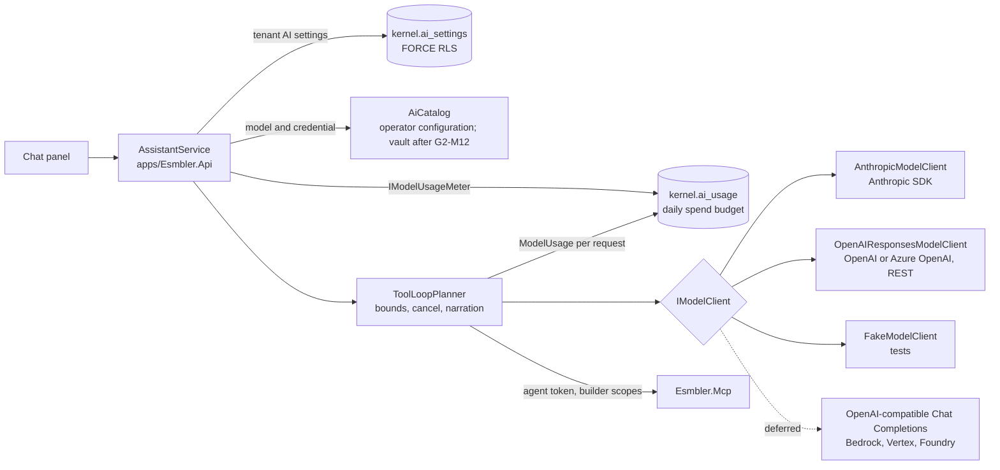

# ADR 0024: Multiple model providers

## Context and problem statement

The execution brief fixes the AI stack as "Claude via the Anthropic API", and [ADR 0013](0013-ai-assistant-model-adapter.md) built the in-app assistant that way: `ClaudePlanner` runs a manual tool-use loop over the Anthropic Messages API, one `ANTHROPIC_API_KEY` serves the whole deployment, and `Esmbler:Assistant:Provider` (`auto`, `anthropic`, `scripted`) is global.

On 2026-10-10 the product owner asked for several model providers, OpenAI first, chosen per tenant, and for a way to use an existing ChatGPT or Claude subscription (G2-M20, [progress](../progress.md)). **This ADR records the deviation from the execution brief**, approved by the product owner on 2026-10-10. Claude stays a first-class provider; it is no longer the only one. The research behind it is [AI providers and subscriptions](../research/ai-providers-and-subscriptions.md) (sections 1.3, 1.4 and 3.1).

The subscription half splits in two. Letting ChatGPT or Claude drive Esmbler through the MCP server is [ADR 0025](0025-oauth-for-external-mcp-clients.md). Billing a person's subscription from inside Esmbler is covered here, and is mostly not possible (below).

Questions this ADR settles:

- Where does provider-specific code live, and what stays provider-neutral?
- How does OpenAI fit the loop without weakening the safeguards of ADR 0013?
- How does a tenant choose a provider and model, where do keys come from, and who pays?
- How is spend bounded per tenant ([KI-002](../known-issues.md))?
- What happens to a person's ChatGPT or Claude subscription?

## Decision drivers

- The safeguards of ADR 0013 carry over unchanged: one tool path through MCP, authority = user ∩ scopes ∩ `acts_for`, untrusted content as data, per-turn bounds, Stop, no publish (REQ-AISAFE-001, REQ-AISAFE-003, REQ-AISAFE-004).
- The loop and its tests are written once; adding a provider adds only a translation layer.
- Provider features we rely on (prompt caching, effort, the refusal fallback, reasoning replay with `store: false`) stay typed and explicit.
- A model is offered to tenants only after it passes the evaluation suite (REQ-AISAFE-005).
- Keys never reach the API, MCP, logs, audit details or exports (REQ-ADM-002, threat model T-41, T-42).
- Choosing a provider is a tenant decision with data-handling consequences, so it belongs to permission administrators, is audited, and is never available to agents (REQ-AUTHZ-007).
- Spend is bounded per tenant per day, not only per turn (KI-002, T-24).
- CI and local development keep working with no key (scripted planner).

## Considered options

1. **Provider-neutral `ToolLoopPlanner` over a narrow `IModelClient` per provider, in `packages/Esmbler.Assistant`; per-tenant settings that pick from an operator catalog of evaluated models and named credentials.**
2. Microsoft.Extensions.AI `IChatClient` as the core abstraction, with the Anthropic and OpenAI adapters behind it.
3. Provider-hosted MCP connectors: the Anthropic MCP connector or the OpenAI Responses remote MCP tool calls our MCP server directly.
4. One global provider per deployment, switched by configuration (today's model with an OpenAI branch).

## Decision outcome

**Chosen option 1.**

### Provider abstraction

`IPlanner`, `IToolGateway`, `IAssistantSink` and `AssistantBudget` (`packages/Esmbler.Assistant/Abstractions.cs`) do not change, so `AssistantService`, the SignalR events and the scripted planner are untouched. `ClaudePlanner` is split into:

- **`ToolLoopPlanner`**: the provider-neutral loop. It lists the MCP tools once, calls `IModelClient.CompleteAsync`, runs each `ToolCall` through `IToolGateway` with narration and step events, appends the `ToolResult` items, and repeats until `EndTurn`, `Refusal` or a bound. It owns the system prompt, the model-turn bound, the deadline, cancellation and the history window.
- **`IModelClient`**: one request to one provider. It translates to the provider's API and back and never calls tools.

The types live in the namespace `Esmbler.Assistant.Models` (research section 1.3). The shapes as built (`packages/Esmbler.Assistant/Models/ModelContracts.cs` is authoritative):

```csharp
namespace Esmbler.Assistant.Models;

public interface IModelClient
{
    string Provider { get; }   // "anthropic", "openai", "azure-openai" or "fake"
    string Model { get; }
    Task<ModelResponse> CompleteAsync(ModelRequest request, CancellationToken ct);
}

// Per client, resolved by the host: model, effort, 16k output tokens, 60 s timeout, Anthropic fallback model.
public sealed record ModelSettings { /* Model, Effort, MaxOutputTokens, Timeout, FallbackModel */ }

public sealed record ModelRequest(string Instructions, IReadOnlyList<ModelItem> Items, IReadOnlyList<ToolDefinition> Tools);

public abstract record ModelItem;
public sealed record UserText(string Text) : ModelItem;
public sealed record AssistantText(string Text) : ModelItem;
public sealed record ToolCall(string CallId, string Name, string ArgumentsJson) : ModelItem;
public sealed record ToolResult(string CallId, string Content, bool IsError) : ModelItem;
public sealed record ProviderState(string Provider, string Json) : ModelItem; // replayed verbatim

public sealed record ModelResponse(StopKind Stop, IReadOnlyList<ModelItem> Output, ModelUsage Usage);
public enum StopKind { EndTurn, ToolUse, MaxTokens, Refusal }

// Normalized: InputTokens is input neither read from nor written to the cache.
public sealed record ModelUsage(int InputTokens, int OutputTokens, int CachedInputTokens, string Model, int CacheWriteTokens = 0);

public interface IModelUsageMeter
{
    Task EnsureWithinBudgetAsync(CancellationToken ct);                        // before every request
    Task RecordAsync(string provider, ModelUsage usage, CancellationToken ct); // after every request
}
```

Clients:

| Client | Status | Notes |
| --- | --- | --- |
| `AnthropicModelClient` | Built (G2-M20b) | Behavior-preserving refactor of `ClaudePlanner` on the `Anthropic` NuGet: the cache breakpoint on the system block, effort, the server-side refusal fallback model (per catalog entry), the 60 s request timeout and 16k output tokens. Claude `thinking` and `redacted_thinking` blocks become `ProviderState` items. Anthropic's `input_tokens` already excludes cache reads and writes |
| `OpenAIResponsesModelClient` | Built (G2-M20c) | The OpenAI **Responses API** (recommended by OpenAI for new projects), called as documented REST (`POST {base}/v1/responses`) with `HttpClient` and `System.Text.Json`, not through the `OpenAI` NuGet (ASM-133). Function tools with `strict: false` (our MCP input schemas have optional properties and free-form objects), `store: false`, `include: ["reasoning.encrypted_content"]`, reasoning effort, `parallel_tool_calls: false`. Returned reasoning items become `ProviderState` and are replayed within the turn. `previous_response_id` is never used, so no conversation state is kept at OpenAI. OpenAI's `input_tokens` include cached tokens, so usage is normalized to uncached input plus cache reads. No streaming ([KI-065](../known-issues.md)) |
| Azure OpenAI | Built (G2-M20c) | The same client with an endpoint variant (`{endpoint}/openai/v1/responses`, header `api-key`, an HTTPS endpoint only); the deployment name is the model, and usage is recorded under the configured model, which is what the catalog prices |
| `FakeModelClient` | Built (G2-M20b) | Replays scripted responses and records each request, so `ToolLoopPlanner` is unit-tested without a network |
| `OpenAICompatibleChatModelClient` (Chat Completions: Gemini, self-hosted, gateways) | Deferred ([KI-066](../known-issues.md)) | Operator-configured endpoint only (never a tenant's, SSRF), labelled experimental, offered only after a model passes the evaluation gate |
| Bedrock, Vertex AI and Foundry variants of the Anthropic client | Deferred to Gate 3, on demand ([KI-066](../known-issues.md)) | `Anthropic.Bedrock`, `Anthropic.Vertex`, `Anthropic.Foundry`; beta features (effort, refusal fallback) checked per platform first |

How each safeguard carries over:

| Concern | After the split |
| --- | --- |
| Budgets | `ToolLoopPlanner` enforces model requests per turn (15) and the deadline (120 s); `McpToolGateway` still counts tool calls (30). Before every request the loop asks `IModelUsageMeter` whether the workspace is within its daily budget, and after it records the `ModelUsage` |
| Cancellation | The turn token reaches `CompleteAsync`, which aborts the HTTP request, and is checked before every model request and tool call |
| Untrusted content | Unchanged: MCP wraps user-written text as `untrusted_data`, and the shared system prompt says it is data. Every client puts tool output only in the provider's tool-result channel (`tool_result`, `function_call_output`), never in system or developer instructions |
| Refusal | Each client maps its provider's signal to `StopKind.Refusal` (Anthropic `stop_reason: "refusal"`; OpenAI `refusal` content or an `incomplete` response with reason `content_filter`). The loop ends the turn with "I can't help with that request." An OpenAI `failed` response is an `AssistantUnavailableException`, not a refusal. Arguments that are not a JSON object (unparseable, or valid JSON of another kind) go back to the model as an `invalid_arguments` tool error, and no tool runs |
| Errors and secrecy | Clients catch provider failures and throw `AssistantUnavailableException` with a generic message (at most the status code, or the Anthropic SDK's exception type name): no provider error bodies (they can echo request data), endpoints or keys. Clients never log request or response bodies, and the text forms of `AiCredential` and `OpenAIEndpoint` omit the key |
| Provider state | `ProviderState` items are replayed only within the same turn and provider. **Cross-turn history stays plain text** (`UserText`, `AssistantText` and short tool summaries), so a tenant can switch providers between turns without breaking a conversation |
| Fallback | No silent cross-provider fallback: a provider outage ends the turn with a clear message. Data-residency or contractual policy may forbid sending context elsewhere. Anthropic's server-side refusal fallback stays, configured per catalog entry, because it stays within one provider |
| Architecture | The models and clients live in `packages/Esmbler.Assistant` (still no kernel references, architecture test). The catalog and settings live in `packages/Esmbler.Kernel.Infrastructure/Assistant` (`AiCatalog`, `AiSettingsService`); `apps/Esmbler.Api/Assistant/AssistantService.cs` resolves the workspace's model and credential for each turn, builds the `IModelClient` and wraps it in `ToolLoopPlanner` with an `AiUsageMeter` |



### Named credentials and the model catalog (platform level)

`AiCatalogFactory` (`packages/Esmbler.Hosting`) builds the operator's `AiCatalog` from configuration under `Esmbler:Assistant` (environment variables), never from workspace data:

- **Named credentials**: three are wired by default. `anthropic-default` takes `Esmbler__Assistant__AnthropicApiKey` or `ANTHROPIC_API_KEY` (so existing deployments keep working), `openai-default` takes `Esmbler__Assistant__OpenAIApiKey` or `OPENAI_API_KEY`, and `azure-openai-default` takes `AZURE_OPENAI_API_KEY` with `AZURE_OPENAI_ENDPOINT` (HTTPS only). More are `Esmbler__Assistant__Credentials__<name>__Provider` with `__ApiKey` or `__ApiKeyVariable` (the name of another environment variable), and `__Endpoint` for Azure. A credential is handed to a client only when it is configured (an Azure credential also needs its HTTPS endpoint), its provider matches the catalog entry's, and that provider is one Esmbler has a client for (`AiCatalog.KnownProviders`); anything else is not available, so it is never offered or chosen.
- **The model catalog**: by default `claude-opus-5-5`, `claude-sonnet-5-5`, `gpt-6.1-sol` and `gpt-6-astra`. An operator replaces it with `Esmbler__Assistant__Catalog__N__*` entries: `Id`, `Label`, `Provider`, `Model`, `Credential`, `Effort`, `InputPerMillion` and `OutputPerMillion` (US dollars per million tokens, for estimates), `Evaluated`, `FallbackModel` (Anthropic only) and **`AllowedTenants`**. The default model is `Esmbler__Assistant__DefaultModel` (or the legacy `Esmbler__Assistant__Model` of ADR 0013 when it names a catalog entry); when it is not usable for a workspace, the first usable entry is the default.
- **Customer-paid keys**: a catalog entry whose credential holds one customer's own key names the workspaces it is for (`Esmbler__Assistant__Catalog__N__AllowedTenants__0=acme`, by workspace slug). Other workspaces never see it and cannot choose it (ASM-134, ASM-135, threat model T-102). Entries without `AllowedTenants` are for every workspace.
- **The operator ceiling**: `Esmbler__Assistant__MaxDailyBudgetUsd` (default 100, ASM-150) is the highest daily budget a workspace may set.
- **The evaluation gate**: a workspace can use an entry only when it is evaluated, its credential is configured for the right provider, and it is offered to that workspace (`AiCatalog.Usable`). An operator marks an entry evaluated (`Esmbler__Assistant__EvaluatedModels__N=<id>`, or `Evaluated` on a catalog entry) after `AssistantTests.Model_driven_planner_evaluation_runs_when_a_key_is_configured` passed for it: that test runs the 43 cases of `tests/ai-evals/builder-cases.json` once per provider whose key is set (`ANTHROPIC_API_KEY`, `OPENAI_API_KEY`) and requires at most one miss overall and none on injection or policy cases. `claude-opus-5-5` ships evaluated, grandfathered from ADR 0013 until the scored run of [KI-007](../known-issues.md) (ASM-145); the other defaults ship unevaluated.

`Esmbler:Assistant:Provider` is now `auto` (each workspace's model when its credential is configured, otherwise the scripted planner) or `scripted` (always scripted). With no credential configured, `auto` still selects the scripted planner, so local development, CI and Playwright need no key. `GET /api/assistant/status` reports the planner, provider and model for the caller's workspace, never a key.

### Tenant AI settings

A tenant-scoped table, `kernel.ai_settings` (migration `0019_ai_settings.sql`, FORCE RLS on `tenant_id`, one row per tenant), holds:

| Setting | Meaning | Default |
| --- | --- | --- |
| Model (`model_id`) | A catalog entry, accepted only if it is offered to this workspace, evaluated and has a configured credential (`not_found`, `not_evaluated`, `not_configured` errors) | The operator's default (ASM-132) |
| Effort | `low`, `medium`, `high` or `max` | The entry's effort |
| Daily budget (`daily_budget_usd`) | US dollars per workspace per UTC day, from 0 to the operator ceiling; `0` turns the model planner off | 20 (ASM-136) |
| Record access (`allow_records_read`) | Whether external assistants may ever be granted `records:read` (the in-app assistant never asks for it, ASM-146) | Off |
| External assistants | `off`, `non_production` or `all` ([ADR 0025](0025-oauth-for-external-mcp-clients.md)) | `off` |

There is no credential setting: the catalog entry decides which key pays, so a tenant-paid key is an operator-provisioned entry with `AllowedTenants`. **Stored choices are re-validated** on every turn and every read: a model that is no longer evaluated, configured or offered to the workspace falls back to the default, so an operator change takes effect without touching tenant rows.

`GET` and `PUT /api/admin/ai` read and save the settings, with optimistic concurrency on `version`. Only permission administrators (`permissions.admin`, fresh facts for saves) may read or change them; agents are refused. A save locks the row (`FOR UPDATE`), so a concurrent consent sees either the old or the new policy, and it revokes the external connections a narrower policy no longer allows (ADR 0025). It is audited as **`ai.settings_save`** with the previous and new values (models by ID, never keys) and the number of revoked connections. The **AI assistant** admin page (`/admin/ai`) shipped with this milestone, not with G2-M12: it lists the operator's models with availability, evaluation and prices, and edits the effort, the budget (with today's spend), record access and the external assistants policy.

**Tenant keys (BYOK)** are references only. Until the G2-M12 vault exists, the operator provisions a customer's key as a named credential and a catalog entry for that workspace (ASM-134). After G2-M12 a tenant administrator can paste a key: it goes to the vault, and only the `secretref:` is stored. Keys are never returned by the API or MCP, never written to audit details, and never exported in packages. Both commercial models are allowed: platform-paid credentials and credentials that belong to the tenant (ASM-135).

### Metering and the daily spend budget

Every model request records a row in `kernel.ai_usage` (FORCE RLS; the runtime role may only insert and read): tenant, environment, person, conversation, provider, model, uncached input, output and cache-read tokens, and the estimated cost. Usage is normalized across providers: uncached input at the input price, cache reads at a tenth of it, cache writes at 1.25 times it, and output at the output price. The request is priced with the **catalog model the assistant resolved** for the turn, not the model name the provider reports; a model the catalog does not know is priced at the highest catalog prices, so unknown usage never counts as free (ASM-151).

Before each model request `AiUsageMeter` checks that the budget is above zero and that the workspace's spend today, across all its environments and per UTC day (ASM-151), is below it. If not, the turn ends with "This workspace has used today's AI budget. An administrator can raise it under AI assistant settings; it resets at midnight UTC." and no request is sent. The check runs before every request, so one turn can overshoot by at most one request. This closes [KI-002](../known-issues.md).

### Subscriptions inside Esmbler

- **ChatGPT plan usage** ("Sign in with ChatGPT" with plan usage) is available to a hosted commercial product only through OpenAI's limited partner trial. Applying is a [human action](../human-actions.md); nothing is built unless OpenAI accepts Esmbler (ASM-138). If it does, it becomes another `IModelClient` with a per-person OAuth token.
- **Claude subscriptions cannot be used by third-party apps**: Anthropic does not allow routing requests through Free, Pro or Max credentials or holding Claude.ai session tokens. The sanctioned route is the monthly API credits of Max and Team plans: the customer creates a key in the linked Claude Console organization and the operator provisions it as a named credential for that tenant (a vault reference after G2-M12).
- Both vendors officially support a person's own ChatGPT or Claude driving Esmbler as a connector: [ADR 0025](0025-oauth-for-external-mcp-clients.md).

### Consequences

- Good: a second provider is a translation layer and a set of fixtures; the loop, its bounds and its tests exist once.
- Good: tenants choose among models that passed the same evaluation suite, and the choice is audited and limited to permission administrators.
- Good: spend is bounded per tenant per day, and every request is metered, so cost per customization can be reported.
- Good: provider-specific features stay typed inside each client; nothing goes through untyped escape hatches.
- Good: the OpenAI client has no SDK dependency or experimental API surface, and its translation is tested against recorded JSON.
- Bad: we maintain the Responses request and response mapping ourselves, including streaming events if we add them, and must follow API changes without an SDK.
- Bad: cross-turn history is plain text, so reasoning from earlier turns is not replayed; long multi-turn tasks may cost more tokens than with provider-held state.
- Bad: cost figures are estimates from catalog prices (with fixed ratios for cache reads and writes), not the provider's invoice; an operator must keep prices current.
- Bad: before the vault, a tenant's own key needs the operator to set an environment variable and a catalog entry with `AllowedTenants`, and restart.
- Neutral: Anthropic remains the default when only `ANTHROPIC_API_KEY` is set, so existing deployments behave as before.

## Pros and cons of the options

| Option | Pros | Cons |
| --- | --- | --- |
| 1. `ToolLoopPlanner` + `IModelClient`, catalog and tenant settings | One loop; typed provider features; testable with a fake; per-tenant choice with an evaluation gate | We write each translation layer; more configuration for operators |
| 2. Microsoft.Extensions.AI `IChatClient` as core | Common function-call model for free; adapters exist for Anthropic and OpenAI | Cache breakpoints, effort, the refusal-fallback beta and encrypted reasoning replay with `store: false` go through untyped escape hatches; another dependency with its own release cadence. It may still back the deferred OpenAI-compatible client internally |
| 3. Provider-hosted MCP connectors | Less loop code | Our MCP endpoint must be internet-reachable and our MCP token is sent to the provider (passthrough); no offline mode; already rejected in ADR 0013 |
| 4. One global provider per deployment | Smallest change | No per-tenant choice, data-residency or BYOK; a tenant cannot keep Claude while another moves to OpenAI; no per-tenant budget |

## More information

- Deviation: execution brief section 2, product decisions, row "AI" ("Claude via the Anthropic API"), approved by the product owner on 2026-10-10 ([progress](../progress.md)). ADR 0013 stays in force for the loop, tools, bounds and evaluation; this ADR supersedes its single-provider configuration (`Provider`, `AnthropicApiKey`) and its `ClaudePlanner` structure.
- Related: [ADR 0013](0013-ai-assistant-model-adapter.md), [ADR 0025](0025-oauth-for-external-mcp-clients.md), [ADR 0007](0007-mcp-server-design.md), [ADR 0021](0021-notification-routing-and-delivery.md) (secret references), [research](../research/ai-providers-and-subscriptions.md).
- Assumptions: ASM-132 to ASM-138 and ASM-145 to ASM-151 in [assumptions](../decisions/assumptions.md). Known issues: [KI-007](../known-issues.md) (no scored run yet), KI-065 (no OpenAI streaming), KI-066 (compatible client and cloud variants deferred). Human actions: OpenAI key, Azure, Bedrock and compatible endpoints, customer keys with `AllowedTenants`, the budget ceiling, the Sign in with ChatGPT interest form ([human actions](../human-actions.md)).
- Phases (all shipped 2026-10-11): G2-M20b (abstraction, Anthropic refactor, fake), G2-M20c (OpenAI and Azure), G2-M20d (tenant settings, catalog, metering, budget, the `/admin/ai` page). Migration `0019_ai_settings.sql`.
- Verification: `UnitTests/Assistant/ModelProviderTests` (`The_loop_runs_tool_calls_returns_results_to_the_model_and_finishes_with_its_answer`, `Refusals_budgets_and_bad_arguments_end_or_correct_the_turn_the_same_way_for_every_provider`, `OpenAI_requests_keep_no_state_at_the_provider_and_replay_reasoning_within_the_turn`, `OpenAI_answers_become_tool_calls_text_refusals_and_usage`, `Provider_errors_never_show_the_providers_answer_the_endpoint_or_the_key`, `Claude_transcripts_group_into_alternating_messages_with_thinking_replayed`, `Costs_are_estimated_from_catalog_prices_and_only_usable_models_are_defaults`); `IntegrationTests/Assistant/AiSettingsTests` (`Two_workspaces_use_different_providers_and_never_see_each_others_settings_or_spend`, `Only_permission_administrators_choose_evaluated_configured_models`); `AssistantTests.Model_driven_planner_evaluation_runs_when_a_key_is_configured` (per provider, needs keys) and the 43 scripted cases; e2e `ai.spec.ts` `@REQ-AI-006`; the architecture test.
- Revisit triggers: OpenAI ships a stable typed SDK surface that covers `store: false` and reasoning replay; a customer needs regional inference (Bedrock, Vertex, Foundry or Azure regions, ASM-137); OpenAI accepts Esmbler into the Sign in with ChatGPT trial; evaluation shows provider-held state is needed for quality.
