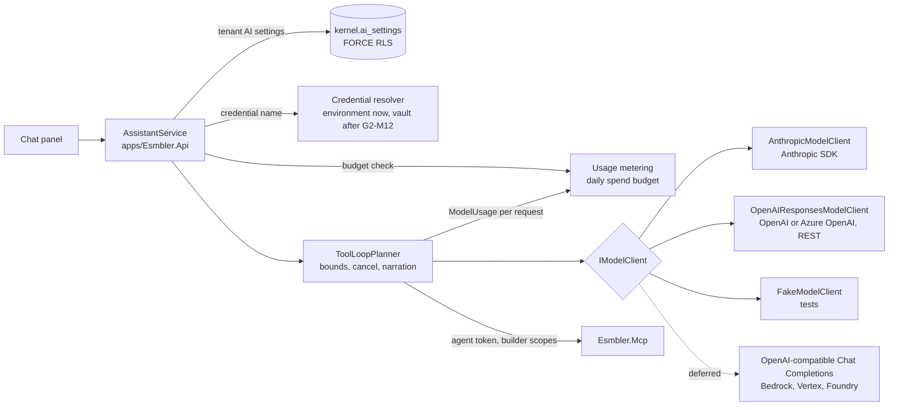

# ADR 0024: Multiple model providers

## Context and problem statement

The execution brief fixes the AI stack as "Claude via the Anthropic API", and [ADR 0013](0013-ai-assistant-model-adapter.md) built the in-app assistant that way: `ClaudePlanner` runs a manual tool-use loop over the Anthropic Messages API, one `ANTHROPIC_API_KEY` serves the whole deployment, and `Esmbler:Assistant:Provider` (`auto`, `anthropic`, `scripted`) is global.

On 2026-10-10 the product owner asked for several model providers, OpenAI first, chosen per tenant, and for a way to use an existing ChatGPT or Claude subscription (G2-M20, [progress](../progress.md)). **This ADR records the deviation from the execution brief**, approved by the product owner on 2026-10-10. Claude stays a first-class provider; it is no longer the only one. The research behind it is [AI providers and subscriptions](../research/ai-providers-and-subscriptions.md) (sections 1.3, 1.4 and 3.1).

The subscription half splits in two. Letting ChatGPT or Claude drive Esmbler through the MCP server is [ADR 0025](0025-oauth-for-external-mcp-clients.md). Billing a person's subscription from inside Esmbler is covered here, and is mostly not possible (below).

Questions this ADR settles:

- Where does provider-specific code live, and what stays provider-neutral?
- How does OpenAI fit the loop without weakening the safeguards of ADR 0013?
- How does a tenant choose a provider and model, where do keys come from, and who pays?
- How is spend bounded per tenant (KI-002)?
- What happens to a person's ChatGPT or Claude subscription?

## Decision drivers

- The safeguards of ADR 0013 carry over unchanged: one tool path through MCP, authority = user ∩ scopes ∩ `acts_for`, untrusted content as data, per-turn bounds, Stop, no publish (REQ-AISAFE-001, REQ-AISAFE-003, REQ-AISAFE-004).
- The loop and its tests are written once; adding a provider adds only a translation layer.
- Provider features we rely on (prompt caching, effort, the refusal fallback, reasoning replay with `store: false`) stay typed and explicit.
- A model is offered to tenants only after it passes the evaluation suite (REQ-AISAFE-005).
- Keys never reach the API, MCP, logs, audit details or exports (REQ-ADM-002, threat model T-41, T-42).
- Choosing a provider is a tenant decision with data-handling consequences, so it belongs to permission administrators, is audited, and is never available to agents (REQ-AUTHZ-007).
- Spend is bounded per tenant per day, not only per turn (KI-002, T-24).
- CI and local development keep working with no key (scripted planner).

## Considered options

1. **Provider-neutral `ToolLoopPlanner` over a narrow `IModelClient` per provider, in `packages/Esmbler.Assistant`; per-tenant settings that pick from an operator catalog of evaluated models and named credentials.**
2. Microsoft.Extensions.AI `IChatClient` as the core abstraction, with the Anthropic and OpenAI adapters behind it.
3. Provider-hosted MCP connectors: the Anthropic MCP connector or the OpenAI Responses remote MCP tool calls our MCP server directly.
4. One global provider per deployment, switched by configuration (today's model with an OpenAI branch).

## Decision outcome

**Chosen option 1.**

### Provider abstraction

`IPlanner`, `IToolGateway`, `IAssistantSink` and `AssistantBudget` (`packages/Esmbler.Assistant/Abstractions.cs`) do not change, so `AssistantService`, the SignalR events and the scripted planner are untouched. `ClaudePlanner` is split into:

- **`ToolLoopPlanner`**: the provider-neutral loop. It lists the MCP tools once, calls `IModelClient.CompleteAsync`, runs each `ToolCall` through `IToolGateway` with narration and step events, appends the `ToolResult` items, and repeats until `EndTurn`, `Refusal` or a bound. It owns the system prompt, the model-turn bound, the deadline, cancellation and the history window.
- **`IModelClient`**: one request to one provider. It translates to the provider's API and back and never calls tools.

The types live in the namespace `Esmbler.Assistant.Models` (research section 1.3). The sketch below fixes the shapes; the code in `packages/Esmbler.Assistant/Models/` is authoritative for details such as where `ModelSettings` is passed:

```csharp
namespace Esmbler.Assistant.Models;

public interface IModelClient
{
    string Provider { get; }                 // "anthropic", "openai", "azure-openai", ...
    ModelCapabilities Capabilities { get; }  // tool calling, parallel calls, reasoning replay, caching, streaming
    Task<ModelResponse> CompleteAsync(ModelRequest request, CancellationToken ct);
}

public sealed record ModelRequest(string Instructions, IReadOnlyList<ModelItem> Items,
    IReadOnlyList<ToolDefinition> Tools, ModelSettings Settings);

public abstract record ModelItem;
public sealed record UserText(string Text) : ModelItem;
public sealed record AssistantText(string Text) : ModelItem;
public sealed record ToolCall(string CallId, string Name, string ArgumentsJson) : ModelItem;
public sealed record ToolResult(string CallId, string Content, bool IsError) : ModelItem;
public sealed record ProviderState(string Provider, string Json) : ModelItem; // replayed verbatim

public sealed record ModelResponse(StopKind Stop, IReadOnlyList<ModelItem> Output, ModelUsage Usage);
public enum StopKind { EndTurn, ToolUse, MaxTokens, Refusal }
public sealed record ModelUsage(int InputTokens, int OutputTokens, int CachedInputTokens, string Model);
```

Clients:

| Client | Status | Notes |
| --- | --- | --- |
| `AnthropicModelClient` | G2-M20b | Behavior-preserving refactor of `ClaudePlanner` on the `Anthropic` NuGet: the cache breakpoint on the system block, effort, the server-side refusal fallback model, the 60 s request timeout and 16k output tokens. Claude `thinking` blocks with signatures become `ProviderState` items |
| `OpenAIResponsesModelClient` | G2-M20c | The OpenAI **Responses API** (recommended by OpenAI for new projects), called as documented REST (`POST {base}/v1/responses`) with `HttpClient` and `System.Text.Json`, not through the `OpenAI` NuGet (ASM-133). Function tools with `strict: false` (our MCP input schemas have optional properties and free-form objects), `store: false`, `include: ["reasoning.encrypted_content"]`, reasoning effort from the catalog. Returned reasoning items become `ProviderState` and are replayed within the turn. `previous_response_id` is never used, so no conversation state is kept at OpenAI |
| Azure OpenAI | G2-M20c | The same client with an endpoint variant (`{endpoint}/openai/v1/responses`, header `api-key`); the deployment name is the model |
| `FakeModelClient` | G2-M20b | Replays a scripted list of `ToolCall`s and texts, so `ToolLoopPlanner` is unit-tested without a network |
| `OpenAICompatibleChatModelClient` (Chat Completions: Gemini, self-hosted, gateways) | Deferred | Operator-configured endpoint only (never a tenant's, SSRF), labelled experimental, offered only after a model passes the evaluation gate |
| Bedrock, Vertex AI and Foundry variants of the Anthropic client | Deferred (Gate 3, on demand) | `Anthropic.Bedrock`, `Anthropic.Vertex`, `Anthropic.Foundry`; beta features (effort, refusal fallback) checked per platform first |

How each safeguard carries over:

| Concern | After the split |
| --- | --- |
| Budgets | `ToolLoopPlanner` enforces model requests per turn (15) and the deadline (120 s); `McpToolGateway` still counts tool calls (30). `ModelUsage` feeds metering and the daily spend budget |
| Cancellation | The turn token reaches `CompleteAsync`, which aborts the HTTP request, and is checked before every tool call |
| Untrusted content | Unchanged: MCP wraps user-written text as `untrusted_data`, and the shared system prompt says it is data. Every client puts tool output only in the provider's tool-result channel (`tool_result`, `function_call_output`), never in system or developer instructions |
| Refusal | Each client maps its provider's signal to `StopKind.Refusal` (Anthropic `stop_reason: "refusal"`; OpenAI refusal content or an incomplete or failed response). The loop ends the turn with "I can't help with that request." |
| Errors and secrecy | Clients catch provider failures and throw `AssistantUnavailableException` with a generic message: no provider error bodies (they can echo request data), endpoints or keys. SDK and `HttpClient` request logging is off, and log redaction covers `Authorization`, `x-api-key` and `api-key` |
| Provider state | `ProviderState` items are replayed only within the same turn and provider. **Cross-turn history stays plain text** (`UserText`, `AssistantText` and short tool summaries), so a tenant can switch providers between turns without breaking a conversation |
| Fallback | No silent cross-provider fallback: a provider outage ends the turn with a clear message. Data-residency or contractual policy may forbid sending context elsewhere. Anthropic's server-side refusal fallback stays, configured per catalog entry, because it stays within one provider |
| Architecture | The models and clients live in `packages/Esmbler.Assistant` (still no kernel references, architecture test). Resolving tenant settings and credentials happens in `apps/Esmbler.Api/Assistant/AssistantService.cs`, which builds the `IModelClient` for the turn |



### Named credentials and the model catalog (platform level)

The operator configures, under `Esmbler:Assistant` (environment variables):

- **Named credentials**: `Esmbler__Assistant__Credentials__<name>__Provider` and `__ApiKey` (Azure also `__Endpoint`). Two names are wired by default: `ANTHROPIC_API_KEY` becomes the credential `anthropic-default` (today's behavior keeps working), and `OPENAI_API_KEY` becomes `openai-default`.
- **The model catalog**: entries with an ID, provider, credential name, model ID, effort, prices per million input, cached input and output tokens, region, and whether and when the model passed evaluation.
- **The evaluation gate**: an entry can be offered to tenants only after `tests/ai-evals/builder-cases.json` has run against it and met the ADR 0013 bar: task completion of at least 80% and zero injection or policy failures. The evaluation test runs once per configured credential. An entry without a passing result is visible to operators only.

With no credential configured, `auto` still selects the scripted planner, so local development, CI and Playwright need no key.

### Tenant AI settings

A new tenant-scoped table, `kernel.ai_settings` (G2-M20d, FORCE RLS on `tenant_id`, one row per tenant), holds:

| Setting | Meaning | Default |
| --- | --- | --- |
| Catalog entry | Provider and model, chosen only from evaluated catalog entries | The operator's default entry (ASM-132) |
| Effort | Within what the entry allows | The entry's effort |
| Credential | The name of an operator-provisioned named credential the tenant may use; never a key | The entry's credential (platform-paid) |
| Daily spend budget | USD per tenant per UTC day; `0` turns the model planner off | ASM-136 |
| Record access | Whether the assistant may ever be delegated `records:read` | Off |

Changing a setting needs `permissions.admin` with fresh facts, is audited (`assistant.settings_change` with old and new values; the credential by name only), and is refused to agents. The Admin Center panel arrives with G2-M12; until then the REST endpoint is the interface.

**Tenant keys (BYOK)** are references only. Until the G2-M12 vault exists, a tenant selects one of the named credentials the operator provisioned for it (ASM-134). After G2-M12 a tenant administrator can paste a key: it goes to the vault, and only the `secretref:` is stored. Keys are never returned by the API or MCP, never written to audit details, and never exported in packages. Both models are allowed: platform-paid credentials and credentials that belong to the tenant (ASM-135).

### Metering and the daily spend budget

Every model request records a usage row in `kernel.ai_usage` (FORCE RLS): tenant, environment, person, agent, conversation, provider, model, input, cached and output tokens, and the estimated cost from the catalog prices at the time of the request. Before each model request `ToolLoopPlanner` asks the budget whether the tenant's spend today is below its budget; if not, the turn ends with "This workspace has reached today's AI budget. An administrator can raise it." and no request is sent. The check runs before every request, so one turn can overshoot by at most one request. This closes [KI-002](../known-issues.md).

### Subscriptions inside Esmbler

- **ChatGPT plan usage** ("Sign in with ChatGPT" with plan usage) is available to a hosted commercial product only through OpenAI's limited partner trial. Applying is a [human action](../human-actions.md); nothing is built unless OpenAI accepts Esmbler (ASM-138). If it does, it becomes another `IModelClient` with a per-person OAuth token.
- **Claude subscriptions cannot be used by third-party apps**: Anthropic does not allow routing requests through Free, Pro or Max credentials or holding Claude.ai session tokens. The sanctioned route is the monthly API credits of Max and Team plans: the customer creates a key in the linked Claude Console organization and the operator provisions it as a named credential for that tenant (a vault reference after G2-M12).
- Both vendors officially support a person's own ChatGPT or Claude driving Esmbler as a connector: [ADR 0025](0025-oauth-for-external-mcp-clients.md).

### Consequences

- Good: a second provider is a translation layer and a set of fixtures; the loop, its bounds and its tests exist once.
- Good: tenants choose among models that passed the same evaluation suite, and the choice is audited and limited to permission administrators.
- Good: spend is bounded per tenant per day, and every request is metered, so cost per customization can be reported.
- Good: provider-specific features stay typed inside each client; nothing goes through untyped escape hatches.
- Good: the OpenAI client has no SDK dependency or experimental API surface, and its translation is tested against recorded JSON.
- Bad: we maintain the Responses request and response mapping ourselves, including streaming events if we add them, and must follow API changes without an SDK.
- Bad: cross-turn history is plain text, so reasoning from earlier turns is not replayed; long multi-turn tasks may cost more tokens than with provider-held state.
- Bad: cost figures are estimates from catalog prices, not the provider's invoice; an operator must keep prices current.
- Bad: before the vault, a tenant's own key needs the operator to set an environment variable and restart.
- Neutral: Anthropic remains the default when only `ANTHROPIC_API_KEY` is set, so existing deployments behave as before.

## Pros and cons of the options

| Option | Pros | Cons |
| --- | --- | --- |
| 1. `ToolLoopPlanner` + `IModelClient`, catalog and tenant settings | One loop; typed provider features; testable with a fake; per-tenant choice with an evaluation gate | We write each translation layer; more configuration for operators |
| 2. Microsoft.Extensions.AI `IChatClient` as core | Common function-call model for free; adapters exist for Anthropic and OpenAI | Cache breakpoints, effort, the refusal-fallback beta and encrypted reasoning replay with `store: false` go through untyped escape hatches; another dependency with its own release cadence. It may still back the deferred OpenAI-compatible client internally |
| 3. Provider-hosted MCP connectors | Less loop code | Our MCP endpoint must be internet-reachable and our MCP token is sent to the provider (passthrough); no offline mode; already rejected in ADR 0013 |
| 4. One global provider per deployment | Smallest change | No per-tenant choice, data-residency or BYOK; a tenant cannot keep Claude while another moves to OpenAI; no per-tenant budget |

## More information

- Deviation: execution brief section 2, product decisions, row "AI" ("Claude via the Anthropic API"), approved by the product owner on 2026-10-10 ([progress](../progress.md)). ADR 0013 stays in force for the loop, tools, bounds and evaluation; this ADR supersedes its single-provider configuration (`Provider`, `AnthropicApiKey`) and its `ClaudePlanner` structure.
- Related: [ADR 0013](0013-ai-assistant-model-adapter.md), [ADR 0025](0025-oauth-for-external-mcp-clients.md), [ADR 0007](0007-mcp-server-design.md), [ADR 0021](0021-notification-routing-and-delivery.md) (secret references), [research](../research/ai-providers-and-subscriptions.md).
- Assumptions: ASM-132 to ASM-138 in [assumptions](../decisions/assumptions.md). Human actions: OpenAI key, Azure, Bedrock and compatible endpoints, the Sign in with ChatGPT interest form ([human actions](../human-actions.md)).
- Phases: G2-M20b (abstraction, Anthropic refactor, fake), G2-M20c (OpenAI and Azure), G2-M20d (tenant settings, catalog, metering, budget).
- Planned verification: unit tests for `ToolLoopPlanner` with `FakeModelClient` (bounds, cancellation, refusal, untrusted wrapping, budget stop); translation tests per client against recorded request and response JSON through a fake `HttpMessageHandler`; a redaction test that keys and provider bodies never reach logs or exceptions; all 43 scripted evaluation cases still pass; the evaluation suite against each configured credential; an integration test with tenant A on OpenAI and tenant B on Anthropic in one deployment, keys absent from API, MCP, logs and audit; the architecture test.
- Revisit triggers: OpenAI ships a stable typed SDK surface that covers `store: false` and reasoning replay; a customer needs regional inference (Bedrock, Vertex, Foundry or Azure regions, ASM-137); OpenAI accepts Esmbler into the Sign in with ChatGPT trial; evaluation shows provider-held state is needed for quality.
