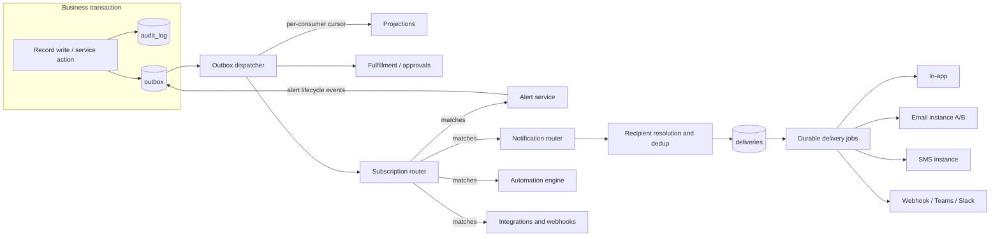

# Events, audit, alerts and notifications

This is the design for turning the platform's events, audit, alerting and notifications into one configurable shared service. The decisions and trade-offs are recorded in [ADR 0017](../adr/0017-event-audit-alert-notification-services.md). It builds on the transactional outbox and durable jobs of [ADR 0005](../adr/0005-job-and-workflow-execution.md) and the configuration system of [ADR 0003](../adr/0003-configuration-artifact-and-overlay-format.md).

## 1. What exists today

| Area | Implemented | Where | Gap |
| --- | --- | --- | --- |
| Event envelope | Event ID, type, schema version, tenant, environment, entity, record, record revision, config revision, occurred-at, correlation and causation IDs, actor, depth, minimal payload. Since G2-M17 (v2): source, type version, emitter, severity, sensitivity, trace context, recorded-at; `config.published` is a normal envelope | `packages/Esmbler.Sdk/Events/EventEnvelope.cs`, `EventWriter` | The wire shape stays v1-compatible (section 3.1) |
| Event types | Registry since G2-M17: platform types built in (`record.*`, `activity.added`, `config.published`, `platform.approval.*`, `platform.sla.warning` and `.breached` since G2-M4), module types declared in releases (Tickets 1.4.0), tenant types through `event_type.add`; transitions `emits`, `emit_event` rule actions; [AsyncAPI reference](../reference/asyncapi.json) | `EventTypeSpec`, `PlatformModule.EventTypes`, `EventEmission` | Done (SLA events since G2-M4, ADR 0018) |
| Transactional outbox | Record change, audit row and outbox row in one transaction; privileged claim across tenants with tenant interleaving | `RecordService`, `Migrations/0001`, `0005` | None for publishing |
| Delivery to consumers | At least once, durable inbox per consumer and event, backoff, dead letters, operator replay. Since G2-M17 each consumer runs in its own transaction, fails, retries and dead-letters alone (`kernel.consumer_failures`), is replayed alone, and dispatched events are purged after 14 days | `OutboxDispatcher`, `OperationsService` | Consumers still tolerate reordering (projections check revisions) rather than getting per-record order |
| Subscribers | Code consumers registered in the composition root: projection, in-app notification templates, fulfillment, approvals | `IEventConsumer` (internal), `ServiceRegistration` | Not a public contract; no configurable subscriptions; packages cannot subscribe |
| Durable jobs and timers | Leases, jittered backoff, max attempts, dead letters, replay, dedup keys, idempotent timers, depth and fan-out governors | `Jobs.cs`, `JobRunner.cs` | Ready to carry deliveries and escalations |
| Automation engine | Governors only (causation depth, fan-out, queue quotas) | `JobScheduler` | The trigger → condition → action engine is not built |
| Audit | Append-only `kernel.audit_log` (no UPDATE or DELETE for the app role), FORCE RLS, written in the same transaction as the change; actor, agent, channel, operation, target, outcome, correlation, config revision, change details | `AuditWriter`, `Migrations/0001` | No retention or legal-hold policy, no export, no tamper evidence, denied writes rely on each service |
| Notifications | Templates (`NotificationTemplateSpec`) on record events, recipients from user fields, rendered per recipient with their field permissions into `kernel.notifications` (`in_app_fake`); approval notifications written directly | `NotificationConsumer`, `ApprovalService` | No channels besides a fake in-app store, no API or UI to read them, no profiles, routing, preferences, quiet hours, delivery states, retries per recipient, rate limits, or preview |
| Alerts | None | | Whole service |
| Configuration | Typed overlay ops, drafts, review, publish, rollback, upgrades, MCP tools | `Sdk/Overlay`, `Kernel/Configuration` | No spec objects for events, routes, profiles, alert rules |
| Secrets | Environment variables for platform settings | `PlatformOptions` | Per-tenant credentials as vault references come with the Admin Center (G2-M12) |

## 2. Target architecture



Four services with independent storage, lifecycle, retention and permissions:

| Concept | Meaning | Written when | Store | Lifecycle | Retention | Who reads |
| --- | --- | --- | --- | --- | --- | --- |
| Event | Something happened | In the business transaction (outbox) | `kernel.outbox`, per-consumer cursors | Immutable; dispatched, then archived | Days (replay window), then summarized | Platform services, subscribers |
| Audit record | Accountable history | In the business transaction, never optional | `kernel.audit_log` | Immutable, append-only | Policy per tenant (default 7 years), legal hold | `audit.read`, record history by field permissions |
| Alert | A condition that stays open | By the alert service from events or timers | `kernel.alerts`, `kernel.alert_activity` | open → acknowledged → resolved (or suppressed), escalation levels | Policy (default 1 year after resolution) | `alerts.read`, assignees, profile recipients |
| Notification | Information delivered to someone | By the notification router from events | `kernel.notification_messages`, `kernel.notification_deliveries` | queued → sending → accepted → delivered or failed; ambiguous, suppressed, deferred | Delivery history 90 days, in-app inbox until read plus 30 days | Recipient (own inbox), `notifications.admin` (history and replay) |

Audit never depends on subscriptions: it is written by the service that performs the action, inside its transaction. Alerts and notifications are downstream of events and can fail, be delayed or be reconfigured without touching audit or the business transaction.

## 3. Event platform

### 3.1 Envelope, version 2

Version 2 is additive; consumers read both versions. Field names are the JSON wire names.

```jsonc
{
  "specVersion": 2,
  "id": "0b8c…",                       // event ID, unique, dedup key for every consumer
  "type": "core.tickets.ticket.escalated",
  "typeVersion": 1,                     // payload schema version of this type
  "dataSchema": "esmbler://events/core.tickets.ticket.escalated/1",
  "source": "core.tickets",             // module or service that published it (platform.sla, platform.approvals, …)
  "tenantId": "…", "environmentId": "…",
  "subject": { "entity": "core.tickets.ticket", "recordId": "…", "revision": 7, "number": "INC-0042" },
  "actor": { "kind": "user", "id": "…", "agentId": null, "onBehalfOf": null },
  "occurredAt": "2026-10-10T14:03:11.204Z",
  "recordedAt": "2026-10-10T14:03:11.209Z",
  "configRevision": 12,
  "correlationId": "…", "causationId": "…", "depth": 0,
  "traceparent": "00-…-…-01",
  "severity": "critical",              // optional; declared by the type, may be computed
  "sensitivity": "internal",           // public | internal | restricted: limits who may receive payload values
  "payload": { "from": "in_progress", "to": "escalated", "priority": "p1", "assignmentGroup": "…", "reason": "…" }
}
```

**As built (G2-M17).** The wire shape stays the v1 envelope plus additive fields, so v1 consumers keep working: `schemaVersion` (2), `eventId`, `type`, `typeVersion`, `source` (the layer that published it: for record events the entity's module, for declared events the module of the rule or transition, else `tenant`; `core.platform` for configuration events and `platform.approvals` for approval events), `emitter` (the rule or `workflow/transition`), `severity`, `sensitivity`, `traceparent` (W3C, from the current activity), `recordedAt`, and the v1 fields. The subject is `entity` + `recordId` + `recordRevision`; the payload schema reference is `type` + `typeVersion`, resolved in the registry and in the generated [AsyncAPI reference](../reference/asyncapi.json); the actor stays the `user:`/`agent:`/`system` reference. A structured subject and actor can be added later without breaking readers (ASM-052).

Rules: payloads carry IDs and small, non-secret values; hidden or restricted field values never enter payloads ("claim check": consumers that need content read the record under the recipient's or the subscriber's permissions). The envelope is the same for record events, domain events and platform events (`config.published` becomes a normal envelope).

### 3.2 Event type registry (public SDK)

```jsonc
// SpecCatalog.eventTypes[] (module, package or platform)
{
  "id": "core.tickets.ticket.escalated",
  "version": 1,
  "label": "Ticket escalated",
  "description": "A ticket was escalated to a higher support tier.",
  "subjectEntity": "core.tickets.ticket",
  "payloadSchema": { "type": "object", "properties": { "from": {"type":"string"}, "to": {"type":"string"}, "priority": {"type":"string"}, "reason": {"type":"string"} }, "required": ["to"] },
  "severity": { "default": "high", "from": "payload.priority == 'p1' ? 'critical' : 'high'" },
  "sensitivity": "internal",
  "category": "operational"          // operational | security | audit-relevant | informational
}
```

Versioning: additive payload changes keep the version; a breaking change publishes `version + 1` alongside the old one for one release; subscribers declare the versions they accept.

Publishing without code (declarative modules):

| Publisher | How |
| --- | --- |
| Workflow transition | `"emits": ["core.tickets.ticket.escalated"]` on the transition; payload mapped from the transition and record by expressions |
| Rule | New action `emit_event` with type and payload expressions |
| Platform services | SLA (`platform.sla.warning`, `platform.sla.breached`), approvals (`platform.approval.requested`, `.approved`, `.rejected`, `.cancelled`; built in G2-M17), alerts (`platform.alert.opened`, `.acknowledged`, `.escalated`, `.resolved`), notifications (`platform.notification.failed`) |
| Code (first-party services, extension runtime) | `IEventPublisher.Publish(db, envelope)` inside the caller's transaction |

The validator checks that emitted payloads conform to the declared schema (expressions are type-checked against the payload schema).

**As built (G2-M17).** Payload fields are typed `string`, `number`, `boolean` or `list` (at most 30). `emits` entries map payload keys to expressions over `record`, `prior`, `user` and `now`, with an optional severity expression; the validator refuses unknown types, missing required fields, undeclared keys, a plain field whose type does not match, fields any permission set hides (unless the type is `restricted`), emits of platform types, platform namespaces (`platform.`, `record.`, `config.`, `activity.`, `draft.`) outside the platform, module types outside the module's namespace, and `emit_event` on form rules. At run time a value that fails or does not match its type is left out and text is capped at 1,000 characters. `emit_event` publishes on the edge: when the rule's condition becomes true (or on create when it is true). Tenants may add emits to a module's transition but not remove the module's own. Approval events are `platform.approval.requested`, `.approved`, `.rejected` and `.cancelled`. Platform event types are built in, so every tenant's registry lists them whatever platform version it installed (ASM-051).

### 3.3 Subscriptions

Built in G2-M18 with the notification service, which is their first target ([ADR 0021](../adr/0021-notification-routing-and-delivery.md)). The built subscription has `event`, an optional `entity` and `when` condition over `event` and `record`, and the target `notify`; the other targets come later.

One public contract for "something reacts to events", stored as configuration:

```jsonc
// SpecCatalog.subscriptions[]
{
  "id": "tenant__critical_escalations",
  "label": "Critical escalations",
  "events": ["core.tickets.ticket.escalated"],     // exact IDs or "core.tickets.*"
  "when": "event.severity == 'critical' && record.assignment_group == group('network')",
  "target": { "kind": "notify", "route": "tenant__critical_escalations" }   // notify | alert | automation | webhook | package
}
```

- The **subscription router** is one outbox consumer. It loads the active configuration, matches subscriptions (type, module, entity, condition over `event`, `record` and `variables`, evaluated with the subscription owner's permissions), and hands each match to its target service by scheduling a durable job keyed by `(event ID, subscription ID)`. A slow or failing target never holds back another.
- First-party platform services keep code consumers (`IEventConsumer`) for invariants that must react to every event (projections, fulfillment, approvals). Everything optional (alerts, notifications, automations, integrations) goes through subscriptions.
- Packages declare subscriptions in their manifest with capability `events.subscribe:<type>`; the handler runs in the extension runtime (G3-M4) and receives only the envelope and what its capabilities allow.
- Adding or removing a notification route, alert rule or automation is a configuration change; the publishing module never changes.

### 3.4 Dispatcher improvements

- **Per-consumer progress.** Replace "all consumers in one transaction per event" with per-consumer delivery state. A failing consumer retries and dead-letters on its own; the others carry on. *As built:* the inbox records successes and `kernel.consumer_failures` records failing consumers (attempts, last error, dead); the event backs off while any consumer is still retrying and counts as dispatched once every consumer succeeded or is dead. Per-record ordering is not enforced per consumer; consumers keep tolerating reordering (projections check revisions, ADR 0005).
- **Replay by consumer.** Operators replay one dead consumer for one event (queue `consumers` on the Operations page), audited with the consumer and event; the inbox keeps every other consumer from running again. Replay of one consumer from a point in time is not built yet.
- **Outbox retention.** Dispatched events are kept for a replay window (default 14 days, never under 7), then deleted with their inbox marks by `kernel.purge_outbox` in batches; events with a dead consumer stay until replayed; audit is the long-term record.

## 4. Audit

- Captured synchronously by the service performing the action, in the same transaction (`AuditWriter`); required capture never depends on subscriptions, notification settings or delivery.
- What is audited (categories): record writes (with field changes, truncated, hidden values redacted to "changed"), access-relevant actions (permissions, roles, delegations, impersonation), configuration (draft steps, publish, rollback, upgrades), approvals and alert lifecycle actions taken by people, administrative actions on channels, profiles, routes and credentials (never secret values), denied attempts on sensitive actions, and platform governors.
- Additions: per-tenant retention policy with legal hold (deletion job outside the app role, itself audited), export API (`audit.export`, streamed, filtered), and tamper evidence through a per-tenant hash chain (each row stores `prev_hash` and `hash` over its canonical form; a nightly verifier reports breaks).
- Notification delivery history is not audit: it lives with the notification service, with its own shorter retention. Changes to notification configuration and replays of deliveries are audited.

## 5. Alerts

```jsonc
// SpecCatalog.alertRules[]
{
  "id": "tenant__critical_escalation",
  "label": "Critical ticket escalation",
  "trigger": { "events": ["core.tickets.ticket.escalated"], "when": "event.severity == 'critical'" },
  "dedupKey": "'ticket:' + event.subject.recordId",   // one open alert per ticket
  "severity": "event.severity",
  "title": "'Critical escalation: ' + record.number + ' ' + record.title",
  "owner": { "group": "network" },
  "autoResolve": { "events": ["record.transitioned"], "when": "record.status in ['resolved', 'closed']" },
  "escalation": [
    { "afterMinutes": 0,  "notify": ["tenant__network_ops"] },
    { "afterMinutes": 15, "notify": ["tenant__management"], "unlessAcknowledged": true },
    { "afterMinutes": 60, "notify": ["tenant__management"], "repeat": true, "unlessAcknowledged": true }
  ]
}
```

Lifecycle: `open → acknowledged → resolved`, plus `suppressed` (maintenance windows) and re-open on a new occurrence within a cool-down. A repeated trigger with the same dedup key increments `occurrences` on the open alert instead of opening another. Escalation steps are durable timers (`alert.escalate`, dedup key per alert and level), cancelled by acknowledgment or resolution. Every state change emits `platform.alert.*` events, so notifications about alerts are ordinary routes; the alert service never sends messages itself.

Storage: `kernel.alerts` (rule, dedup key, status, severity, title, subject record, owner, level, occurrences, opened/acknowledged/resolved at and by) and `kernel.alert_activity` (timeline). Permissions: `alerts.read`, `alerts.acknowledge`; owners and notified people see the alerts they are part of.

## 6. Notifications

This section is the design target. What G2-M18 built, and where it differs (a smaller channel contract, recipients on routes rather than profiles, no team layer, schedules or quiet hours yet), is recorded in [ADR 0021](../adr/0021-notification-routing-and-delivery.md).

### 6.1 Channel types and channel instances

```csharp
// Public SDK: channel type contract (first-party adapters now; packages through the extension runtime later)
public interface INotificationChannel
{
    string Type { get; }                                 // in_app, email, sms, webhook, teams, slack, push
    ChannelCapabilities Capabilities { get; }            // idempotency keys, status callbacks, max length, rich content
    Task<ProviderResult> SendAsync(ChannelMessage message, ChannelInstance instance, ISecretResolver secrets, CancellationToken ct);
    ProviderStatus? ParseStatusCallback(ChannelInstance instance, HttpRequestData callback);   // delivered / failed receipts
}

public sealed record ProviderResult(DeliveryOutcome Outcome, string? ProviderMessageId, string? Error, TimeSpan? RetryAfter);
public enum DeliveryOutcome { Accepted, Delivered, RetryableFailure, PermanentFailure, Ambiguous }
```

A **channel instance** is a tenant's configured account for a channel type. It is an environment setting managed in the Admin Center, not promoted configuration, because it holds credential references, sender identities and destinations that must not travel from sandbox to production:

```jsonc
// kernel.channel_instances (per tenant and environment)
{
  "id": "email.ops_mailbox",
  "type": "email",
  "label": "Ops mailbox (SendGrid)",
  "provider": "sendgrid",
  "settings": { "from": "it-ops@acme.example", "replyTo": "it-help@acme.example" },
  "credential": "vault://tenants/acme/prod/email/ops",     // reference only, resolved by the worker at send time
  "limits": { "perMinute": 300, "perDay": 20000 },
  "mode": "live",                                            // live | capture (sandbox default: messages stored, nothing sent) | test
  "testDestination": "it-ops-test@acme.example",
  "enabled": true
}
```

Published configuration refers to instances by ID (`email.ops_mailbox`) or by type (`email` = the environment's default email instance). Promotion keeps the IDs; each environment binds them to its own accounts.

### 6.2 Templates

```jsonc
// SpecCatalog.notificationTemplates[] (version 2; version 1 templates are converted on load)
{
  "id": "tenant__escalation",
  "events": ["core.tickets.ticket.escalated", "platform.alert.escalated"],
  "variants": {
    "email":  { "subject": "[{{event.severity | upper}}] {{record.number}} escalated", "text": "…", "markdown": "…" },
    "sms":    { "text": "{{record.number}} escalated ({{event.severity}}). {{link}}" },        // ≤ 320 chars after rendering
    "in_app": { "title": "{{record.number}} escalated", "body": "{{record.title}}", "link": "record" },
    "teams":  { "card": "…" }
  },
  "externalFields": ["number", "priority"],      // the only record fields rendered for recipients who are not users
  "locale": "en"
}
```

Rendering happens per recipient: users get the record as their own permissions show it (hidden fields render empty), external addresses get only `externalFields` and event values marked public. Rich text is sanitized; links point to the app, never embed content.

### 6.3 Profiles

```jsonc
// SpecCatalog.notificationProfiles[]
{
  "id": "tenant__network_ops",
  "label": "Network Operations",
  "targets": [
    { "channel": "email.ops_mailbox", "recipients": [ {"email": "noc@acme.example"}, {"email": "netlead@acme.example"} ] },
    { "channel": "sms.twilio_main",  "recipients": [ {"phone": "+15550100"}, {"phone": "+15550101"} ] },
    { "channel": "in_app",           "recipients": [ {"group": "network"} ] }
  ],
  "templates": { "sms": "tenant__escalation_short" },     // per-channel override; otherwise the route's template
  "minSeverity": "high",
  "schedule": { "timeZone": "Europe/Madrid", "active": [ {"days": "mon-fri", "from": "07:00", "to": "20:00"} ] },
  "quietHours": { "from": "22:00", "to": "07:00", "behavior": "defer", "bypassAtSeverity": "critical" },
  "delivery": { "mode": "all" }                            // all | fallback
}
```

```jsonc
{
  "id": "tenant__management",
  "label": "Management",
  "targets": [
    { "channel": "email", "recipients": [ {"email": "it-management@acme.example"} ] },
    { "channel": "in_app", "recipients": [ {"user": "…"}, {"user": "…"} ] }
  ],
  "delivery": {
    "mode": "fallback",
    "steps": [ { "channels": ["in_app"] }, { "channels": ["email"], "after": "PT10M", "unlessRead": true } ]
  }
}
```

Recipients can be users, groups, roles, record fields (`{"field": "assignee"}`), raw email addresses, phone numbers, and on-call schedules (`{"onCall": "network_primary"}`, resolved at send time; the on-call model arrives with the org model).

### 6.4 Routing rules and inheritance

```jsonc
// SpecCatalog.notificationRoutes[]
{
  "id": "tenant__critical_escalations",
  "label": "Critical escalations",
  "layer": "tenant",                                   // module | tenant | team
  "scope": { "group": null },                          // team routes are scoped to a group's records
  "events": ["core.tickets.ticket.escalated"],
  "when": "event.severity == 'critical'",
  "profiles": ["tenant__network_ops", "tenant__management"],
  "recordRecipients": [ { "field": "assignee", "channels": ["in_app", "email"] } ],
  "template": "tenant__escalation",
  "mandatory": true,                                    // users cannot opt out (they can choose among allowed channels)
  "stop": false,
  "order": 100
}
```

How layers combine:

| Layer | Owner | Can | Cannot |
| --- | --- | --- | --- |
| Module defaults | Module release | Ship routes, templates and profiles that work out of the box (e.g. "assigned to you") | Reference tenant channel instances or raw addresses |
| Tenant | Admins (`notifications.admin`), drafts and publish | Add routes and profiles, disable or override module routes (except those the module marks `required`), set mandatory | |
| Team | Group managers with `notifications.team` for their group | Add routes scoped to their group's records and add their members or their team profiles | Change tenant routes or reach outside their scope |
| User preferences | Each person | Choose channels per category among those a route allows, quiet hours, digest, mute non-mandatory categories | Opt out of mandatory routes, add recipients, change other people's settings |

Resolution for one event:

1. Collect matching routes from all layers in order (`order`, then layer: module, tenant, team). A route with `stop: true` ends matching for lower-priority routes of the same event.
2. Expand profiles and record recipients into candidate deliveries `(person or address, channel instance, template, route, profile, step)`.
3. Normalize identities: a group expands to members; a raw email that is a member's verified address becomes that member.
4. Apply profile filters (severity, schedule) and then user preferences (non-mandatory only); quiet hours mark deliveries `deferred` (or let them through at the bypass severity).
5. Deduplicate on `(person or address, channel type, fallback step)`: the same person through the same channel once, whichever profiles overlap; different channels stay (intentional). The winning candidate is the one from the highest-priority route; the others are kept as `reasons` for preview and history.
6. Persist one `notification_message` per event and route resolution, and one `notification_delivery` per remaining candidate; schedule a delivery job per delivery.

### 6.5 Delivery and reliability

```sql
CREATE TABLE kernel.notification_messages (
  tenant_id uuid, environment_id uuid, id uuid,
  event_id uuid NOT NULL, event_type text NOT NULL, subject_record uuid,
  severity text, routes text[] NOT NULL, created_at timestamptz NOT NULL,
  PRIMARY KEY (tenant_id, environment_id, id),
  UNIQUE (tenant_id, environment_id, event_id)            -- one resolution per event (replay-safe)
);

CREATE TABLE kernel.notification_deliveries (
  tenant_id uuid, environment_id uuid, id uuid,           -- id is the provider idempotency key where supported
  message_id uuid NOT NULL,
  recipient_kind text NOT NULL,                           -- user | email | phone | webhook
  recipient_ref text NOT NULL,                            -- user ID, or the address (encrypted at rest, masked in views)
  channel_type text NOT NULL, channel_instance text NOT NULL,
  template_id text NOT NULL, fallback_step int NOT NULL DEFAULT 0,
  status text NOT NULL,   -- queued | sending | accepted | delivered | read | failed | ambiguous | suppressed | deferred | cancelled
  attempts int NOT NULL DEFAULT 0, next_attempt_at timestamptz,
  provider_message_id text, last_error text,              -- redacted provider error, never content or secrets
  reasons jsonb NOT NULL,                                 -- routes and profiles that selected it
  created_at timestamptz NOT NULL, updated_at timestamptz NOT NULL,
  PRIMARY KEY (tenant_id, environment_id, id),
  UNIQUE (tenant_id, environment_id, message_id, recipient_kind, recipient_ref, channel_type, fallback_step)
);

CREATE TABLE kernel.notification_inbox (                  -- in-app channel
  tenant_id uuid, environment_id uuid, id uuid, recipient uuid NOT NULL,
  delivery_id uuid NOT NULL, title text NOT NULL, body text NOT NULL, link text,
  severity text, read_at timestamptz, created_at timestamptz NOT NULL,
  PRIMARY KEY (tenant_id, environment_id, id)
);

CREATE TABLE kernel.channel_instances ( … as in 6.1 …, PRIMARY KEY (tenant_id, environment_id, id) );
CREATE TABLE kernel.notification_preferences ( tenant_id, environment_id, principal_id, settings jsonb, … );
-- All with FORCE RLS on tenant and environment; esmbler_app gets SELECT, INSERT, UPDATE; no DELETE (retention job only).
```

- **Jobs.** Each delivery is a durable job (`notify.deliver`, dedup key = delivery ID) on the existing runner: leases, jittered backoff, max attempts, dead letters, operator replay.
- **States.** `queued` → `sending` → `accepted` (provider took it) → `delivered` or `read` (only when the provider or in-app channel reports it) or `failed`. A timeout or connection loss after the request may have reached the provider is `ambiguous`: it is retried automatically only when the provider honours idempotency keys (the delivery ID); otherwise it waits for a status callback or an operator decision. The platform promises at-least-once with idempotency where providers support it, never exactly-once.
- **Rate limits.** A token bucket per channel instance (and per recipient for SMS) in the database; when exhausted, the job is deferred to the next window rather than failed. Provider `Retry-After` is honoured.
- **Isolation of failures.** Every delivery is its own job: a failing SMS provider retries or dead-letters its own deliveries; email, in-app, audit and the business transaction are unaffected.
- **Fallback.** For `fallback` profiles the next step's deliveries are created only when the earlier step fails or is not read within `after`, through a timer keyed by message and step.
- **Inspection and replay.** Admins see failed, ambiguous and dead-lettered deliveries with redacted errors and can replay one or a filtered set; a replay re-sends with the same delivery ID (idempotent providers deduplicate) and is audited.
- **Redaction.** Content for external recipients is limited to `externalFields` and public event values; SMS and chat bodies are truncated; provider errors are scrubbed of content before storage.

### 6.6 Preview and test mode

`POST /api/notifications/preview` (and MCP `preview_notification`) takes an event: a recent real event ID, a synthetic event built from a sample record, or a hand-written payload. It resolves against the draft configuration and returns, without sending anything:

- matched subscriptions, routes (and why others did not match), profiles, and the fallback plan;
- recipients per channel with addresses masked, the reasons each was selected, the deduplication decisions, and what preferences, schedules or quiet hours would suppress or defer;
- each rendered template variant as each recipient would see it (permissions applied);
- warnings: unresolved recipients, missing templates for a channel, disabled or capture-mode instances, external recipients receiving restricted values.

A **test send** delivers to the channel instance's `testDestination` only, is labelled as a test, and needs `notifications.admin`. Sandbox environments default every instance to `capture` mode, so nothing leaves the platform unless an admin sets a test destination (master spec, environment safety).

## 7. Administration, configuration and MCP

| Object | Kind | Managed through | Publish | AI (MCP) |
| --- | --- | --- | --- | --- |
| Event types | Spec object (module, package) | Module releases; tenants may add `tenant__` domain events emitted by their rules | Draft and publish | `list_event_types` |
| Subscriptions, routes | Spec objects | Admin Center → Notifications; overlay ops `notification_route.add/update/remove`, `subscription.*` | Draft and publish | `add_notification_route`, `update_notification_route` |
| Profiles | Spec objects | Admin Center; `notification_profile.*` | Draft and publish | `add_notification_profile` (no raw addresses: adding external recipients is a permission change) |
| Templates | Spec objects | Admin Center editor with live preview; `notification_template.*` | Draft and publish | `add_notification_template` |
| Alert rules | Spec objects | Admin Center → Alerts; `alert_rule.*` | Draft and publish | `add_alert_rule` |
| Channel instances, credentials | Environment settings (not promoted) | Admin Center → Channels; credentials as vault references | Immediate, audited, `notifications.admin` | Read-only (`list_channels`, never credentials) |
| Preferences | Per-user data | User settings | Immediate | None |
| Preview | Read-only | Admin Center, builder Test tab | | `preview_notification` |

Permission-relevant changes (adding external recipients, making a route non-mandatory, removing a required route, changing who receives restricted values) are `AffectsPermissions` and need permission administration to publish, like approval changes (ADR 0016).

## 8. End-to-end example: a critical ticket escalation

Configuration (published): event type `core.tickets.ticket.escalated` (Tickets), alert rule "Critical ticket escalation" (section 5), profiles "Network Operations" and "Management" (section 6.3), route "Critical escalations" (section 6.4) selecting both profiles plus the assignee.

```mermaid
sequenceDiagram
    autonumber
    participant Agent
    participant API as Record engine
    participant DB as Postgres (one transaction)
    participant Disp as Outbox dispatcher
    participant Sub as Subscription router
    participant Alert as Alert service
    participant Notif as Notification router
    participant Jobs as Delivery jobs
    Agent->>API: Escalate INC-0042 (P1)
    API->>DB: update record, audit "record.transition" (actor, from→to), outbox: record.transitioned + core.tickets.ticket.escalated (severity critical)
    DB-->>Agent: 200 OK (business transaction done)
    Disp->>Sub: escalated event (consumer cursor)
    Sub->>Alert: job: alert rule matched
    Sub->>Notif: job: route "Critical escalations" matched
    Alert->>DB: open alert ticket:INC-0042 (critical), timeline, timer level 2 in 15 min, outbox platform.alert.opened
    Notif->>DB: message + 8 deliveries (dedup: Ana in both profiles via in-app → once)
    Jobs->>Jobs: email ×3 accepted; in-app ×3 delivered; SMS ×2 → provider 503 → retry with backoff
    Note over Jobs: SMS retries never block email, audit or the ticket
    Jobs->>DB: SMS attempt 3 accepted, then delivered (status callback)
    Note over Alert: 15 minutes later, not acknowledged
    Alert->>DB: escalate to level 2, outbox platform.alert.escalated
    Disp->>Notif: route "Alert escalations" → Management fallback: in-app, then email after 10 min unless read
    Agent->>Alert: Acknowledge (audited), timers cancelled
    Agent->>API: Resolve INC-0042 → alert auto-resolved (rule autoResolve)
```

What each store holds afterwards:

- **Audit**: `record.transition` (escalate, actor, fields), `alert.acknowledged` (by whom), `record.transition` (resolve). Written whether or not any notification was configured or succeeded.
- **Alert**: one alert with status `resolved`, two escalation levels reached, timeline of occurrences, acknowledgment and resolution.
- **Notifications**: two messages (escalation, alert escalation) with deliveries per recipient and channel, their states (accepted, delivered, read, the SMS retries), and the reasons each was selected.
- **Events**: the escalated, alert and transition events, kept for the replay window.

## 9. Phased implementation

| Phase | Milestone | Scope | Exit evidence |
| --- | --- | --- | --- |
| 1 | G2-M17 Event platform v2 (done; SLA events moved to G2-M4, subscriptions to G2-M18, subject and payload schema reference as in ASM-052) | Envelope v2 (source, subject, dataSchema, traceparent, severity, sensitivity) read alongside v1; event type registry in the SDK and module specs; `emits` on transitions and the `emit_event` rule action with payload type-checking; platform events for approvals and SLA; `config.published` as an envelope; per-consumer delivery state with independent retries, dead letters and replay; outbox retention | Tickets 1.4.0 emits `ticket.escalated`; a poison consumer no longer blocks others; contract tests for envelope v1/v2 |
| 2 | G2-M18 Notification service (done per [ADR 0021](../adr/0021-notification-routing-and-delivery.md); team layer, schedules and quiet hours, approvals and legacy templates onto routes, live push and Admin Center editing of routes deferred) | Subscriptions spec object and the subscription router (section 3.3); channel abstraction; in-app inbox (API, bell, list, read state); email (fake plus one provider) and SMS (fake plus one provider) adapters; channel instances in Admin Center with vault references and capture mode; templates v2; profiles; routes with layers; resolution and dedup; delivery tables and jobs; rate limits; idempotency; ambiguous handling; failed-delivery inspection and replay; preview and test send; MCP tools; migrate existing templates and approval notifications onto routes | End-to-end test: one event to two profiles across three channels with an SMS outage; preview matches real resolution; isolation tests for every new table |
| 3 | G2-M19 Alerts and audit policy | Alert rules, lifecycle, acknowledgment, escalation timers, auto-resolve, maintenance suppression, alerts page; SLA breach alerts; audit retention and legal hold, export, hash-chain verifier | The section 8 example runs as an acceptance test |
| 4 | Gate 3 | User preferences UI and team-level routes; digests; on-call schedules (with the org model); webhook, Teams, Slack and push channels; package subscribers through the extension runtime; the automation engine (trigger → condition → action) as a subscription target | Package subscriber conformance tests; automation governors enforced end to end |

Recommended order: G2-M3 (approvals, closing) → G2-M17 → G2-M4 SLA (publishes breach events) → G2-M9 and G2-M9b (connected workspace, as agreed) → G2-M18 → G2-M19 → G2-M5 email intake (reuses the email channel and delivery jobs). Phase 1 is small and makes SLA and dashboards publish proper events; notifications land before email intake because both need the email adapter.

## 10. Trade-offs

- **Subscriptions as configuration versus code consumers.** Configuration gives drafts, review, publish, rollback and AI editing, and keeps publishers ignorant of subscribers. Invariant-carrying reactions (projections, fulfillment, approvals) stay code consumers because they must run for every event and are part of the platform's correctness, not a tenant's choice.
- **Fan-out through durable jobs.** One job per subscription match and per delivery costs more rows than inline handling, but isolates failures, gives retries, rate limits and replay for free, and keeps the dispatcher fast. The governors (depth, fan-out, queue quotas) bound the cost.
- **Audit in the transaction, not from events.** Deriving audit from events would make it eventually consistent and lossy on consumer bugs. Writing it synchronously costs a row per action but guarantees accountability; the outbox remains the source for everything optional.
- **Channel instances outside promoted configuration.** Credentials, sender identities and destinations differ per environment and must never be copied to production by a promotion; keeping them as environment settings costs a mapping step during promotion (IDs stay the same, bindings differ).
- **At-least-once, not exactly-once.** Providers without idempotency keys can deliver twice after an ambiguous failure. The design surfaces ambiguity instead of guessing, retries automatically only where providers deduplicate, and documents the guarantee per channel.
- **Per-recipient rendering.** Rendering each message under the recipient's permissions is more work than one rendering per event, but it is the only way to keep hidden fields out of notifications (derived surfaces follow permissions).
- **Dedup on person and channel.** Collapsing the same person across profiles prevents noise, but a team that wants two copies on purpose (for example two mailboxes) must use two different addresses or channel instances; the preview shows every collapse and why.
- **Alerts emit events instead of sending.** One extra hop, but alerts, notifications and automations stay independent and configurable, and an alert can drive integrations (paging tools) without the alert service knowing them.

## 11. Requirements added

| ID | Requirement |
| --- | --- |
| REQ-EVT-008 | Versioned event envelope v2 and an event type registry with payload schemas; modules publish domain events declaratively |
| REQ-EVT-009 | Configurable subscriptions with independent, isolated subscribers; publishers never reference subscribers |
| REQ-AUD-001 | Audit retention, legal hold, export and tamper evidence, independent of notifications |
| REQ-ALR-001 | Alerts with dedup, acknowledgment, escalation and resolution, separate from notifications |
| REQ-NOT-001 | Pluggable channel types and per-environment channel instances with vault-referenced credentials |
| REQ-NOT-002 | Templates per channel, rendered per recipient with permissions and external redaction |
| REQ-NOT-003 | Notification profiles with multiple channels, recipients, filters, schedules, quiet hours and fallback |
| REQ-NOT-004 | Routing rules across module, tenant, team and user layers with explicit precedence, mandatory routes and deduplication |
| REQ-NOT-005 | Reliable per-recipient, per-channel delivery: states, retries, rate limits, idempotency, ambiguity, inspection, replay |
| REQ-NOT-006 | Preview and test mode without live sends; sandbox capture by default |
| REQ-NOT-007 | Admin Center and MCP management through the versioned configuration and publish process |
