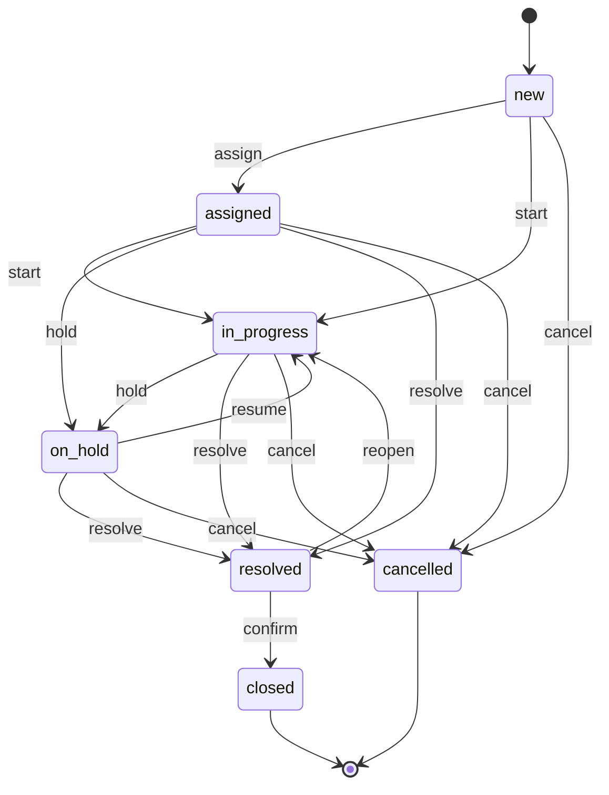
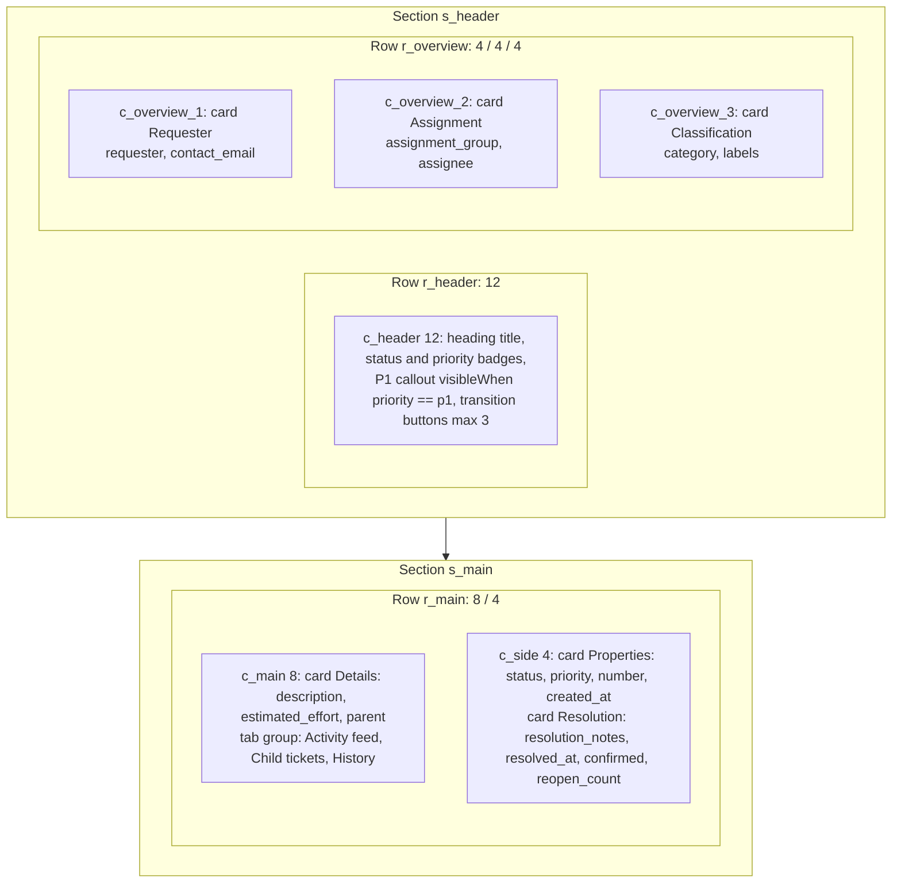

# Tickets module architecture

## Overview

`core.tickets` is the default Tickets and Service Requests module and the reference implementation for module authors ([REQ-MOD-001](../../spec/traceability.md)).

- **Code:** `modules/tickets/Esmbler.Modules.Tickets` (releases) and `Esmbler.Modules.Tickets.Contracts` (public IDs in `TicketsIds`).
- **Fully declarative:** each release is one JSON file, `Releases/<version>/module.json`, embedded and loaded by `ModuleReleaseLoader`. There is no C# business logic.
- **Boundaries:** references only `Esmbler.Sdk` and its own Contracts. `tests/Esmbler.ArchitectureTests` enforces this ([REQ-MOD-002](../../spec/traceability.md)).
- **Dependencies:** `core.platform ^1.0.0`. It uses the shared rules, workflow, assignment and notification services.
- **Releases:** `1.0.0` (initial), `1.1.0` (the first upgrade, used by the Gate 1 upgrade scenario), `1.2.0` (service requests, see [Release 1.2.0](#release-120-service-requests)), `1.3.0` (approvals, see [Release 1.3.0](#release-130-approvals)) `1.4.0` (published ticket events, see [Release 1.4.0](#release-140-ticket-events)) `1.5.0` (service levels, see [Release 1.5.0](#release-150-service-levels)) `1.6.0` (Overview dashboard and metrics, see [Release 1.6.0](#release-160-overview-dashboard)) `1.7.0` (notification routes, see [Release 1.7.0](#release-170-notification-routes)) and `1.8.0` (SLA alerts, see [Release 1.8.0](#release-180-sla-alerts)). Demo tenant Acme is seeded on 1.0.0 and Globex on the newest release (ASM-043, ASM-066). Workspaces created from the [IT ticketing starter](#starter-it-ticketing) also start on the newest release.

| Public ID (`TicketsIds`) | Value |
| --- | --- |
| Module | `core.tickets` |
| Entity | `core.tickets.ticket` |
| Record view / list view / quick create | `core.tickets.record`, `core.tickets.list`, `core.tickets.quick_create` |
| Workflow | `core.tickets.lifecycle` |
| Roles | `core.tickets.agent`, `core.tickets.requester`, `core.tickets.admin`; `core.tickets.approver` (1.3.0, `ApproverRole`) |
| Request entity / task entity / request workflow (1.2.0) | `core.tickets.request`, `core.tickets.request_task`, `core.tickets.request_lifecycle` |

The other IDs added in 1.2.0 (task workflow, views, catalog items) are listed in [Release 1.2.0](#release-120-service-requests), and those added in 1.3.0 (approval policies, permission set, notification) in [Release 1.3.0](#release-130-approvals).

## Entity: Ticket

`core.tickets.ticket`. The title field is `title`. All fields are stored in `kernel.records.data` keyed by field key ([ADR 0002](../../adr/0002-storage-and-query-model.md)).

| Key | Type | Label | Constraints and notes |
| --- | --- | --- | --- |
| `number` | auto_number | Number | Prefix `TCK`; system, read-only |
| `title` | short_text | Title | Required, max 200 |
| `description` | rich_text | Description | Sanitized HTML, max 20,000 |
| `status` | status | Status | Choice list `core.tickets.status`, default `new`; read-only (changes only through transitions) |
| `priority` | priority | Priority | Required, default `p3` |
| `category` | single_select | Category | Choice list `core.tickets.category` |
| `labels` | multi_select | Labels | Choice list `core.tickets.labels` |
| `requester` | user | Requester | Required; `defaultExpression: user.id` |
| `contact_email` | email | Contact email | Max 254 |
| `assignment_group` | group | Assignment group | |
| `assignee` | user | Assignee | |
| `parent` | lookup | Parent ticket | Target `core.tickets.ticket` |
| `estimated_effort` | short_text | Estimated effort | Max 40. Deprecated and hidden in 1.1.0 |
| `resolution_notes` | long_text | Resolution notes | Max 4,000 |
| `resolved_at` | date_time | Resolved at | Read-only; set by the `resolve` transition |
| `confirmed` | toggle | Requester confirmed | Read-only, default false |
| `reopen_count` | integer | Times reopened | Read-only, default 0, min 0 |
| `created_at`, `updated_at` | date_time | Created, Updated | System, read-only |

**Access fields** (record-level ReBAC, see the [authorization model](../../explanation/authorization-model.md)): `requester` → relation `requester`, `assignee` → `assignee`, `assignment_group` → `owner_group`. All three grant edit.

### Choice lists

Option IDs are stable strings stored in records ([REQ-REC-005](../../spec/traceability.md)). Tones are design tokens.

| Choice list | Options (`id`: label, tone) |
| --- | --- |
| `core.tickets.status` | `new`: New (gray), `assigned`: Assigned (blue), `in_progress`: In progress (purple), `on_hold`: On hold (amber), `resolved`: Resolved (green), `closed`: Closed (gray), `cancelled`: Cancelled (gray) |
| `core.tickets.priority` | `p1`: Critical (red), `p2`: High (amber), `p3`: Medium (blue), `p4`: Low (gray) |
| `core.tickets.category` | `hardware`, `software`, `network`, `access` (Access request), `other` |
| `core.tickets.labels` | `vip` (purple), `outage` (red), `security` (amber), `onboarding` (green) |

### Relationship

`core.tickets.parent_child`: a lookup from `parent` to another ticket. Labels are "Parent ticket" and "Child tickets". `onTargetDelete: restrict`, so a parent with children cannot be deleted ([REQ-REC-006](../../spec/traceability.md)).

## States and transitions

The workflow is `core.tickets.lifecycle`, state field `status`, initial state `new`, `definitionVersion: 1`. It is executed in-transaction by the platform workflow service ([ADR 0005](../../adr/0005-job-and-workflow-execution.md)).



| Transition | From → to | Roles | Required fields | Sets |
| --- | --- | --- | --- | --- |
| `assign` (Assign) | new → assigned | agent, admin | `assignment_group` | |
| `start` (Start work) | new, assigned → in_progress | agent, admin | | `assignee = has(record.assignee) ? record.assignee : user.id` |
| `hold` (Put on hold) | assigned, in_progress → on_hold | agent, admin | | |
| `resume` (Resume) | on_hold → in_progress | agent, admin | | |
| `resolve` (Resolve) | assigned, in_progress, on_hold → resolved | agent, admin | `resolution_notes` | `resolved_at = now` |
| `confirm` (Confirm resolution) | resolved → closed | requester, agent, admin | | `confirmed = true` |
| `reopen` (Reopen) | resolved → in_progress | requester, agent, admin | | `reopen_count + 1`, `resolved_at = null`, `confirmed = false` |
| `cancel` (Cancel, danger tone) | new, assigned, in_progress, on_hold → cancelled | requester, agent, admin | | |

State categories (`new`, `active`, `pending`, `resolved`, `closed`, `cancelled`) drive saved views. SLA conditions (1.5.0) name status values instead, for example `record.status == 'on_hold'` pauses resolution.

## Rules

All base rules are data-scoped, so they are enforced on every write path ([REQ-RULE-004](../../spec/traceability.md)). Tenants may disable a base rule (`rule.update` with `enabled: false`) but cannot rewrite or remove it.

| ID | Kind | Condition | Effect | Order |
| --- | --- | --- | --- | --- |
| `core.tickets.rules.title_length` | validation | always | Assert `!has(record.title) \|\| record.title.size() >= 5` on `title` (absence is handled by `required`) | 10 |
| `core.tickets.rules.resolution_notes` | conditional | `record.status in ['resolved', 'closed']` | Require `resolution_notes` | 20 |
| `core.tickets.rules.closed_read_only` | conditional | `record.status in ['closed', 'cancelled']` | Read-only `title`, `description`, `priority`, `category` | 30 |
| `core.tickets.rules.p1_impact` (1.1.0) | conditional | `record.priority == 'p1'` | Require `impact` | 40 |

**Assignment rules** (first match wins, through the `core.tickets.strategy.assignment` extension point):

1. `core.tickets.assign.network`: when `record.category == 'network'`, assign group `network` (order 10).
2. `core.tickets.assign.default`: always, assign group `service_desk` (order 100).

**Notification templates** (Gate 1 delivers to the in-app channel through `NotificationConsumer`):

- `core.tickets.notify.resolved`: on `record.transitioned:resolved`, notifies `requester`.
- `core.tickets.notify.assigned`: on `record.updated:assignee`, notifies `assignee`.

## Roles and permission sets

| Permission set | Roles | Ticket access | Fields | Actions |
| --- | --- | --- | --- | --- |
| `core.tickets.ps_agent` | agent | create; read all; update all; no delete | all writable | none |
| `core.tickets.ps_requester` | requester | create; read related; update related; no delete | read-only `priority`, `requester`, `assignment_group`, `assignee`, `parent`, `resolution_notes`; hidden `estimated_effort`, `labels`; other non-system fields (`title`, `description`, `contact_email`, `category`, …) writable on related tickets | none |
| `core.tickets.ps_admin` | admin | create; read all; update all; delete | all writable | `config.edit`, `config.publish`, `audit.read`, `records.export` |
| `core.tickets.ps_approver` (1.3.0) | approver | requests only: no create; read related (through the `approvers` access field); no update; no delete. No ticket access | no field rules (the request's other permission sets apply) | none |
| `core.platform.ps_tenant_admin` (platform) | `core.platform.tenant_admin` | all entities, full | all | every platform action, including `permissions.admin` and `modules.manage` |

The Tickets admin can publish configuration but cannot change permissions. That needs `permissions.admin`, which only the tenant admin holds ([REQ-AUTHZ-008](../../spec/traceability.md)).

## Pages

All views are layout trees on the 12-column grid with stable node IDs ([REQ-LAY-001](../../spec/traceability.md)).

### Record page (`core.tickets.record`)



- **Header row (12 columns):** `display.heading` bound to `title` (level 1), `display.badge` for `status` and `priority`, a critical `display.callout` shown only when `record.priority == 'p1'`, and `action.transition_buttons` (max 3 visible, the rest in overflow).
- **Overview row (4/4/4):** three cards, Requester, Assignment and Classification.
- **Main row (8/4):** the main column has the Details card and a tab group:
  - **Activity:** `activity.feed` with public replies and internal work notes; the composer defaults to internal ([REQ-BIZ-002](../../spec/traceability.md)).
  - **Child tickets:** `collection.related_list` over `core.tickets.parent_child`.
  - **History:** `activity.audit_history`, 25 per page.

  The side column has the Properties and Resolution cards. This is the `core.tickets.slots.record_side_panel` UI slot, where the canonical tenant customization adds its Vendor card.

### List page (`core.tickets.list`)

- **Toolbar row (12):** `collection.saved_views` (All open, Assigned to me, Unassigned, My requests, Resolved) and a `collection.filter_bar` (status, priority, category, assignment group, assignee, with search).
- **Table row (12):** `collection.data_table` (compact density, 50 per page, sorted by `updated_at` descending) with columns number, title, status, priority, assignment group, assignee and updated.

### Quick create form (`core.tickets.quick_create`)

One card, "New ticket", with title, description, category and priority.

## Extension points

| ID | Kind | Cardinality | Contract |
| --- | --- | --- | --- |
| `core.tickets.hooks.before_write` | lifecycle_hook | ordered_pipeline | Synchronous, deterministic validators before create or update. No network |
| `core.tickets.hooks.after_write` | lifecycle_hook | multiple | Asynchronous subscribers after commit, at-least-once |
| `core.tickets.strategy.assignment` | strategy | single_provider | Chooses the assignment group. Default: ordered assignment rules |
| `core.tickets.slots.record_side_panel` | ui_slot | multiple | Cards in the record page's right column |

Package contributions to these points arrive in Gate 3. Exclusive conflicts on `single_provider` points are rejected explicitly ([REQ-PKG-002](../../spec/traceability.md)).

## Sample data

Nine synthetic tickets seed new environments and draft previews. They cover each category and most states: `vpn` (network, in progress, with public reply and work note), `laptop`, `payroll_access` (access, new), `email_outage`, `printer` (resolved), `wifi_guest` (on hold), `crm_license` (closed), `monitor` and `vpn_child` (a child of `vpn`). Users and groups are referenced symbolically (`@user:dana`, `@group:network`) and resolved per tenant at seed time.

## Release 1.1.0 upgrade

| Change | Classification ([REQ-MIG-001](../../spec/traceability.md)) | Detail |
| --- | --- | --- |
| New choice list `core.tickets.impact` (high, medium, low) and field `impact` (single_select) | Requires backfill | Migration `backfill_impact`: `record.priority == 'p1' ? 'high' : (record.priority == 'p2' ? 'medium' : 'low')`, batch 200 |
| New choice list `core.tickets.channel` and field `channel` (default `portal`) | Compatible | Default applies to new records |
| New field `effort_hours` (decimal, scale 2, 0–1000) | Requires explicit conversion | Migration `convert_effort` from `estimated_effort`, batch 200 |
| `estimated_effort` becomes `deprecated: true, hidden: true` | Contract phase | Values kept read-only for history; no new writes |
| New rule `core.tickets.rules.p1_impact` | Compatible after backfill | Requires `impact` when priority is P1 |
| Record page: `f_impact` and `f_channel` added to the Classification card; `f_effort_hours` replaces `f_estimated_effort` in the Details card | Compatible | Node IDs are stable, so tenant anchors survive |

### Upgrade flow

1. **Compose.** The compiler composes 1.1.0 beneath each tenant's overlay and classifies every op as applied, redundant, conflict or failed ([REQ-CFG-009](../../spec/traceability.md)).
2. **Report.** The artifact manifest lists `core.tickets@1.1.0:backfill_impact` and `core.tickets@1.1.0:convert_effort`.
3. **Migrate.** `POST /api/modules/core.tickets/upgrades` queues an `upgrade.run` job; the worker runs the migrations (expand and backfill) in checkpointed batches before the pointer switch, and the activation health check runs before the new revision commits.
4. **Convert safely.** `convert_effort` never drops values. A value that is not a number (for example "half a day") stays in `estimated_effort` and is listed in the migration report ([REQ-MIG-002](../../spec/traceability.md)).
5. **Recover from failure.** Batches checkpoint progress. If a run fails partway, the upgrade is marked failed, the 1.0.0 revision stays live, and `POST /api/upgrades/{id}/resume` continues from the last checkpoint. Configuration rollback to a revision with a different module version is refused (`rollback_unsafe`), because it would not undo the data migrations; the response suggests a forward repair ([REQ-ACC-04](../../spec/traceability.md)).

Evidence:

- `tests/Esmbler.UnitTests/Configuration/UpgradeTests.cs`: the canonical customization survives 1.1.0; relabel conflicts; base adopting the tenant value is redundant; removed dependencies block with an impact report; a missing anchor falls back with a warning.
- `TicketsReleaseTests.cs`: both releases compile; the content hash is deterministic.
- `tests/Esmbler.IntegrationTests/Configuration/UpgradeTests.cs`: `Upgrade_preserves_customizations_and_recovers_from_a_partial_migration_failure`, `Conflicting_customization_blocks_the_upgrade_with_an_impact_report`, `Requesters_and_agents_cannot_manage_module_versions`.
- `Acceptance.Gate1PathTests.Customize_with_ai_publish_operate_upgrade_and_isolate` and Playwright `gate1.spec.ts` (`@REQ-ACC-03`).

## Release 1.2.0: service requests

1.2.0 turns Tickets into Tickets and Service Requests ([ADR 0015](../../adr/0015-requests-catalog-fulfillment-and-workflow-versions.md)). The release is additive: upgrading from 1.0.0 or 1.1.0 adds the new entities and catalog without touching tickets, and an upgrade from 1.0.0 runs the 1.1.0 migrations on the way. Its ticket sample data also fixes the P1 sample that 1.1.0 could not provision ([KI-012](../../known-issues.md)).

| Element | IDs |
| --- | --- |
| Entities | `core.tickets.request` (prefix `REQ`, request binding), `core.tickets.request_task` (prefix `TSK`) |
| Workflows | `core.tickets.request_lifecycle`, `core.tickets.task_lifecycle` |
| Views | `core.tickets.request_record`, `core.tickets.request_list`, `core.tickets.task_record`, `core.tickets.task_list` |
| Relationship | `core.tickets.request_tasks` (task `request` → request, restrict delete) |
| Catalog items | `core.tickets.catalog.new_laptop`, `core.tickets.catalog.software_access`, `core.tickets.catalog.onboarding` |
| Assignment | `core.tickets.assign.requests` (requests go to the Service Desk) |
| Notifications | `core.tickets.notify.request_fulfilled` (requester), `core.tickets.notify.task_assigned` (assignee) |

### Request and task workflows

| Workflow | States (category) | Transitions |
| --- | --- | --- |
| Request | `submitted` (new), `fulfilling` (active), `fulfilled` (resolved), `closed` (closed), `rejected` (cancelled), `cancelled` (cancelled) | `start_fulfillment` (agents), `complete` (system, sets `fulfilled_at`), `close`, `reject` (agents), `cancel` |
| Task | `blocked` (pending), `open` (new), `in_progress` (active), `done` (resolved), `skipped` (cancelled) | `release` (system), `start`, `complete` (sets `completed_at`), `skip` (agents), `cancel` (system) |

System transitions are never shown as buttons and are refused from people; only the fulfillment engine (and, from 1.3.0, the approval engine) fires them.

### Fulfillment

```mermaid
sequenceDiagram
    participant R as Requester
    participant A as Agent
    participant E as Record engine
    participant F as Fulfillment consumer
    R->>E: create request (catalog item + typed answers)
    E->>E: RequestHook validates answers
    A->>E: start_fulfillment
    E-->>F: record.transitioned (outbox)
    F->>E: create applicable tasks once, release ready ones
    A->>E: complete a task
    E-->>F: record.transitioned
    F->>E: release dependents; when all finish, complete the request (complete or partial)
```

- Answers are typed like fields of the same type, and errors point at `variables.<key>`.
- A task whose `when` condition is false is not created; dependencies on it count as met.
- A skipped task counts as finished (ASM-041), and the outcome becomes `partial`.
- Rejecting or cancelling a request cancels its unfinished tasks.
- Requesters can create and follow their own requests; they cannot see tasks.

### Catalog items

| Item | Questions | Tasks (dependencies) |
| --- | --- | --- |
| New laptop | model (required), accessories, needed by, justification (required) | order → image → deliver |
| Software access | application, access level, business reason (all required) | security review (only for administrator access) → grant → notify |
| New hire onboarding | name, start date, department (required), needs a laptop (default yes) | accounts and badge in parallel; laptop after accounts (only if needed); welcome pack after all three |

Tenants and the AI builder add their own items with `catalog_item.add`, and deactivate default ones instead of removing them.

## Release 1.3.0: approvals

1.3.0 puts requests behind approval before fulfillment ([ADR 0016](../../adr/0016-approvals.md)). The release is additive and has no data migrations: requests already in flight keep their state, and only new requests for items with a policy wait for approval.

| Element | IDs and detail |
| --- | --- |
| Request field | `approvers` (type `principals`, read-only, maintained by the platform): the users and groups asked to approve. Access field with relation `approver`, `canEdit: false` |
| Approval binding | On `core.tickets.request`: state `awaiting_approval`, transitions `request_approval`, `approve`, `decline`, approvers field `approvers` |
| Status option | `awaiting_approval`: Awaiting approval (amber), state category `pending` |
| Role and permission set | `core.tickets.approver` (Approver, `TicketsIds.ApproverRole`) with `core.tickets.ps_approver`: reads related requests only, cannot create or update them, and has no ticket access |
| Approval policies | `core.tickets.approval.manager`, `core.tickets.approval.access` |
| Catalog items | `core.tickets.catalog.new_laptop` uses the manager policy; `core.tickets.catalog.software_access` uses the access policy; `core.tickets.catalog.onboarding` needs no approval |
| Notification | `core.tickets.notify.request_declined`: on `record.transitioned:rejected`, notifies the requester ("Not approved: …"). Approvers get an `approval.requested` in-app notification from the approval engine |
| Record page (`core.tickets.request_record`) | `core.tickets.request_record.approval_callout` (info callout in the header, shown while `record.status == 'awaiting_approval'`) and `core.tickets.request_record.approvals` (`activity.approvals` panel in the side column: stages, decisions, delegates, due times, and Approve/Reject for people who may decide) |

### Request workflow changes

| Transition | From → to | Who |
| --- | --- | --- |
| `request_approval` (Send for approval) | submitted → awaiting_approval | system (approval engine, when the item names a policy) |
| `approve` (Approved) | awaiting_approval → fulfilling | system (every stage approved) |
| `decline` (Declined) | awaiting_approval → rejected | system (a stage rejected, or expired without escalation) |
| `cancel` | now also from awaiting_approval | as in 1.2.0 (no role restriction) |

`start_fulfillment` is still offered from `submitted` for items without a policy. For items with a policy, `RequestHook` refuses a person's move from `submitted` into fulfillment (`approval_required`), so only the approval engine starts it.

### Approval policies

| Policy | Stages |
| --- | --- |
| `core.tickets.approval.manager` (Manager approval) | `manager`: mode `any`, any holder of `core.tickets.approver`; expires after 72 hours and escalates once to the `service_desk` group |
| `core.tickets.approval.access` (Access approval) | `manager` as above; then `security` (Security sign-off): mode `all`, holders of `core.tickets.admin`, only when `variables.access_level == 'admin'` |

The requester never approves their own request, even if they hold the Approver role. In the Globex demo tenant, Jamie Ortiz (`jamie@globex.example`) holds the Approver role next to Requester, so the laptop flow in `requests.spec.ts` is: Taylor orders, Jamie approves in Approvals, Morgan's team fulfils.

Evidence: `tests/Esmbler.UnitTests/Configuration/ApprovalPolicyTests.cs` (`Release_1_3_0_puts_laptops_and_software_access_behind_approval` and policy validation), `tests/Esmbler.IntegrationTests/Requests/ApprovalTests.cs`, `Api/ApprovalApiTests.cs`, and Playwright `requests.spec.ts`.

## Release 1.4.0: ticket events

1.4.0 declares the module's domain events so notifications, alerts and integrations can subscribe to what happened instead of decoding record changes ([ADR 0017](../../adr/0017-event-audit-alert-notification-services.md)). The release is additive with no data migrations.

| Element | IDs and detail |
| --- | --- |
| Ticket fields | `escalated` (toggle, read-only, set by the transition), `escalation_reason` (long text, required by the transition). Requesters read both (`core.tickets.ps_requester`) |
| Transition | `escalate` (Escalate, tone danger): from assigned, in_progress or on_hold to in_progress, agents and admins, requires `escalation_reason`, sets `escalated` |
| Event types | `core.tickets.ticket.escalated` (severity high; payload `priority` required, `from`, `reason`, `assignment_group`), `core.tickets.ticket.priority_raised` (critical; `priority` required, `previous`), `core.tickets.ticket.resolved` (info; `priority` required, `escalated`) |
| Publishers | `escalate` emits `escalated` with severity `record.priority == 'p1' ? 'critical' : 'high'`; `resolve` emits `resolved`; rule `core.tickets.rules.p1_raised` emits `priority_raised` each time a ticket becomes P1 (on create or later) |
| Record page | The resolution card shows `escalated` and `escalation_reason` |

The generated [events reference](../../reference/asyncapi.json) lists the payload schemas. Evidence: `tests/Esmbler.UnitTests/Configuration/EventTypeTests.cs` (`Release_1_4_0_declares_ticket_events_and_publishes_them_from_transitions_and_rules`), `tests/Esmbler.IntegrationTests/Events/EventPlatformTests.cs`.

## Release 1.5.0: service levels

1.5.0 adds service levels ([ADR 0018](../../adr/0018-sla-and-business-hours.md)). The release is additive with no data migrations. Targets that start on create (ticket response and resolution, request fulfillment) apply to records created after the upgrade; targets with a start condition (task completion) also start on an existing record's next write when the condition holds.

| Element | IDs and detail |
| --- | --- |
| Business calendar | `core.tickets.calendar.business_hours` (Service desk hours): America/New_York, Monday to Friday 08:00–18:00, nine US federal holidays a year for 2026–2027 as observed (Columbus Day and Veterans Day are working days; ASM-054). Tenants change the time zone, hours and holidays with `business_calendar.update` |
| Ticket SLA | `core.tickets.sla.ticket`: `response` (First response, stops when the ticket leaves `new`, no restart on reopen) and `resolution` (pauses `on_hold`, stops when resolved, closed or cancelled, resumes on reopen). Goals: P1 30 min / 4 h around the clock; P2 2 h / 10 h, P3 8 h / 30 h, P4 16 h / 50 h in service desk hours. Warning at 75% |
| Request SLA | `core.tickets.sla.request`: `fulfillment`, 50 service desk hours (five days), paused while awaiting approval, stops when fulfilled, closed, rejected or cancelled. Warning at 80% |
| Task SLA | `core.tickets.sla.task`: `completion`, 20 service desk hours (two days), starts when a task is open or in progress (blocked tasks wait), stops when done or skipped |
| Record pages | `core.tickets.record.sla`, `core.tickets.request_record.sla`, `core.tickets.task_record.sla` (`activity.sla`, titled Service levels) |

Evidence: `tests/Esmbler.UnitTests/Configuration/SlaPolicyTests.cs` (`Release_1_5_0_ships_a_calendar_and_service_levels_for_tickets_requests_and_tasks`), `tests/Esmbler.UnitTests/Sla/SlaEngineTests.cs`, `tests/Esmbler.IntegrationTests/Records/SlaTests.cs`, Playwright `sla.spec.ts`.

## Release 1.6.0: overview dashboard

1.6.0 adds reusable metrics and an Overview dashboard ([ADR 0019](../../adr/0019-metrics-dashboards-and-connected-explorer.md)). Every figure counts only the tickets the viewer can read and opens the ticket list on exactly those tickets. The release is additive with no data migrations; customizations and running SLA clocks are kept on upgrade.

| Metric (`core.tickets.metric.*`) | Label | Definition | Who sees it |
| --- | --- | --- | --- |
| `open` | Open | Count of tickets not resolved, closed or cancelled | Everyone who reads tickets |
| `unassigned` | Unassigned | Open tickets with no assignee | Everyone who reads tickets |
| `sla_breached` | SLA breached | Open tickets with a recorded breach of `core.tickets.sla.ticket` (any target) | Everyone who reads tickets |
| `avg_resolution` | Average resolution time | Average hours from `created_at` to `resolved_at`, tickets resolved in the last 30 days (service desk calendar days) | Agents and admins |
| `workload_by_team` | Workload by team | Open tickets grouped by `assignment_group` (12 largest, including no team) | Agents and admins |
| `resolved_trend` | Resolved per week | Tickets resolved in the last 8 weeks, in weekly buckets (weeks start Monday, ASM-058) | Agents and admins |
| `open_by_category` | Open by category | Open tickets grouped by `category` | Agents and admins |

| Element | IDs and detail |
| --- | --- |
| Dashboard view | `core.tickets.dashboard` (Overview, kind `dashboard`): KPI tiles for open, unassigned (warning tone), SLA breached (critical tone) and average resolution time; bar charts for workload by team (horizontal) and resolved per week (vertical); a metric table for open by category. It is the home page for people who can see it; requesters see only the first three tiles, counting their own tickets |
| Saved views | All open (`core.tickets.metric.open`) and Unassigned (`core.tickets.metric.unassigned`) reference metrics, so they list exactly what the tiles count |
| Ticket list | `collection.data_table` offers grouping by status, priority, category, assignment group and assignee (`groupOptions`) |

**Upgrade note:** the Unassigned saved view now also leaves out resolved tickets. In 1.5.0 it left out only closed and cancelled tickets. This is intended: the view and the Unassigned tile count the same tickets (ASM-068).

Evidence: `tests/Esmbler.UnitTests/Configuration/MetricSpecTests.cs` (`Release_1_6_0_ships_an_overview_dashboard_built_from_shared_metrics`), `tests/Esmbler.IntegrationTests/Records/MetricTests.cs`, `tests/Esmbler.IntegrationTests/Configuration/UpgradeTests.cs` (`Upgrading_to_dashboards_keeps_customizations_and_running_sla_clocks`), Playwright `dashboard.spec.ts`.

## Release 1.7.0: notification routes

1.7.0 routes the 1.4.0 ticket events to people through the notification service ([ADR 0021](../../adr/0021-notification-routing-and-delivery.md)). The release is additive with no data migrations; workspace routes, mutes and the Gate 1 templates (`core.tickets.notify.*`, which keep their own triggers) are unchanged on upgrade.

| Element | IDs and detail |
| --- | --- |
| Subscriptions | `core.tickets.sub.escalated` (event `core.tickets.ticket.escalated`), `core.tickets.sub.p1_raised` (event `core.tickets.ticket.priority_raised`, published each time a ticket becomes P1) |
| Templates | `core.tickets.template.escalated` ("Escalated: {{record.number}} {{record.title}}" with the reason, priority and link) and `core.tickets.template.p1_raised` ("P1: {{record.number}} {{record.title}}"), each with a shorter `sms` variant |
| Route `core.tickets.route.escalated` | Escalations to the assignee and team: recipients `field:assignee` and `field:assignment_group`, profile `core.platform.profile.in_app_email` (bell and email). Optional: people can mute it or its email |
| Route `core.tickets.route.p1_raised` | P1 alert to the assignee and team: same recipients, profile `core.platform.profile.urgent` (bell, email, and text message where a number is known, for high and critical events). Mandatory: nobody can mute it, the tenant cannot turn it off or change its recipients, and making it optional is a permission change (ASM-081) |

Email and text messages need a channel instance in the environment ([human actions](../../human-actions.md)); without one they are recorded as suppressed and the bell still delivers. Every recipient sees only the ticket fields they may read.

Evidence: `tests/Esmbler.UnitTests/Configuration/NotificationSpecTests.cs` (`Tickets_routes_escalations_and_makes_the_p1_alert_mandatory`), `tests/Esmbler.IntegrationTests/Notifications/NotificationTests.cs` (`Upgrading_tickets_adds_a_mandatory_p1_alert_and_keeps_the_workspace_routes`), Playwright `notifications.spec.ts` (`@REQ-NOT-004`).

## Release 1.8.0: SLA alerts

1.8.0 turns SLA risk and breaches into alerts ([ADR 0022](../../adr/0022-alerts-and-audit-policy.md), REQ-ALR-001; the "exact SLA alerts" follow-up of the Zendesk research). The release is additive with no data migrations and no permission-set changes, so upgrading from 1.7.0 has no permission impact; workspace routes and rules are kept.

| Element | IDs and detail |
| --- | --- |
| Alert subscriptions (target `alert`) | `core.tickets.sub.sla_breached_alert` (`platform.sla.breached`), `core.tickets.sub.sla_warning_alert` (`platform.sla.warning`), `core.tickets.sub.ticket_done_alert` (`record.transitioned` when the ticket is resolved, closed or cancelled) |
| Alert rule `core.tickets.alert.sla_breached` | Key `record.id + ':' + event.target` (one alert per ticket and SLA target); title "SLA breached: {{record.number}} {{record.title}} ({{event.target}})"; owner the ticket's `assignment_group`; one escalation step after 30 minutes unless acknowledged; resolved by `ticket_done_alert` |
| Alert rule `core.tickets.alert.sla_at_risk` | Severity `medium`, same key and owner, title "SLA at risk: ..."; no escalation; resolved by `ticket_done_alert` or by the breach (`sla_breached_alert`), so the breach alert takes over |
| Notification subscriptions | `core.tickets.sub.sla_alert_opened` (`platform.alert.opened` for either rule) and `core.tickets.sub.sla_alert_escalated` (`platform.alert.escalated` for the breach rule) |
| Template | `core.tickets.template.sla_alert` (the alert title, a pointer to the Alerts page and the link; shorter `sms` variant) |
| Route `core.tickets.route.sla_alert_opened` | Recipients `alert_owner` (the owner group and assignee), profile `core.platform.profile.in_app_email`. Optional |
| Route `core.tickets.route.sla_alert_escalated` | Recipients `alert_owner`, profile `core.platform.profile.urgent`. Optional |

Team members answer their own team's alerts on the Alerts page as owners; acknowledging a breach stops its escalation. Tenants can disable or retune the rules (owner, escalation, title, severity), but not change their trigger or key.

Evidence: `tests/Esmbler.UnitTests/Configuration/AlertSpecTests.cs` (`Tickets_alerts_on_sla_breach_and_risk_and_resolves_them_with_the_ticket`, including no permission change from 1.7.0), `tests/Esmbler.IntegrationTests/Alerts/AlertTests.cs` (`Tickets_alerts_the_owning_team_on_an_sla_breach_and_resolves_it_with_the_ticket`, upgrading from 1.7.0), `TicketsReleaseTests` and `DesignTokenTests` for 1.8.0.

## Starter: IT ticketing

`TicketsModule.Starters` offers one starter for guided workspace creation ([ADR 0020](../../adr/0020-self-service-workspace-creation.md), REQ-WS-001). It adds no configuration: creating a workspace installs the newest release, which already connects forms, explorers, the Overview dashboard, navigation, roles and the catalog.

| Property | Value |
| --- | --- |
| ID | `ticketing` |
| Name | IT ticketing |
| Keywords | ticket, ticketing, help desk, helpdesk, service desk, it support, incident, support |
| Team `service_desk` | Asked: "Which team receives new tickets?" (example "IT Support"). Holds the agent role; the creator joins it. Tickets no other rule routes go to this team |
| Team `network` | Named Network, agent role, starts empty |

The group keys match the release's assignment rules. A new workspace has no sample tickets (ASM-073); its Overview shows labeled preview figures until the first ticket arrives (ASM-071).

Evidence: `tests/Esmbler.IntegrationTests/Configuration/WorkspaceCreationTests.cs`, Playwright `workspace.spec.ts` (`@REQ-ACC-15`).

## Related documents

- [Layered configuration](../../explanation/layered-configuration.md): worked example on this module
- [Architecture overview](../overview.md)
- [Acceptance plan](../../testing/acceptance-plan.md): REQ-ACC-01, 03, 04, 05
