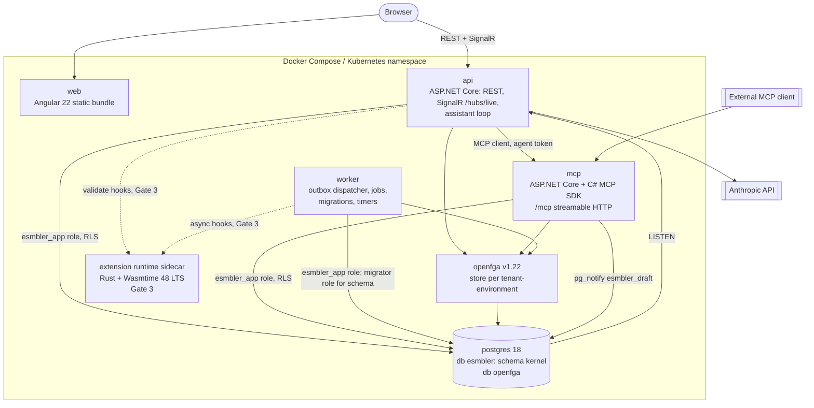
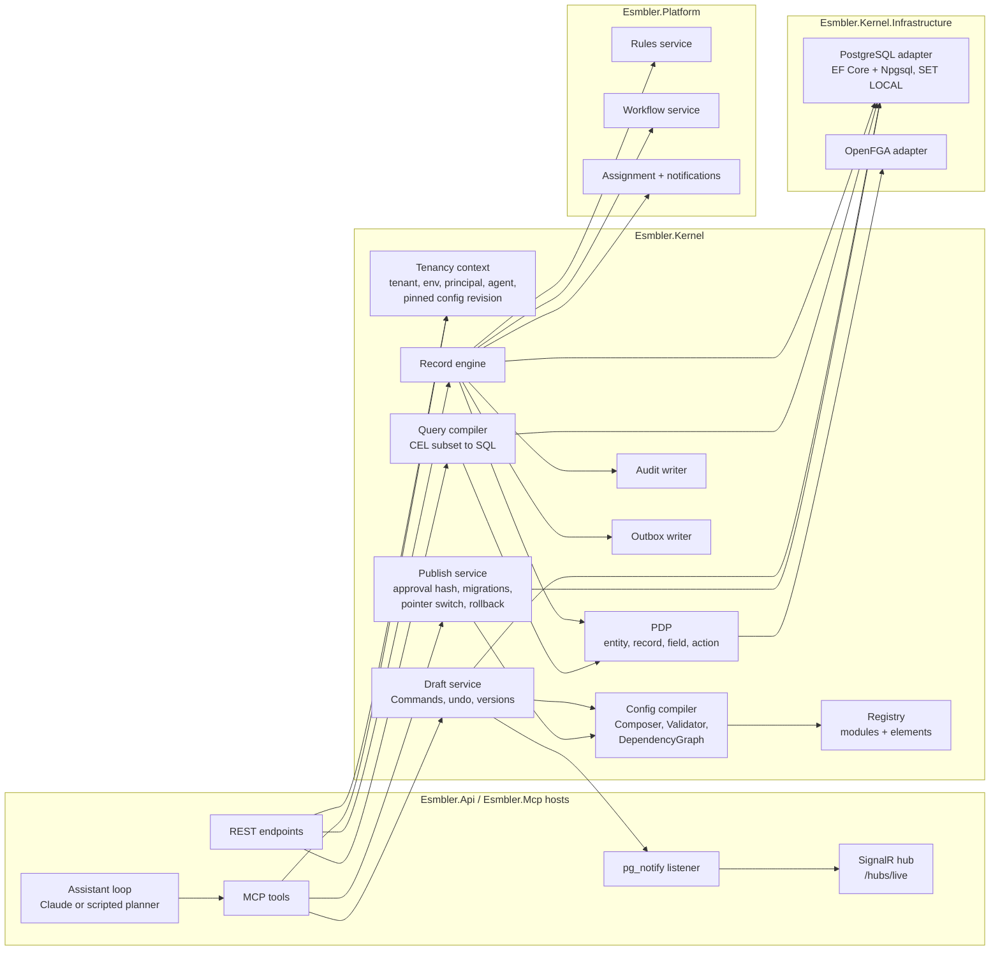
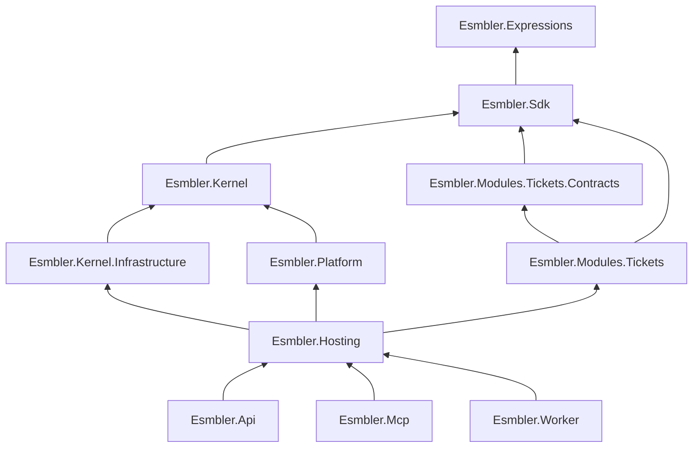
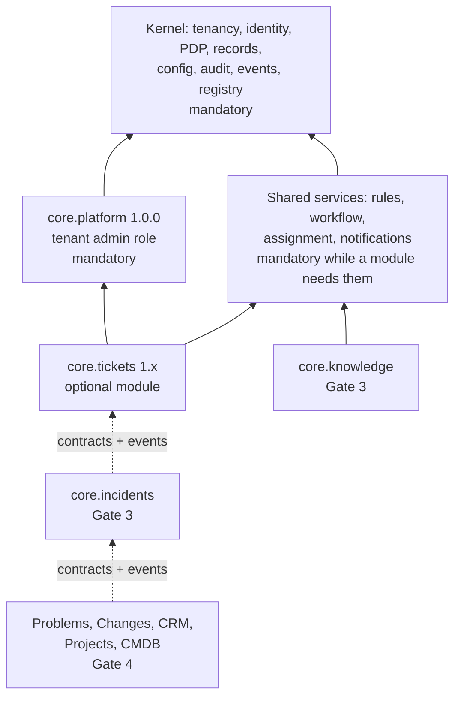

# Architecture overview

## One-page summary

Esmbler is an AI-native, composable Enterprise Service Management platform. It is a **modular monolith**: one repository and one set of .NET assemblies, deployed as a few containers that share a kernel library.

- **Kernel** (`packages/Esmbler.Kernel`): tenant/environment context, identity and authorization enforcement (the PDP), the record engine, configuration compile/draft/publish, audit, the transactional outbox and the module registry. It knows no business-module internals.
- **Shared platform services** (`packages/Esmbler.Platform`): rules, workflow state machines, assignment and notifications, plugged into kernel hooks.
- **Business modules** (`modules/*`): declarative spec releases on the public SDK (`packages/Esmbler.Sdk`). Tickets is the first. Modules never reference the kernel; architecture tests enforce this ([ADR 0012](../adr/0012-repository-layout-and-module-boundaries.md)).
- **Configuration is a compiled artifact.** Base modules plus the tenant overlay (typed operations) compile into an immutable, content-hashed `EffectiveConfig`. Each request pins one config revision ([ADR 0003](../adr/0003-configuration-artifact-and-overlay-format.md), [layered configuration](../explanation/layered-configuration.md)).
- **Storage is pooled.** One PostgreSQL 18 database, schema `kernel`, a shared `kernel.records` table with JSONB data, and RLS with `FORCE` on every tenant table ([ADR 0002](../adr/0002-storage-and-query-model.md), [ADR 0010](../adr/0010-database-migrations-and-roles.md)).
- **Authorization** is a kernel PDP over versioned permission-set specs plus OpenFGA relationship facts ([ADR 0004](../adr/0004-authorization-engine.md), [authorization model](../explanation/authorization-model.md)).
- **The AI builder** uses Esmbler's own MCP server (`apps/Esmbler.Mcp`). The in-app chat runs Claude as an MCP client with the user's delegated agent token ([ADR 0007](../adr/0007-mcp-server-design.md), [ADR 0013](../adr/0013-ai-assistant-model-adapter.md)).
- **Live editing:** every build tool writes a Command to the draft. A SignalR push lets the Angular renderer apply each change in under a second ([ADR 0008](../adr/0008-realtime-channel-for-live-editing.md)).
- **Extensions** (Gate 3) run in a Rust Wasmtime sidecar with no database credentials and no egress ([ADR 0006](../adr/0006-extension-runtime.md)).

### Invariants

1. Tenant and environment come only from the authenticated session, never from record IDs or tool arguments.
2. Every write path goes through the record engine: authorization, rules, revision check, audit and outbox in one transaction.
3. Configuration changes are typed overlay operations. The runtime only consumes validated, immutable artifacts.
4. Modules talk only through events, versioned contracts and the relationship service.
5. Hidden field values never leave the server.

## Level 1: system context


| Actor or system | Interaction | Gate |
| --- | --- | --- |
| Agents, requesters, admins | Browser UI (Angular). Dev auth uses local passwords | 1 |
| Claude (Anthropic API) | Called by the API's assistant loop. A deterministic scripted planner replaces it when `ANTHROPIC_API_KEY` is unset | 1 |
| External MCP clients | Connect to `/mcp` with an agent token minted for a user (`POST /api/auth/agent-token`) | 1 |
| Email, object storage | Behind adapters with local fakes. Gate 1 notifications go to an in-app fake outbox | 2 |
| Identity providers | Per-tenant OIDC/SAML/SCIM | 2 |
| Payment provider | Sandbox first; live credentials are a human action | 5 |

## Level 2: containers



| Container | Technology | Responsibilities | Data access |
| --- | --- | --- | --- |
| `web` | Angular 22 (standalone, signals, zoneless), Angular CDK | Shell, server-driven renderer (one component per registry element), live editing, command palette, chat panel | None directly; REST and SignalR to `api` |
| `api` | ASP.NET Core on .NET 10 | REST API (OpenAPI from code), auth endpoints, SignalR hub `/hubs/live`, assistant loop (Anthropic SDK + MCP client), `pg_notify` listener | `esmbler_app` role via kernel |
| `mcp` | ASP.NET Core + `ModelContextProtocol.AspNetCore` | Discovery, build, review, lifecycle and explain tools; resources `esmbler://registry/elements`, `esmbler://design-system/tokens`, `esmbler://app/graph`. Accepts only `esmbler-mcp` audience tokens | Same kernel services in-process, same authorization |
| `worker` | .NET generic host | Outbox dispatch (`FOR UPDATE SKIP LOCKED`, leases, backoff, dead letters), inbox dedup, data migrations, OpenFGA tuple writer, timers | `esmbler_app`; runs schema migrations as `esmbler_migrator` at startup |
| `postgres` | PostgreSQL 18 | `kernel` schema (records, audit, outbox, inbox, jobs, config artifacts, drafts, identity); separate `openfga` database | RLS with `FORCE`; runtime role is not owner and has no `BYPASSRLS` |
| `openfga` | OpenFGA v1.22 | Relationship facts: nested group membership, role assignments, agent `acts_for` | Own database; isolation by store |
| extension runtime | Rust sidecar, `wasmtime =48.0.5` (Gate 3) | Runs tenant extension components with fuel, epoch and memory limits | None: no DB or vault credentials, egress denied |

## Level 3: components inside the API and kernel



| Component | Responsibility | Key types or tables |
| --- | --- | --- |
| Tenancy context | Resolves tenant, environment, principal, agent and delegated scopes from the token. Opens every transaction with `set_config('app.tenant_id', …, true)` | `app.tenant_id`, `app.environment_id` |
| Config compiler | Composes base modules (sorted by module ID), then applies overlay ops in order. Validates against the element registry and builds the dependency graph | `Composer`, `ConfigValidator`, `DependencyGraph`, `ConfigCompiler`, `ArtifactManifest` |
| Draft service | One open draft per tenant environment. Each edit is a Command with `expectedDraftVersion`; a mismatch returns `409 draft_conflict` with a diff. Undo marks a command undone | `kernel.draft_commands`, `kernel.publish_requests` |
| Publish service | Recompiles, compares against the approved hash, runs migrations, switches `kernel.active_config` with optimistic concurrency, health-checks, keeps the previous artifact | `kernel.config_artifacts`, `kernel.active_config` |
| Record engine | Create, update, transition and soft delete. Checks revision and idempotency key, then runs PDP, rules, workflow, audit and outbox in one transaction | `kernel.records`, `kernel.audit`, `kernel.outbox` |
| Query compiler | Typed query contract to parameterized SQL over JSONB. The permission predicate is ANDed before `ORDER BY`/`LIMIT`/`COUNT` | Max page 100, 64 filter nodes, `statement_timeout` 5 s |
| PDP | Policy decisions with an explain trace. Fails closed | `IAuthorizationEngine`, `IRelationshipGraph` |
| Audit | Append-only change history with actor, agent and config revision. Runtime role has `INSERT`/`SELECT` only | `kernel.audit` |
| Outbox | Writes event envelopes in the record transaction. The worker dispatches at least once | `kernel.outbox`, `kernel.inbox`, `kernel.jobs` |
| Registry | Module releases and the element catalog. Read by the compiler, renderer and MCP | `IElementRegistry`, `IModuleDefinition` |
| Rules and workflow services | Evaluate data rules on every write path and declarative state machines in-transaction | `RuleSpec`, `WorkflowSpec` |
| SignalR hub | Group `draft:{tenant}:{env}:{draftId}`; pushes `draftChanged {draftId, version, seq, ops summary, changedTargets, view spec}` | `/hubs/live` |
| Assistant loop | Agent loop with bounded tool calls and spend. Wraps untrusted record content as data and applies field redaction before sending context | ADR 0013 |

## Key flows

### Record write (one transaction)

```mermaid
sequenceDiagram
    participant C as Client
    participant A as API
    participant K as Record engine
    participant P as PDP
    participant DB as PostgreSQL
    C->>A: PATCH /records/{id} (If-Match revision, Idempotency-Key, X-Config-Revision)
    A->>K: UpdateRecord(cmd) under pinned config revision
    K->>DB: BEGIN; set_config('app.tenant_id', ..., true)
    K->>P: can update record? fields writable?
    P-->>K: allow with trace, or deny (fail closed)
    K->>K: workflow guard, data rules, validation
    K->>DB: UPDATE kernel.records WHERE revision = expected
    K->>DB: INSERT kernel.audit
    K->>DB: INSERT kernel.outbox (record.updated envelope)
    K->>DB: COMMIT
    K-->>C: 200 with new revision (or 409 record_conflict, 422 rule errors)
```

### AI change visible on the live page

```mermaid
sequenceDiagram
    participant U as User (chat panel)
    participant L as Assistant loop (api)
    participant M as MCP server
    participant D as Draft service
    participant DB as PostgreSQL
    participant H as SignalR hub (api)
    participant R as Angular renderer
    U->>L: "Add a Vendor field to the right column"
    L->>M: tools/call add_field, insert_node
    M->>D: Command(op, expectedDraftVersion)
    D->>DB: INSERT draft_commands; bump version; pg_notify('esmbler_draft', ...)
    DB-->>H: NOTIFY delivered on commit (LISTEN)
    H-->>R: draftChanged {version, changedTargets, view spec}
    R->>R: patch node tree by ID, highlight targets
    M-->>L: tool result (summary, targets)
    L-->>U: step "Added Vendor card" linked to the node
```

The p95 target from tool completion to render is under 1 s ([REQ-LIVE-002](../spec/traceability.md)).

## Module dependency graph

### Build-time (assemblies)



Arrows point at the referenced project. The kernel uses `Esmbler.Expressions` through the SDK. These rules are enforced by `tests/Esmbler.ArchitectureTests/BoundaryTests.cs`:

- Modules reference only `Esmbler.Sdk`, `Esmbler.Expressions`, their own projects and other modules' `*.Contracts`.
- The SDK references nothing internal.
- The kernel references no platform, modules, infrastructure, Npgsql, EF Core or OpenFGA.
- The platform references no modules or infrastructure.

### Runtime (spec modules)



`core.tickets` declares `"dependencies": {"core.platform": "^1.0.0"}`. A shared service cannot be removed while an installed module depends on it.

## Transaction boundaries

| Command | Boundary | Consistency notes |
| --- | --- | --- |
| Record create, update, transition or delete | One PostgreSQL transaction: record row, audit entry and outbox event ([REQ-EVT-001](../spec/traceability.md)) | Revision check (`409 record_conflict`); idempotency key dedups retries |
| Event consumer | One transaction: inbox row `(consumer, event_id)` plus the handler's own writes | At-least-once delivery; per-record ordering by revision |
| Draft command (human or AI) | One transaction: `draft_commands` row, draft version bump and `pg_notify` | NOTIFY is delivered only on commit |
| Publish | Several steps. (1) Compile and verify the approval hash. (2) Run expand/backfill migrations as resumable jobs in batches. (3) One transaction: pointer switch with expected revision, audit, outbox `config.published` | Not one atomic distributed transaction ([REQ-CFG-007](../spec/traceability.md), [REQ-MIG-002](../spec/traceability.md)) |
| Membership and role change | PostgreSQL transaction plus outbox, then an idempotent OpenFGA writer | Revocations dispatched synchronously, with the outbox as fallback; nightly reconciliation |
| External side effects (Gate 2+) | Outside any DB transaction; provider idempotency keys or reconciliation | Never hold a transaction open on a remote call |
| Cross-module workflows (Gate 4) | Sagas with compensation over events | No cross-module transaction |

## Configuration revisions and caches

- Clients send `X-Config-Revision`. A write under an incompatible older revision returns `409 config_conflict` with reload instructions ([REQ-CFG-008](../spec/traceability.md)).
- Caches are keyed by `(tenant, environment, config revision)` or `(store, principal, authz_revision)`. No cache key omits the tenant ([REQ-TEN-002](../spec/traceability.md)).
- Active workflow instances pin their definition version. Authorization always uses current access rules.

## Service extraction path

Module boundaries keep extraction possible, but it is engineering work, not a switch.

| Concern | Today (monolith) | After extracting module X |
| --- | --- | --- |
| Code | X references only the SDK and Contracts | Unchanged; X moves to its own host |
| Data | X's records live in `kernel.records` under X's entity IDs | X keeps calling the record engine through a remote record API, or gets its own database plus a kernel adapter (larger change) |
| Events | Worker dispatches from the outbox in-process | An outbox relay publishes to a broker; X consumes with its own inbox |
| Contracts | In-process calls to `*.Contracts` | HTTP or gRPC with the same versioned contract |
| Authorization | In-process PDP | PDP library plus OpenFGA access, or a PDP sidecar |
| Configuration | Shared compiled artifact | X reads the artifact by revision (immutable, cacheable) |
| Transactions | Already no cross-module transactions | Unchanged; sagas already required |

Costs to plan for: a network hop on the record write path, broker operations, distributed tracing, and RLS in a second database.

## Deployment

- `docker compose up` starts web, api, mcp, worker, postgres and openfga with seed data: tenants `acme` and `globex`, environments `prod` and `sandbox` ([REQ-OPS-006](../spec/traceability.md)).
- Kubernetes manifests are provided but not exercised in CI ([assumptions](../decisions/assumptions.md)).
- Images: one per deployable. The extension runtime is added in Gate 3.

## Related documents

- [Threat model](../security/threat-model.md)
- [Tickets module architecture](modules/tickets.md)
- [Element registry schema](../reference/element-registry-schema.md)
- [Design principles](../explanation/design-principles.md)
- [Acceptance plan](../testing/acceptance-plan.md)
