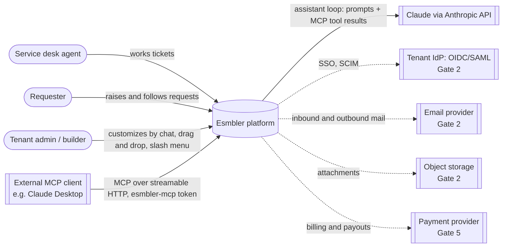
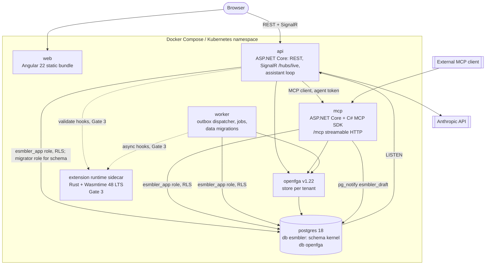
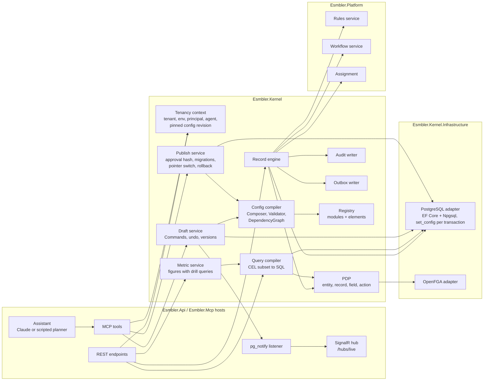
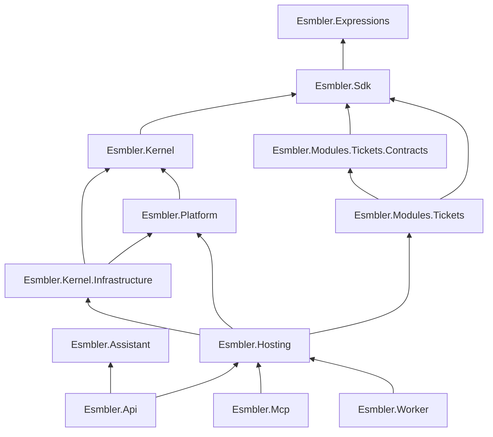
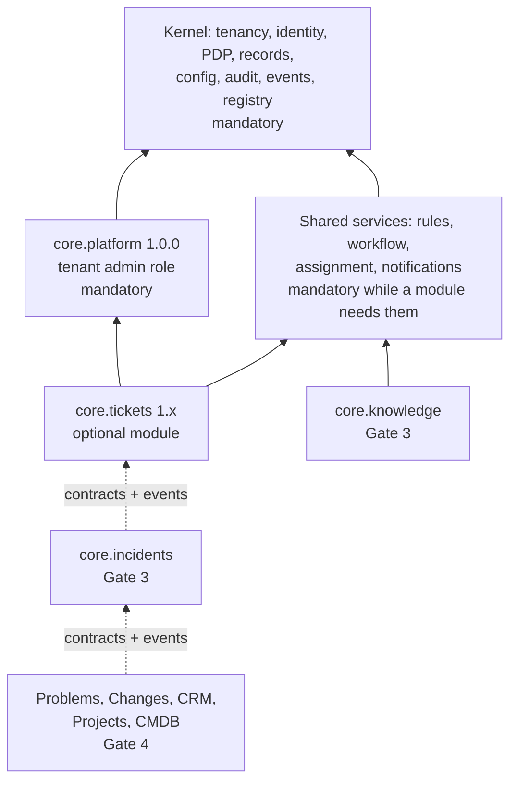

# Architecture overview

## One-page summary

Esmbler is an AI-native, composable Enterprise Service Management platform. It is a **modular monolith**: one repository and one set of .NET assemblies, deployed as a few containers that share a kernel library.

- **Kernel** (`packages/Esmbler.Kernel`, pure logic) and its adapters (`packages/Esmbler.Kernel.Infrastructure`: PostgreSQL, OpenFGA): tenant/environment context, identity and authorization enforcement (the PDP), the record engine, configuration compile/draft/publish, audit, the transactional outbox and the module registry. It knows no business-module internals.
- **Shared platform services** (`packages/Esmbler.Platform`): workflow (hook order 100), catalog requests (`RequestHook`, 150), assignment (200) and rules (300), plugged into the kernel's `IRecordWriteHook`. The notification service (`SubscriptionRouter` and the `notify.resolve` and `notify.deliver` jobs, [ADR 0021](../adr/0021-notification-routing-and-delivery.md)), the alert service (`AlertRouter` and the `alert.evaluate` and `alert.escalate` jobs, [ADR 0022](../adr/0022-alerts-and-audit-policy.md)), legacy in-app templates, request fulfillment and approvals are event consumers in `Esmbler.Kernel.Infrastructure` (`SubscriptionRouter`, `AlertRouter`, `NotificationConsumer`, `FulfillmentConsumer`, `ApprovalConsumer`); approval decisions go through `ApprovalService`.
- **Business modules** (`modules/*`): declarative spec releases on the public SDK (`packages/Esmbler.Sdk`). Tickets is the first. Modules never reference the kernel; architecture tests enforce this ([ADR 0012](../adr/0012-repository-layout-and-module-boundaries.md)).
- **Configuration is a compiled artifact.** Base modules plus the tenant overlay (typed operations) compile into an immutable, content-hashed `EffectiveConfig`. Each request pins one config revision ([ADR 0003](../adr/0003-configuration-artifact-and-overlay-format.md), [layered configuration](../explanation/layered-configuration.md)).
- **Storage is pooled.** One PostgreSQL 18 database, schema `kernel`, a shared `kernel.records` table with JSONB data, and RLS with `FORCE` on every tenant table ([ADR 0002](../adr/0002-storage-and-query-model.md), [ADR 0010](../adr/0010-database-migrations-and-roles.md)).
- **Authorization** is a kernel PDP over versioned permission-set specs plus OpenFGA relationship facts ([ADR 0004](../adr/0004-authorization-engine.md), [authorization model](../explanation/authorization-model.md)).
- **The AI builder** uses Esmbler's own MCP server (`apps/Esmbler.Mcp`). The in-app chat (`packages/Esmbler.Assistant`, run by the API) drives Claude, or a deterministic scripted planner without an API key, as an MCP client with the user's delegated agent token ([ADR 0007](../adr/0007-mcp-server-design.md), [ADR 0013](../adr/0013-ai-assistant-model-adapter.md)).
- **Live editing:** every build tool writes a Command to the draft. A SignalR push lets the Angular renderer show each change in under a second (measured p95 about 390 ms) ([ADR 0008](../adr/0008-realtime-channel-for-live-editing.md)).
- **Extensions** (Gate 3) run in a Rust Wasmtime sidecar with no database credentials and no egress ([ADR 0006](../adr/0006-extension-runtime.md)).

### Build status

Gate 1 (architecture proof) is implemented: REST API, record engine, drafts and publish with activation health checks and rollback, module upgrades with resumable data migrations, the worker (outbox dispatcher, job runner, notifications), the MCP server and its tools, the SignalR live channel, the AI assistant (Claude or scripted planner) and the Angular renderer with live draft mode. Gate 2 has added durable jobs and timers (G2-M1), service requests with versioned workflows (G2-M2, [ADR 0015](../adr/0015-requests-catalog-fulfillment-and-workflow-versions.md)), approvals (G2-M3, [ADR 0016](../adr/0016-approvals.md)), the event platform v2 (G2-M17, [ADR 0017](../adr/0017-event-audit-alert-notification-services.md)), SLAs and business hours (G2-M4, [ADR 0018](../adr/0018-sla-and-business-hours.md)), metrics, dashboards and the connected explorer (G2-M9, [ADR 0019](../adr/0019-metrics-dashboards-and-connected-explorer.md)) guided workspace creation (G2-M9b, [ADR 0020](../adr/0020-self-service-workspace-creation.md)) the notification service (G2-M18, [ADR 0021](../adr/0021-notification-routing-and-delivery.md)), alerts and the audit policy (G2-M19, [ADR 0022](../adr/0022-alerts-and-audit-policy.md)) and email intake (G2-M5, [ADR 0023](../adr/0023-email-intake.md)). Migrations are `0001_kernel.sql` to `0018_mail_intake.sql`. What is not built yet is listed in [progress](../progress.md) and [known issues](../known-issues.md). The diagrams below show the Gate 1 system; Gate 2+ elements are labeled.

### Invariants

1. Tenant and environment come only from the authenticated session, never from record IDs or tool arguments.
2. Every write path goes through the record engine: authorization, rules, revision check, audit and outbox in one transaction.
3. Configuration changes are typed overlay operations. The runtime only consumes validated, immutable artifacts.
4. Modules talk only through events, versioned contracts and the relationship service.
5. Hidden field values never leave the server.

## Level 1: system context



| Actor or system | Interaction | Gate |
| --- | --- | --- |
| Agents, requesters, admins | Browser UI (Angular). Dev auth uses local passwords | 1 |
| Claude (Anthropic API) | Called by the API's assistant loop. A deterministic scripted planner replaces it when no API key is configured (`ANTHROPIC_API_KEY`, mapped to `Esmbler__Assistant__AnthropicApiKey`) | 1 |
| External MCP clients | Connect to `/mcp` with an agent token minted for a user (`POST /api/auth/agent-token`) | 1 |
| Email, object storage | Behind adapters with local fakes. Notification email goes through an SMTP adapter and SMS through a Twilio-style HTTPS adapter, both only to operator allow-listed hosts and in capture mode until a person turns a channel live ([ADR 0021](../adr/0021-notification-routing-and-delivery.md)). Inbound email arrives through a webhook with a per-mailbox token or by IMAP polling from allow-listed servers ([ADR 0023](../adr/0023-email-intake.md)); object storage comes later | 2 |
| Identity providers | Per-tenant OIDC/SAML/SCIM | 2 |
| Payment provider | Sandbox first; live credentials are a human action | 5 |

## Level 2: containers



| Container | Technology | Responsibilities | Data access |
| --- | --- | --- | --- |
| `web` | Angular 22 (standalone, signals, zoneless), Angular CDK | Shell, server-driven renderer (one component per registry element), live editing, command palette, chat panel | None directly; REST and SignalR to `api` |
| `api` | ASP.NET Core on .NET 10 | REST API (OpenAPI from code), auth endpoints, SignalR hub `/hubs/live`, assistant (`Esmbler.Assistant`: Anthropic SDK + MCP client), `DraftNotificationListener` (`LISTEN esmbler_draft`); the inbound mail webhook `POST /api/mail/inbound` (no session, mailbox token, rate limited); `/health/live`, `/health/ready` | `esmbler_app` role via kernel; runs schema migrations as `esmbler_migrator` at startup (`Esmbler:MigrateOnStartup`) or with the `migrate` argument |
| `mcp` | ASP.NET Core + `ModelContextProtocol.AspNetCore` | Discovery, build, review, lifecycle and explain tools; resources `esmbler://registry/elements`, `esmbler://design-system/tokens`, `esmbler://app/graph`. Accepts only `esmbler-mcp` audience tokens | Same kernel services in-process, same authorization |
| `worker` | .NET generic host | Outbox and job dispatch through `kernel.claim_outbox` / `kernel.claim_jobs` (`FOR UPDATE SKIP LOCKED`, leases, backoff, dead letters), one transaction per consumer and event with per-consumer dead letters, outbox retention (`kernel.purge_outbox`), inbox dedup, record projection, notifications (`SubscriptionRouter`, legacy `NotificationConsumer`), request fulfillment (`FulfillmentConsumer`), starting and cancelling approvals (`ApprovalConsumer`), durable jobs and timers: module-upgrade data migrations (`upgrade.run`), workflow instance migration (`workflow.migrate`), approval stage expiry (`approval.expire`), SLA warning and breach checks (`sla.check`), notification resolution and delivery (`notify.resolve`, `notify.deliver`, the only outbound calls: SMTP and SMS providers on the allow-lists), alerts (`AlertRouter`, `alert.evaluate`, `alert.escalate`), inbound mail processing (`mail.process`) and IMAP polling of allow-listed servers (`ImapPollingService`, every minute, through `kernel.mail_inboxes_due`), and `AuditMaintenanceService`: sealing the audit hash chain every 10 s, verifying chains daily and retention hourly through the definer functions `kernel.seal_audit`, `kernel.verify_audit_chain`, `kernel.audit_verification_due`, `kernel.purge_retention` and `kernel.purge_inbound_mail` | `esmbler_app` only |
| `postgres` | PostgreSQL 18 | Database `esmbler`: `kernel` schema (records, audit log, outbox, inbox, jobs, config artifacts, drafts, workflow definitions, approvals, SLA timers, notification channels, deliveries and preferences, alerts, audit chain heads, audit policies and legal holds, mailboxes and inbound messages, identity) and `esmbler_meta.schema_migrations` (migrations up to `0018_mail_intake.sql`); separate `openfga` database. Roles from `deploy/postgres/00-roles.sh` | RLS with `FORCE`; runtime role is not owner and has no `BYPASSRLS` |
| `openfga` | OpenFGA v1.22 | Relationship facts: nested group membership, role assignments, agent `acts_for`. A derived index of `kernel.group_members` / `kernel.role_assignments`, one store per tenant | Own database (`openfga`, role `esmbler_openfga`); isolation by store |
| extension runtime | Rust sidecar, `wasmtime =48.0.5` (Gate 3) | Runs tenant extension components with fuel, epoch and memory limits | None: no DB or vault credentials, egress denied |

## Level 3: components inside the API and kernel



| Component | Responsibility | Key types or tables |
| --- | --- | --- |
| Tenancy context | Resolves tenant, environment, principal, agent and delegated scopes from the token. `Database.InTenantAsync` opens every transaction with `set_config('app.tenant_id', …, true)` | `RequestContext`, `Database`; `app.tenant_id`, `app.environment_id`, `app.principal_id` |
| Config compiler | Composes base modules (sorted by module ID), then applies overlay ops in order. Validates against the element registry and builds the dependency graph | `Composer`, `ConfigValidator`, `DependencyGraph`, `ConfigCompiler`, `ArtifactManifest` |
| Draft service | One open draft per tenant environment. Each edit is a Command with the expected draft version; a mismatch returns `409 draft_conflict` with the steps since. Undo marks a command undone (refused when later steps depend on it). Commands applied by one request share a batch: applied whole or not at all, one version (REQ-WS-005); one step can be undone alone, or the whole batch with `wholeChange` (REQ-LIVE-003). Undoing or redoing any step of a batch that contains a permission-affecting op needs `permissions.admin`, so such a change is never split by someone without it | `kernel.drafts` (partial unique index `drafts_one_open`), `kernel.draft_commands` (`batch_id`), `kernel.publish_requests`; `DraftService.ApplyBatchAsync` |
| Publish, activation and upgrade services | Recompile and compare the reviewed hash; switch `kernel.active_config` with optimistic concurrency and run `ActivationHealthCheck` in the same transaction (a failure rolls back); roll back to an earlier revision as a new one; module upgrades run checkpointed data migrations before the switch | `PublishService`, `ConfigActivator`, `UpgradeService`, `MigrationExecutor`; `kernel.config_artifacts`, `kernel.active_config` |
| Record engine | Create, update, transition, soft delete and restore (30 days). Checks revision and idempotency key, then runs PDP, the write pipeline (field permissions, normalization, defaults, hooks, required checks), audit and outbox in one transaction | `RecordWriteEngine`, `IRecordWriteHook`; `kernel.records`, `kernel.record_sequences`, `kernel.idempotency_keys`, `kernel.audit_log`, `kernel.outbox` |
| Query compiler | Typed query contract to parameterized SQL over JSONB. The permission predicate is ANDed before `ORDER BY`/`LIMIT`/`COUNT`; filtering on hidden fields is rejected. `QueryCompiler.Where` is the one WHERE clause for lists, explorer group counts and metrics, so a figure equals the list it drills into; it also compiles SLA breach conditions (`EXISTS` over `kernel.sla_timers`) and explorer grouping | `QueryCompiler`: max page 100, offset ≤ 10,000, 64 filter nodes, at most 20 filters a request, counts capped at 10,000; `statement_timeout` 5 s |
| PDP | Policy decisions with an explain trace. Fails closed. Record relations come from the entity's access fields: `user` and `group` fields hold one ID, a `principals` field (the platform-maintained approvers list) matches when it contains the caller or one of their groups, in the PDP and in the SQL list filter (`?\|`). Facts cached 5 s per `(tenant, principal, authz_revision)`; sensitive actions read fresh | `EffectivePermissions`, `AccessService`, `AuthzFactsCache`, `IRelationshipGraph` |
| Audit | Append-only change history with actor, agent and config revision, written in the acting transaction. Runtime role has column-level `INSERT` (not the chain columns) and `SELECT` only; a guard trigger makes sealed rows immutable. The worker seals rows into one SHA-256 chain per workspace, verifies it daily and applies retention by policy (365 to 3,650 days) unless a legal hold is active. REST `/api/admin/audit` (search with `audit.read`; export with `audit.export`, audited, 2 a minute; details redacted for viewers without `permissions.admin`, JSON Lines only for them; chain status, verify now, retention and holds with `audit.manage`); agents are refused ([ADR 0022](../adr/0022-alerts-and-audit-policy.md)) | `AuditWriter`, `AuditService`, `AuditMaintenance`, `AuditMaintenanceService`; `kernel.audit_log`, `kernel.audit_chain_heads`, `kernel.audit_policies`, `kernel.legal_holds` (migrations 0016 and 0017) |
| Outbox and events | Writes event envelopes (v2: source, type version, severity, sensitivity, trace context) in the caller's transaction through `EventWriter`. Modules declare event types (`eventTypes`) and publish them from transitions (`emits`) and edge-triggered `emit_event` rule actions; platform services publish `platform.*` events. The worker dispatches at least once, per consumer, and purges dispatched events after 14 days ([ADR 0017](../adr/0017-event-audit-alert-notification-services.md)) | `EventWriter`, `EventEmission`, `OutboxDispatcher`, `EventTypeSpec`; `kernel.outbox`, `kernel.inbox`, `kernel.consumer_failures`, `kernel.record_projections`, `kernel.jobs` |
| Registry | Module releases and the element catalog. Read by the compiler, renderer and MCP | `IElementRegistry`, `IModuleDefinition` |
| Rules and workflow services | Evaluate data rules on every write path and declarative state machines in-transaction. Records are pinned to the workflow definition version they started on; transitions use the pinned version, rules and permissions the current configuration | `WorkflowHook`, `AssignmentHook`, `RulesHook`, `WorkflowVersions`; `RuleSpec`, `WorkflowSpec`; `kernel.workflow_definitions`, `kernel.records.workflow_version` |
| Requests and fulfillment | Validates catalog requests and their typed variables on every write path; `GET /api/catalog` lists the items a person may request; an event consumer creates, releases and cancels fulfillment tasks and completes the request ([ADR 0015](../adr/0015-requests-catalog-fulfillment-and-workflow-versions.md)) | `RequestHook`, `FulfillmentConsumer`, `ExperienceService.CatalogAsync`; `CatalogItemSpec`, `RequestBindingSpec` |
| Approvals | Starts an approval when a request whose catalog item names a policy is created, runs stages in order from a pinned policy snapshot, records human decisions (approver or active delegate, never the requester, never an AI agent), escalates or declines on expiry, and drives the request through the binding's system transitions. Approvers read the request through its `principals` access field. REST: `/api/approvals` (inbox, count, decisions, delegations) and `GET /api/records/{entity}/{id}/approvals` ([ADR 0016](../adr/0016-approvals.md)) | `ApprovalService`, `ApprovalConsumer`, `ApprovalExpiryJobHandler` (`approval.expire`), `RequestHook` (`approval_required`); `ApprovalPolicySpec`, `ApprovalBindingSpec`; `kernel.approvals`, `kernel.approval_steps`, `kernel.approval_delegations` |
| SLAs and business hours | Business calendars (IANA time zone, local working hours, holidays) and SLA policies (targets with start, pause, stop and reopen conditions, goals by condition in business or elapsed time). Timers change in every record write transaction, keep a snapshot of target, goal and calendar, and a durable check per running timer publishes `platform.sla.warning` and `platform.sla.breached`. REST: `GET /api/records/{entity}/{id}/sla` ([ADR 0018](../adr/0018-sla-and-business-hours.md)) | `BusinessTime`, `SlaEngine`, `SlaService`, `SlaCheckJobHandler` (`sla.check`); `BusinessCalendarSpec`, `SlaPolicySpec`; `kernel.sla_timers` |
| Metrics and dashboards | Metric definitions are spec objects (filter, measure, groups, rolling date range, SLA breach condition, roles). `MetricService` evaluates them for the viewer through `QueryCompiler.Where`, each figure in a savepoint with a 5 s timeout (up to 12 a dashboard, about 8 s overall), and returns the drill query each figure, bar and row counted. Figures the viewer may not see are removed, never widened. The metric endpoints are rate limited per person. Dashboards are views of kind `dashboard`. REST: `GET /api/dashboards/{view}/data`, `GET /api/metrics/{id}`, `GET /api/records/{entity}/groups` ([ADR 0019](../adr/0019-metrics-dashboards-and-connected-explorer.md)) | `MetricService`, `DateBuckets`, `QueryFilterSupport`, `ConfigValidator.ValidateMetric`; `MetricSpec`, `ViewKinds.Dashboard`; elements `display.kpi_tile`, `display.bar_chart`, `display.metric_table` |
| Workspace creation | Lists the starters modules declare, with the surfaces their latest release generates, and creates a workspace from one: the tenant row through `kernel.create_workspace` (enabled people only, per-person limit under an advisory lock, inserted as `provisioning`; migrations `0012_workspace_creation.sql` and `0013_workspace_provisioning_state.sql`), teams named from the answers, the creator as tenant administrator, the latest release installed without sample data, audit `workspace.create`, then `kernel.activate_workspace` makes it active and visible. Off unless an operator sets `Esmbler:AllowWorkspaceCreation`; agents are refused; its own per-person rate limit (`workspaces`, 3 a minute). While a viewer can see no records of a dashboard's entity, `MetricService` returns labeled preview figures with no drill (the emptiness check runs within the dashboard's request budget in a savepoint; on timeout the real figures are shown). REST: `GET /api/starters`, `POST /api/workspaces` ([ADR 0020](../adr/0020-self-service-workspace-creation.md)) | `WorkspaceService`, `WorkspaceCreationPolicy`, `ProvisioningService`, `StarterSpec`; `kernel.tenants.created_by` and `status`; `DashboardData.Empty`, `MetricResult.Preview` |
| Notifications | Subscriptions match events and schedule a durable `notify.resolve` job; it applies the subscription's routes (mandatory, then tenant, then module), their profiles and people's mutes, renders the template once per recipient under their permissions (external recipients see only allowed fields of public events) and stores one delivery per recipient and channel with the idempotency key event:who:channel; `notify.deliver` writes the inbox or calls the channel adapter of the environment's channel instance (live, capture or disabled) with rate limits, retries and ambiguous outcomes. REST `/api/me/notifications`, `/api/me/notification-preferences`, `/api/admin/notifications`; legacy templates with their own trigger still go through `NotificationConsumer` ([ADR 0021](../adr/0021-notification-routing-and-delivery.md)) | `SubscriptionRouter`, `NotifyResolveJobHandler`, `NotifyDeliverJobHandler`, `NotificationRenderer`, `NotificationService`, `INotificationChannel` (`SmtpEmailChannel`, `HttpSmsChannel`), `ISecretStore`; `SubscriptionSpec`, `NotificationRouteSpec`, `NotificationProfileSpec`, `NotificationTemplateSpec`; `kernel.notifications`, `kernel.notification_channels`, `kernel.notification_deliveries`, `kernel.notification_delivery_attempts`, `kernel.notification_preferences` |
| Alerts | Alert rules on `alert` subscriptions raise alerts in a durable `alert.evaluate` job: one active alert per rule and key (unique index), occurrences, maintenance windows, cool-down reopen, auto-resolve by record or key; `alert.escalate` raises the level on timers until acknowledged. Alerts only publish `platform.alert.*` events about the subject record; routes with `alert_owner` recipients tell people. Owners, the assignee and `alerts.respond` see and answer alerts, each view needs read access to the record, and agents never act. REST `/api/alerts`, `/api/admin/alerts/suppressions` ([ADR 0022](../adr/0022-alerts-and-audit-policy.md)) | `AlertRouter`, `AlertEvaluateJobHandler`, `AlertEscalateJobHandler`, `AlertService`, `AlertLifecycle`; `AlertRuleSpec`; `kernel.alerts`, `kernel.alert_activity`, `kernel.alert_suppressions` (migration 0015) |
| Email intake | Mail intakes (module spec objects) say what a message to a mailbox creates. Mailboxes are environment settings (webhook token stored as a hash, or an allow-listed IMAP server with secret references). Each message is stored once per mailbox and Message-ID and processed by a durable `mail.process` job: guards (own mail, RFC 3834 automatic mail, per-sender cap, sender verification through the trusted server's `Authentication-Results`, membership), then threading (delivery Message-ID, inbound Message-ID, `[NUMBER]`) and a write as the sender through `RecordService`; doubtful mail waits at `/mail` for people who work the entity. Outbound email carries Message-ID, References, Reply-To and `Auto-Submitted`; `{{activity.body}}` shows public replies only. REST `/api/mail/inbound`, `/api/mail/messages`, `/api/admin/mail/inboxes`, `/api/admin/mail/intakes` ([ADR 0023](../adr/0023-email-intake.md)) | `MailIntakeService`, `MailProcessJobHandler`, `MailParser`, `MailGuard`, `MailThreading`, `ImapPoller`; `MailIntakeSpec`; `kernel.mail_inboxes`, `kernel.inbound_messages` (migration 0018) |
| SignalR hub | Group `draft:{tenant}:{env}` (builders only, joined with `WatchDraft`); pushes `draftChanged {d, v, s, k, targets, agent, at}` with IDs only, and the client reloads. Group `user:{principal}` carries `assistantEvent` progress | `LiveHub`, `DraftNotificationListener` |
| Assistant | Planner loop with bounded tool calls, model requests and time; acts only through MCP with a builder-scoped agent token; record text from tools arrives wrapped as `untrusted_data` | `IPlanner`, `ClaudePlanner`, `ScriptedPlanner`, `McpToolGateway`, `AssistantService` ([ADR 0013](../adr/0013-ai-assistant-model-adapter.md)) |

## Key flows

### Record write (one transaction)

```mermaid
sequenceDiagram
    participant C as Client
    participant A as API
    participant K as Record engine
    participant P as PDP
    participant DB as PostgreSQL
    C->>A: PATCH /api/records/{entity}/{id} {revision, changes, configRevision} + Idempotency-Key
    A->>K: UpdateRecord(cmd) under pinned config revision
    K->>DB: BEGIN; set_config('app.tenant_id', ..., true)
    K->>P: can update record? fields writable?
    P-->>K: allow with trace, or deny (fail closed)
    K->>K: workflow guard, data rules, validation
    K->>DB: UPDATE kernel.records WHERE revision = expected
    K->>DB: INSERT kernel.audit_log
    K->>DB: INSERT kernel.outbox (record.updated envelope)
    K->>DB: COMMIT
    K-->>C: 200 with new revision (or 409 record_conflict, 422 rule errors)
```

### AI change visible on the live page

```mermaid
sequenceDiagram
    participant U as User (chat panel)
    participant L as Assistant loop (api)
    participant M as MCP server
    participant D as Draft service
    participant DB as PostgreSQL
    participant H as SignalR hub (api)
    participant R as Angular renderer
    U->>L: "Add a Vendor field to the Classification card"
    L->>M: tools/call add_field (place_in_view_node)
    M->>D: Command(op, expected_version)
    D->>DB: INSERT draft_commands; bump version; pg_notify('esmbler_draft', ids)
    DB-->>H: NOTIFY delivered on commit (DraftNotificationListener)
    H-->>R: draftChanged {v, s, targets, at}
    R->>R: reload draft and view, patch node tree by ID, highlight targets
    M-->>L: tool result (summary, targets)
    L-->>U: step "Added Vendor card" linked to the node
```

The p95 target from tool completion to render is under 1 s ([REQ-LIVE-002](../spec/traceability.md)); `tests/e2e/specs/experience.spec.ts` measured about 390 ms p95 over 20 samples, and about 650 ms p50 from prompt to previewed draft.

### Inbound email

A message reaches `POST /api/mail/inbound` (API) or the IMAP poller (worker), is stored once in `kernel.inbound_messages` with a `mail.process` job in the same transaction, and the job writes the record or reply as the sender through the record write path above, so rules, permissions, audit and events apply as for any write. The full sequence and the guards are in [ADR 0023](../adr/0023-email-intake.md#receiving).

## Module dependency graph

### Build-time (assemblies)



Arrows point at the referenced project. The kernel uses `Esmbler.Expressions` through the SDK. These rules are enforced by `tests/Esmbler.ArchitectureTests/BoundaryTests.cs`:

- Modules reference only `Esmbler.Sdk`, `Esmbler.Expressions`, their own projects and other modules' `*.Contracts`.
- The SDK references nothing internal.
- The kernel references no platform, modules, infrastructure, Npgsql, EF Core or OpenFGA.
- The platform references no modules or infrastructure.
- The assistant references no kernel, platform, infrastructure, hosting, SDK or module assembly: it acts only through MCP.

### Runtime (spec modules)



`core.tickets` declares `"dependencies": {"core.platform": "^1.0.0"}`. A shared service cannot be removed while an installed module depends on it.

## Transaction boundaries

| Command | Boundary | Consistency notes |
| --- | --- | --- |
| Record create, update, transition or delete | One PostgreSQL transaction: record row, audit entry and outbox event ([REQ-EVT-001](../spec/traceability.md)) | Revision check (`409 record_conflict`); idempotency key dedups retries |
| Event consumer | One transaction per consumer and event: inbox row `(consumer, event_id)` plus the handler's own writes; a failure is recorded in `kernel.consumer_failures` and retried for that consumer alone | At-least-once delivery; per-record ordering by revision; one failing consumer never holds back another ([ADR 0017](../adr/0017-event-audit-alert-notification-services.md)) |
| Approval decision, expiry or cancellation | One transaction that first locks the request row (`SELECT … FOR UPDATE`): step update, audit, the next stage's steps or the finishing system transition (with its outbox event) | Decisions, expiry, cancellation and fulfillment on one request serialize; starting an approval is eventually consistent, like fulfillment ([ADR 0016](../adr/0016-approvals.md)) |
| Draft command (human or AI) | One transaction: `draft_commands` row, draft version bump and `pg_notify` | NOTIFY is delivered only on commit |
| Publish | One transaction: recompile and verify the reviewed hash, pointer switch with expected revision, audit, outbox `config.published`, activation health check (failure rolls back). Module upgrades first run expand/backfill migrations as a resumable job in checkpointed batches, then activate the same way | Not one atomic distributed transaction ([REQ-CFG-007](../spec/traceability.md), [REQ-MIG-002](../spec/traceability.md)) |
| Membership and role change | `kernel.group_members` / `kernel.role_assignments` (system of record) and an idempotent OpenFGA write; the `authz_revision` trigger bumps in the same transaction | Revocations written to OpenFGA before commit; grants after commit. Outbox retry for failed grant writes and scheduled reconciliation are not built yet |
| External side effects (Gate 2+) | Outside any DB transaction; provider idempotency keys or reconciliation | Never hold a transaction open on a remote call |
| Cross-module workflows (Gate 4) | Sagas with compensation over events | No cross-module transaction |

## Configuration revisions and caches

- Record writes send `configRevision`. A write under an incompatible older revision returns `409 config_conflict` with reload instructions ([REQ-CFG-008](../spec/traceability.md)).
- Active artifacts are cached by `(tenant, environment, revision)`; authorization facts by `(tenant, principal)` with `authz_revision` and a 5 s lifetime. No cache key omits the tenant ([REQ-TEN-002](../spec/traceability.md)).
- Active workflow instances pin their definition version. Authorization always uses current access rules.

## Service extraction path

Module boundaries keep extraction possible, but it is engineering work, not a switch.

| Concern | Today (monolith) | After extracting module X |
| --- | --- | --- |
| Code | X references only the SDK and Contracts | Unchanged; X moves to its own host |
| Data | X's records live in `kernel.records` under X's entity IDs | X keeps calling the record engine through a remote record API, or gets its own database plus a kernel adapter (larger change) |
| Events | Worker dispatches from the outbox in-process | An outbox relay publishes to a broker; X consumes with its own inbox |
| Contracts | In-process calls to `*.Contracts` | HTTP or gRPC with the same versioned contract |
| Authorization | In-process PDP | PDP library plus OpenFGA access, or a PDP sidecar |
| Configuration | Shared compiled artifact | X reads the artifact by revision (immutable, cacheable) |
| Transactions | Already no cross-module transactions | Unchanged; sagas already required |

Costs to plan for: a network hop on the record write path, broker operations, distributed tracing, and RLS in a second database.

## Deployment

- `docker compose -f deploy/docker-compose.yml up --build` starts postgres, openfga (after `openfga-migrate`), api, mcp, worker and web. Ports: web 8080, API 5080, MCP 5090 (`/mcp`), OpenFGA 8081, Postgres 55432. Compose sets `Esmbler__SeedDemoData=true`, so the API seeds demo tenants `acme` and `globex` (environments `prod` and `sandbox`) with sample tickets on first start ([REQ-OPS-006](../spec/traceability.md)). The browser reaches the API through the web container's nginx (`/api`, `/hubs`).
- Images: one per deployable. `deploy/docker/dotnet.Dockerfile` builds each .NET host (`APP` = `Esmbler.Api`, `Esmbler.Mcp` or `Esmbler.Worker`); `deploy/docker/web.Dockerfile` builds the Angular bundle served by nginx. Health checks run `dotnet <Host>.dll healthcheck <path>`, so runtime images need no curl. The extension runtime is added in Gate 3.
- Kubernetes manifests are planned and will not be exercised in CI at first ([assumptions](../decisions/assumptions.md)).

## Related documents

- [Threat model](../security/threat-model.md)
- [Tickets module architecture](modules/tickets.md)
- [Element registry schema](../reference/element-registry-schema.md)
- [Design principles](../explanation/design-principles.md)
- [Acceptance plan](../testing/acceptance-plan.md)
