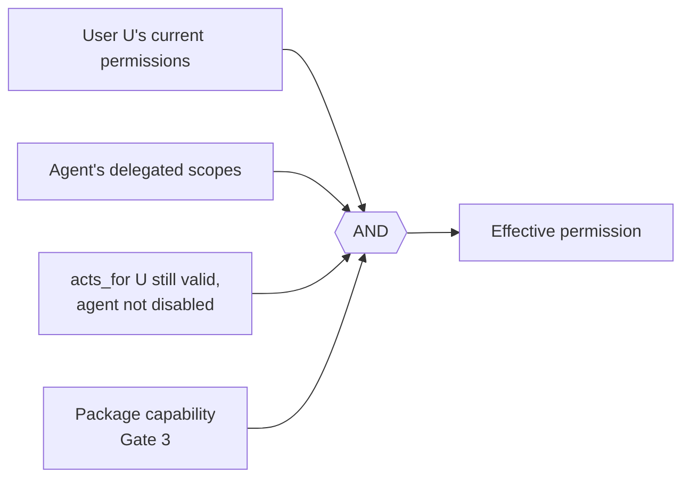

# Authorization model

## In one paragraph

Every request is decided by the kernel's **policy decision point (PDP)**, which combines two sources:

- **Tenant policy:** versioned permission-set specs, customized through the same overlay, draft and rollback flow as all other configuration ([REQ-AUTHZ-003](../spec/traceability.md)).
- **Relationship facts in OpenFGA:** nested group membership, role assignments and agent delegation, in one store per tenant (identity is tenant-wide). The kernel tables `kernel.group_members` and `kernel.role_assignments` are the system of record; the store is a derived index that can be rebuilt from them.

Record attributes such as requester, assignee and owner group stay on the record row; they are matched in-process (or sent to OpenFGA as contextual tuples), so they are never dual-written. Lists are pre-filtered in SQL. AI agents get the intersection of the user's permissions and the agent's delegated scopes. When authorization cannot be established, the answer is deny. The decision and spike evidence are in [ADR 0004](../adr/0004-authorization-engine.md).

## Principals

| Principal | Source | Notes |
| --- | --- | --- |
| User | Global `kernel.principals` table plus a row in `kernel.memberships` | A person may belong to several tenants and switches explicitly ([ADR 0011](../adr/0011-identity-and-development-authentication.md)) |
| Group | Tenant-wide identity data (`kernel.groups`, `kernel.group_members`) | Nested membership in OpenFGA (`group#member`) |
| Role | Spec (`RoleSpec`) | Assigned to users or groups (`kernel.role_assignments`); tenant-wide, not per environment |
| AI agent | Principal of kind `agent` with `acts_for` a user and `agent_tenant` | Has its own audited identity; can be disabled ([REQ-IAM-001](../spec/traceability.md)) |
| Module or package principal | Module ID | Background handlers act as the module, with only its scopes |

## Four levels

Each level is expressed in `PermissionSetSpec` (`packages/Esmbler.Sdk/Specs/Experience.cs`) ([REQ-AUTHZ-002](../spec/traceability.md)).

| Level | Spec | Values | Tickets example |
| --- | --- | --- | --- |
| Entity | `entities[].create / read / update / delete` | `read` and `update` scopes: `none`, `related`, `all` | Requesters: create; read and update `related` |
| Record | Entity `accessFields` define "related" (each with a relation and whether it grants edit); optional ABAC `updateCondition` | Relations named by the entity, e.g. `requester`, `assignee`, `owner_group`, `approver`. An access field is a `user` field, a `group` field (any of the person's groups) or a `principals` list of users and groups (the approvers of a request, maintained by the platform, [ADR 0016](../adr/0016-approvals.md)) | A requester sees only tickets where they are the requester; an approver reads only the requests they were asked to approve |
| Field | `fields[]` with `entity`, `field` (or `*`) and `access` | `hidden`, `read`, `write` | Requesters: `labels` and `estimated_effort` hidden |
| Action | `actions[]` | `config.edit`, `config.publish`, `permissions.admin`, `audit.read`, `records.export` (CSV export of lists and figures), `modules.manage`, `notifications.manage`, `alerts.respond`, `alerts.manage`, `audit.export`, `audit.manage` | Tickets admins publish config and export lists but cannot change permissions |

Rules for combining:

- **Union then intersect.** A user's permission sets are combined as a union. The agent intersection is then applied on top.
- **Field access within one set.** A specific field entry overrides the `*` entry. A field the set does not list gets `write` if the set may create or update the entity, and `read` otherwise. Without the agent scope `records:write`, `write` drops to `read`.
- **Field access across sets.** The highest access wins. A person who is both requester and agent gets agent access.
- **Rules still apply.** Field definitions (`readOnly`, `system`) and data rules (`read_only` actions) can narrow access further. Permissions never widen them.
- **Hidden means absent.** Hidden field values are never serialized: not in records, lists, exports, activity, audit diffs, notifications, rule evaluation payloads or AI context ([REQ-AUTHZ-004](../spec/traceability.md), [REQ-RULE-006](../spec/traceability.md)). The UI follows automatically, with no per-page permission code.

## How a check runs

The PDP is `EffectivePermissions` (`packages/Esmbler.Kernel/Authorization/PolicyDecisionPoint.cs`); `AccessService` builds one per request.

```mermaid
sequenceDiagram
    participant S as Kernel service
    participant A as AccessService
    participant F as OpenFGA store<br/>(tenant)
    participant P as EffectivePermissions (PDP)
    S->>A: ForAsync(request context, pinned config)
    A->>A: membership and agent checks; read authz_revision
    A->>F: ListObjects(user, assignee, role) and<br/>ListObjects(user, member, group), HIGHER_CONSISTENCY<br/>(skipped on an AuthzFactsCache hit for this revision)
    F-->>A: roles and transitive groups (AuthorizationFacts)
    A->>P: facts + permission sets of the pinned config + agent scopes
    S->>P: CanRead / CanUpdate / FieldAccess / Can(action)
    P->>P: entity grant, record relation from access fields,<br/>updateCondition, field access, agent ∩ user
    P-->>S: decision (any graph error → AuthorizationUnavailableException → deny)
```

The OpenFGA model is fixed and versioned by the platform (`packages/Esmbler.Kernel.Infrastructure/Authorization/platform-model.fga`). Tenants never edit it. Types: `user`, `agent` (`acts_for`), `group` (`member`, nested), `role` (`assignee`) and `record` (`requester`, `assignee`, `owner_group`, `related`); record relations are only sent as contextual tuples, never stored. Permission sets are not compiled into tuples: the PDP evaluates them in-process against the pinned configuration revision.

**Linking never grants access.** A lookup or related list shows a linked record only if the viewer can read it on its own merits. Restricted targets render as "1 restricted record", with no title ([REQ-AUTHZ-010](../spec/traceability.md)).

## AI agents: intersection, never elevation

An MCP or assistant call runs as `agent:X acts_for user:U` with delegated scopes from the token (`scp`; scopes are `config:read`, `config:edit`, `config:publish:request`, `records:read`, `records:write` and `access:explain`) ([REQ-AUTHZ-007](../spec/traceability.md)).



- **No self-elevation.** The agent cannot elevate itself through configuration. Ops with `AffectsPermissions` (such as `permission.field_access`) require `permissions.admin`, which is checked against the human approver at publish time, in addition to `config.publish` ([REQ-AUTHZ-008](../spec/traceability.md)).
- **No publishing.** An agent context never holds `config.publish`, `permissions.admin`, `modules.manage` or `records.export`, whatever the user's roles. The AI never publishes. `request_publish` creates a request that a human approves in the UI, bound to the artifact hash.
- **Current permissions.** The user's permissions are re-evaluated on every tool call. A revoked user immediately revokes their agent.

## List filtering

Lists, counts and lookups are filtered **before** paging and aggregation, so counts leak nothing ([REQ-AUTHZ-005](../spec/traceability.md), [REQ-REC-003](../spec/traceability.md)).

1. `AccessService` reads the principal's roles and transitive groups from OpenFGA (`ListObjects`, `HIGHER_CONSISTENCY`).
2. `QueryCompiler.PermissionPredicate` turns the entity's read scope into SQL: `all` → `true`; `related` → one clause per access field, with the principal and group IDs as parameters; `none`, or an agent without `records:read` → `false`.
3. The query compiler ANDs the predicate in before `ORDER BY`, `LIMIT` and `COUNT`. Filtering on a field hidden from the caller is rejected (`invalid_filter`).

```sql
-- requester role, read scope "related"; principal facts bound as parameters
SELECT id, data->>'title' AS title
FROM kernel.records
WHERE entity_id = 'core.tickets.ticket'
  AND deleted_at IS NULL
  AND ( data->>'requester' = @user_id
        OR data->>'assignee' = @user_id
        OR data->>'assignment_group' = ANY(@group_ids) )   -- permission predicate
  AND ( data->>'status' = 'resolved' )                     -- user filter
ORDER BY updated_at DESC
LIMIT 50;
-- RLS adds tenant_id / environment_id from set_config('app.tenant_id', ..., true)
```

The spike's conformance run found 0 mismatches across 10,656 cases between engine `Check` and the compiled SQL predicate. A CI conformance test between `PermissionPredicate` and `EffectivePermissions.CanRead` is not built yet; `Records.RecordServiceTests.Requester_sees_only_related_tickets_and_no_hidden_fields` covers the behavior, and `Records.QueryBenchmarkTests.List_queries_meet_the_latency_budget_at_100k_tickets` the cost with the predicate in SQL. Compiled list filters are not cached; the principal's facts are (below).

## Revocation and failure

| Surface | Behavior | Bound |
| --- | --- | --- |
| Interactive request | Roles and groups come from `AuthzFactsCache`, keyed by (tenant, principal, `authz_revision`) with a 5 s lifetime. A trigger bumps `authz_revision` on every membership, group-member or role-assignment change, in the same transaction | Next request after the change commits; at most 5 s while the graph write and the database write land in two steps |
| Sensitive action (publish, rollback, module upgrade, permission administration) | Facts read fresh from the graph (`HIGHER_CONSISTENCY`), bypassing the cache | Immediately |
| Queued job | Re-authorized as its principal at execution time, never at enqueue time | At execution |
| AI session | Every tool call re-checks the user and agent; disabling the agent principal or revoking the token stops it | Next tool call |
| Engine unavailable | Deny with `authorization_unavailable` (HTTP 503); lists return nothing; sensitive actions never use cached facts | Fail closed |

Revocations (role revoke, group member removal) are written to OpenFGA before the database change commits, so a failure loses access rather than keeping it; grants are written after commit. Retrying failed grant writes through the outbox and a scheduled reconciliation of PostgreSQL with OpenFGA are not built yet; `IdentityService.RebuildGraphAsync` can rebuild a tenant's store from the kernel tables ([REQ-AUTHZ-006](../spec/traceability.md)). Acceptance scenario REQ-ACC-07 is covered by `Identity.RevocationTests` (next request despite cached facts, publish, queued job, agent session).

## People, groups and administration endpoints

- `GET /api/directory/people` and `GET /api/directory/groups` serve the user and group pickers to any member of the workspace. They return only IDs and display names (groups also their key): no emails, roles or memberships.
- `GET /api/admin/members`, `/api/admin/groups` and `/api/admin/roles` (emails, role assignments, group membership) and every `/api/admin/*` write require `permissions.admin`, checked with fresh facts. Role and group targets must belong to the current tenant.
- Verification: `Api.SecurityHardeningTests.Member_directory_and_publish_requests_are_scoped`, `Api.SecurityHardeningTests.Role_targets_must_belong_to_the_tenant`.

## Explain access

`EffectivePermissions.Explain` lists the roles (with how each was obtained), the permission sets that grant access, the record relations and, for agents, the scope limit behind a decision. `GET /api/access/explain?entity=…&record=…&principal=…&field=…` (`AccessExplainer`) and the MCP tool `explain_access` return it ([REQ-AUTHZ-009](../spec/traceability.md)). The explanation is itself authorized: explaining someone else's access requires `permissions.admin` or `audit.read`, and agents need the `access:explain` scope ([ADR 0007](../adr/0007-mcp-server-design.md)). It never returns record values, only the decision and its reasons.

```json
{
  "principal": "3d0e7c51-…", "principalName": "Maria Lopez",
  "entity": "core.tickets.ticket", "record": "6f1c2a9e-3c55-4c1e-9a43-0f1d2b7c8e11",
  "canRead": true, "canUpdate": true, "fieldAccess": null,
  "reasons": [
    { "kind": "role", "text": "Has role Agent (via group Network)." },
    { "kind": "permission_set", "text": "Permission set Agents grants Tickets: create yes, read all, update all, delete no." },
    { "kind": "relationship", "text": "Is related to this record as Assignment group (member of that group)." },
    { "kind": "decision", "text": "Can see this record." },
    { "kind": "decision", "text": "Can edit this record (update scope: all)." }
  ]
}
```

Other reason kinds are `field` (when a field is asked about), `agent` (the scope limit for an agent caller) and `membership` (not a member of the workspace). A deny caused by engine unavailability is an `authorization_unavailable` error (HTTP 503), never presented as a policy result.

## Related documents

- [ADR 0004: Authorization engine](../adr/0004-authorization-engine.md) and the [OpenFGA spike](../../spikes/authz-openfga/README.md)
- [Threat model](../security/threat-model.md)
- [Tickets roles and permission sets](../architecture/modules/tickets.md#roles-and-permission-sets)
