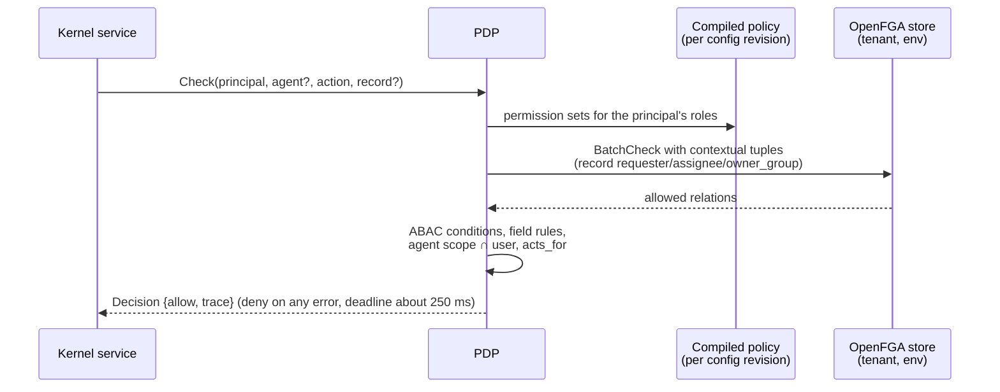
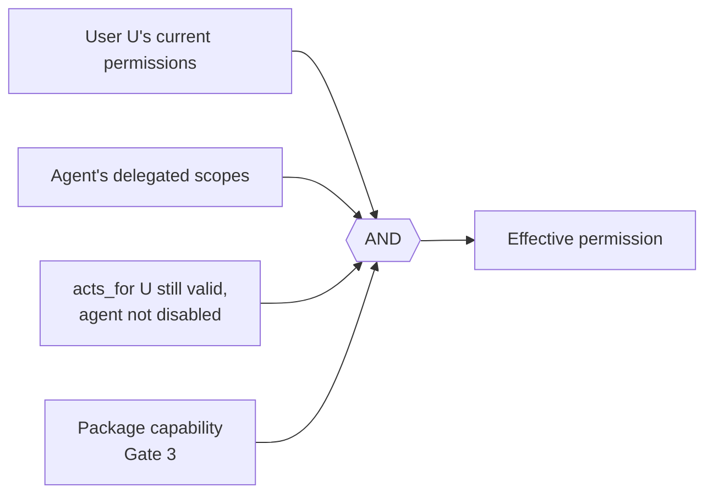

# Authorization model

## In one paragraph

Every request is decided by the kernel's **policy decision point (PDP)**, which combines two sources:

- **Tenant policy:** versioned permission-set specs, customized through the same overlay, draft and rollback flow as all other configuration ([REQ-AUTHZ-003](../spec/traceability.md)).
- **Relationship facts in OpenFGA:** nested group membership, role assignments and agent delegation, in one store per tenant-environment.

Record attributes such as requester, assignee and owner group stay on the record row and are sent to OpenFGA as contextual tuples, so they are never dual-written. Lists are pre-filtered in SQL. AI agents get the intersection of the user's permissions and the agent's delegated scopes. When authorization cannot be established, the answer is deny. The decision and spike evidence are in [ADR 0004](../adr/0004-authorization-engine.md).

## Principals

| Principal | Source | Notes |
| --- | --- | --- |
| User | Global `principals` table plus a tenant membership | A person may belong to several tenants and switches explicitly ([ADR 0011](../adr/0011-identity-and-development-authentication.md)) |
| Group | Tenant-wide identity data | Nested membership in OpenFGA (`group#member`) |
| Role | Spec (`RoleSpec`) | Assigned to users or groups; tenant-wide, not per environment |
| AI agent | Agent principal with `acts_for` a user | Has its own audited identity; can be disabled ([REQ-IAM-001](../spec/traceability.md)) |
| Module or package principal | Module ID | Background handlers act as the module, with only its scopes |

## Four levels

Each level is expressed in `PermissionSetSpec` (`packages/Esmbler.Sdk/Specs/Experience.cs`) ([REQ-AUTHZ-002](../spec/traceability.md)).

| Level | Spec | Values | Tickets example |
| --- | --- | --- | --- |
| Entity | `entities[].create / read / update / delete` | `read` and `update` scopes: `none`, `related`, `all` | Requesters: create; read and update `related` |
| Record | Entity `accessFields` define "related"; optional ABAC `updateCondition` | Relations `requester`, `assignee`, `owner_group`, `watcher` | A requester sees only tickets where they are the requester |
| Field | `fields[]` with `entity`, `field` (or `*`) and `access` | `hidden`, `read`, `write` | Requesters: `labels` and `estimated_effort` hidden |
| Action | `actions[]` | `config.edit`, `config.publish`, `permissions.admin`, `audit.read`, `records.export`, `modules.manage` | Tickets admins publish config but cannot change permissions |

Rules for combining:

- **Union then intersect.** A user's permission sets are combined as a union. The agent intersection is then applied on top.
- **Field access within one set.** A specific field entry overrides the `*` entry. A field the set does not list gets `write` if the set may create or update the entity, and `read` otherwise. Without the agent scope `records:write`, `write` drops to `read`.
- **Field access across sets.** The highest access wins. A person who is both requester and agent gets agent access.
- **Rules still apply.** Field definitions (`readOnly`, `system`) and data rules (`read_only` actions) can narrow access further. Permissions never widen them.
- **Hidden means absent.** Hidden field values are never serialized: not in records, lists, exports, activity, audit diffs, notifications, rule evaluation payloads or AI context ([REQ-AUTHZ-004](../spec/traceability.md), [REQ-RULE-006](../spec/traceability.md)). The UI follows automatically, with no per-page permission code.

## How a check runs



The OpenFGA model is fixed and versioned by the platform. Tenants never edit it. Types: `user`, `agent` (`acts_for`), `group` (`member`), `role` (`assignee`), `entity_type` (`read_all`, `edit_all`, `create`, agent scopes), record types such as `ticket` (`requester`, `assignee`, `owner_group`, `watcher`, `can_view`, `can_edit`), `field` (`reader`, `writer`) and `tenant` (`config_publish`, `permissions_admin`). Activating a permission-set revision compiles it into grant tuples plus in-process ABAC predicates.

**Linking never grants access.** A lookup or related list shows a linked record only if the viewer can read it on its own merits. Restricted targets render as "1 restricted record", with no title ([REQ-AUTHZ-010](../spec/traceability.md)).

## AI agents: intersection, never elevation

An MCP or assistant call runs as `agent:X acts_for user:U` with delegated scopes from the token (`scp`, for example `config:read config:edit config:publish:request records:read`) ([REQ-AUTHZ-007](../spec/traceability.md)).



- **No self-elevation.** The agent cannot elevate itself through configuration. Ops with `AffectsPermissions` (such as `permission.field_access`) require `permissions.admin`, which is checked against the human approver at publish time, in addition to `config.publish` ([REQ-AUTHZ-008](../spec/traceability.md)).
- **No publishing.** The AI never publishes. `request_publish` creates a request that a human approves in the UI, bound to the artifact hash.
- **Current permissions.** The user's permissions are re-evaluated on every tool call. A revoked user immediately revokes their agent.

## List filtering

Lists, counts and lookups are filtered **before** paging and aggregation, so counts leak nothing ([REQ-AUTHZ-005](../spec/traceability.md), [REQ-REC-003](../spec/traceability.md)).

1. The PDP calls `ListObjects(user, member, group)` and checks `read_all` / `edit_all` on the entity type.
2. It compiles the result into a parameterized predicate that is cached by `(store, principal, authz_revision)`.
3. The query compiler ANDs the predicate in before `ORDER BY`, `LIMIT` and `COUNT`.

```sql
-- requester role, read scope "related"; principal facts bound as parameters
SELECT id, data->>'title' AS title
FROM kernel.records
WHERE entity_id = 'core.tickets.ticket'
  AND deleted_at IS NULL
  AND ( data->>'requester' = @user_id
        OR data->>'assignee' = @user_id
        OR data->>'assignment_group' = ANY(@group_ids) )   -- permission predicate
  AND ( data->>'status' = 'resolved' )                     -- user filter
ORDER BY updated_at DESC
LIMIT 50;
-- RLS adds tenant_id / environment_id from set_config('app.tenant_id', ..., true)
```

The spike's conformance run found 0 mismatches across 10,656 cases between engine `Check` and the compiled SQL predicate. A CI conformance test keeps it that way.

## Revocation and failure

| Surface | Behavior | Bound |
| --- | --- | --- |
| Interactive request | Sensitive actions (`permissions.admin`, `config.publish`, export, installs) use `HIGHER_CONSISTENCY`; other checks use a cache with TTL ≤ 10 s | Immediate for sensitive actions; ≤ 10 s otherwise |
| Cached list filter | Keyed by `authz_revision`, which is bumped on every membership or role change; safety TTL 30 s | Next request after the bump |
| Queued job | Re-authorized as its principal at execution time, never at enqueue time | At execution |
| AI session | Every tool call re-checks the user and agent; disabling the agent principal or revoking the token stops it | Next tool call |
| Engine unavailable | Deny, audited `authorization_unavailable`, metric; lists return nothing; never a cached allow for sensitive actions | Fail closed |

Membership changes commit in PostgreSQL and reach OpenFGA through an outbox writer. Revocations are dispatched synchronously first. A nightly job reconciles PostgreSQL with OpenFGA ([REQ-AUTHZ-006](../spec/traceability.md)). Acceptance scenario REQ-ACC-07 tests all four surfaces.

## Explain access

`GET /api/access/explain?subject=user:maria&record={id}&action=read` and the MCP tool `explain_access` return the decision trace ([REQ-AUTHZ-009](../spec/traceability.md)). The explanation is itself authorized: it requires `permissions.admin`, or the subject asking about themselves, plus `records:read` scope for agents ([ADR 0007](../adr/0007-mcp-server-design.md)). It never reveals hidden field values.

```json
{
  "subject": { "type": "user", "id": "user:maria", "name": "Maria Lopez" },
  "agent": null,
  "record": { "entity": "core.tickets.ticket", "id": "6f1c2a9e-3c55-4c1e-9a43-0f1d2b7c8e11", "number": "TCK-000231" },
  "action": "read",
  "decision": "allow",
  "configRevision": 14,
  "authzRevision": 982,
  "evaluatedAt": "2026-10-10T09:42:17Z",
  "summary": "Maria can see TCK-000231 because she is in the Network group, which owns the ticket, and Agents can read all tickets.",
  "paths": [
    {
      "level": "entity",
      "result": "allow",
      "grant": { "permissionSet": "core.tickets.ps_agent", "via": "role core.tickets.agent assigned to group network", "read": "all" }
    },
    {
      "level": "record",
      "result": "allow",
      "relation": "owner_group",
      "chain": ["user:maria", "member of group:network_oncall", "member of group:network", "owner_group of ticket"]
    }
  ],
  "fields": {
    "hidden": [],
    "readOnly": ["number", "status", "resolved_at", "created_at", "updated_at"],
    "note": "Read-only by field definition or workflow, not by permission."
  },
  "notGranted": [
    { "action": "delete", "reason": "No permission set grants delete on Ticket to Maria's roles.", "suggestion": "Tickets admins can delete; ask a tenant admin to assign that role." }
  ]
}
```

A denial uses the same shape with `"decision": "deny"` and the first failing check. A deny caused by engine unavailability says so explicitly and is never presented as a policy result.

## Related documents

- [ADR 0004: Authorization engine](../adr/0004-authorization-engine.md) and the [OpenFGA spike](../../spikes/authz-openfga/README.md)
- [Threat model](../security/threat-model.md)
- [Tickets roles and permission sets](../architecture/modules/tickets.md#roles-and-permission-sets)
