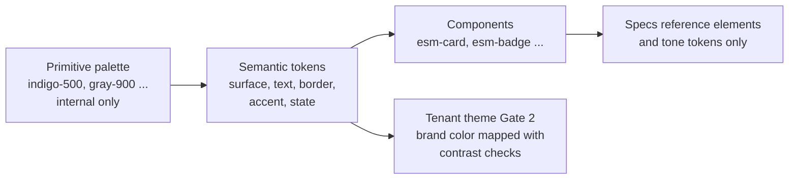

# Design principles

## Esmbler's personality

Esmbler is **calm, precise and quick**. The name comes from *assembler*: pages are assembled from blocks. The product should feel like a sharp tool, not a dashboard.

- **Calm:** content leads. Chrome, color and motion step back until they carry meaning.
- **Precise:** every element sits on the spacing scale, every color is a token, every error says how to fix it.
- **Quick:** common actions feel instant, and everything is reachable from the keyboard.

The signature color is an **indigo-violet accent** (`accent.brand`). We learn from the interaction patterns of Linear (speed, keyboard, density) and Notion (blocks, slash menu, inline editing), as the [execution brief section 3](../spec/execution-brief.md) asks. We do not copy their branding, logos, icons, illustrations or visual identity. Icons come from Lucide (ISC license) through the `esm-icon` component and take their color from tokens ([ADR 0014](../adr/0014-tailwind-css-for-the-web-ui.md)).

## Principles and concrete rules

| Principle | Esmbler rule | Enforced by |
| --- | --- | --- |
| Speed is a feature | Optimistic updates for property edits, transitions, assignment and reorder. Roll back with an error toast that offers Retry | Component contract; Playwright timing tests |
| No spinners for common actions | Nothing for the first 150 ms. Then a layout-shaped skeleton (`feedback.loading`). Spinners only inside a busy button for long, explicit actions such as publish | Design lint `DL-009`; review |
| Keyboard-first | Every action has a palette entry; frequent ones have shortcuts ([map below](#keyboard-shortcut-map)) | Shortcut registry test: every route action has a palette command |
| Dense but calm lists | Compact rows (32 px) by default, comfortable (40 px) optional. No zebra stripes; hover uses `state.hover`; hairline `border.subtle` dividers; sticky header | `collection.data_table` component |
| Minimal chrome | One slim sidebar with the workspace switcher, search and navigation; breadcrumbs on record pages. No boxed panels inside cards. Icons aid recognition in navigation, actions and status, and are never the only signal | Review checklist |
| Quiet palette | Neutral surfaces with soft elevation. Color only for meaning: status and priority tones, focus, selection, the single primary action per view, and errors. The brand gradient is decorative only (brand mark, AI builder mark, sign-in panel) and never sits behind body text | Design lint `DL-001`, `DL-007` |
| Subtle, fast motion | `motion.fast` (120 ms) for hover, focus, popovers and highlights; `motion.base` (200 ms) for panels. No bounce. `prefers-reduced-motion` turns transitions into instant changes | Design lint `DL-006` |
| Dark mode parity | Every color token has a light and a dark value. Both themes pass the same contrast checks and visual tests | Token contrast test; Playwright screenshots in both themes |
| Inline editing | Properties edit in place: click or `e`, then Enter to save and Esc to cancel. No separate edit forms for existing records | `field` component contract |
| Block-based composition | In edit mode every layout node is a block with a drag handle. Drag, slash menu, palette and AI chat all write the same draft Commands ([REQ-LAY-004](../spec/traceability.md)) | Renderer; Command tests |
| Slash menu | In edit mode, `/` opens an element inserter filtered to the children allowed at the cursor (registry `allowedChildren`) | Registry-driven menu; compiler rejects invalid placement anyway |
| Generous whitespace | Cards breathe at `space.4` padding; sections separate at `space.6`. Line length at most about 80 characters for prose | Spacing scale lint `DL-003` |
| Clear typography | Seven text styles only (`text.title-xl`, `text.title-lg`, `text.title-md`, `text.title-sm`, `text.body`, `text.body-sm`, `text.caption`) plus mono for IDs | Design lint `DL-004` |
| Accessible by default | WCAG 2.2 AA, full keyboard operation, screen reader names, translatable labels, RTL-safe layout ([REQ-DS-003](../spec/traceability.md)) | axe in component tests and Playwright; review |

### Live editing feel

- **Draft mode is unmistakable but quiet.** A slim `accent.brand` band at the top says "Draft: only you see these changes", with Publish, Discard and the step count ([REQ-LIVE-001](../spec/traceability.md)).
- **Changes appear as they happen.** Each AI or human change animates in with a `motion.fast` highlight ring (`state.changed`), and removed nodes fade out. Each change shows within 1 s of its tool call at p95 ([REQ-LIVE-002](../spec/traceability.md)).
- **Chat steps and nodes link both ways.** Hovering a chat step outlines its node; selecting a node attaches it to the chat (point-and-prompt).

## Keyboard shortcut map

Single-key shortcuts work only when focus is not in a text input. Users can turn them off in their preferences (WCAG 2.1.4 Character Key Shortcuts). Combinations that use Cmd/Ctrl always work.

| Shortcut | Action | Scope |
| --- | --- | --- |
| Cmd/Ctrl+K | Open the command palette (`action.command_palette`) | Global |
| `?` | Show keyboard help | Global |
| `g` then `t` | Go to Tickets | Global |
| `g` then `h` | Go to home | Global |
| `/` | Open the slash menu to insert an element | Page in edit (draft) mode |
| `/` | Focus search | List pages, view mode |
| `j` / `k` | Next / previous row | Lists, related lists |
| Enter | Open the focused row | Lists |
| `x` | Select or deselect the focused row | Lists |
| `e` | Edit the focused property inline | Record page, list cell |
| Esc | Cancel edit, close a popover, or exit selection | Global |
| Cmd/Ctrl+Enter | Save, or send the composer or chat message | Forms, activity feed, chat |
| `c` | Quick create in the current context | Lists, record page |
| Cmd/Ctrl+I | Open or close the AI chat panel | Pages the user may customize |
| Cmd/Ctrl+Z / Cmd/Ctrl+Shift+Z | Undo / redo the last draft step | Edit mode |
| Alt+Up / Alt+Down | Move the focused block up or down (keyboard alternative to dragging) | Edit mode |
| Cmd/Ctrl+. | Open the action menu of the focused block or record | Record page, edit mode |

## Token schema

Tokens are the only styling vocabulary. Specs and registry elements reference them by name (`tokens` in [the registry schema](../reference/element-registry-schema.md)). Components consume them as CSS custom properties: `surface.raised` becomes `--esm-surface-raised`. Names match `^[a-z]+(\.[a-z0-9-]+)+$`. The values live in `apps/web/src/styles/tokens.css`, the only file with raw colors.

Tailwind CSS ([ADR 0014](../adr/0014-tailwind-css-for-the-web-ui.md)) reads the same tokens: `apps/web/src/styles.css` removes Tailwind's default palette, radii, shadows and type scale and maps them onto tokens. The only color names are the surfaces (`base`, `raised`, `sunken`, `nav`, `hero`), text (`fg`, `muted`, `on-accent`, `on-hero`, `on-hero-muted`), borders (`subtle`, `strong`, `control` for `border.input`), `brand` and `brand-hover`, the tones (`red`, `amber`, `green`, `blue`, `purple`, `gray`) and states (`hover`, `selected`, `focus`), so utilities read `bg-raised`, `text-muted`, `border-control` or `bg-green`. The rest of the vocabulary is `rounded-sm` to `rounded-xl` and `rounded-full`, `shadow-xs`, `shadow-card`, `shadow-raised`, `shadow-overlay`, and `text-title-xl` to `text-caption`.

Primitives are private to the design system. Specs, components and packages may use only semantic tokens.

### Color roles

Light and dark values were proposed in Gate 1 and refined in Gate 2 ([ADR 0014](../adr/0014-tailwind-css-for-the-web-ui.md)). Ratios are measured against `surface.base`, light / dark.

| Token | Role | Light | Dark | Contrast (light / dark) |
| --- | --- | --- | --- | --- |
| `surface.base` | App and page background | `#F6F6F9` | `#0F0F13` | n/a |
| `surface.raised` | Cards, popovers, table body | `#FFFFFF` | `#17171D` | n/a |
| `surface.sunken` | Wells, code, segmented controls | `#EEEEF3` | `#0A0A0D` | n/a |
| `surface.nav` | Sidebar | `#F1F0F7` | `#131318` | n/a |
| `surface.hero` | Sign-in panel (with `text.on-hero`, `text.on-hero-muted`) | `#16132C` | `#16132C` | 16.4 / 10.2 (on-hero, on-hero-muted) |
| `text.default` | Primary text color | `#18181D` | `#ECECF1` | 16.4 / 16.2 |
| `text.muted` | Secondary text, labels, metadata | `#5C5C68` | `#A3A3B1` | 6.1 / 7.7 |
| `text.on-accent` | Text on `accent.brand` fills | `#FFFFFF` | `#111114` | 6.0 / 6.7 (on accent) |
| `border.subtle` | Dividers, card outlines (decorative) | `#E4E4EA` | `#25252E` | n/a (decorative) |
| `border.strong` | Neutral button outlines, dashed wells (decorative) | `#D2D2DB` | `#33333E` | n/a (decorative) |
| `border.input` | Input and control boundaries (non-text contrast ≥ 3:1) | `#8C8C98` | `#6B6B78` | 3.1 / 3.6 |
| `accent.brand` | Esmbler indigo-violet: the primary action, links, draft band (`accent.brand-hover` darker in light, lighter in dark) | `#5B4DDB` | `#958CFF` | 5.5 / 6.8 |
| `accent.blue` | Info tone, "assigned" | `#2D64CC` | `#72A5FF` | 5.1 / 7.8 |
| `accent.green` | Success tone, "resolved" | `#1D7349` | `#4CC38A` | 5.4 / 8.6 |
| `accent.amber` | Warning tone, "on hold", P2 | `#9A5B05` | `#E9A23B` | 5.0 / 8.8 |
| `accent.red` | Critical or danger tone, P1, destructive actions | `#C42F3A` | `#F2676F` | 5.1 / 6.3 |
| `accent.purple` | Category tone ("in progress", VIP) | `#7A45C9` | `#B992FF` | 5.5 / 7.8 |
| `accent.gray` | Neutral tone ("new", "closed", P4) | `#62626D` | `#9C9CA8` | 5.6 / 7.0 |
| `state.hover` | Hover overlay | ink (`text.default`) at 5% | white at 6% | n/a |
| `state.selected` | Selected row or tab background | brand at 10% | brand at 18% | Text on it ≥ 4.5 |
| `state.focus` | Focus ring, 2 px plus 2 px offset | `#5B4DDB` | `#958CFF` | ≥ 3:1 against adjacent colors |
| `state.changed` | Draft highlight ring for new or changed nodes | brand at 40% | brand at 50% | Never the only signal; a "New" or "Changed" label accompanies it |
| `state.ring` | Focus halo around focused inputs and the chat composer (with the brand border) | brand at 22% | brand at 30% | Decorative; the border carries the 3:1 boundary |
| `scrim` | Behind dialogs, the palette and the slash menu | ink at 38% | black at 60% | n/a |
| `gradient.brand` | Brand mark, avatars, AI builder mark (with `text.on-gradient`) | indigo to violet to orchid | same | Decorative only |

Badges use the tone at 11% alpha as background, a tone dot, and the tone mixed 18% toward `text.default` as text, so text keeps at least 4.5:1 in both themes, including on hovered and selected rows. Callouts use the tone at 8% over `surface.raised` with a 3 px tone rail and a tone icon.

### Typography

Font stack: `"Inter Variable", system-ui, -apple-system, "Segoe UI", Roboto, sans-serif`. Inter is self-hosted (`@fontsource-variable/inter`), so pages make no third-party font request. Mono: `ui-monospace, "SF Mono", "Cascadia Code", monospace`. Sizes are in rem (base 16 px) so text resizes to 200%.

| Token | Size / line height | Weight | Use |
| --- | --- | --- | --- |
| `text.title-xl` | 1.75rem / 2.25rem | 650 | Record title |
| `text.title-lg` | 1.5rem / 2rem | 600 | Page title |
| `text.title-md` | 1.125rem / 1.5rem | 600 | Section heading |
| `text.title-sm` | 0.9375rem / 1.375rem | 600 | Card title, dialog title |
| `text.body` | 0.875rem / 1.25rem | 400 | Default text, field values |
| `text.body-sm` | 0.8125rem / 1.125rem | 400 or 500 | Tables, badges, labels, metadata |
| `text.caption` | 0.6875rem / 1rem | 500 | Uppercase table headers, section labels, key hints |
| `text.mono` | 0.8125rem / 1.125rem | 400 | Record numbers, IDs, code |

`text.*` style tokens set size, line height and weight, and default to `text.default` color. `text.muted` is the one secondary color role.

### Spacing, radius, elevation, motion

| Group | Tokens |
| --- | --- |
| Spacing (4 px base) | `space.0` 0, `space.1` 4 px, `space.2` 8 px, `space.3` 12 px, `space.4` 16 px, `space.5` 20 px, `space.6` 24 px, `space.8` 32 px, `space.10` 40 px, `space.12` 48 px |
| Radius | `radius.sm` 6 px (inputs, buttons), `radius.md` 10 px (popovers, wells, message bubbles), `radius.lg` 14 px (cards, panels, tables), `radius.xl` 20 px (dialogs, palette), `radius.full` (avatars, pills, badges) |
| Elevation | `shadow.xs` (buttons, inputs, chips), `shadow.card` (cards, tables), `shadow.raised` (cards in drag), `shadow.overlay` (popovers, menus, dialogs, toasts), plus `scrim` behind modals. Dark mode relies on lighter surfaces and keeps shadows subtle |
| Motion | `motion.instant` 0 ms, `motion.fast` 120 ms, `motion.base` 200 ms, `motion.slow` 320 ms (draft band, chat panel). Easing `motion.ease-out` = `cubic-bezier(0.2, 0, 0, 1)` |

The Gate 1 registry already uses these tokens: `surface.base`, `surface.raised`, `text.title-lg`, `text.title-sm`, `text.body`, `text.body-sm`, `text.muted`, `border.subtle`, `border.input`, `accent.{gray,blue,green,amber,red}`, `state.{hover,focus,selected}`, `space.{1,2,3,4,6}`, `radius.{sm,md}`, `elevation.overlay` and `motion.fast`. The registry's `elevation.overlay` predates the `shadow.*` names above and has no CSS custom property; the registry needs to move to `shadow.overlay` before the registry token test (`DL-007`) is switched on.

### Tenant theming (Gate 2)

Tenants may set a logo, a brand color, the default theme and density ([REQ-DS-004](../spec/traceability.md)). The brand color maps onto `accent.brand` only after automatic contrast checks pass in both themes. If they fail, the nearest passing shade is suggested. Tenants cannot override surfaces, typography, spacing or tones.

## Component contract

Every renderer component (one per placeable registry element) follows this contract.

1. **Selector and name:** `esm-<element-name>`, for example `esm-card` for `layout.card`. Standalone, `OnPush`, signal inputs, zoneless-safe.
2. **Inputs:** exactly the element's `propsSchema`, already validated by the compiler, plus the bound data the renderer supplies (field value and field access). No other inputs.
3. **Styling:** semantic tokens only, through CSS custom properties. No hex colors, raw pixel values, inline styles or `!important`.
4. **States:** default, hover, focus-visible, active, disabled, read-only, loading (skeleton), empty, error and hidden. A rule hook (`required`, `visible`, `read_only`, `options`) maps to a state; it never maps to custom code.
5. **Accessibility:** implements `accessibility.role` and `accessibility.keyboard` from the registry. Uses Angular CDK primitives (focus trap, listbox, overlay, drag and drop with a keyboard alternative). Targets are at least 24 × 24 px.
6. **Text:** all strings come from translatable labels. Logical CSS properties keep layouts RTL-safe.
7. **Data:** components never fetch. The renderer passes values. Hidden fields are absent from the payload, and components must not render placeholders that reveal that a hidden field exists.
8. **Edit mode:** a block wrapper adds the drag handle, selection outline and slash target. The component emits intents (`insert`, `move`, `update`) and never mutates specs; the draft service turns intents into Commands.
9. **Optimism:** writes update local state immediately, reconcile with the server revision, and on failure roll back and raise a `feedback.toast` with Retry.
10. **Tests:** a unit test per state, an axe check with no violations, a keyboard test, and a visual snapshot in light and dark at compact density.

## Design-lint rules

| ID | Rule | Where it runs |
| --- | --- | --- |
| `DL-001` | No raw colors (hex, rgb, hsl, named) outside the token source file | Stylelint in CI for `apps/web` |
| `DL-002` | Specs contain no styling. Every `propsSchema` sets `additionalProperties: false`, so a `color` prop fails with `layout.bad_props` | Config compiler; registry schema test |
| `DL-003` | Margin, padding and gap use `space.*` tokens only (spacing scale) | Stylelint |
| `DL-004` | Font size, weight and line height come from `text.*` style tokens only | Stylelint |
| `DL-005` | Border radius uses `radius.*`; shadows and z-index use `elevation.*` | Stylelint |
| `DL-006` | Transition and animation durations use `motion.*`; every animation has a `prefers-reduced-motion` variant | Stylelint and review |
| `DL-007` | Every registry `tokens` entry and every choice option `tone` names an existing semantic token | Unit test over the registry and module releases |
| `DL-008` | Token pairs (text on surface, tone on tinted badge, focus ring on surface) meet WCAG 2.2 AA in both themes: 4.5:1 for text, 3:1 for UI boundaries and focus | Token contrast test |
| `DL-009` | No spinner component in list, record or navigation routes; use skeletons | Lint rule on templates |
| `DL-010` | Icons only from the approved set (Lucide through `esm-icon`, which accepts only listed names), with an accessible name on the control or `aria-hidden` | `esm-icon` type check and axe |

Status: `DL-002` is enforced by the config compiler (`Configuration.OverlayTests.Invalid_props_are_rejected`); `DL-001` and `DL-004` hold by construction for Tailwind utilities, whose theme exposes only token names; `DL-007` by `Configuration.DesignTokenTests` (registry tokens and choice tones against `tokens.css`); `DL-010` by the `IconName` type; Playwright `a11y.spec.ts` (`@REQ-DS-003`) runs axe WCAG scans on the sign-in, list, record and draft pages in light and dark mode in CI. The Stylelint rules for component style blocks and arbitrary utility values (`DL-001`, `DL-003` to `DL-006`), the automated contrast test (`DL-008`, ratios above computed by hand) and the spinner template lint (`DL-009`) are not set up yet.

Gate 3 extends these rules to marketplace UI packages through the design-system SDK.

## Design review checklist for new screens

- [ ] Starts from a page pattern (record, list, form) and uses only registry elements.
- [ ] One primary action per view, in `accent.brand`. Other actions are neutral or in an action menu.
- [ ] Color appears only for meaning (tone, focus, selection, error). Nothing decorative.
- [ ] All spacing on the 4 px scale; cards at `space.4`, sections at `space.6`.
- [ ] Only the five text styles plus mono. Titles are short noun phrases.
- [ ] Common actions are optimistic; skeletons replace spinners; no layout shift when data arrives.
- [ ] Every action is in the command palette; frequent actions have shortcuts listed in `?` help.
- [ ] Inline editing works for every editable property, with Enter, Esc and visible focus.
- [ ] In edit mode, blocks have drag handles, a keyboard move alternative and a slash menu limited to allowed children.
- [ ] Dark mode checked; both themes pass the contrast test.
- [ ] axe reports no violations; keyboard-only walkthrough done; screen reader names make sense.
- [ ] Empty, loading, error and read-only states designed with actionable copy.
- [ ] Works at 360 px width (columns stack) and at 200% zoom.
- [ ] Field permissions respected: no hint of hidden fields.
- [ ] Motion uses `motion.fast` or `motion.base` and respects reduced motion.
- [ ] Copy is calm and precise: says what happened and what to do next; no exclamation marks.

## Known gaps (open at the Gate 1 close)

- **Primary tone token.** `action.button`, `action.transition_buttons` and `feedback.loading` list `accent.blue` for the primary tone. Switch them to `accent.brand`, or document that the primary tone resolves to `accent.brand`.
- **Missing tokens in the registry.** The Tickets choice lists use `accent.purple`, and no registry element lists it yet. `DL-007` must validate it against the token set above.
- **Design-lint tooling.** See the status note under [Design-lint rules](#design-lint-rules).
- **Generated token reference.** The token file (`apps/web` design tokens, exposed as MCP resource `esmbler://design-system/tokens`) becomes the source of truth. A generated reference will replace the tables on this page.
