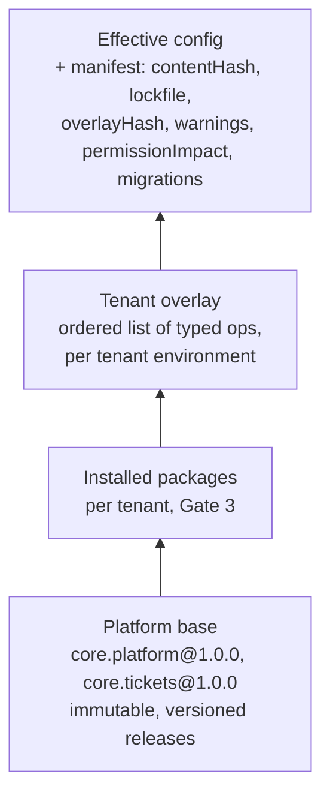
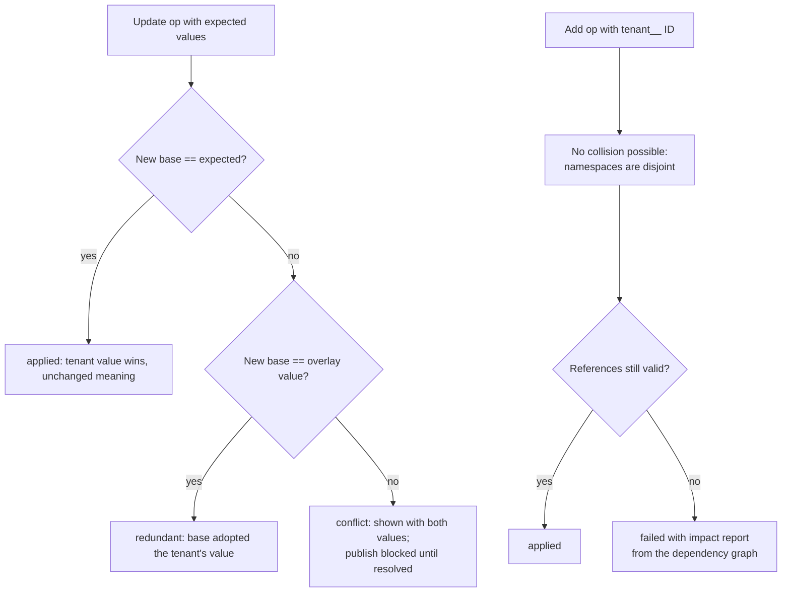

# Layered configuration

## Why layers

Every tenant starts from the same complete default modules and customizes them without forking. Three properties follow:

- the defaults keep receiving upgrades;
- a tenant's changes stay visible and reversible;
- one tenant's changes cannot reach another tenant ([REQ-TEN-002](../spec/traceability.md)).

The master spec calls this layered metadata. Esmbler implements it as a compiler: typed overlay operations are applied to immutable base specs and produce an immutable, content-hashed artifact ([ADR 0003](../adr/0003-configuration-artifact-and-overlay-format.md)).



## Composition

`Composer.Compose(modules, ops)` in `packages/Esmbler.Kernel/Configuration/Composer.cs`:

1. **Base.** Clone every module release, ordered by module ID, into one catalog. Record each element's provenance (`core.tickets@1.0.0`) and the lockfile entry `{id, version, specHash}`.
2. **Packages** (Gate 3). Composed the same way in lockfile order, with the publisher namespace `<publisher>.<module>.*` and `<publisher>__` field keys.
3. **Overlay.** Apply ops in order. Each op targets stable IDs, never array positions or labels ([REQ-CFG-002](../spec/traceability.md)), and yields an outcome: `applied`, `redundant`, `conflict` or `failed`.
4. **Validate.** `ConfigValidator` checks types, references, registry containment and props, expression types and cost, rule cycles, and contradictions such as required plus hidden without a default ([REQ-CFG-005](../spec/traceability.md)). `DependencyGraph` links fields, rules, nodes, workflows and permission sets ([REQ-CFG-004](../spec/traceability.md)).
5. **Manifest.** `ConfigCompiler` produces the `ArtifactManifest` ([REQ-CFG-006](../spec/traceability.md)): `contentHash` (SHA-256 over canonical JSON with sorted keys, excluding provenance), lockfile, `overlayHash`, renderer `esmbler-renderer@^1.0`, SDK, warnings, permission impact and required migrations.

### Operation types

Defined in `packages/Esmbler.Sdk/Overlay/OverlayOps.cs`. The JSON is camelCase, nulls are omitted, and the `op` property is the discriminator.

| `op` | Purpose | Base elements? |
| --- | --- | --- |
| `field.add` | Add a field; key must start with `tenant__` | Adds next to base fields |
| `field.update` | Patch label, help, required, limits, pattern, default; carries `expected` prior values | Only tighten: cannot unset required, raise max length or widen a range |
| `field.hide` | Hide or show; data kept | Yes, except the title field and the workflow state field |
| `field.remove` | Remove a tenant field with no dependents | No: hide instead |
| `choice_list.add`, `choice.add`, `choice.update` | New list, new option (`tenant__` ID on base lists, anchored), relabel or hide an option | Relabel and hide only |
| `rule.add`, `rule.update`, `rule.remove` | Tenant rules (`tenant__` ID); `expectedHash` detects base drift | Base rules: enable or disable only |
| `node.insert`, `node.update`, `node.move`, `node.remove` | Layout edits with `anchor` `{before, after, position}`; `expected` props | Base nodes are hidden, not deleted |
| `permission.field_access` | Set a field's access in a permission set | Needs `permissions.admin` in addition to `config.publish` |

## Provenance and customized markers

- `EffectiveConfig.Provenance` maps every element key (`entity/field`, rule ID, node ID, …) to the layer that produced it: `core.tickets@1.0.0` or `tenant`. A base element changed by an overlay keeps its base provenance, so "reset to default" knows there is a default to return to.
- `EffectiveConfig.Customized` lists every key the tenant added or changed. The builder shows "Modified" badges from it, and the AI answers "what have we customized in Tickets?" from it (MCP `get_customizations`, planned for G1-M9) ([REQ-CFG-011](../spec/traceability.md)).
- Compare with default: compile the same base with an empty overlay and diff the element.

## Worked example: tenant A customizes Tickets

Tenant **acme** (A) asks the assistant: *"Add a Vendor field in its own card under Properties. Add a Justification field, and make it required when the category is Access request."* Tenant **globex** (B) does nothing.

### Stored overlay (tenant A, prod)

The assistant's MCP calls (`add_field` twice, `add_rule`, `insert_node` twice) each became a draft Command. On publish, the overlay is this ordered list. It is exactly what `SpecJson` serializes; defaults such as `"required": false` are written explicitly.

```json
[
  {
    "op": "field.add",
    "entity": "core.tickets.ticket",
    "field": {
      "key": "tenant__vendor", "type": "short_text", "label": "Vendor",
      "required": false, "readOnly": false, "hidden": false, "deprecated": false, "system": false,
      "maxLength": 80, "unique": false
    }
  },
  {
    "op": "field.add",
    "entity": "core.tickets.ticket",
    "field": {
      "key": "tenant__justification", "type": "long_text", "label": "Justification",
      "required": false, "readOnly": false, "hidden": false, "deprecated": false, "system": false,
      "maxLength": 2000, "unique": false
    }
  },
  {
    "op": "rule.add",
    "rule": {
      "id": "tenant__access_needs_justification",
      "kind": "conditional",
      "scope": "data",
      "entity": "core.tickets.ticket",
      "description": "Access requests need a justification",
      "when": "record.category == 'access'",
      "actions": [
        { "type": "require", "field": "tenant__justification", "message": "Explain why this access is needed." }
      ],
      "order": 100,
      "enabled": true
    }
  },
  {
    "op": "node.insert",
    "view": "core.tickets.record",
    "parent": "core.tickets.record.c_side",
    "node": {
      "id": "tenant__n_vendor_card",
      "type": "layout.card",
      "props": { "title": "Vendor" },
      "children": [
        { "id": "tenant__n_vendor_field", "type": "field", "props": { "field": "tenant__vendor" }, "children": [], "hidden": false }
      ],
      "hidden": false
    },
    "anchor": { "after": "core.tickets.record.card_properties" }
  },
  {
    "op": "node.insert",
    "view": "core.tickets.record",
    "parent": "core.tickets.record.card_details",
    "node": { "id": "tenant__n_justification_field", "type": "field", "props": { "field": "tenant__justification" }, "children": [], "hidden": false },
    "anchor": { "after": "core.tickets.record.f_description" }
  }
]
```

Points to note:

- **Namespaces.** Every new ID or key starts with `tenant__` ([REQ-CFG-003](../spec/traceability.md)). An unprefixed key such as `vendor` fails with `overlay.namespace` and the suggestion `tenant__vendor`.
- **Stable choice IDs.** The rule compares against the stable option ID `'access'`, not a label or a number ([assumptions](../decisions/assumptions.md)).
- **Anchors, not positions.** The card is placed *after* `card_properties`. If a future base release removes that card, the compiler places the Vendor card at the end and emits the warning `overlay.anchor_missing`.
- **Data scope.** The rule is data-scoped, so it holds on every write path: UI, API, imports, automations and AI ([REQ-RULE-004](../spec/traceability.md)). The assistant restates it as *"Justification is now required whenever Category is Access request, on all forms and the API."*

### Resolved configuration (excerpt, tenant A)

Compiling `[core.platform@1.0.0, core.tickets@1.0.0]` with these five ops gives five `applied` outcomes and no warnings.

```json
{
  "entities": [{
    "id": "core.tickets.ticket",
    "fields": [
      "… 19 base fields …",
      { "key": "tenant__vendor", "type": "short_text", "label": "Vendor", "maxLength": 80 },
      { "key": "tenant__justification", "type": "long_text", "label": "Justification", "maxLength": 2000 }
    ]
  }],
  "rules": [
    "… core.tickets.rules.title_length, resolution_notes, closed_read_only …",
    { "id": "tenant__access_needs_justification", "kind": "conditional", "when": "record.category == 'access'",
      "actions": [{ "type": "require", "field": "tenant__justification" }] }
  ],
  "views": [{
    "id": "core.tickets.record",
    "layout": { "…": "…", "core.tickets.record.c_side (span 4)": [
      "core.tickets.record.card_properties",
      "tenant__n_vendor_card",
      "core.tickets.record.card_resolution"
    ] }
  }],
  "provenance": {
    "core.tickets.ticket/category": "core.tickets@1.0.0",
    "core.tickets.record.card_properties": "core.tickets@1.0.0",
    "core.tickets.ticket/tenant__vendor": "tenant",
    "tenant__access_needs_justification": "tenant",
    "tenant__n_vendor_card": "tenant"
  },
  "customized": [
    "core.tickets.ticket/tenant__justification",
    "core.tickets.ticket/tenant__vendor",
    "tenant__access_needs_justification",
    "tenant__n_justification_field",
    "tenant__n_vendor_card",
    "tenant__n_vendor_field"
  ]
}
```

The excerpt is abridged: boolean defaults are omitted, and the layout is shown as the child order of `c_side`. The manifest has this shape (the hashes come from the current compiler and will change as the specs evolve):

```json
{
  "contentHash": "sha256:11315d28cc81944cb9d6c59e40e25d72a900a3c0dc08804e9ccbf761e092d355",
  "lockfile": [
    { "id": "core.platform", "version": "1.0.0", "specHash": "sha256:52fcb96c…" },
    { "id": "core.tickets", "version": "1.0.0", "specHash": "sha256:6ce0f9f1…" }
  ],
  "overlayHash": "sha256:1732a219…",
  "overlayOperations": 5,
  "renderer": "esmbler-renderer@^1.0",
  "sdk": "esmbler-sdk@1.0.0",
  "warnings": [],
  "permissionImpact": { "changed": false, "changes": [] },
  "migrations": []
}
```

### Why tenant B is unaffected

| Layer | Tenant A (acme) | Tenant B (globex) |
| --- | --- | --- |
| Overlay | 5 ops | empty |
| Artifact | `contentHash sha256:11315d28…` | `contentHash sha256:6db76a0a…` (base only) |
| Active pointer | `kernel.active_config` row for (acme, prod) | Its own row for (globex, prod) |
| Records | Ticket `data` may contain `tenant__vendor` | A write with `tenant__vendor` is rejected as an unknown field |
| Rule | Access tickets without Justification are rejected (422) | Access tickets save normally |
| Record page | Shows the Vendor card | Unchanged layout |

The guarantees behind this:

1. **Separate artifacts and pointers.** Overlays, artifacts and pointers are keyed by tenant and environment. `kernel.active_config` and `kernel.config_artifacts` are under RLS with `FORCE`, so a request in B's context cannot read A's rows ([REQ-TEN-001](../spec/traceability.md)).
2. **Shared base, private copies.** Base modules are immutable and shared; the composer clones them before applying ops (`SpecJson.Clone`). A's ops never mutate the base that B composes.
3. **Tenant-keyed caches.** Compiled config is cached by `(tenant, environment, config revision)`.
4. **Pinned revisions.** Each request pins the config revision of its own tenant environment.

The acceptance test for REQ-ACC-01 asserts all of this end to end: B's artifact hash, record API behavior, rendered page and accessible data are byte-for-byte unchanged after A publishes ([acceptance plan](../testing/acceptance-plan.md)).

## Upgrades: three-way comparison

When `core.tickets` moves from 1.0.0 to 1.1.0, the compiler composes the **candidate base beneath the unchanged overlay** and compares three values for every update op ([REQ-CFG-009](../spec/traceability.md)):

- **Expected:** the base value when the tenant authored the change, stored in the op as `expected` or `expectedHash`.
- **New base:** the value in 1.1.0.
- **Overlay:** the value the tenant wants.



- **Running the example against 1.1.0:** all five ops apply. The artifact gains `impact`, `channel` and `effort_hours` from the base, keeps the Vendor card after `card_properties`, and lists the migrations `core.tickets@1.1.0:backfill_impact` and `core.tickets@1.1.0:convert_effort` (`UpgradeTests.Canonical_customization_survives_upgrade_to_1_1_0`).
- **A conflict:** suppose the tenant relabeled Category to "Request type" with `expected.label = "Category"`, and a release relabels it "Service category". The outcome is a conflict with the message *"'label' was "Category" when this change was made but is now "Service category""* and the suggestion *"Keep your value or accept the new default"* (`UpgradeTests.Relabel_conflicts_when_base_changed_the_same_property`).
- **Never silent.** Conflicts and failures block activation. They are never resolved silently. The upgrade report lists each op's outcome and the dependency impact ([REQ-ACC-03](../spec/traceability.md)).

## Reset to default

A tenant can reset one field, rule, page or the whole module ([REQ-CFG-011](../spec/traceability.md)).

1. **Select ops.** The builder finds the overlay ops whose targets include the selection. For a page, that is every node under the view; for a module, every op targeting its IDs.
2. **Preview impact.** The dependency graph shows the impact before anything changes. For example, resetting the Justification field also removes `tenant__access_needs_justification` and `tenant__n_justification_field`, which depend on it.
3. **Draft the reset.** The reset lands in the draft as Commands that drop or neutralize those ops. It is reviewed and published like any other change.
4. **Keep the data.** Reset changes configuration only. Values stored under `tenant__justification` stay in `kernel.records` until a separate, authorized data purge.

## Related documents

- [Architecture overview](../architecture/overview.md)
- [Tickets module architecture](../architecture/modules/tickets.md)
- [Authorization model](authorization-model.md): permission-affecting ops
- [Element registry schema](../reference/element-registry-schema.md): containment and props validation
