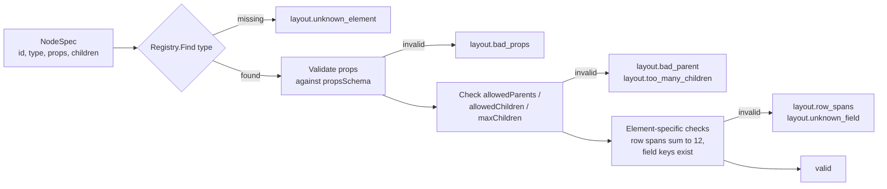

# Element registry schema

The element registry is the self-describing catalog of every building block that a spec can use ([REQ-AI-002](../spec/traceability.md)). Three consumers read the same definitions:

- the **configuration compiler** validates props, containment and rule hooks;
- the **Angular renderer** maps each element ID to a component;
- the **AI builder** reads them through MCP (`list_elements`, `describe_element`, resource `esmbler://registry/elements`).

| Item | Location |
| --- | --- |
| JSON Schema (2020-12) | `packages/Esmbler.Sdk/Schemas/element.schema.json` |
| Element definitions (Gate 1: 60 files) | `packages/Esmbler.Sdk/Registry/Elements/<id>.json` |
| C# model | `Esmbler.Sdk.Registry.ElementDefinition`, loaded by `ElementRegistry.LoadBuiltIn()` |
| Tests | `tests/Esmbler.UnitTests/Configuration/TicketsReleaseTests.cs` (`Registry_loads_gate1_catalog`) |

> **Generated references.** `tools/Esmbler.DocGen` generates the full [element catalog](element-catalog.md) (every element with its props, containment and examples) from `Registry/Elements/*.json`, and JSON Schemas for every spec type in [`schemas/`](schemas/) (for example [`entity.schema.json`](schemas/entity.schema.json), [`overlay_op.schema.json`](schemas/overlay_op.schema.json), [`node.schema.json`](schemas/node.schema.json)). Regenerate with `dotnet run --project tools/Esmbler.DocGen`; CI runs it with `--check` and fails when they are stale. This page explains the element definition format; the [catalog section](#gate-1-catalog) below is a hand-written summary, and the generated catalog wins on any difference ([execution brief section 7](../spec/execution-brief.md)).

## Field-by-field

The schema sets `additionalProperties: false`, so unknown keys are rejected. Required keys: `id`, `version`, `category`, `gate`, `label`, `description`, `propsSchema`, `accessibility`, `examples`.

| Field | Type | Required | Meaning |
| --- | --- | --- | --- |
| `$schema` | string | no | Relative path to the schema, for editor validation |
| `id` | string matching `^[a-z][a-z0-9_]*(\.[a-z][a-z0-9_]*)*$` | yes | Stable element ID, for example `layout.card`, `field.short_text`, `spec_object.entity`. Node specs use it as `type`. Never renamed |
| `version` | semver `x.y.z` | yes | Element contract version. A breaking props change needs a major bump and a renderer compatibility check |
| `category` | enum | yes | `spec_object`, `layout`, `field_type`, `field`, `display`, `collection`, `activity`, `action`, `feedback` |
| `gate` | integer 1–5 | yes | Delivery gate that introduced the element. Not enforced yet: the compiler does not reject elements from a gate later than the running platform |
| `label` | string | yes | Human name shown in the slash menu, palette and builder |
| `description` | string, at least 20 chars | yes | What the element is and when to use it, **written for an LLM**. The first sentence is the one-line summary |
| `usage` | string[] | no | Do-guidance for the AI builder ("Give every card a short noun-phrase title") |
| `constraints` | string[] | no | Hard rules the compiler enforces, stated plainly so the AI can avoid errors |
| `placeable` | boolean | no | `true` if the element can be a node in a layout tree. Spec objects, field types and overlay-only feedback patterns are not placeable |
| `propsSchema` | JSON Schema object | yes | Validates node `props` (or the spec object itself). Must use `additionalProperties: false`, so raw styling such as `color` is rejected with `layout.bad_props` ([REQ-DS-001](../spec/traceability.md)) |
| `valueSchema` | JSON Schema object | no | Field types only: the JSON shape stored in `kernel.records.data` |
| `allowedParents` | string[] | no | Element IDs or `category.*` patterns this element may be placed in. A violation returns `layout.bad_parent` ([REQ-LAY-002](../spec/traceability.md)) |
| `allowedChildren` | string[] | no | Allowed child IDs or patterns. Empty means a leaf |
| `maxChildren` | integer or null | no | Upper bound on children. A violation returns `layout.too_many_children` |
| `binding.kind` | enum | no | What data the element shows: `none`, `field`, `record`, `query`, `relationship`, `workflow` |
| `binding.description` | string | no | How the binding is set, for example "props.field is a field key of the view's entity" |
| `events` | string[] | no | UI events the element emits, such as `change`, `click`, `toggle` or `transition`. Reserved for later automation triggers |
| `ruleHooks` | enum[] | no | Rule actions that can affect the element: `required`, `visible`, `read_only`, `options`, `value`, `message` |
| `tokens` | string[] matching `^[a-z]+(\.[a-z0-9-]+)+$` | no | Design tokens the element's component uses. Specs never contain raw styling; see [design principles](../explanation/design-principles.md#token-schema) |
| `accessibility.role` | string | yes | ARIA role or landmark the component exposes |
| `accessibility.keyboard` | string | yes | Keyboard behavior ([REQ-DS-003](../spec/traceability.md)) |
| `accessibility.notes` | string | no | Accessible name source, live-region behavior, focus management |
| `responsive` | string | no | Behavior at tablet and mobile widths (stacking, collapse below 720 px) |
| `examples` | array, at least 1, of `{description, spec}` | yes | Complete, valid specs that the AI can copy. Not enforced yet: no test compiles every example |

### Example (abridged)

```json
{
  "id": "layout.card",
  "version": "1.0.0",
  "category": "layout",
  "gate": 1,
  "label": "Card",
  "description": "A titled container that groups related fields and widgets on a page, like a block in a document. ...",
  "constraints": ["Parent must be layout.column or layout.tab.", "title is required and at most 60 characters."],
  "placeable": true,
  "propsSchema": {
    "type": "object",
    "additionalProperties": false,
    "required": ["title"],
    "properties": {
      "title": { "type": "string", "minLength": 1, "maxLength": 60 },
      "columns": { "enum": [1, 2], "default": 1 },
      "collapsible": { "type": "boolean", "default": false }
    }
  },
  "allowedParents": ["layout.column", "layout.tab"],
  "allowedChildren": ["field", "display.*", "action.button", "action.action_menu", "collection.related_list", "activity.*", "action.transition_buttons"],
  "maxChildren": 30,
  "binding": { "kind": "record" },
  "ruleHooks": ["visible"],
  "tokens": ["surface.raised", "border.subtle", "radius.md", "space.4", "text.title-sm"],
  "accessibility": { "role": "region", "keyboard": "Collapsible cards toggle with Enter or Space on the heading button." },
  "examples": [{ "description": "Assignment card with three fields", "spec": { "id": "core.tickets.record.card_assignment", "type": "layout.card", "props": { "title": "Assignment", "columns": 2 }, "children": [] } }]
}
```

### How the compiler uses it



Every error carries `code`, `message`, `target` and `suggestion` so the AI can self-correct ([REQ-AI-004](../spec/traceability.md)).

## Gate 1 catalog

60 elements, all `gate: 1`, matching [execution brief section 5](../spec/execution-brief.md).

### Spec objects (`spec_object`, 14, not placeable)

- `spec_object.entity`: a record type with labels, title field, fields and access fields.
- `spec_object.field_definition`: one field of an entity: stable key, field type, label and constraints.
- `spec_object.relationship`: a lookup between two entities, with its one-to-many inverse.
- `spec_object.choice_list`: a reusable, ordered list of options with stable IDs and tone tokens.
- `spec_object.validation_rule`: blocks a write unless its assert expression is true.
- `spec_object.conditional_rule`: when a condition holds, require, show, hide, make read-only, set a value, restrict options or show a message.
- `spec_object.workflow`: the entity's state machine: states, transitions, guards, required fields and roles.
- `spec_object.assignment_rule`: routes records to a group when a condition holds; first match wins.
- `spec_object.notification_template`: a message on a record event to user-field recipients or watchers.
- `spec_object.record_view`: the page for viewing and editing one record (layout rooted at `layout.page`).
- `spec_object.list_view`: the page for finding and working many records.
- `spec_object.form`: a compact create or edit form, used by quick create and, later, portal forms.
- `spec_object.role`: a named job function. Roles carry no permissions themselves.
- `spec_object.permission_set`: grants roles entity, field and platform-action access.

### Layout (`layout`, 7)

- `layout.page`: root node of every view; holds sections in reading order.
- `layout.section`: a horizontal band that groups rows under an optional heading.
- `layout.row`: a line of 1–4 columns whose spans sum to 12.
- `layout.column`: a vertical slot spanning 1–12 grid columns.
- `layout.card`: a titled container that groups related fields and widgets, like a document block.
- `layout.tab_group`: shows one tab panel at a time inside a column.
- `layout.tab`: one panel of a tab group.

### Field placement (`field`, 1)

- `field`: places one field of the view's entity, rendered by its field type component. Supports a form-level label override and form-level read-only (never a security control).

### Field types (`field_type`, 17, not placeable)

- `field.short_text`: single-line plain text, up to 500 characters.
- `field.long_text`: multi-line plain text, up to 10,000 characters.
- `field.rich_text`: formatted text stored as sanitized HTML.
- `field.integer`: a whole number.
- `field.decimal`: a fixed-scale number (scale 0–6).
- `field.date`: a calendar date with no time zone.
- `field.date_time`: an instant stored in UTC, shown in the viewer's time zone.
- `field.single_select`: one option ID from a choice list.
- `field.multi_select`: several unique option IDs from a choice list.
- `field.toggle`: yes/no; null reads as false.
- `field.status`: the workflow state, changed only by transitions.
- `field.priority`: an ordered urgency choice rendered as a tone badge.
- `field.email`: a validated email address.
- `field.lookup`: a reference to one record of an entity.
- `field.user`: a reference to one tenant member.
- `field.group`: a reference to one tenant group.
- `field.auto_number`: a system-assigned number such as `TCK-000123`, unique per tenant environment.

### Display (`display`, 5)

- `display.heading`: a heading with fixed text or bound to a field.
- `display.label_value`: a compact read-only label and value pair.
- `display.badge`: a pill showing a choice option with its tone, or fixed text.
- `display.callout`: a toned message box, optionally shown only when `visibleWhen` holds.
- `display.empty_state`: explains why an area is empty and what to do next.

### Collections (`collection`, 5)

- `collection.data_table`: a dense, keyboard-navigable, server-paged record list with inline editing.
- `collection.column`: one data table column bound to a field.
- `collection.filter_bar`: field filter chips and search above a table.
- `collection.saved_views`: named filter and sort presets shown as tabs.
- `collection.related_list`: records that point at the current record through a lookup.

### Record activity (`activity`, 2)

- `activity.feed`: public replies and internal work notes in one timeline, with a composer.
- `activity.audit_history`: append-only field change timeline with actor, agent and config revision.

### Actions (`action`, 5)

- `action.button`: one labeled action: a transition, save, or open quick create.
- `action.action_menu`: a menu of secondary actions.
- `action.transition_buttons`: the transitions the viewer can fire now, with overflow.
- `action.quick_create`: opens a compact create form in a dialog.
- `action.command_palette`: the app-wide Cmd/Ctrl+K palette (not placeable).

### Feedback (`feedback`, 4, not placeable)

- `feedback.toast`: a brief non-blocking confirmation or error, optionally with Undo.
- `feedback.confirm_dialog`: confirms destructive or hard-to-undo actions.
- `feedback.inline_error`: an actionable error next to its field.
- `feedback.loading`: skeletons, inline indicators or a thin progress bar.

## Gate 2 additions

Ten elements so far, `gate: 2`. The generated [element catalog](element-catalog.md) has their props and examples.

- `spec_object.catalog_item` (G2-M2, [ADR 0015](../adr/0015-requests-catalog-fulfillment-and-workflow-versions.md)): a requestable service with typed questions and fulfillment tasks.
- `field.catalog_item` and `field.variables` (G2-M2): the catalog item a request was raised from, and its typed answers.
- `spec_object.approval_policy` (G2-M3, [ADR 0016](../adr/0016-approvals.md)): ordered approval stages with approvers, conditions, expiry and escalation.
- `field.principals` (G2-M3): a platform-maintained list of user and group IDs, such as a request's approvers; usable as an access field.
- `activity.approvals` (G2-M3): the approvals panel on a request record, with Approve and Reject for people who may decide.
- `spec_object.event_type` (G2-M17, [ADR 0017](../adr/0017-event-audit-alert-notification-services.md)): an event a module or tenant publishes, with a small typed payload, default severity and sensitivity; transitions publish it through `emits` and rules through an `emit_event` action.
- `spec_object.business_calendar` and `spec_object.sla_policy` (G2-M4, [ADR 0018](../adr/0018-sla-and-business-hours.md)): working hours in a time zone minus holidays, and service-level targets with start, pause and stop conditions and goals by priority.
- `activity.sla` (G2-M4): the Service levels panel on a record page, with time left, pauses, breaches and outcomes.

## Adding an element

A how-to guide (`docs/how-to/add-an-element.md`) is planned but not written yet. In summary:

1. Add `Registry/Elements/<id>.json` with the current gate.
2. Add the Angular component and register it in the renderer map.
3. Add examples that compile.
4. Regenerate the references (`dotnet run --project tools/Esmbler.DocGen`) and commit [`element-catalog.md`](element-catalog.md).
