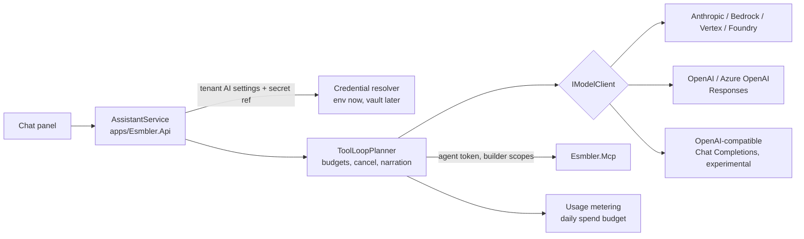

# AI providers and bring-your-own subscription

Research for G2-M20 ([progress](../progress.md)): how the AI builder can use model providers other than Anthropic, and how a customer can use an existing ChatGPT or Claude subscription instead of an API key. Sources were checked on 2026-10-10. Each claim cites the official page it came from. Claims marked **Unverified** could not be confirmed on an official page and must be rechecked before they shape a decision.

## Summary

- **API keys (path A).** The server-side planner can support several providers with one change: split today's `ClaudePlanner` into a provider-neutral tool loop and a small per-provider model client. OpenAI should be added through the **Responses API**, which OpenAI recommends for new projects. Azure OpenAI and Amazon Bedrock (Claude) are cheap to add after that because they reuse the same SDKs. A generic "OpenAI-compatible" client (Chat Completions) covers Gemini and self-hosted models, but should be labelled experimental until it passes the evaluation suite.
- **Using a subscription from inside Esmbler: mostly not possible.**
  - *OpenAI:* "Sign in with ChatGPT" with ChatGPT plan usage exists. For a hosted commercial product like Esmbler, though, it is a **limited trial for selected partners** that you join from a waitlist. Open-source and locally hosted apps can use plan usage freely.
  - *Anthropic:* **prohibits** third-party apps from offering Claude.ai login or sending requests through users' Free, Pro or Max credentials.
  - *The one sanctioned Claude route:* Max and Team plans now include monthly API credits in a linked Claude Console organization. A customer can create an API key there and give it to Esmbler as a tenant key.
- **Bringing your own assistant (path B): officially supported by both.** Claude (custom connectors, all plans including Free) and ChatGPT (custom MCP servers / plugins; write actions on Business, Enterprise and Edu) can connect to Esmbler's MCP server over the internet with OAuth. The person's subscription does the reasoning. Esmbler keeps enforcing authority: user permissions ∩ scopes, drafts only, no publish. Esmbler must become an OAuth 2.1 authorization server. That means protected resource metadata, Client ID Metadata Documents (CIMD), PKCE, resource-bound audiences, refresh-token rotation, revocation and a consent screen.
- **Recommendation:** build A (multiple providers, chosen per tenant) and B (the MCP server as a remote connector) as separate milestones. Ship A first because it is internal. B adds an internet-facing OAuth surface and needs the public hostname, TLS and signing keys that are already open [human actions](../human-actions.md).

## Current design (what this builds on)

| Piece | Today | Source |
|---|---|---|
| Planner contract | `IPlanner.RunAsync(request, IToolGateway, IAssistantSink, AssistantBudget, ct)`; `ScriptedPlanner` and `ClaudePlanner` | [Abstractions.cs](../../packages/Esmbler.Assistant/Abstractions.cs) |
| Claude loop | Manual tool-use loop over the Anthropic Messages beta surface (`Anthropic` NuGet 12.55.0). Prompt caching on the system block, effort, a server-side refusal fallback model, a 60 s request timeout, 16k max tokens and the last 12 turns of history. A refusal ends the turn. Provider errors become `AssistantUnavailableException` with no provider details | [ClaudePlanner.cs](../../packages/Esmbler.Assistant/ClaudePlanner.cs), [ADR 0013](../adr/0013-ai-assistant-model-adapter.md) |
| Tools | MCP client (`ModelContextProtocol` 2.2.0, Streamable HTTP) to `apps/Esmbler.Mcp`. `McpToolGateway` counts tool calls against the turn budget. Tool `readOnlyHint` is read | [McpToolGateway.cs](../../packages/Esmbler.Assistant/McpToolGateway.cs) |
| Key | `Esmbler:Assistant:AnthropicApiKey` or `ANTHROPIC_API_KEY`. Compose maps the env var. One key for the whole deployment | [ADR 0013](../adr/0013-ai-assistant-model-adapter.md) |
| Provider selection | `Esmbler:Assistant:Provider` = `auto`, `anthropic` or `scripted`. Global, not per tenant | [ADR 0013](../adr/0013-ai-assistant-model-adapter.md) |
| MCP auth | Symmetric-key JWT with audience `esmbler-mcp`. Claims `sub`, `tid`, `eid`, `act` (agent principal), `scp`. 30-minute lifetime, no refresh token. Minted only by `POST /api/auth/agent-token` or by `AssistantService` with `AgentScopes.Builder` (`config:read config:edit config:publish:request access:explain`). Stateless Streamable HTTP at `/mcp`. API tokens are rejected and nothing is forwarded | [TokenService.cs](../../packages/Esmbler.Hosting/Auth/TokenService.cs), [Program.cs](../../apps/Esmbler.Mcp/Program.cs), [ADR 0007](../adr/0007-mcp-server-design.md), [ADR 0011](../adr/0011-identity-and-development-authentication.md) |
| Safety | Untrusted text wrapped as `untrusted_data`. Authority = user ∩ `scp` ∩ `acts_for` in the PDP. No publish tool. Per-turn and per-token governors. Per-agent disable. 43 evaluation cases | [threat model](../security/threat-model.md) T-20 to T-27 |
| Gaps relevant here | No per-tenant spend budget (KI-002). Claude never scored on the evaluation suite (KI-007). The execution brief names "Claude via the Anthropic API" as the AI stack, so a second provider is a recorded deviation that needs an ADR. The product owner requested it on 2026-10-10 | [known issues](../known-issues.md), [progress](../progress.md) |

ADR 0013 already anticipated this: "need for regional processing or a second provider (add an `IModelClient` adapter)".

## 1. API-key providers (path A)

### 1.1 OpenAI

**Which API.** OpenAI says: "While Chat Completions remains supported, Responses is recommended for all new projects". The Assistants API "was officially sunset on August 26, 2026" ([migrate to Responses](https://developers.openai.com/api/docs/guides/migrate-to-responses)). The current models page says flagship models are "available via the Responses API … and our Client SDKs" ([models](https://developers.openai.com/api/docs/models)). Use Responses for OpenAI and Azure OpenAI.

**Function calling in Responses** ([migrate to Responses](https://developers.openai.com/api/docs/guides/migrate-to-responses)):

- Tool definitions are internally tagged (`{type: "function", name, description, parameters}`), not wrapped in `function` as in Chat Completions.
- The model emits `function_call` output items with a `call_id`. You return `function_call_output` input items with the same `call_id`. This maps one-to-one to Anthropic's `tool_use` / `tool_result` with `id`.
- Strict mode: "Responses attempts strict mode when `strict` is omitted and falls back to non-strict if the schema is incompatible". Our MCP input schemas have optional properties and free-form objects, so expect non-strict fallback for some tools. Setting `strict: false` explicitly keeps behavior predictable.
- Structured outputs move to `text.format` (`type: "json_schema"`, `strict: true`). The builder loop does not need them, because tool calls carry the structure. They are useful later for a "plan" step or for evaluation grading.
- Streaming uses typed server-sent events (`response.output_text.delta`, `response.function_call_arguments.delta`/`.done`, `response.completed`, `error`).
- State: responses are stored by default. Set `store: false` and pass back every returned reasoning item, which carries `encrypted_content`, on later requests. This matches what we already do with Claude `thinking` blocks and their signatures. Do not use `previous_response_id`: it keeps conversation state at OpenAI, and the ChatGPT-plan flow forbids it (section 2.1).

**Current models** ([models](https://developers.openai.com/api/docs/models), checked 2026-10-10):

| Model ID | Positioning on the page | Price in / out per MTok | Context / max output |
|---|---|---|---|
| `gpt-6-astra` | "our flagship model for complex reasoning and coding" (where to start) | $10 / $50 | 1.05M / 128K |
| `gpt-6.1-sol` | balanced intelligence and cost | $2 / $10 | 1.05M / 128K |
| `gpt-6-luna` | cost-sensitive, high volume | $0.10 / $0.50 | 1.05M / 128K |

All three support function tools, and reasoning effort `low` through `max` (`gpt-6-luna` also supports `none`). Suggested default: `gpt-6.1-sol` at `medium` effort, with `gpt-6-astra` as the high-quality option. Pick the final default by evaluation score per cost, not by this table.

**.NET SDK.** The official package is `OpenAI` (owner `OpenAIOfficial` on NuGet, latest 2.14.0, checked 2026-10-10). It exposes `OpenAI.Responses.ResponsesClient` with `CreateResponseAsync` and `CreateResponseStreamingAsync`, reasoning options, and a custom `Endpoint` for Azure and OpenAI-compatible servers ([openai-dotnet README](https://github.com/openai/openai-dotnet/blob/main/README.md)). **Unverified:** whether any `ResponsesClient` members we need are still marked `[Experimental]` in 2.14.0 (the README says some APIs are). If they are, suppress the diagnostic in one file only.

### 1.2 Other providers: worth supporting?

| Provider | How | Value for Esmbler | Recommendation |
|---|---|---|---|
| **Azure OpenAI (Microsoft Foundry)** | Same `OpenAI` SDK pointed at `{endpoint}/openai/v1/`. The `/openai/v1` path is GA and needs no `api-version`. The Responses API is supported for the GPT-6 family. Entra ID is recommended over keys ([Azure OpenAI Responses](https://learn.microsoft.com/en-us/azure/foundry/openai/how-to/responses), [openai-dotnet README](https://github.com/openai/openai-dotnet/blob/main/README.md)) | Enterprise customers with Azure commitments, data residency and private networking. Regional quota varies, and some subscriptions need a quota request ([region availability](https://learn.microsoft.com/en-us/azure/foundry/foundry-models/concepts/models-sold-directly-by-azure-region-availability)) | **Yes, cheap:** a configuration variant of the OpenAI client (endpoint plus key or Entra credential). The deployment name is the "model" |
| **Amazon Bedrock (Claude)** | Anthropic publishes `Anthropic.Bedrock` (0.13.7, owner `Anthropic`, verified on NuGet). Bedrock IDs are `anthropic.claude-opus-5-5`, `anthropic.claude-sonnet-5-5`, and so on ([Claude models overview](https://platform.claude.com/docs/en/about-claude/models/overview)). Bedrock offers global and regional endpoints and sets its own model lifecycle dates (same page) | AWS-committed and regulated customers who must keep inference in their region or account | **Yes, later:** a variant of the Anthropic client. Beta features we use (server-side refusal fallback, the effort parameter) must be checked per platform. **Unverified:** that `server-side-fallback-2026-06-01` is available on Bedrock |
| **Google Vertex AI (Claude) / Microsoft Foundry (Claude)** | `Anthropic.Vertex` 0.5.3 and `Anthropic.Foundry` 0.7.1 (owner `Anthropic`). The same model IDs as the Claude API ([models overview](https://platform.claude.com/docs/en/about-claude/models/overview)) | Same as Bedrock for GCP or Azure customers | Same adapter pattern. Build it on demand |
| **Google Gemini** | OpenAI-compatible base URL `https://generativelanguage.googleapis.com/v1beta/openai/` supporting **Chat Completions** (function calling, streaming, structured output). Responses is not mentioned, and "Support for the OpenAI libraries is still in beta" ([Gemini OpenAI compatibility](https://ai.google.dev/gemini-api/docs/openai)). Recommended current IDs are `gemini-3.8-flash` and `gemini-3.5-flash-lite`; Pro is only `gemini-3.1-pro-preview` ([Gemini models](https://ai.google.dev/gemini-api/docs/models)) | Price and latency options. Customers on Google Workspace or GCP | **Through the generic OpenAI-compatible client only**, marked experimental until it passes the evaluation suite |
| **OpenAI-compatible endpoints (self-hosted, gateways)** | `OpenAI` SDK with a custom `Endpoint` and Chat Completions ([openai-dotnet README](https://github.com/openai/openai-dotnet/blob/main/README.md): "a proxy or self-hosted OpenAI-compatible LLM") | Air-gapped or on-premises deployments and corporate LLM gateways. Tool-calling quality varies widely between servers and models (**Unverified** for any specific server: vendors' own docs were outside this review) | **Yes, as an operator-configured option.** The endpoint is set by the platform operator, never by a tenant in pooled hosting (SSRF, T-41). Each model must pass the evaluation suite before an operator can offer it |

We considered and rejected the providers' hosted MCP features for path A: the Anthropic Messages API MCP connector (ADR 0013, option 2) and OpenAI's Responses remote MCP tool (`type: "mcp"`, `server_url`, `require_approval`) ([OpenAI MCP guide](https://developers.openai.com/api/docs/mcp)). Both need an internet-reachable MCP endpoint and send our MCP token to the provider. Keeping the loop in our API keeps the token inside our network, and the loop works offline with the scripted planner.

### 1.3 Proposed provider abstraction

Keep `IPlanner`, `IToolGateway`, `IAssistantSink` and `AssistantBudget` unchanged. Split `ClaudePlanner` into a provider-neutral **`ToolLoopPlanner`** and a narrow **`IModelClient`**:

```csharp
namespace Esmbler.Assistant.Models;

/// One model request. Implementations translate to a provider API and back; they never call tools.
public interface IModelClient
{
    string Provider { get; }                    // "anthropic", "openai", "azure-openai", "bedrock", "openai-compatible"
    ModelCapabilities Capabilities { get; }     // tool calling, parallel calls, reasoning replay, prompt caching, streaming
    Task<ModelResponse> CompleteAsync(ModelRequest request, CancellationToken ct);
}

public sealed record ModelRequest(
    string Instructions,                        // system prompt (Anthropic system / OpenAI instructions)
    IReadOnlyList<ModelItem> Items,             // provider-neutral transcript for this turn
    IReadOnlyList<ToolDefinition> Tools,        // from MCP tools/list, unchanged
    ModelSettings Settings);                    // model, effort, max output tokens, timeout

public abstract record ModelItem;
public sealed record UserText(string Text) : ModelItem;
public sealed record AssistantText(string Text) : ModelItem;
public sealed record ToolCall(string CallId, string Name, string ArgumentsJson) : ModelItem;
public sealed record ToolResult(string CallId, string Content, bool IsError) : ModelItem;
/// Opaque provider state that must be replayed verbatim (Claude thinking + signature, OpenAI reasoning encrypted_content).
public sealed record ProviderState(string Provider, string Json) : ModelItem;

public sealed record ModelResponse(StopKind Stop, IReadOnlyList<ModelItem> Output, ModelUsage Usage);
public enum StopKind { EndTurn, ToolUse, MaxTokens, Refusal }
public sealed record ModelUsage(int InputTokens, int OutputTokens, int CachedInputTokens, string Model);
```

How the existing safeguards carry over:

| Concern | Where it lives after the split |
|---|---|
| Tool-calling loop over MCP tools | `ToolLoopPlanner`: list tools once, call `CompleteAsync`, run each `ToolCall` through `IToolGateway` with narration and step events, then append the `ToolResult` items. Same event types as today |
| Budgets | `ToolLoopPlanner` enforces model turns and the deadline. `McpToolGateway` still counts tool calls. The new `ModelUsage` feeds metering and the per-tenant daily spend budget (closes KI-002) |
| Cancellation | The turn `CancellationToken` passes to `CompleteAsync` (which aborts the HTTP request) and is checked before every tool call, as today |
| Untrusted content | Unchanged: the MCP server wraps record text as `untrusted_data`, and the shared system prompt says it is data. Each model client must put tool output only in the provider's tool-result channel (never in system or developer instructions) |
| Refusal | Every client maps its provider signal to `StopKind.Refusal`: Anthropic `stop_reason: "refusal"`, and OpenAI refusal content or incomplete or failed status (**Unverified**: the exact Responses refusal shape for the GPT-6 family). The loop ends the turn with "I can't help with that request." |
| Errors and secrecy | Clients catch SDK exceptions and throw `AssistantUnavailableException` with a generic message. They never include provider error bodies (which can echo request data), endpoints or keys. SDK and `HttpClient` logging is off. Redaction covers `Authorization`, `x-api-key`, `api-key` (Azure) and `x-goog-api-key` (T-42) |
| Provider-specific features | Stay inside the client: Anthropic cache breakpoints, effort and the refusal-fallback beta; OpenAI `store: false`, reasoning effort and `include: reasoning.encrypted_content`. `ProviderState` items are replayed only within the same turn and provider. Cross-turn history stays plain text, which also allows switching providers between turns |
| Streaming | Optional per client. Clients may stream internally and aggregate (the ChatGPT-plan flow in section 2.1 requires `stream: true`). Text deltas can later become `assistantEvent` chunks |
| Determinism in CI | `ScriptedPlanner` stays. Add a `FakeModelClient` that replays a scripted list of `ToolCall`s, so `ToolLoopPlanner` is unit-tested without a network. Per-client translation tests use recorded request and response JSON fixtures |
| Architecture rule | The models live in `packages/Esmbler.Assistant` (still no kernel references). Resolving settings and credentials happens in `apps/Esmbler.Api/Assistant/AssistantService.cs`, which builds the `IModelClient` for the tenant |

We considered **Microsoft.Extensions.AI `IChatClient`** (10.10.x) as the abstraction. The Anthropic SDK ships `AsIChatClient`, and `Microsoft.Extensions.AI.OpenAI` adapts the OpenAI SDK. It gives a common function-call model for free. We don't recommend it as the core contract: the features we rely on (cache breakpoints, effort, the refusal-fallback beta, encrypted reasoning replay with `store: false`) would go through untyped escape hatches, and it adds another dependency on its own release cadence. It can still back the generic "openai-compatible" client internally.

### 1.4 Per-tenant provider and model selection

- **Platform level** (`Esmbler:Assistant`, environment variables): the list of **named credentials** and the **model catalog** the operator offers. Each catalog entry has a provider, model ID, effort, price per MTok, region, whether it passed evaluation, and the date it passed. Example: `Esmbler__Assistant__Credentials__openai-default__Provider=openai` with `Esmbler__Assistant__Credentials__openai-default__ApiKey` read from `OPENAI_API_KEY`. `ANTHROPIC_API_KEY` keeps working as the `anthropic-default` credential.
- **Tenant level** (new tenant-scoped settings table with FORCE RLS, edited in the Admin Center from G2-M12): provider and model chosen from the catalog, effort, daily spend budget, allowed delegations (whether the assistant may ever request `records:read`), and allowed regions. This puts in place the master spec's "Enforce model-provider, regional-processing, retention, and allowed-data policies before sending context" (MS AI execution safeguards). Changing the AI provider is a permission-sensitive admin action, audited and never available to agents.
- **Tenant-supplied keys (BYOK)** are stored only as a **secret reference** (`secretref:…`) resolved server-side by a secret resolver. Until the vault from G2-M12 exists, the resolver supports only environment-backed named credentials, so a tenant picks from credentials the operator provisioned for it. After G2-M12, a tenant admin can paste a key into the Admin Center: it is written to the vault, and only the reference is stored (REQ-ADM-002, T-41). Keys are never returned by the API or MCP, never written to audit details (the audit stores the credential name only), and never exported in packages.
- **Fallback** stays explicit. There is no silent switch to another provider: data-residency policy may forbid it. Within one provider, Anthropic's server-side refusal fallback stays configured per catalog entry.
- **Evaluation gate:** a model can be enabled for tenants only after `tests/ai-evals/builder-cases.json` has run against it and met the ADR 0013 bar (task completion ≥ 80%, zero injection or policy failures). Extend the evaluation test to run once per configured credential.

## 2. Using an existing subscription

### 2.1 OpenAI: "Sign in with ChatGPT" and ChatGPT plan usage

What is official on 2026-10-10:

- **Two parts.** Identity (`openid profile email`) for sign-in, and an optional **ChatGPT plan usage** permission: "Using a ChatGPT plan requires separate Responses API scopes that the user must authorize". "It doesn't grant access to the user's API key or conversations" ([SIWC quickstart](https://developers.openai.com/siwc/quickstart)).
- **Availability:** "Sign in with ChatGPT is currently available to selected commercial partners through a limited trial." "ChatGPT plan usage is available to all open-source partners and selected private clients" ([SIWC quickstart](https://developers.openai.com/siwc/quickstart)). Client IDs are "offered to a select group of commercial partners". To join, "complete the Sign in with ChatGPT interest form" ([request a client ID](https://developers.openai.com/siwc/request-client-id), [interest form](https://openai.com/form/sign-in-with-chatgpt-interest/)). The open-source plan-usage guide targets "open-source and locally hosted apps". For "a paid or remotely hosted app, complete the interest form" ([plan usage in open-source apps](https://developers.openai.com/siwc/token-sharing-open-source)). The website integration guide covers identity only, and for the waitlist it says "contact your OpenAI representative" ([SIWC for websites](https://developers.openai.com/siwc/website)).
- **Eligible users:** "Eligible ChatGPT Plus and Pro users" per the developer quickstart ([SIWC quickstart](https://developers.openai.com/siwc/quickstart)). Search snippets of the help-center article ([Using your ChatGPT plan in other apps and sites](https://help.openai.com/en/articles/20001542-using-your-chatgpt-plan-in-other-apps-and-sites)) also list Go. **Unverified** because the help page returned 403 to our fetch. OpenAI's DevDay 2026 recap names 16 partners (Devin, Notion, Vercel and others), and users "control how much each can use" ([DevDay 2026 recap](https://openai.com/index/devday-2026-recap/)). That page also returned 403, so this is from search snippets and **Unverified** in detail.
- **Technical contract** (open-source flow): OAuth with PKCE, then `POST https://api.openai.com/v1/responses` with the bearer token. "Set `store` to `false` and `stream` to `true` on each HTTP inference request". Do not use ChatGPT `backend-api` endpoints. Models come from the account's own `GET /v1/models` catalog. Usage-limit errors arrive mid-stream as `subscription_sharing_usage_limit_exceeded` or `subscription_sharing_usage_unavailable` ([models and inference](https://developers.openai.com/siwc/token-sharing-open-source/models-and-inference)).
- **Preview limitations relevant to us:** function and custom tools are supported. Hosted MCP/connectors, `tool_search`, `previous_response_id` over HTTP and the fields `max_output_tokens`, `max_tool_calls`, `metadata`, `temperature`, `truncation`, `user` and `safety_identifier` are not ([preview limitations](https://developers.openai.com/siwc/token-sharing-open-source/preview-limitations)). Our loop sends only function tools and keeps its own history, so it fits. We would lose the `max_output_tokens` cap, so output must be bounded by turn and time budgets instead.
- **Codex CLI.** Codex's "Sign in with ChatGPT" is OpenAI's own client. We found no official permission for a third-party *hosted* product to reuse Codex credentials. The only sanctioned paths are the partner trial above and the open-source / locally hosted flow.

**Implications for Esmbler.** Esmbler is a hosted multi-tenant SaaS, so ChatGPT plan usage is available **only if OpenAI accepts Esmbler into the commercial partner trial**. If accepted, the `IModelClient` design supports it as an `openai-chatgpt-plan` client. It would use a per-person OAuth token instead of a tenant key: stored encrypted, refreshed server-side, never logged, and revoked when the person unlinks or leaves the tenant. Billing and caps would be the person's own. Until then this is a business action (interest form), not engineering work.

### 2.2 ChatGPT driving Esmbler through MCP (plugins / custom MCP servers)

What is official:

- **User experience.** In [ChatGPT Plugins](https://chatgpt.com/plugins), select **+** then **Add custom MCP server**. Enter the server URL (or a Secure MCP Tunnel), choose authentication (OAuth, none, or mixed), accept an "Elevated risk" warning, select "Create as a plugin", then install it. Supported protocols are "SSE and streaming HTTP". "Write actions require confirmation by default", and a tool counts as a write action unless it has `readOnlyHint`. The approval can be remembered per tool within a conversation ([add custom MCP server](https://developers.openai.com/api/docs/guides/custom-mcp-server)). In the newer interface, plugins are used from **Work** mode by typing `@` ([plugins quickstart](https://developers.openai.com/plugins/quickstart)). "ChatGPT currently requires manual confirmation in any conversation before write actions can be taken", and "write actions can occur even when a server marks an action as read-only" ([OpenAI MCP guide](https://developers.openai.com/api/docs/mcp)).
- **Plans.** The help article [Developer mode and MCP apps in ChatGPT](https://help.openai.com/en/articles/12584461-developer-mode-and-mcp-apps-in-chatgpt) is the plan source. Our fetch got 403, so these points come from search-engine snippets of that page and are **partially verified**:
  - Full MCP including write actions is in beta for **Business, Enterprise and Edu**.
  - **Pro** can connect MCP servers with read/fetch permissions in developer mode.
  - **Plus** is not mentioned. Community reports say Plus cannot connect personal MCP servers (**Unverified**).
  - On Business only admins can enable developer mode; Enterprise and Edu use RBAC.
  - Agent mode does not use custom apps, and deep research uses them read-only.

  The developer pages say only "Workspace permissions and security restrictions, including Lockdown, apply" ([add custom MCP server](https://developers.openai.com/api/docs/guides/custom-mcp-server)).
- **Auth requirements** ([plugin authentication](https://developers.openai.com/plugins/build/auth)):
  - **Protected resource metadata** (RFC 9728) at `/.well-known/oauth-protected-resource` with `resource` and `authorization_servers`. A 401 response carries `WWW-Authenticate: Bearer resource_metadata="…"`.
  - **Authorization server metadata** (RFC 8414 or OIDC discovery). `code_challenge_methods_supported` must include `S256`: "MCP servers are unsupported when their authorization server metadata omits this field".
  - **Client registration.** CIMD is preferred: the client ID is `https://chatgpt.com/oauth/client.json` or a callback-specific `https://chatgpt.com/oauth/{callback_id}/client.json`, with auth methods `none` or `private_key_jwt`. DCR (one registration per connection) and predefined clients also work.
  - **Redirect URIs:** `https://chatgpt.com/connector_platform_oauth_redirect`, or callback-specific `https://chatgpt.com/connector/oauth/{callback_id}`.
  - **Issuer identification.** RFC 9207 `iss` in every authorization response, matched exactly.
  - **Resource and audience.** ChatGPT sends `resource=<MCP URL>` on the authorization and token requests, and the token's `aud` must carry that value.
  - **Scopes and tokens.** `scopes_supported` is used to describe permissions. The server verifies signature, `iss`, `aud`, `exp`, `nbf` and scopes on every request.
  - **Per-tool `securitySchemes`** (`noauth`, `oauth2` with scopes). Re-authentication is triggered with `_meta["mcp/www_authenticate"]`.
  - **No machine-to-machine grants.** Optional client identification: OpenAI presents an mTLS client certificate with SAN `mtls.prod.connectors.openai.com`, and egress IP allowlisting is available.
- **Directory publishing** is optional and reviewed. "Published plugins use continuous review for tool updates" ([connect and test](https://developers.openai.com/plugins/deploy/connect-chatgpt)).

**What it means for users.** A Business or Enterprise workspace admin adds Esmbler as a plugin, or Esmbler publishes one to the directory. Each person connects and signs in to Esmbler (OAuth consent), then asks ChatGPT "add a Vendor field to the ticket form". ChatGPT calls `describe_entity` and `get_view` (read-only, no prompt), then asks the person to confirm `add_field`. The change lands in the Esmbler draft, and the Esmbler page updates live if it is open. Publishing stays in Esmbler (`request_publish`, then a person publishes). The person's ChatGPT plan pays for the reasoning.

### 2.3 Claude custom connectors (remote MCP)

What is official:

- **Plans and surfaces.** Custom connectors work on Free (one connector), Pro, Max, Team and Enterprise, in Claude (web), Cowork and Claude Desktop, and the network section names mobile ([get started with custom connectors](https://support.claude.com/en/articles/11175166-get-started-with-custom-connectors-using-remote-mcp), [add a connector that isn't in the directory](https://claude.com/docs/connectors/custom/remote-mcp)). On Team and Enterprise, only Owners (or Enterprise roles that manage libraries) add the connector, and "members then connect with their own account". Pro and Max users add it under **Customize > Connectors**. Claude connects "from Anthropic's cloud infrastructure", and traffic originates from `160.79.104.0/21` ([connector authentication](https://claude.com/docs/connectors/building/authentication)).
- **Tool approval.** "Claude asks for approval before invoking tools". Users can choose "Allow always" or block individual tools. Research mode can call tools without further approval, so disabling write tools there is advised ([get started with custom connectors](https://support.claude.com/en/articles/11175166-get-started-with-custom-connectors-using-remote-mcp)).
- **Auth requirements** ([connector authentication](https://claude.com/docs/connectors/building/authentication)):
  - **Discovery.** A `401` with `WWW-Authenticate: Bearer resource_metadata=…` is required; Claude ignores the header on `200`. The metadata's `resource` must equal the URL as entered, including the path. Claude uses only the first `authorization_servers` entry.
  - **CIMD** is used when the authorization server advertises both `"client_id_metadata_document_supported": true` and `"none"` in `token_endpoint_auth_methods_supported`; otherwise Claude falls back to **DCR**. "Anthropic-held client credentials" are available through `mcp-review@anthropic.com`.
  - **PKCE and scopes.** PKCE S256 is always used. Requested scopes come from the 401 `scope` parameter, otherwise from `scopes_supported`. Claude adds `offline_access` if the authorization server lists it.
  - **Redirects.** The hosted apps use `https://claude.ai/api/mcp/auth_callback`. Claude Code uses a loopback redirect on any port, declared in its CIMD at `https://claude.ai/oauth/claude-code-client-metadata`.
  - **Token endpoint.** It must accept `application/x-www-form-urlencoded`, return `invalid_grant` for dead refresh tokens, and rotate refresh tokens for public clients. Discovery, registration and token calls have a 10 s timeout; refresh has 30 s.
  - **No `client_credentials`.** Enterprise Managed Auth (SSO assertion, no consent screen) is a separate option.

  **Unverified:** the URL of the CIMD document that Anthropic hosts for the claude.ai, Desktop and mobile apps. Only the Claude Code document URL is published, so our allowlist must be confirmed by testing.
- **Transport:** "A URL ending in `/sse` selects the older SSE transport". Otherwise Streamable HTTP is used ([add a connector that isn't in the directory](https://claude.com/docs/connectors/custom/remote-mcp)).

### 2.4 Can a third-party app bill a user's Claude subscription? No

- Anthropic: "Anthropic does not permit third-party developers to offer Claude.ai login into their own applications, or to route requests through Free, Pro, or Max plan credentials on behalf of their users. Moreover, developers may not collect, store, or intermediate Claude.ai credentials or session tokens." Developers "should use API key authentication through Claude Console or a supported cloud provider" ([Claude Code legal and compliance](https://code.claude.com/docs/en/legal-and-compliance)). The help center adds that subscription plans "can only be used by subscribers" and prohibits tools that "misrepresent their identity to Anthropic's servers" ([log in to your Claude account](https://support.claude.com/en/articles/13189465-log-in-to-your-claude-account)).
- The Agent SDK help page (updated 2026-10-07) says Agent SDK and "third-party app usage" still draw from subscription limits ([Agent SDK with your Claude plan](https://support.claude.com/en/articles/15036540-use-the-claude-agent-sdk-with-your-claude-plan)). That covers tools a subscriber runs themselves. It does not grant a hosted product permission to hold subscribers' tokens, and the developer terms above forbid exactly that.
- **The sanctioned route: Max and Team API credits.** Max 5x ($100), Max 20x ($200), and Team ($20 per Standard seat, $100 per Premium seat, pooled and capped at $500) now include monthly API credits in a **linked Claude Console organization**. "Everyone with an API key in the linked organization can use the balance". Credits cover the Claude API (Messages), and when they run out, requests stop ("Usage is never charged to your Claude plan"). Free, Pro and Enterprise are not eligible ([monthly API credits for Max and Team plans](https://support.claude.com/en/articles/17154008-monthly-api-credits-for-max-and-team-plans)). A customer on Max or Team can create an API key in that organization and give it to Esmbler as a **tenant BYOK key** (path A). This is legitimate because it is ordinary API-key usage billed to the key owner.

### 2.5 Other "bring your own subscription" patterns

| Pattern | Status | Fit for Esmbler |
|---|---|---|
| **Tenant BYOK API key** (Anthropic, OpenAI, Azure, Bedrock) | Standard. Anthropic explicitly allows customers to provision their own keys "provided the resulting usage is billed to the key owner" ([legal and compliance](https://code.claude.com/docs/en/legal-and-compliance)) | **Yes** (path A, per-tenant credentials) |
| **Max/Team API credits → Console key → BYOK** | Official as of October 2026 ([API credits](https://support.claude.com/en/articles/17154008-monthly-api-credits-for-max-and-team-plans)) | **Yes**, documented as how a Claude subscriber covers Esmbler's AI costs |
| **Customer's cloud account** (Bedrock, Vertex AI, Foundry, Azure OpenAI) under their own commitment | Standard enterprise practice. Needs cross-account credentials (for example an AWS role to assume, or Entra workload identity) | **Later**, with vault references and per-tenant credentials |
| **Bring your own assistant via MCP** (ChatGPT, Claude, Claude Code, other MCP clients) | Officially supported by both vendors (sections 2.2 and 2.3) | **Yes** (path B) |
| **Sign in with ChatGPT plan usage** | Limited commercial trial (section 2.1) | **Apply. Build only if accepted** |
| **Claude Code / Codex as the user's local agent against Esmbler MCP** | Claude Code supports remote MCP with its own CIMD and loopback redirect ([connector authentication](https://claude.com/docs/connectors/building/authentication)) | Comes free with path B if loopback redirects are accepted |
| **Reusing consumer session tokens, scraping chat UIs, proxying `backend-api`** | Prohibited ([legal and compliance](https://code.claude.com/docs/en/legal-and-compliance); [models and inference](https://developers.openai.com/siwc/token-sharing-open-source/models-and-inference) says not to use `backend-api`) | **Never** |

## 3. Recommendation

### 3.1 Path A: server-side planner with pluggable API-key providers



- `ToolLoopPlanner` plus `IModelClient` (section 1.3). Clients: `AnthropicModelClient` (today's behavior, a pure refactor), `OpenAIResponsesModelClient` (OpenAI and Azure), `OpenAICompatibleChatModelClient` (experimental), and later the Bedrock, Vertex and Foundry variants of the Anthropic client.
- Per-tenant settings, a catalog of evaluated models, named credentials from environment variables, then vault references (section 1.4).
- Metering: record `ModelUsage` per turn (tenant, environment, person, provider, model, tokens, estimated cost) and enforce the daily tenant budget before each model request (KI-002, T-24).
- The scripted planner stays the default when no credential is configured.

### 3.2 Path B: "bring your own assistant"

```mermaid
sequenceDiagram
    participant U as Person (ChatGPT or Claude)
    participant H as Host (chatgpt.com / claude.ai)
    participant M as Esmbler.Mcp (resource server)
    participant A as Esmbler.Api (authorization server)
    participant W as Esmbler web (consent)
    H->>M: POST /mcp (no token)
    M-->>H: 401 WWW-Authenticate: Bearer resource_metadata=".../.well-known/oauth-protected-resource"
    H->>M: GET protected resource metadata
    H->>A: GET /.well-known/oauth-authorization-server
    H->>U: open /oauth/authorize?client_id=<CIMD URL>&code_challenge=..&resource=<MCP URL>&scope=..
    A->>A: fetch + validate CIMD (allowlisted host, exact redirect_uri)
    A->>W: sign in (password / tenant SSO) and consent
    W->>U: "ChatGPT (chatgpt.com) wants to edit the draft of Acme / Sandbox": scopes, workspace, environment
    U->>W: approve
    A-->>H: redirect with code + iss
    H->>A: POST /oauth/token (code_verifier, resource)
    A-->>H: access token (aud = MCP URL, tid, eid, act, scp) + rotating refresh token
    H->>M: tools/call add_field (Bearer)
    M->>M: validate aud, scp, agent enabled, PDP (user ∩ scp)
    M-->>H: result (draft step); draftChanged to the Esmbler page
```

**MCP server and identity changes for B:**

| Change | Detail |
|---|---|
| Canonical resource URI | Introduce `Esmbler:Mcp:PublicUrl` (for example `https://mcp.<domain>/mcp`). It becomes the token audience for **all** MCP tokens, including the in-app assistant's, so the server validates one audience. API tokens stay `esmbler-api` and are still rejected (T-22). Claude requires `resource` to equal the URL as entered, path included |
| Protected resource metadata (RFC 9728) | The MCP SDK 2.2.0 ships `McpAuthenticationHandler`, with `ResourceMetadata` / `ResourceMetadataUri` options and the 401 challenge. Serve `resource`, `authorization_servers: [<API issuer>]` and a minimal `scopes_supported`. Return `401` with `resource_metadata` (and `scope`) on missing or invalid tokens. Return `403 insufficient_scope` for step-up, and also put `_meta["mcp/www_authenticate"]` in tool error results for ChatGPT |
| Authorization server (in `apps/Esmbler.Api`) | `/.well-known/oauth-authorization-server` (`issuer`, `authorization_endpoint`, `token_endpoint`, `revocation_endpoint`, `code_challenge_methods_supported: ["S256"]`, `client_id_metadata_document_supported: true`, `token_endpoint_auth_methods_supported: ["none", "private_key_jwt"]`, `authorization_response_iss_parameter_supported: true`, `scopes_supported`). Authorization-code grant with PKCE S256 only. The token endpoint accepts form-urlencoded bodies, the `resource` parameter (RFC 8707) is required and must equal the canonical URI, and `iss` goes in every authorization response (RFC 9207). Library choice is an ADR item (for example, OpenIddict versus a minimal custom implementation on top of `TokenService`). The latency targets are 10 s for token and discovery, 30 s for refresh (Claude) |
| Client registration | **CIMD first.** MCP 2026-07-28 says authorization servers and clients "SHOULD support" CIMD, and that DCR "is deprecated and retained for backwards compatibility" ([MCP authorization](https://modelcontextprotocol.io/specification/latest/basic/authorization)). Both ChatGPT and Claude use CIMD when advertised. Fetch CIMD documents through the egress proxy with HTTPS only and private ranges blocked (SSRF; [MCP security best practices](https://modelcontextprotocol.io/specification/latest/basic/security_best_practices)). Cache them, and accept only hosts on an allowlist (`chatgpt.com`, `claude.ai` by default, extensible by the operator and narrowed by tenant policy). **DCR off by default.** Enable it later only for named partner clients, with rate limits and expiry |
| Consent screen (web) | Requires an interactive session (agent tokens refused). Shows the client name **and hostname** and the redirect host. The person picks the **workspace and environment**: default non-production, production only if tenant policy allows. Scopes appear in plain language, with `records:read` unticked by default and `records:write` never offered. A data notice: "configuration you can see will be sent to OpenAI/Anthropic under your own account's terms". CSRF protection, `frame-ancestors 'none'`, `__Host-` cookies, single-use `state`. Consent is stored per (person, client, tenant, environment) |
| Grant → agent principal | Each consent creates an **agent principal** (the existing `act`) labelled with the client, so the PDP, audit (`mcp.*` with the agent), the per-agent disable switch and `acts_for` all work unchanged. Tokens carry `sub`, `tid`, `eid`, `act`, `scp`, `client_id` and `aud` = canonical URI |
| Tokens | Access tokens last 15–30 minutes. Refresh tokens are hashed, rotated, and revoke their whole family on reuse (reuse the T-51 machinery), bound to client and agent, with an absolute lifetime (proposed 30 days, ASM). Refresh is refused when the person is disabled, loses membership or config-edit rights, or the agent is disabled. Move signing to asymmetric keys from KMS (an existing human action). The MCP server keeps validating locally and still never forwards tokens |
| Scopes mapping | OAuth scopes = existing `AgentScopes`: `config:read` (baseline in `scopes_supported`), `config:edit`, `config:publish:request`, `access:explain`, and `records:read` (opt-in, only if tenant policy allows). `records:write` and anything mapping to `config.publish`, approvals or `permissions.admin` are never grantable to external clients. A tool needing a scope the token lacks returns a step-up challenge |
| Revocation | RFC 7009 `revocation_endpoint`. A "Connected assistants" page lists each connection with client, workspace, environment, scopes and last use, plus a revoke button (disables the agent and revokes its refresh family). Tenant admins see and revoke all connections. Removing a member revokes their connections |
| Tool metadata | Add `ReadOnly = true` and `Destructive` annotations accurately on every tool: build tools are not read-only, and `discard_draft`, `remove_node`, `remove_rule` and `reset_to_default` are destructive. ChatGPT then asks for confirmation only on writes. Declare per-tool `securitySchemes` for ChatGPT. **Unverified:** whether the C# SDK 2.2.0 exposes tool `_meta` / `securitySchemes` directly. `preview_url` must return an absolute URL for external clients |
| Governors | The per-token budget (200 calls) no longer fits long-lived connections. Replace it with per-connection limits per minute and per day, and keep the ops-per-draft cap. Model spend is the person's, so no Esmbler spend budget applies to path B |
| Tenant policy | "External assistants": off, on for non-production, or on for all. Plus allowed clients and the maximum scopes. Defaults: off for production, `records:read` not allowed |
| Protocol | The server is already stateless Streamable HTTP. The C# SDK 2.2.0 lists protocol versions up to `2026-07-28`, the current MCP revision ([versioning](https://modelcontextprotocol.io/specification/versioning)). Keep `/mcp` (ChatGPT's examples expect it). SSE is not needed |
| Network | Public HTTPS for the MCP host and the authorization server. If a WAF is used, allow Anthropic's egress range `160.79.104.0/21` for MCP and authorization endpoints; OpenAI offers mTLS client identification and egress allowlisting ([plugin authentication](https://developers.openai.com/plugins/build/auth)) |

**Security risks for path B and their mitigations** (new threat-model rows to add):

| Risk | Mitigation |
|---|---|
| Prompt injection through record text or configuration labels, now processed by a model we do not control | Unchanged server-side boundary. Authority is user ∩ `scp` ∩ `acts_for`. No publish, approval or permission tools. Drafts only, with human review of the diff in Esmbler. `untrusted_data` wrapping stays. `records:read` is off by default, so most record text never reaches the host |
| Cross-connector exfiltration (the host also has email or drive connectors and copies Esmbler data out) | Outside our control. Keep the default scopes to configuration only, show the data notice at consent, offer tenant policy to disable external assistants, and audit every tool call with the agent |
| Host auto-approval ("Always allow", ChatGPT low-risk auto-approve, Claude Research mode) | Writes land only in the draft and are undoable step by step. Publishing needs a person in Esmbler. Accurate `readOnlyHint`/`destructiveHint` keep confirmations meaningful |
| Consent phishing (an attacker sends an authorization link with their own CIMD client) | CIMD host allowlist. Consent shows the client hostname and redirect host. Exact `redirect_uri` match against the CIMD document. No DCR by default |
| Confused deputy | Esmbler issues its own tokens and does not proxy a third-party authorization server today. Once tenant SSO (G2-M11) sits upstream of consent, Esmbler becomes a proxy and **must** keep per-client consent before redirecting to the IdP, as [MCP security best practices](https://modelcontextprotocol.io/specification/latest/basic/security_best_practices) require |
| Token theft or replay | Short access-token lifetime. Audience bound to the canonical MCP URI. Rotated refresh tokens with reuse detection. Revocation and agent disable. No tokens in query strings. Optionally verify OpenAI's mTLS client certificate for ChatGPT connections |
| Mix-up and code interception | PKCE S256 required. `iss` in responses. Single-use codes with short expiry |
| SSRF when fetching CIMD | Egress proxy, HTTPS only, private ranges blocked, response size and time limits, host allowlist |
| Wrong workspace or environment | Tenant and environment are chosen at consent and fixed in the token (`tid`/`eid`). No tool takes them as arguments (T-03). A production connection needs explicit tenant policy |
| Data governance (data processed under the person's consumer terms) | Tenant policy can forbid external assistants or limit them to non-production. The consent notice names the vendor |

**What must go into [human actions](../human-actions.md):**

| Action | For |
|---|---|
| Provide `OPENAI_API_KEY` (and optionally an organization or project) | Path A OpenAI client and its evaluation run |
| Provide an Azure OpenAI endpoint and deployment, plus a key or Entra workload identity | Path A Azure variant (when a customer needs it) |
| Enable Bedrock model access in an AWS account and provide an IAM role | Path A Bedrock variant (when a customer needs it) |
| Optionally provide a Gemini API key or an OpenAI-compatible endpoint for evaluation | The experimental compatible client |
| Keep `ANTHROPIC_API_KEY` open (already listed) | Path A Anthropic and KI-007 |
| Public DNS and TLS for `mcp.<domain>` and the authorization server issuer (extends the existing DNS/TLS action) | Path B. Both hosts connect from their clouds |
| Production asymmetric signing keys in KMS (extends the existing signing-key action) | Path B tokens |
| ChatGPT Business or Enterprise test workspace with developer mode enabled by an admin, plus a Claude Pro or Team test account | Manual path B acceptance (write actions need Business, Enterprise or Edu) |
| Firewall or WAF allowlist for Anthropic `160.79.104.0/21`, and OpenAI egress or mTLS if a WAF fronts the MCP host | Path B connectivity |
| Decide whether to submit to the ChatGPT plugin directory and the Claude Connectors Directory (review, listing, support contact) | Path B distribution (Gate 3) |
| Submit the OpenAI Sign in with ChatGPT interest form ([form](https://openai.com/form/sign-in-with-chatgpt-interest/)) | Optional ChatGPT plan usage in path A |
| Legal review of OpenAI and Anthropic terms and of the data-processing position for tenants using external assistants | Path B data notice and tenant policy defaults |

## 4. Phased plan

| Milestone | Scope | Exit evidence |
|---|---|---|
| **G2-M20a Decisions** | ADR 0019 "Multiple model providers". It records the deviation from the execution brief's "Claude via the Anthropic API", approved by the product owner on 2026-10-10. ADR 0020 "OAuth for external MCP clients" supersedes ADR 0007's revisit trigger. Assumptions: default OpenAI model, refresh lifetime, consent defaults | ADRs accepted. Assumptions logged |
| **G2-M20b Provider abstraction** | `IModelClient`, `ToolLoopPlanner`, `AnthropicModelClient` (behavior-preserving refactor), `FakeModelClient`. Provider errors and redaction tests | Unit tests for the loop (budgets, cancellation, refusal, untrusted wrapping unchanged). All 43 scripted evaluation cases still pass. Architecture test still passes |
| **G2-M20c OpenAI** | `OpenAIResponsesModelClient` (`OpenAI` 2.14.0): function tools, `store: false`, encrypted reasoning replay, streaming aggregation. Azure variant through the endpoint. Catalog entries | Translation fixtures. The evaluation suite runs against OpenAI when `OPENAI_API_KEY` is set (human action), as the Claude run does |
| **G2-M20d Per-tenant selection and metering** | Tenant AI settings (FORCE RLS), named credentials from the environment, catalog with an evaluation gate, usage metering, daily spend budget (closes KI-002), admin audit. Vault references follow G2-M12 | Integration tests: tenant A on OpenAI and tenant B on Anthropic in one deployment. Keys never appear in API, MCP, logs or audit. Budget stops a turn with a clear message |
| **G2-M20e MCP authorization server** | Protected resource metadata, authorization server metadata, CIMD with allowlist and SSRF guard, PKCE, `resource`, `iss`, rotating refresh, revocation, canonical audience, consent UI, connected-assistants page, tenant policy, tool annotations, step-up | Integration tests with a fake CIMD client: full flow, reuse detection, revoked connection cut off at the next call, wrong audience rejected, production blocked by policy, `records:write` never grantable. Threat-model rows added. Security reviewer passes |
| **G2-M20f Connect ChatGPT and Claude** | Deploy to a public host (human actions). Manual acceptance from Claude (Pro or Team) and ChatGPT (Business or Enterprise) plus Claude Code. User guide "Use Esmbler from ChatGPT or Claude". Test-guide section | Recorded manual runs: draft step appears live, `request_publish` works, a person publishes in Esmbler, revoke works |
| **Gate 3 (partner beta)** | Directory submissions. Optional DCR for named partners. Claude Enterprise Managed Auth. OpenAI mTLS client verification. Bedrock, Vertex and Foundry variants on demand. Sign in with ChatGPT plan usage if OpenAI accepts Esmbler | As scoped then |

## 5. Open questions

1. **Production access for external assistants.** Should a person ever connect ChatGPT or Claude to a production environment's draft, or only to sandbox, with promotion through G2-M10? The proposed default is non-production only, with tenant policy to widen it.
2. **`records:read` for external hosts.** Allowed at all? It sends record text to a vendor under the person's own account terms.
3. **BYOK before the vault.** Is operator-provisioned named credentials enough for the Gate 2 pilot, or do pilot tenants need to paste keys before G2-M12?
4. **Commercial model.** Does Esmbler include platform-paid AI (marked-up tokens), require BYOK, or both? This drives the default credential and the spend-budget defaults.
5. **ChatGPT plan rules.** Which plans can use custom MCP write actions is still moving. The help page could not be fetched (403), and Plus support is unconfirmed. Re-verify before writing user documentation.
6. **Claude hosted-app CIMD URL** for the allowlist is not published. Confirm by observing a real connection, or ask `mcp-review@anthropic.com`.
7. **Authorization server implementation.** A library (for example OpenIddict) or a minimal custom server on `TokenService`? It is also the hook for G2-M11 tenant SSO.
8. **C# MCP SDK coverage** of tool `_meta`, `securitySchemes`, and the `2026-07-28` stateless revision as ChatGPT and Claude use it. Run a spike against MCP Inspector before G2-M20e.
9. **Sign in with ChatGPT.** Apply to the partner trial now (no engineering cost), or wait until path A ships?
10. **Data residency.** Do pilot customers need regional inference (Bedrock or Azure regions) in Gate 2, or can it wait for Gate 3?
