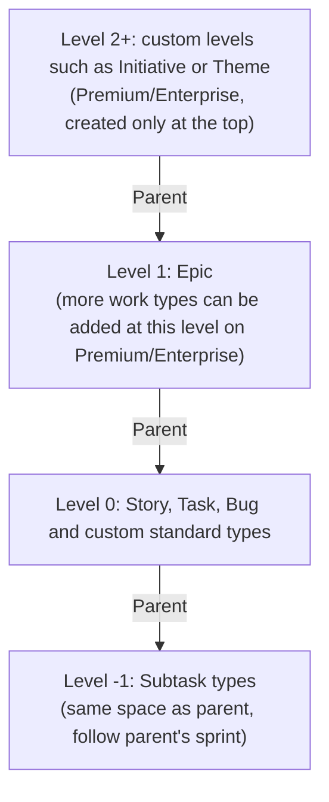
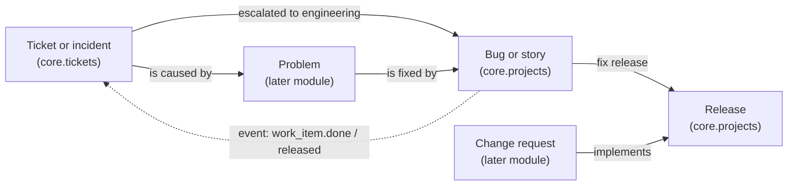

# Jira work hierarchy and work item model (research)

This is product research for Esmbler, written at the product owner's request (see [progress](../progress.md), "Interjected"). It describes how Jira (Jira Software / Jira Cloud) and Jira Service Management (JSM) model work as of October 2026, what customers complain about, and what Esmbler should copy, do differently or avoid when it builds a Projects module ([REQ-MOD-004](../spec/traceability.md)) and links service tickets to engineering work. It is a reference, not a decision: anything adopted goes through an ADR or the [assumptions log](../decisions/assumptions.md).

Sources are cited inline. Official Atlassian pages (support.atlassian.com, developer.atlassian.com, atlassian.com) are primary. Community posts and third-party pages are marked as such where they are the only source. Atlassian renamed many concepts in 2025–2026 and several support pages were mid-rebrand when read, so some names may differ on a given site.

## Top findings

1. **Jira's core model is one record type ("work item") with a type discriminator and a numeric hierarchy level.** Epic is level 1, standard types (story, task, bug) level 0, subtasks level −1, and Premium/Enterprise sites add levels above Epic. One `Parent` field replaced Epic Link and Parent Link in 2024 ([work type hierarchy](https://support.atlassian.com/jira-cloud-administration/docs/configure-the-issue-type-hierarchy/), [Parent field announcement](https://community.atlassian.com/forums/discussion/2377758/introducing-the-new-parent-field-in-company-managed-projects)).
2. **The hierarchy is rigid in ways customers dislike.** Levels can be added only above the top, so nothing fits between Epic and Story. Changing the hierarchy breaks existing parent links and cannot be undone. Subtasks must stay in their parent's space and sprint.
3. **Configuration is spread across a dozen shared "schemes".** These cover work types, workflows, fields, screens, permissions, notifications and security. In 2026 Atlassian started enforcing hard limits (700 fields and 150 work types per space, 200 statuses per workflow) and shipped clean-up tools because configuration sprawl was hurting performance ([data limits](https://support.atlassian.com/jira-cloud-administration/docs/data-limits-and-guardrails/), [optimisation tools](https://www.atlassian.com/blog/how-we-build/optimisation-tools-for-jira)).
4. **There are two project models (team-managed and company-managed) with different features.** Moving between them loses components, versions, sprints and report history ([migration guide](https://support.atlassian.com/jira-software-cloud/docs/migrate-between-team-managed-and-company-managed-projects/)). Even estimation has two fields: "Story points" and "Story point estimate".
5. **Status categories (To Do, In Progress, Done) are the thing that makes cross-workflow reporting, boards and roll-ups work.** Esmbler already has a richer version with six state categories.
6. **Boards are saved queries plus column-to-status mapping plus a global rank.** Rank is one LexoRank string shared by every board. WIP limits are visual only and not enforced.
7. **Planning features are layered and tier-gated.** Basic timeline roll-ups are turned off above 10,000 items. Cross-space hierarchy, estimate roll-ups, capacity, dependencies and scenarios need Plans (Premium/Enterprise).
8. **JSM is Jira plus a request layer.** Request types are portal-facing views over work types. Queues, SLAs (start/pause/stop conditions, JQL goals, calendars) and approvals sit on workflow statuses. ITSM to dev linkage is mostly plain links ("is caused by") plus deployment gating for changes.
9. **AI in 2025–2026 moved from helpers to agents.** The helpers are AI work breakdown, natural-language to JQL, summaries and formula fields. The agents can be assignees, are triggered by transitions or board columns, and Rovo can generate a whole space from a description ([summer 2026 release](https://www.atlassian.com/blog/development/jira-summer-release), [agents on work items](https://support.atlassian.com/jira-software-cloud/docs/collaborate-on-work-items-with-ai-agents/)).
10. **Esmbler can model most of this declaratively, but it lacks six platform capabilities.** They are typed many-to-many links, a hierarchy relationship with roll-ups, a rank field with a move command, a board (Kanban) element, time-series metrics from state history, and a sprint/iteration pattern with a bulk close-out command. The [recommendations](#prioritized-recommendations) rank them.

## Terminology (2025–2026 renames)

| Old Jira term | Current term | Notes |
| --- | --- | --- |
| Issue | Work item ("work" collectively) | Rolled out 2025, Free/Standard first; Data Center unchanged ([community announcement](https://community.atlassian.com/forums/Jira-articles/It-s-here-Work-is-the-new-collective-term-for-all-items-you/bc-p/2983529), [Jimi Wikman, Community Champion](https://jimiwikman.se/content/writings/my-articles/atlassian/the-renaming-of-issues-and-making-work-as-the-new-collective-term-for-all-items-tracked-in-jira-r253/)) |
| Issue type | Work type | Story, task, bug, epic keep their names |
| Project | Space | From late 2025, Premium/Enterprise from 20 October 2025; "purely terminology" ([Jira Spaces have landed](https://community.atlassian.com/forums/Jira-articles/Jira-Spaces-have-landed/ba-p/3117620)) |
| Next-gen / classic project | Team-managed / company-managed space | |
| Advanced Roadmaps | Plans (advanced planning) | Premium and Enterprise ([Plans guide](https://www.atlassian.com/software/jira/guides/advanced-roadmaps)) |
| Epic Link, Parent Link | Parent | 2023–2024 ([Parent field announcement](https://community.atlassian.com/forums/discussion/2377758/introducing-the-new-parent-field-in-company-managed-projects)) |
| Automation rule, component | Flow, step | 2026 docs ([What are automation flows](https://support.atlassian.com/jira-core-cloud/docs/what-are-automation-rules/)) |
| Atlassian Intelligence | Rovo (AI features and agents) | |
| Conditions, validators, post functions | Restrict transitions, Validate details, Perform action (new workflow editor) | ([Edit a workflow's rules](https://support.atlassian.com/jira-cloud-administration/docs/edit-an-issue-workflow/)) |

Lesson for Esmbler: a large vendor spent two years renaming its core nouns. Esmbler's labels are already stable IDs with display labels, so it can rename freely. The only rule is never to put a label in an ID.

## 1. Work hierarchy

### Levels

- **Default levels.** "Three levels ship by default: level 1 is Epic, level 0 is Story, and level −1 is Subtask." Admins manage them under Settings → Work items → Work type hierarchy. Changes apply to every company-managed space on the site ([Configure the work type hierarchy](https://support.atlassian.com/jira-cloud-administration/docs/configure-the-issue-type-hierarchy/)).
- **Custom levels.** Premium and Enterprise sites can "Create level". The new level is always placed "at the top of the work type hierarchy". Removing a level sends its work types back to level 0. "Changing your work type hierarchy will break existing parent and child relationships between your work items… Once these changes are made, they cannot be undone" (same page). Plans uses the levels to unify work across spaces. Its hierarchy "correlates to, but is independent from" the work type scheme, and the Parent field must be on screens for the relationships to show ([Configure custom hierarchy levels in your plan](https://support.atlassian.com/jira-software-cloud/docs/configure-custom-hierarchy-levels-in-advanced-roadmaps/)).
- **Nothing between Epic and Story.** Community experts report that levels can only be added above Epic. The common workaround is to rename Epic to "Feature" and create a new "Epic" type above it ([community thread](https://community.atlassian.com/forums/Jira-questions/Guidance-on-implementing-Epic-Feature-Story-hierarchy-in-Jira/qaq-p/3198888); not stated on the official page).
- **One parent per item, typed by level.** A level-N item's parent must be at level N+1. A subtask cannot take an Epic as parent ([community](https://community.atlassian.com/forums/Jira-questions/How-to-add-Epic-link-to-Subtask-with-new-Parent-field-that/qaq-p/2565774)). Subtasks must be in the same space as their parent; cross-space subtasks are a long-standing open request ([JRACLOUD-59141](https://jira.atlassian.com/browse/JRACLOUD-59141)). Epics and higher levels can parent items in other spaces.
- **Ordinary links do not count.** "Jira will not recognize a generic issue link as a parent/child relationship" ([community](https://community.atlassian.com/forums/App-Central-articles/Jira-Hierarchy-Levels-Structure-amp-Best-Practices/ba-p/3264323)). Apps such as Structure exist largely to build deeper or link-based trees.

### The Parent field (Epic Link retirement)

- In company-managed spaces, Epic Link and Parent Link were replaced by the single Parent field that team-managed spaces already used. Views, create screens and transition screens that showed the old fields were migrated automatically, and existing values moved to Parent ([Parent field announcement](https://community.atlassian.com/forums/discussion/2377758/introducing-the-new-parent-field-in-company-managed-projects)).
- JQL `parent` was extended to cover the old `"Epic Link"`, `"Parent Link"` and `parentEpic` searches, and automation rules had to move to the Parent field ([automation KB](https://confluence.atlassian.com/automationkb/jira-automation-create-and-link-child-issues-with-epic-when-rule-triggered-manually-from-an-existing-epic-1188419965.html)).
- Any hierarchy level can be renamed ([Configure the work type hierarchy](https://support.atlassian.com/jira-cloud-administration/docs/configure-the-issue-type-hierarchy/)), and Atlassian announced the Parent field together with "flexible naming" ([Beyond epics: flexible naming has landed](https://community.atlassian.com/forums/discussion/2609733/beyond-epics-flexible-naming-has-landed)). The hierarchy level, not the type name, now carries the meaning.

The design lesson: Jira spent years undoing a special case. Epic was a work type with its own link field, Epic Name and Epic Status fields. The generic replacement is "one parent reference whose allowed targets are set by level". Esmbler should start with the generic form.

### Work types and work type schemes

- A **work type** (story, bug, task, epic, subtask or custom) is a discriminator on the single work item record. A **work type scheme** lists the types available in a company-managed space. Team-managed spaces define their own types. Since March 2026 the hard limit is 150 work types per space ([data limits](https://support.atlassian.com/jira-cloud-administration/docs/data-limits-and-guardrails/)).
- Almost every other scheme is keyed by work type: workflow scheme (type → workflow), field configuration scheme (type → field behavior), work type screen scheme (type → screens per operation), and field contexts (type + space → options and defaults). Per-type behavior is powerful, and it is also why configuration multiplies (see [pain points](#9-well-known-pain-points)).

## 2. Fields and configuration

| Concept | What it does | Scope |
| --- | --- | --- |
| Custom field | Typed field (text, number, select, user, date, cascading select and others) | Global object in company-managed spaces; space-local in team-managed spaces |
| Field context | Options and default value per space and work type combination; a global context is the fallback ([contexts](https://support.atlassian.com/jira-cloud-administration/docs/configure-advanced-field-options-using-contexts/)) | Field × spaces × work types |
| Field configuration (+ scheme) | Required, hidden, description and renderer per field; the scheme maps work types to configurations ([field behavior](https://confluence.atlassian.com/adminjiracloud/specifying-field-behavior-776636443.html)) | Shared across spaces |
| Screen, screen scheme, work type screen scheme | Which fields appear on create, edit and view, and on transition screens ([defining a screen](https://confluence.atlassian.com/adminjiracloud/defining-a-screen-776636475.html)) | Shared across spaces |
| Formula fields (2026) | Calculated fields such as remaining budget or days to deadline; "Describe what you want in plain language and Rovo writes the formula" ([summer 2026 release](https://www.atlassian.com/blog/development/jira-summer-release)) | Space |

Agile-specific fields:

- **Estimation.** Company-managed boards use an "estimation statistic", by default the Story Points field. Team-managed spaces use a separate "Story point estimate" field. Only the native field shows on board cards, and merging the two is an open request ([community](https://community.atlassian.com/forums/Jira-questions/Jira-Story-Points-are-gone/qaa-p/3209924)). Time tracking (original estimate, remaining, logged) is a separate system feature that drives the time-tracking reports ([reports](https://support.atlassian.com/jira-software-cloud/docs/generate-a-report/)).
- **Components** are space-scoped, admin-managed values, often with a default assignee. **Versions (releases)** are space-scoped containers with a status (unreleased, released, archived). Work items reference them through Fix version and Affects version. **Labels** are free-form and anyone can create them while editing. All three are flat, with no hierarchy ([Atlassian blog on subcomponents](https://www.atlassian.com/blog/development/organize-jira-issues-subcomponents)). Hard limits from September 2026: 10,000 components and 15,000 releases per space ([data limits](https://support.atlassian.com/jira-cloud-administration/docs/data-limits-and-guardrails/)).
- **Sprint** is a system field whose value is the sprint(s) an item was in. An item can belong to closed sprints and one open sprint at the same time, which is how carry-over history is kept.
- **Rank** is a locked system field that stores a LexoRank string. Ranking is global: "issues keep the same order across projects and boards", and a background service rebalances the strings as they grow ([How Jira issue ranking works, community](https://community.atlassian.com/forums/Jira-articles/How-Jira-Issue-Ranking-Works/ba-p/1371226)).

A JSM-specific trap: a field hidden from the portal with no valid default blocks request creation ("This form contains a hidden field that does not have a valid default value configured", [KB](https://support.atlassian.com/jira/kb/error-this-form-contains-a-hidden-field-that-does-not-have-a-valid-default-value-configured-when-raising-a-new-request-from-the-customer-portal/)). Esmbler's compiler should reject that combination at publish time instead of failing at runtime.

## 3. Workflows

- **Statuses and status categories.** Every status belongs to one of three categories, To Do, In Progress or Done. The category gives its color and its place in the lifecycle, and boards, timelines, roll-ups and reports read it ([community explainer](https://community.atlassian.com/forums/Jira-articles/Jira-Image-of-the-Day-Status-Categories/ba-p/2646552)). The category does not affect permissions. Resolution is a separate field, usually set on the transition into Done. Hard limit from September 2026: 200 statuses per workflow and 150 workflows per workflow scheme ([data limits](https://support.atlassian.com/jira-cloud-administration/docs/data-limits-and-guardrails/)).
- **Transitions** are directed edges between statuses. Company-managed workflows also allow "global" transitions (any status to X). Team-managed workflows default to "any status to any status".
- **Rules on transitions.** The new workflow editor renamed and regrouped them ([Edit a workflow's rules](https://support.atlassian.com/jira-cloud-administration/docs/edit-an-issue-workflow/)):

  | New editor group | Classic name | Examples |
  | --- | --- | --- |
  | Restrict transitions | Conditions | Only certain users or groups; "Complex logic is best delivered with the Restrict transitions rule" |
  | Request input | Transition screen | Show a screen to set resolution or add a comment |
  | Validate details | Validators | Field must have a value before the transition completes |
  | Perform action | Post functions | Update a field, assign, add comment, require subtasks done, notify or call a webhook |

  Marketplace apps (JMWE, JSU, Workflow Toolbox) add scripted conditions and validators. Their support in the new editor arrived late, especially in team-managed spaces ([JRACLOUD-85534](https://jira.atlassian.com/browse/JRACLOUD-85534)).
- **Workflow schemes** map work types to workflows per company-managed space. JSM approvals are configured on a workflow status (see [section 5](#5-jira-service-management)).
- **AI agents on transitions (2026).** A site admin can attach an agent to a transition so it starts when work moves into a status ([agents on work items](https://support.atlassian.com/jira-software-cloud/docs/collaborate-on-work-items-with-ai-agents/)).

### Team-managed vs company-managed

| Aspect | Team-managed | Company-managed |
| --- | --- | --- |
| Who configures | Space admins, no Jira admin needed | Jira admins, through shared schemes and screens ([comparison](https://support.atlassian.com/jira-software-cloud/docs/what-are-team-managed-and-company-managed-projects/)) |
| Sharing | Nothing shared; fields are space-local | Schemes are shared, so one change affects every space using them |
| Boards | One board per space; cannot pull from two spaces ([ONES, third-party](https://ones.com/blog/team-managed-vs-company-managed-jira-project-types-compared/)) | Many Scrum or Kanban boards per space, each driven by a saved filter that can span spaces |
| Estimation | Story point estimate | Story Points or any numeric field as the board's estimation statistic |
| Reports | Burnup, velocity, sprint burndown, CFD | Full set, including control chart, epic and version reports ([reports](https://support.atlassian.com/jira-software-cloud/docs/generate-a-report/)) |
| Migration | Moving work between the two loses components, versions, sprints and report history; custom field values "will appear blank" ([migration guide](https://support.atlassian.com/jira-software-cloud/docs/migrate-between-team-managed-and-company-managed-projects/)) | |

The trade-off is autonomy against standardization. Atlassian solved it with two products in one, and users still struggle to pick one. Esmbler gets the same split from its layered overlays (base module, tenant overlay, permissions), so it should not add a second project model.

## 4. Boards and planning

### Scrum and Kanban boards

- A board "displays issues from one or more projects". A space can have several boards, mixing Scrum (sprints) and Kanban (continuous flow, WIP) ([What is a board?](https://confluence.atlassian.com/jirasoftwareserver/what-is-a-board-938845235.html), Data Center docs; same model in Cloud company-managed spaces).
- **A company-managed board** is a saved JQL filter plus a column → status mapping plus swimlanes (by query, assignee, epic/parent or story) plus quick filters plus card layout plus an estimation statistic. A work item is "done" for the sprint when it is in the last column ([Complete a sprint](https://support.atlassian.com/jira-software-cloud/docs/complete-a-sprint/)).
- **WIP limits** are per-column minimum and maximum "column constraints". They are visual warnings and are not enforced ([community](https://community.atlassian.com/t5/Jira-questions/How-to-set-the-WIP-Limit/qaq-p/877982)). Per-swimlane, per-person and story-point-based limits are open requests ([JSWSERVER-3517](https://jira.atlassian.com/browse/JSWSERVER-3517)) served by Marketplace apps.
- **Summer 2026.** Board, list and timeline were rebuilt on a shared foundation: work items load 45% faster, lists and search 48% faster, boards and backlogs up to 22% faster. Team-managed boards got swimlanes, subtasks on cards, inline editing and "no work item caps". List and All Work merged into one List view with JQL or natural-language search, parent/child hierarchy, inline editing and saved views ([summer 2026 release](https://www.atlassian.com/blog/development/jira-summer-release)). Boards can now assign agents to columns ([release notes](https://community.atlassian.com/release-notes/release-tracks-changes?products=JIRA_SOFTWARE&bundleDate=2026-08-11&limit=100)).

### Backlog and sprints

- The Scrum backlog lists unscheduled work and future sprints, ordered by rank. Sprints are created on a board, given a name, goal, start and end, and started one at a time unless the Parallel Sprints feature is on ([sprints tutorial](https://www.atlassian.com/agile/tutorials/sprints)).
- **Completing a sprint** needs the Manage Sprints permission. Unfinished work goes to the backlog, a future sprint or a new sprint ([Complete a sprint](https://support.atlassian.com/jira-software-cloud/docs/complete-a-sprint/)).
- **Subtasks follow their parent.** They "cannot be assigned to a sprint independently", and when the parent carries over, all its subtasks move with it, done or not ([community](https://community.atlassian.com/forums/Jira-questions/Alternatives-to-putting-subtasks-in-different-sprints/qaq-p/2194558)).

### Timeline and Plans

- **Timeline (space level).** A Gantt-style view of start and due dates with dependencies. Parent dates roll up: "The parent start date is the earliest start date of its child items", the end date is the latest child due date, and progress reflects child statuses. "In very large spaces, we may turn off automatic roll-ups" (above 10,000 work items) ([timeline](https://support.atlassian.com/jira-software-cloud/docs/what-is-the-timeline-and-how-do-i-use-it/), [software space timeline](https://support.atlassian.com/jira-software-cloud/docs/create-manage-and-visualize-work-on-the-timeline/)). Child-level planning, releases and PNG or Confluence export are available.
- **Plans (Premium/Enterprise)** "pulls work from multiple projects and boards into a single project timeline", sourced from boards, spaces and JQL filters. Views: Summary, Timeline, List, Program board, Calendar, Teams (capacity), Dependencies and Scenarios ("what if") ([Plans guide](https://www.atlassian.com/software/jira/guides/advanced-roadmaps)). Plans rolls up estimates from remaining work: unestimated children are ignored, filters apply, and rolled-up values can be overridden ([How your plan rolls up estimates](https://support.atlassian.com/jira-software-cloud/docs/how-advanced-roadmaps-rolls-up-estimates)). Dependencies come from link types and show a lead time ([Managing dependencies, Portfolio docs](https://confluence.atlassian.com/display/JIRAPortfolioServer0220/Managing+dependencies)). A new Capacity view (2026) shows allocation per person beside the backlog.

### Links and dependencies

- Link types are site-wide pairs of outward and inward descriptions. Defaults include blocks / is blocked by, clones / is cloned by, duplicates / is duplicated by, relates to, causes / is caused by, implements / is implemented by, reviews / is reviewed by, merged into / merged from, and is idea for / added to idea ([Link work items](https://support.atlassian.com/jira-software-cloud/docs/link-issues/)). Admins add, rename or delete types and can remap existing links when deleting one. Clone types should not be edited, because cloning uses them ([Configure work item linking](https://support.atlassian.com/jira-cloud-administration/docs/configure-issue-linking/)).
- Links are untyped in behavior. "Blocks" means something to Plans and timeline dependency lines, but no workflow rule enforces it out of the box. Teams add validators or automation to do that.
- Remote links point to Confluence pages, web URLs and development data (branches, commits, pull requests, builds and deployments from GitHub, Bitbucket, GitLab and Jenkins), shown in the development panel.

## 5. Jira Service Management

| Concept | How JSM does it |
| --- | --- |
| Service space and work categories | A service space adds work categories (Service requests, Incidents, Problems, Changes, Post-incident reviews), each with dedicated request types, queues and reports ([JSM features](https://support.atlassian.com/jira-service-management-cloud/docs/get-to-know-the-main-jira-service-management-features/)) |
| Request type | A portal-facing form and name over an underlying work type. The work type decides workflow and fields; the request type decides portal label, portal group, which fields show and their portal names. A field can be "preset and hidden from portal". Some fields (assignee, linked items, version pickers) can only be preset, and some (reporter, time tracking, security level) cannot be added at all ([hidden and unsupported fields](https://support.atlassian.com/jira-service-management-cloud/docs/what-are-hidden-fields-and-unsupported-fields-in-request-types)) |
| Portal and help center | Request types are grouped into portal groups (two levels: group, then request) with a knowledge base beside them |
| Queues | Saved JQL views for agents, usually sorted by SLA, with priority groups ([queues](https://support.atlassian.com/jira-service-management-cloud/docs/check-out-your-queues/)) |
| SLAs | A metric (for example Time to first response) with start, pause and stop conditions (events or statuses), plus ordered goals, each a JQL filter, a target duration and a calendar (working hours, time zone, holidays) ([setting up SLAs](https://confluence.atlassian.com/servicemanagementserver0416/setting-up-slas-1062241713.html)). JQL functions: `breached()`, `everBreached()`, `paused()`, `running()`, `completed()`, `elapsed()`, `remaining()`, `withinCalendarHours()` ([SLA JQL](https://confluence.atlassian.com/servicemanagementserver101/using-jql-queries-specific-to-slas-1455887606.html)) |
| Approvals | An approval step is attached to a workflow status, with an approvers field (user or group picker, customer-chosen or preset per request type), the number of approvals needed, and approve and decline transitions. Approvers do not need an agent license and can approve from email or chat ([Set up an approval stage](https://support.atlassian.com/jira-service-management-cloud/docs/set-up-an-approval-stage-for-a-request/), [DC configuration](https://confluence.atlassian.com/adminjiraserver104/configuring-jira-service-management-approvals-1527942701.html)) |
| Incident → dev work | Open the incident, choose Link work item, select "is caused by" and pick the work item, for example in a software space when "a second or third-line support member needs to work on a fix". Incidents also link to problems and change requests ([link incidents](https://support.atlassian.com/jira-service-management-cloud/docs/link-incident-records-to-a-task-in-another-project/)) |
| Change management | Change requests with risk assessment (automation-based), CAB approvals, and deployment tracking from Bitbucket, GitHub or Jenkins. Deployment gating maps an "allow" status (for example Implementing) and a "prevent" status (for example Declined) so the pipeline waits for change approval ([deployment gating](https://support.atlassian.com/jira-service-management-cloud/docs/set-up-deployment-gating/), [modern change management](https://www.atlassian.com/blog/it-teams/a-modern-approach-to-change-management-with-bitbucket-and-jira-service-management)) |
| Assets, on-call | Assets (CMDB) schemas connect to incidents and changes; alerting and on-call (former Opsgenie) live inside JSM |

ITSM practice embedded in JSM: incident → problem (root cause) → change (fix) → deployment. Dev work in Jira Software is linked rather than owned. A support agent sees the linked story's status, but the request and the dev item have separate workflows, fields and permissions. Keeping them in sync (for example notifying the customer when the bug fix ships) is left to automation.

## 6. Automation, permissions and notifications

### Automation (flows)

- A flow is a trigger, then conditions, actions and branches ("Every flow starts with a trigger"). Branches run steps on related items (subtasks, parent, linked items, JQL results). Advanced steps are Premium/Enterprise only ([What are automation flows](https://support.atlassian.com/jira-core-cloud/docs/what-are-automation-rules/)). Flows can be scoped to one space, several spaces or globally, and run as a configured actor.
- **Smart values** are templates over the triggering item and context (`{{issue.key}}`, `{{issue.parent.summary}}`, `{{lookupIssues}}`), usable in almost any field ([concepts](https://confluence.atlassian.com/automation074/concepts-1141481028.html)).
- **Service limits** ([automation service limits](https://support.atlassian.com/cloud-automation/docs/automation-service-limits/)):

  | Limit | Value |
  | --- | --- |
  | Steps per flow / per advanced flow | 65 / 500 |
  | Concurrent flows (Free / Standard / Premium / Enterprise) | 5 / 10 / 20 / 30 |
  | Scheduled JQL search results | 999 work items |
  | Lookup work items action | 100 work items |
  | Associated items per flow | 5,000 |
  | Loop detection | 10 self- or cross-triggers, then the run stops as LOOP |
  | Daily processing time | 60 minutes per 12 hours |

  Usage quotas are metered per plan, and in 2026 the metric changed from "rule runs" to "automation steps" ([third-party pricing tracker](https://pricingsaas.com/companies/atlassian.jira/diffs/2026W37)).
- **AI in automation:** a "Use Rovo Agent" step (soft limit 500 requests per minute) and Delivery Agent templates for health checks, standup digests and stakeholder updates ([summer 2026 release](https://www.atlassian.com/blog/development/jira-summer-release)).

### Permissions and notifications

- **Permission scheme:** a set of grants, each a permission (Browse, Create, Edit, Transition, Manage Sprints, Administer space and so on) given to a holder (group, space role, user, reporter, assignee or user field). Schemes are shared by spaces ([REST: permission schemes](https://developer.atlassian.com/cloud/jira/platform/rest/v3/api-group-permission-schemes/)). Hard limit from September 2026: 50 grants per permission ([data limits](https://support.atlassian.com/jira-cloud-administration/docs/data-limits-and-guardrails/)).
- **Work item security scheme:** one per space. Levels restrict who can see an individual item; the hard limit is 50 levels per space ([security schemes](https://support.atlassian.com/jira-cloud-administration/docs/restrict-sensitive-data-using-work-item-security-schemes/)).
- **Notification scheme:** event (created, assigned, transitioned, commented) → recipients (role, group, assignee, reporter, watchers, user field). Recipients still need browse permission. JSM adds customer notifications per request type.
- There is **no field-level read security** in core Jira. Field configurations hide fields from screens but not from the API or search. This is a known weak spot that Esmbler's field-level permissions already cover ([REQ-RULE-006](../spec/traceability.md)).

## 7. Reporting and JQL

| Report | Board type | What it shows ([Generate a report](https://support.atlassian.com/jira-software-cloud/docs/generate-a-report/)) |
| --- | --- | --- |
| Sprint burndown | Scrum | Remaining work in the sprint against the guideline, by estimation statistic |
| Burnup | Scrum, team-managed | Sprint scope against completed work |
| Velocity | Scrum | Committed against completed estimate per sprint (gray bar = estimate at sprint start) |
| Sprint report | Scrum | Completed and returned-to-backlog items, scope changes |
| Epic report, epic burndown | Scrum | Progress of one epic; projected sprints to finish |
| Version report, release burndown | Scrum | Projected release date for a version |
| Cumulative flow diagram | Scrum, Kanban | Count of items per status over time (bottlenecks) |
| Control chart | Scrum, Kanban (company-managed) | Cycle time per item, rolling average and deviation |
| General reports | Any (space or filter) | Average age, created vs resolved, pie chart, resolution time, time since, time tracking, user and version workload |

- Agile reports are tied to a board and its estimation statistic. A report about a team that spans several boards needs Plans, dashboards or Marketplace apps. One vendor notes the native velocity chart is "capped at 7 sprints" ([third-party listing](https://marketplace.atlassian.com/apps/3707070829/velocity-chart-for-jira)).
- **Dashboards** are grids of gadgets: filter results, pie chart, two-dimensional filter statistics, created vs resolved, sprint burndown and others, each bound to a saved filter or board. "Built-in gadgets can't… combine multiple data sources into a single chart" ([Add and customize gadgets](https://support.atlassian.com/jira-software-cloud/docs/add-and-customize-gadgets/)).
- **JQL** is the universal query language behind boards, filters, queues, SLA goals, automation conditions, dashboards and Plans. It covers fields, `ORDER BY Rank`, functions such as `openSprints()`, `futureSprints()`, `closedSprints()`, `unreleasedVersions()`, `releasedVersions()`, `membersOf()`, `currentUser()` and `linkedIssues()`, hierarchy (`parent in (...)`, `portfolioChildIssuesOf()` in Plans, which does not include team-managed spaces, [JPOCLOUD-7620](https://jira.atlassian.com/browse/JPOCLOUD-7620)), and history operators (`status WAS`, `CHANGED`). Atlassian's own JQL function reference was not readable when this was written, so check the exact names against the live docs.

## 8. AI features (Atlassian Intelligence and Rovo, 2025–2026)

| Feature | What it does | Notes |
| --- | --- | --- |
| AI work breakdown | Suggests child work items for an epic or large item, optionally grounded in a linked Confluence page; the user reviews, edits and accepts each or all. Available in Plans ("Suggest child work items") and in List view ("Break down with Rovo", the `/create-work-items` skill) | Respects the user's permissions ([announcement](https://answers.atlassian.com/t5/Atlassian-Intelligence-Articles/Spend-less-time-creating-work-and-more-time-moving-work-forward/ba-p/2681622), [list view](https://jimiwikman.se/atlassian/atlassian-resources/atlassian-app-updates/break-down-work-items-with-rovo-in-list-view-r1265/)). Creating subtasks in the same pass as stories can fail ([ROVO-704](https://jira.atlassian.com/browse/ROVO-704)) |
| Natural-language search | "Rovo in Jira can translate what you type into a Jira Query Language (JQL) code", from List → Ask AI. Works best in English with fields that exist; not for charts, analysis or non-work entities ([Search with Rovo](https://support.atlassian.com/jira-software-cloud/docs/use-atlassian-intelligence-to-search-for-work-items/)) | On by default on Standard, Premium and Enterprise |
| Work item summary | Card at the top of a work item: what it is about, where it stands, who is involved, next steps | Summer 2026 |
| Formula fields | Plain-language description → formula; results searchable and sortable | Summer 2026 |
| Rovo-generated spaces | Describe how the team works (or attach Confluence pages, Looms, images) → Rovo generates a space with workflows, work types, views and first work items ([summer 2026 release](https://www.atlassian.com/blog/development/jira-summer-release)) | Closest analogue to Esmbler's guided creation ([REQ-WS-001](../spec/connected-workspace.md)) |
| Agents in Jira | Assign an agent from the Agent picker, @mention it, attach it to a transition or a team-managed board column. Rovo agents, space-built agents and third-party or MCP agents (GitHub Copilot coding agent, and others) are available. Output is private until shared ([agents on work items](https://support.atlassian.com/jira-software-cloud/docs/collaborate-on-work-items-with-ai-agents/), [AI agents in Jira](https://www.atlassian.com/blog/rovo/ai-agents-in-jira)) | Consumes Rovo credits; allowances start 3 December 2026 |
| Delivery Agent | Automation templates for health checks, standup digests and stakeholder updates | Summer 2026 |
| Rovo MCP server | Remote MCP server (GA early 2026) exposing Jira and Confluence search, create, update and link to external AI clients with OAuth 2.1 and admin allowlists ([GA announcement](https://community.atlassian.com/forums/discussion/3186690/announcing-ga-of-the-atlassian-rovo-mcp-server)) | Data access, not configuration building |

Atlassian's AI mostly creates and summarizes **records**. Configuration is generated wholesale ("generate a space") or by formula, with no reviewable, diffable change set the way Esmbler's draft and overlay model works ([REQ-AI-005](../spec/traceability.md)). That gap is Esmbler's differentiator.

## 9. Well-known pain points

| Pain point | Evidence | Esmbler implication |
| --- | --- | --- |
| Configuration sprawl and scheme complexity | Atlassian introduced hard limits (700 fields per space and others) and clean-up tools because unused fields and work types "lead to slower experiences, heavier data shapes, and higher admin overhead"; customers removed "tens of millions" of unused fields ([optimisation tools](https://www.atlassian.com/blog/how-we-build/optimisation-tools-for-jira), [data limits](https://support.atlassian.com/jira-cloud-administration/docs/data-limits-and-guardrails/)) | Keep configuration per module and overlay, not per shared scheme. Publish field-usage analytics and guardrails early |
| Steep learning curve, "too many similar settings" | Capterra and G2 reviews: "a lot of settings, and many settings seem similar"; complex permissions and automation "often require a dedicated administrator" ([Capterra](https://www.capterra.com/p/19319/JIRA/reviews/), [G2](https://www.g2.com/survey_responses/jira-review-4533740)) | The AI builder and guided creation should be the default path, with advanced settings secondary |
| Performance at scale | Reviews cite lag on transitions and large projects; timeline roll-ups are turned off above 10,000 items; the 2026 rebuild gave 22–48% speedups ([summer 2026 release](https://www.atlassian.com/blog/development/jira-summer-release)) | Budget roll-ups and board queries from day one (bounded queries, [REQ-REC-002](../spec/traceability.md)) |
| Rigid hierarchy | Levels only at the top, Premium-gated, changes irreversible; subtasks tied to parent's space and sprint | Allow hierarchy definitions to be edited safely (typed overlay ops, migration report) |
| Two project models | Feature gaps and lossy migration ([migration guide](https://support.atlassian.com/jira-software-cloud/docs/migrate-between-team-managed-and-company-managed-projects/)); two story point fields | One model; governance through permissions and overlays |
| Global rank | One order shared by all boards; a board-specific order needs another field ([community](https://community.atlassian.com/forums/Jira-articles/How-Jira-Issue-Ranking-Works/ba-p/1371226)) | Rank per ordering context, with a global default |
| WIP limits not enforced | Visual only ([community](https://community.atlassian.com/t5/Jira-questions/How-to-set-the-WIP-Limit/qaq-p/877982)) | Offer advisory or enforced limits as a rule |
| Board-bound reports | Velocity and burndown depend on one board's filter and estimation statistic | Metrics bound to named definitions ([REQ-WS-004](../spec/connected-workspace.md)), not to a view |
| Renaming churn | Issues → work items, projects → spaces; users "aren't so sure" ([UC Today](https://www.uctoday.com/project-management/jira-projects-are-now-spaces-atlassian-says-its-clarity-users-arent-so-sure/)) | Labels are tenant-editable; IDs never change |
| Runtime errors from configuration | Hidden portal field without a valid default blocks request creation ([KB](https://support.atlassian.com/jira/kb/error-this-form-contains-a-hidden-field-that-does-not-have-a-valid-default-value-configured-when-raising-a-new-request-from-the-customer-portal/)) | Catch at compile time with an actionable error ([REQ-AI-004](../spec/traceability.md)) |

## 10. What Esmbler should learn

### Concept map: Jira to Esmbler today

| Jira concept | Esmbler primitive today | Gap |
| --- | --- | --- |
| Space (project) | Module (`core.projects`) installed per tenant environment; tenant overlay | Multiple "projects" or teams inside one module need a `team` or `project` record and record-level access, not separate configurations |
| Work item + work type | Entity record + `single_select` discriminator; conditional rules (show, require, read-only, restrict options) keyed on the type ([REQ-RULE-002](../spec/traceability.md)) | No per-type workflow or per-type layout selection; only guards and conditional visibility |
| Parent / hierarchy levels | `lookup` relationship to the same entity, `onTargetDelete: restrict` (Tickets `core.tickets.parent_child`) | No allowed-parent rules by type or level, no cycle prevention, no descendant query, no roll-ups, no cross-entity hierarchy |
| Link types (blocks, relates, duplicates, causes) | None (only many-to-one lookups); catalog task dependencies exist inside fulfillment ([ADR 0015](../adr/0015-requests-catalog-fulfillment-and-workflow-versions.md)) | Typed many-to-many links through the shared link service (master spec "Module communication") |
| Status + status category | Workflow states with six categories (new, active, pending, resolved, closed, cancelled) | Already richer than Jira; reuse for boards, CFD, cycle time |
| Transition conditions, validators, post functions | Transition `guard`, `roles`, `requiredFields`, `set` expressions, `emits`; data rules on every write path | Mostly covered. Missing: transition screens beyond required fields, and "all children done" style aggregate guards |
| Rank | None | Rank field type and move command |
| Board (Scrum or Kanban) | `collection.data_table`, `collection.saved_views`, `collection.filter_bar` | Board element (master spec lists "Kanban board" and "Board view" as long-term elements) |
| Sprint, version, component | Could be entities with lookups | Container semantics: one active sprint per team, close-out with carry-over, membership history |
| Estimation, roll-ups | `decimal` field | Rollup and formula fields (master spec "Computed/formula field, Rollup") |
| Burndown, velocity, CFD, control chart | Metric definitions and dashboards planned in G2-M9 ([REQ-WS-004](../spec/connected-workspace.md)); full audit history ([REQ-REC-007](../spec/traceability.md)) | Time-series and "as-of" metrics over field and state history |
| JQL | Typed query contract with CEL filters ([REQ-REC-002](../spec/traceability.md)) | Hierarchy and link operators, history operators (`was`, `changed`), relative date and sprint functions |
| Automation flows | Rules, assignment rules, notifications, event types and publishers ([ADR 0017](../adr/0017-event-audit-alert-notification-services.md)) | General trigger → condition → action automation (master spec "Automation") with branches over related records |
| JSM request types, approvals, SLAs | Catalog items with typed variables, approval policies, SLA policies with business calendars ([Tickets 1.2–1.5](../architecture/modules/tickets.md)) | At parity or better; links to dev work are missing |
| AI work breakdown, NL search, summaries, agents | AI builder over MCP for configuration; agent = user permissions ∩ scopes ([REQ-AI-003](../spec/traceability.md)) | Record-level AI helpers (breakdown, NL → typed query, summaries) as permission-bound MCP tools |

### How a Projects module could look on today's primitives

A declarative `core.projects` module, written on the public SDK like Tickets, could cover most of the agile model before any platform work.

| Element | Proposal |
| --- | --- |
| Entities | `core.projects.work_item` (one entity for epic, story, task, bug, subtask, with a `work_type` discriminator), `core.projects.sprint`, `core.projects.release`, `core.projects.team` (or `project`). Use one entity for work items, as Jira does: type changes stay cheap, boards and backlogs query one entity, and rank covers all types |
| Work item fields | `number` (auto, prefix per module), `title`, `description`, `work_type`, `status`, `priority`, `assignee`, `team`, `parent` (lookup to `work_item`), `sprint` (lookup), `fix_release` (lookup), `story_points` (decimal), `start_date`, `due_date`, `labels`, `component` (single select or entity), `resolution`, `rank` (needs the new field type) |
| Rules | Conditional visibility per `work_type` (epics hide `sprint` and `story_points`; subtasks hide `fix_release`); validation `work_type == 'subtask'` requires `parent`; restrict `parent` choices by type (needs relationship filters); read-only `sprint` on subtasks, set from the parent (needs cross-record set or a hook) |
| Workflow | One workflow, `To do (new) → In progress (active) → In review (active) → Done (resolved)`, plus `Won't do (cancelled)`, with guards per type where needed. Avoid a workflow per type by default |
| Views | Record page with a "Child items" related list and a "Links" panel; list view with saved views (My work, Current sprint, Backlog, Bugs); board view (needs element); dashboard with sprint metrics (needs time series) |
| Roles and access | `core.projects.member`, `core.projects.lead`, `core.projects.viewer`; team membership as a ReBAC relation so a team's members edit its items |
| Events | `core.projects.work_item.done`, `.released` (on release transition), `.blocked`, so Tickets can react through contracts |
| Starter | A "Scrum team" and a "Kanban team" starter for guided creation ([REQ-WS-001](../spec/connected-workspace.md)) |

### Missing platform capabilities

The capabilities below are generic. Tickets, Incidents, Problems, Changes and CMDB need most of them as well, which is why they belong in the platform rather than in a Projects module.

1. **Typed record links.** Many-to-many links with a link type (`id`, outward and inward labels, optional `semantics: blocks | duplicates | causes | relates | implements`) through the kernel's shared relationship/link service. They should work across entities and modules (incident ↔ problem ↔ story), be audited, and never widen access: the master spec requires that "creating a link must not implicitly grant broader access". The UI needs a links panel and a picker that hides records the viewer cannot read.
2. **A hierarchy relationship kind.** Generalize the `lookup` relationship with `kind: hierarchy` and a level map, so the rule "subtask → story, story → epic, epic → initiative" is configuration. Add cycle prevention, a maximum depth, a query operator for descendants and ancestors (a closure table or materialized path under RLS), and safe edits of the level map as overlay ops with an impact report. Jira's "cannot be undone" is the behavior to beat. Allow cross-entity parents so an Epic can be a separate entity if a tenant prefers.
3. **Roll-up and formula fields.** Sum, count, min, max and "percent done by state category" over children or linked records, computed under the viewer's authorization (the master spec forbids leaking through roll-ups), with bounded fan-out and asynchronous recomputation through the outbox.
4. **A rank field type and a move command.** A fractional-index string per ordering context: a global default plus optional named contexts (per board or per team backlog). `record.move { before | after }` with optimistic concurrency and a background rebalance job. Keyboard reordering is part of the design principles.
5. **A board element.** `collection.board` with columns bound to workflow states or state categories. Dragging a card fires the transition, and a transition with required fields opens its form. Add swimlanes by field (assignee, parent, priority), card field configuration, quick filters reused from saved views, rank order within a column, and WIP limits as advisory badges or an enforced data rule. The same element serves Tickets queues as a Kanban view.
6. **Time-series metrics.** Extend G2-M9 metric definitions with "as of date", "state duration" and "count per state per day" measures derived from audit and transition history. That gives burndown and burnup, CFD, cycle and lead time (control chart), velocity per sprint and SLA trends without per-report code. Metrics stay bound to named definitions, not to a board.
7. **Iteration containers.** A `sprint`-like pattern with one active per team, a date range, a goal and a close-out command that previews and then moves unfinished items (bulk update as one audited job with an idempotency key), keeping membership history so reports know an item was carried over. This can be a module entity plus a generic platform "bulk command with preview".
8. **Per-type behavior.** Workflow selection by discriminator (`workflowFor: { work_type: ... }`) and per-type record layouts. Without them, type differences pile into guards and conditional rules. Ship the conditional-rule approach first, and add workflow selection only if real tenants need it.
9. **Timeline and Gantt element** with start and due dates, parent date roll-ups, dependency lines from `blocks` links and release markers. The master spec lists it as a long-term collection element.

### How ITSM tickets should link to dev work

- **Link, do not merge.** Tickets and dev items keep their own workflows, permissions and SLAs. They connect only through typed links and published events. That is also Esmbler's module boundary rule: modules talk through events, contracts and the link service, never each other's data.
- **One action from the ticket.** An "Escalate to engineering" action on a ticket creates a bug in a chosen team's backlog. It pre-fills the title, sanitized description and environment, adds a `causes`/`escalated_to` link, and leaves the ticket in an `on_hold` (pending) state, so its SLA pauses by state category, as Tickets 1.5.0 already supports.
- **Status flows back.** The Tickets module subscribes to `core.projects.work_item.done` and `.released` events through contracts. Each event adds an internal work note and, when every linked dev item is done, offers or performs `resolve`, then notifies the requester ("fixed in release 4.2"). Many-to-one is normal: fifty tickets linked to one bug all get the update. This is what JSM leaves to hand-built automation.
- **Permission-aware projection.** A service agent sees the linked item's number, title, state category and release only if they can read it. Otherwise they see "Linked engineering item (restricted)" or nothing, according to an explicit relationship policy. Engineers see ticket counts and customer impact (number of linked tickets, highest priority) as a roll-up over links, never requester personal data they cannot read.
- **Change and release gating** comes later. A change approval (existing approval policies) gates the release's `ship` transition, mirroring JSM deployment gating without needing a CI/CD integration on day one.

### Prioritized recommendations

| Priority | Recommendation | Why now | Requirement or milestone |
| --- | --- | --- | --- |
| P0 | **Typed record links through the link service**, with a links panel and authorization-neutral semantics | Needed by Tickets (duplicates, caused by), Incidents and Problems (REQ-MOD-003, REQ-MOD-004) and any dev linkage; cheapest high-value gap | REQ-REC-006; master spec "relationship/link service" |
| P0 | **Hierarchy relationship kind with level map, cycle prevention and descendant queries** | Every hierarchy (tickets, projects, CMDB) needs it; Jira's rigid version is a top complaint | REQ-REC-002, REQ-REC-006 |
| P0 | **Rollup and formula fields** (authorization-safe, bounded) | Progress, estimates and "impacted tickets" all depend on it; the master spec already lists both | REQ-REC-003, master spec "Computed/formula field, Rollup" |
| P1 | **Board element with transition-aware drag, swimlanes and WIP limits** | Highest-visibility agile surface; also gives Tickets a Kanban view | REQ-LAY-001, REQ-EL-001 |
| P1 | **Rank field and move command** (per ordering context) | Needed by boards and backlogs; avoids Jira's single global rank | REQ-REC-004 (concurrency) |
| P1 | **Time-series metrics** (as-of, state durations, per-day state counts) as an extension of G2-M9 metric definitions | Turns audit history into burndown, CFD and cycle time for every module | REQ-WS-004 |
| P1 | **Ticket ↔ dev linkage contract**: escalate action, `work_item.done` and `released` events, permission-aware projection | The ESM differentiator against JSM: status flows back automatically | REQ-BIZ-001, REQ-EVT-008 |
| P2 | **Projects module (`core.projects`)** with one work item entity, sprints, releases, teams, Scrum and Kanban starters | After P0 and P1 primitives exist, the module is declarative JSON like Tickets | REQ-MOD-004 |
| P2 | **AI record helpers as MCP tools**: work breakdown into a reviewable batch, NL → typed query shown in the filter bar, record summaries | Matches Rovo's 2025–2026 features with Esmbler's review-before-apply and agent ∩ user authority | REQ-AI-003, REQ-AISAFE-001 |
| P2 | **Iteration close-out bulk command** and **workflow-per-type selection** | Only once a pilot tenant runs sprints; prefer conditional rules first | REQ-MIG-003 (active instances) |
| P3 | Timeline/Gantt, cross-team plans, capacity, scenarios | Plans is Jira's premium tier; defer until there is demand | Gate 4 |

### What not to copy

- **Shared schemes as the unit of reuse.** Jira's scheme web (workflow, field configuration, screen, permission and notification schemes, each with its own sharing) is the main source of sprawl. Esmbler's reuse unit is the module release plus typed overlays, and it should stay that way.
- **Two configuration models** (team-managed and company-managed). Use permissions to decide who may change what.
- **Hierarchy changes that silently break data.** Hierarchy edits should be overlay ops with a migration report, like the Tickets 1.1.0 upgrade.
- **Special-case fields per level** (Epic Name, Epic Link, two story point fields). Keep one generic mechanism.
- **Visual-only guardrails.** If a limit matters (WIP, required approver), make it a rule that runs on every write path.
- **Runtime configuration errors.** Validate at compile time, with a suggestion for how to fix.

## Related documents

- [Connected workspace and guided creation](../spec/connected-workspace.md): metric definitions, dashboards and starters that agile reporting would extend
- [Tickets module architecture](../architecture/modules/tickets.md): parent/child relationship, workflows, catalog, approvals and SLAs used as the baseline here
- [ADR 0015: requests, catalog, fulfillment and workflow versions](../adr/0015-requests-catalog-fulfillment-and-workflow-versions.md): task dependencies, the closest existing primitive to "blocks" links
- [ADR 0016: approvals](../adr/0016-approvals.md) and [ADR 0018: SLA and business hours](../adr/0018-sla-and-business-hours.md): JSM parity
- [Master spec](../spec/master-spec.md): long-term element catalog (Kanban board, Timeline/Gantt, Tree, Rollup, Formula, Automation) and Projects module
- [Traceability matrix](../spec/traceability.md)
