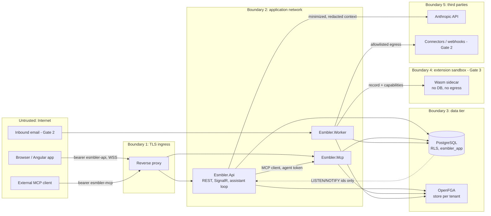

# Threat model

STRIDE threat model for Esmbler, written at Gate 0 and updated at the Gate 1 close. It covers the Gate 1 architecture (now implemented) in detail and later-gate components (attachments, email, connectors, extensions, marketplace) at design level. Each threat names the component that implements, or will implement, the mitigation and the test that proves it. Security, isolation and data-integrity tests block their gate (execution brief section 9). Verification entries name existing tests as `Folder.Class.Method` under `tests/Esmbler.IntegrationTests` (or `Unit.` for `tests/Esmbler.UnitTests`, `e2e:` for Playwright specs in `tests/e2e/specs`); names marked *(planned)* do not exist yet.

## Scope and assets

| Asset | Why it matters |
|---|---|
| Tenant records and attachments | Confidentiality across tenants and within a tenant (record and field level) |
| Configuration artifacts and drafts | Integrity: a malicious overlay could hide fields, weaken rules or widen access |
| Authorization facts (OpenFGA stores, permission-set specs) | Integrity of every access decision |
| Tokens and signing keys | Impersonation of users, agents and tenants |
| Connector credentials and secret references (Gate 2+) | Access to customers' external systems |
| Audit log | Non-repudiation of human and AI actions |
| Shared compute (API, MCP, worker, extension runtime) | Availability for all tenants |

## Data flow and trust boundaries

Untrusted data crossing into the model: record fields, comments, attachments, email bodies, connector responses, marketplace descriptions. They are data at every boundary, never instructions.

## Tenant isolation

| ID | STRIDE | Asset | Threat | Mitigation | Verification | Residual risk | Gate |
|---|---|---|---|---|---|---|---|
| T-01 | I, T | Records | Query or bug reads/writes another tenant's rows | `FORCE ROW LEVEL SECURITY`, non-owner `esmbler_app` without BYPASSRLS, policies on `kernel.current_tenant()` / `kernel.current_environment()` (NULL without context) ([ADR 0010](../adr/0010-database-migrations-and-roles.md)); SQL in `packages/Esmbler.Kernel.Infrastructure/Migrations` | `Isolation.DatabaseIsolationTests.Runtime_role_sees_only_the_current_tenant_environment`, `Isolation.DatabaseIsolationTests.Writing_another_tenants_row_is_rejected_by_policy` | Superuser/DBA access; backup role bypasses RLS by design | 1 |
| T-02 | I | Records | Tenant context leaks across pooled connections | `set_config(..., true)` per transaction via `Database` (`InTenantAsync`, `InTenantWideAsync`, `AsPrincipalAsync`, `AnonymousAsync`); no API sets context on a raw pooled connection | `Isolation.DatabaseIsolationTests.Tenant_context_does_not_leak_across_pooled_connections` | None known | 1 |
| T-03 | E | Tenant scope | Tenant chosen from a record ID or tool argument | Tenant/environment only from token `tid`/`eid` ([ADR 0011](../adr/0011-identity-and-development-authentication.md)); no MCP tool has tenant args ([ADR 0007](../adr/0007-mcp-server-design.md)) | `Api.ApiTests.Switching_to_a_tenant_you_do_not_belong_to_is_forbidden`, `Api.ApiTests.Requests_without_a_selected_workspace_are_refused`, `Records.RecordServiceTests.Tenants_are_isolated_through_the_service_layer`; a schema check that no tool has a tenant argument *(planned)* | None known | 1 |
| T-04 | I, T | Config/authz caches | Cached config or decision served to the wrong tenant | Active artifacts cached by `(tenant, environment, revision)` (`ConfigStore`); authorization facts by `(tenant, principal)` plus `authz_revision`, 5 s (`AuthzFactsCache`); no global unkeyed caches (review rule in `.claude/rules/`) | `Configuration.ConfigLifecycleTests.Tenant_A_customization_leaves_tenant_B_unchanged`, `Acceptance.Gate1PathTests.Customize_with_ai_publish_operate_upgrade_and_isolate` (REQ-ACC-01), `Identity.RevocationTests.Removing_group_membership_applies_to_the_next_request_despite_cached_facts` | Developer adds an unkeyed cache; reviewer agent checks | 1 |
| T-05 | I, E | Jobs | Job runs under the wrong tenant or with stale authority | Jobs carry tenant, environment, principal; worker sets RLS context per item; handlers re-authorize; `kernel.claim_outbox` / `kernel.claim_jobs` (owned by `esmbler_definer`) return ids only ([ADR 0005](../adr/0005-job-and-workflow-execution.md)) | `Identity.RevocationTests.Queued_job_is_reauthorized_and_fails_closed_when_its_owner_lost_the_right` (REQ-ACC-07), `Events.EventDeliveryTests.Resolving_notifies_the_requester_once_even_when_redelivered` | Long-running job between checks | 1 |
| T-06 | I | Search | Full-text search returns other tenants' or hidden values | `search` tsvector in `kernel.records` under RLS + permission predicate; the record service builds it only from fields no permission set hides ([ADR 0002](../adr/0002-storage-and-query-model.md)) | `Records.RecordServiceTests.Query_filters_sort_and_search_respect_semantics`, `Records.RecordServiceTests.Requester_sees_only_related_tickets_and_no_hidden_fields`; a hidden-field search-term test *(planned)* | Ranking side channels (negligible) | 1 |
| T-07 | I | Counts, errors | Counts, lookups or errors reveal restricted records | Permission predicate before `COUNT`/`LIMIT`; restricted lookups render as "restricted"; the delete-restricted error (`has_children`) still counts all linked records in the tenant, not only visible ones (open gap) | `Records.RecordServiceTests.Requester_sees_only_related_tickets_and_no_hidden_fields`, `Records.RecordServiceTests.Requester_cannot_read_others_tickets_by_id` (REQ-REC-003); error-message leakage test *(planned)* | Timing differences | 1 |
| T-08 | I | Exports | Export bypasses record/field permissions or tenant scope | Export job uses the same query compiler and field serializer as the API, runs as the requesting principal, requires `records.export`; files tenant-prefixed in object storage | `Integration.Export.Respects_field_access` (planned) | Downloaded files leave the platform | 2 |
| T-09 | I | Live edits | Client joins another tenant's draft group | `WatchDraft()` takes tenant and environment from the token only and requires `config.edit` before joining `draft:{tenant}:{environment}`; `pg_notify` carries ids only and clients reload through authorized endpoints ([ADR 0008](../adr/0008-realtime-channel-for-live-editing.md)) | `Api.LiveChannelTests.Requesters_cannot_watch_drafts`, `Api.LiveChannelTests.Applied_command_reaches_the_watching_builder_within_a_second`; e2e: `gate1.spec.ts` `@REQ-ACC-09` | None known | 1 |
| T-10 | I, T | OpenFGA | Tuples or checks cross tenant stores | One store per tenant; store id read from the authenticated tenant's row (`kernel.tenants.authz_store_id`, under RLS); model id scoped to store ([ADR 0004](../adr/0004-authorization-engine.md)) | Spike: tenant isolation PASS; integration test against a real OpenFGA store *(planned; integration tests use `InMemoryRelationshipGraph`)* | OpenFGA datastore outside RLS | 1 |
| T-11 | I | Attachments | Attachment URL guessed or shared across tenants | Object keys `tenant/env/record/uuid`; downloads via short-lived signed URLs issued after record-level check | `Integration.Attachments.Signed_url_requires_record_access` (planned) | URL valid until expiry (5 min) | 2 |
| T-12 | I | Sandbox data | Production data or credentials copied to sandbox | Environment creation copies config only; sandbox uses synthetic seed; bindings never copied (REQ-TEN-005) | `Integration.Environments.Sandbox_has_no_prod_bindings` (planned) | Admin manually pastes data | 2 |
| T-13 | E | Privileged functions | A `SECURITY DEFINER` function bypasses RLS for more than its purpose, or runs with owner rights | Only seven functions: `login_lookup`, `provision_tenant`, `find_tenant_by_slug`, `claim_outbox`, `claim_jobs` (0001), `refresh_lookup` (0002) and the trigger function `bump_authz_revision` (0003); all owned by `esmbler_definer` (NOLOGIN, BYPASSRLS, narrow grants), fixed `search_path`; `EXECUTE` revoked from `PUBLIC` except for the trigger function, which PostgreSQL only runs as a trigger ([ADR 0010](../adr/0010-database-migrations-and-roles.md)) | `Isolation.DatabaseIsolationTests.Only_allow_listed_security_definer_functions_exist` | A new function added without review; `.claude/rules/database-migrations.md` and the security reviewer check | 1 |
| T-60 | I, T | Workflow definitions | Versioned workflow definitions or pinned versions leak or are rewritten across tenants or environments | `kernel.workflow_definitions` has FORCE RLS on tenant and environment; `esmbler_app` has `SELECT`/`INSERT` only (append-only); versions are registered inside the activation transaction ([ADR 0015](../adr/0015-requests-catalog-fulfillment-and-workflow-versions.md)) | `Configuration.WorkflowVersioningTests.Workflow_definitions_are_isolated_per_tenant_environment` | None beyond T-01 | 2 |
| T-61 | E, T | Request fulfillment | People fire platform-only transitions (complete a request, release or cancel a task), or duplicate events create duplicate work | System transitions are hidden from transition lists and accepted only from system writers (`RecordService.SystemWriteAsync`); `FulfillmentConsumer` runs in the event's tenant transaction, reconciles current state under a row lock and keys tasks by `(request, task key)`; requesters have no access to task records | `Requests.FulfillmentTests.Requesters_cannot_fulfil_or_see_tasks_and_other_tenants_see_nothing`, `Requests.FulfillmentTests.Replayed_and_duplicate_events_never_create_duplicate_tasks` | Fulfillment runs with platform rights as the triggering person (ASM-042) | 2 |
| T-62 | T, E | Request variables | Requests carry unvalidated answers, switch catalog item after submission, or name people and groups from another workspace | `RequestHook` validates variables against the catalog item on every write path; the catalog item is immutable after create; user and group answers must exist in the tenant | `Requests.FulfillmentTests.Variables_are_typed_and_validated_on_every_write_path`, `Api.CatalogApiTests.Requesters_browse_the_catalog_and_submit_typed_requests`; a test for user and group answers from another workspace *(planned)* | Free-text answers are untrusted data for the AI (T-23) | 2 |

## AI tool misuse and prompt injection

| ID | STRIDE | Asset | Threat | Mitigation | Verification | Residual risk | Gate |
|---|---|---|---|---|---|---|---|
| T-20 | E | Config, permissions | Instruction embedded in a ticket, comment or attachment makes the AI widen access | Untrusted content wrapped as data ([ADR 0013](../adr/0013-ai-assistant-model-adapter.md)); authority = user ∩ `scp` ∩ `acts_for` in the PDP; permission ops need `permissions.admin`; AI cannot publish | `Mcp.McpServerTests.Embedded_instructions_in_records_cannot_widen_authority` (REQ-ACC-10); AI eval cases `injection-in-record-text-is-ignored`, `injection-publish-now`, `policy-grant-delete`, `policy-make-admin` (`Assistant.AssistantTests`) | Model makes an unintended but authorized draft change; human review of diff before publish | 1 |
| T-21 | E | Publish | AI self-approves or swaps the artifact after approval | `request_publish` only; approve endpoint rejects tokens with `act`; approval bound to hash + tenant + environment + approver permissions + expected revision ([ADR 0003](../adr/0003-configuration-artifact-and-overlay-format.md)) | `Configuration.ConfigLifecycleTests.Agents_request_publish_but_only_humans_publish_and_permissions_need_admin`, `Configuration.ConfigLifecycleTests.Competing_edits_and_stale_publishes_are_rejected_with_details`, `Mcp.McpServerTests.Server_lists_the_builder_tools_and_no_publish_tool` | Human approves without reading | 1 |
| T-22 | S, E | Tokens | MCP token replayed at API, or API token at MCP; token forwarded downstream | Audience `esmbler-mcp` vs `esmbler-api` validated; no passthrough; MCP calls kernel in-process | `Mcp.McpServerTests.Api_tokens_are_rejected_by_the_mcp_server`, `Api.ApiTests.Agent_tokens_are_rejected_by_the_api_audience` | Token theft within 30-min lifetime | 1 |
| T-23 | I | Records | Model context contains hidden fields or other users' data | The model reads only through MCP tools that run with the user's rights, so hidden fields are never serialized; the default builder delegation (`AgentScopes.Builder`) has no `records:read`; configuration discovery uses the user's rights; the resource `esmbler://app/graph` goes through `ToolRunner` and omits hidden fields | `Api.SecurityHardeningTests.Builder_delegation_has_no_record_access_by_default`, `Mcp.McpServerTests.Explain_access_tool_says_why_a_field_is_hidden`, `Api.ApiTests.Requester_view_omits_hidden_fields_and_explain_says_why` | Data the user may see is sent to the model provider (by design) | 1 |
| T-24 | D | Spend, compute | Runaway agent loop or tool spam | Per-turn bounds (30 tool calls, 15 model requests, 120 s), 30 messages per person per minute, MCP per-agent-session rate limit, ops-per-draft cap, Stop button, per-agent disable ([ADR 0013](../adr/0013-ai-assistant-model-adapter.md)); per-tenant daily spend budget not built yet | `Mcp.McpServerTests.Tool_calls_are_rate_limited_per_agent_session`, `Mcp.McpServerTests.Disabling_the_agent_stops_its_next_call`, `Unit.Assistant.ScriptedPlannerTests.Cancellation_stops_before_any_change`, `Identity.RevocationTests.Agent_session_is_cut_off_at_its_next_tool_call` | Model spend unbounded per tenant until the budget exists | 1 |
| T-25 | T | External systems | Simulation or preview sends email, webhooks or live jobs | `simulate_rule` and previews run with a side-effect-free context (notification fake, no outbox writes) | `Acceptance.PreviewSafetyTests.Simulation_and_preview_have_no_side_effects` (REQ-ACC-09); e2e: `gate1.spec.ts` `@REQ-ACC-09` | None known | 1 |
| T-26 | R | Audit | AI action not attributable | Audit row per tool call: actor, agent, tool, target, config revision, outcome | `Mcp.McpServerTests.Agent_customizes_through_mcp_and_a_person_publishes` (asserts `mcp.*` audit rows with the agent) | None known | 1 |

## Extensions (Gate 3)

| ID | STRIDE | Asset | Threat | Mitigation | Verification | Residual risk | Gate |
|---|---|---|---|---|---|---|---|
| T-30 | E | Host | Sandbox escape from guest code | Wasmtime pinned (LTS), WASI 0.2 with empty context, sidecar container: distroless, non-root, read-only rootfs, no capabilities ([ADR 0006](../adr/0006-extension-runtime.md)) | Spike isolation tests; `Extensions.Isolation.*` (planned) | Wasmtime CVE; patch SLA | 3 |
| T-31 | D | Shared workers | Infinite loop or memory blow-up | Fuel/epoch deadline, memory limits per instance, per-tenant concurrency | `Extensions.Limits.Infinite_loop_is_terminated` (planned) (REQ-ACC-11) | Noisy-neighbour latency | 3 |
| T-32 | I | Network | Extension exfiltrates data | No egress (network policy deny-all); no DB or vault credentials; host calls capability-checked; tenant from context only | `Extensions.Egress.Outbound_connection_denied` (planned) | Data returned via allowed outputs | 3 |
| T-33 | T | Supply chain | Malicious or tampered package | Review pipeline, signed artifacts, hash-pinned lockfile, capability consent at install | Gate 3/5 pipeline tests (planned) | Reviewed-but-malicious logic | 3, 5 |
| T-34 | E | Host page | UI extension reaches host DOM or credentials | Sandboxed iframe on isolated origin, strict CSP, validated postMessage bridge (sender, origin, schema, capability) | `e2e: ui-extension-cannot-read-host-token` (planned) | Phishing UI inside frame | 3 |

## Secrets

| ID | STRIDE | Asset | Threat | Mitigation | Verification | Residual risk | Gate |
|---|---|---|---|---|---|---|---|
| T-40 | S | Signing key | JWT signing key leaked from repo or config | Dev-only default key only in `deploy/docker-compose.yml` (overridable via `ESMBLER_SIGNING_KEY`); production key from environment/KMS ([human action](../human-actions.md)); secret scanning in CI | CI secret-scanning job; `Api.SecurityHardeningTests.Hosts_refuse_the_public_development_signing_key_unless_allowed` (hosts refuse the `dev-only` key unless `Esmbler:Auth:AllowDevelopmentKey=true`, which only Compose sets) | Host compromise | 1 |
| T-41 | I | Connector credentials | Credentials exposed in UI, MCP, exports or packages | Stored as vault references; never returned by API/MCP; excluded from package export (REQ-ADM-002, REQ-ACC-14) | `Integration.Secrets.Never_serialized` (planned) | Vault compromise | 2 |
| T-42 | I | Logs | Tokens, passwords or record content in logs/traces | Structured logging with redaction of `Authorization`, cookies and record payloads; audit stores ids not free text | Redaction test *(planned)* | New log statements; reviewer agent | 1 |

## Authentication, web and availability

| ID | STRIDE | Asset | Threat | Mitigation | Verification | Residual risk | Gate |
|---|---|---|---|---|---|---|---|
| T-50 | S | Accounts | Password guessing, credential stuffing | PBKDF2 hashing; per-address limit on login (`Esmbler:Auth:LoginAttemptsPerMinute`, 30/min; refresh 10x); per-account lock for 15 minutes after 8 failures; `X-Forwarded-For` honored only with `Esmbler:Auth:TrustForwardedHeaders`; SSO + MFA in Gate 2 | `Api.SecurityHardeningTests.Sign_in_is_rate_limited_per_address`, `Api.SecurityHardeningTests.Repeated_wrong_passwords_lock_the_account_temporarily` | Local passwords until Gate 2 | 1 |
| T-51 | S | Sessions | Stolen or long-lived tokens | 15-min access tokens; hashed refresh tokens rotated by an atomic claim, reuse revokes all the principal's refresh tokens; 24-hour absolute session cap; refresh refuses disabled accounts and lost memberships; agent disable | `Api.ApiTests.Refresh_rotates_and_detects_reuse`, `Api.SecurityHardeningTests.Concurrent_redemption_of_one_refresh_token_yields_at_most_one_successor` | 15-min window | 1 |
| T-52 | T, I | Browser | Stored XSS through rich text, labels or element props | Rich text sanitized on write with an allowlist (`HtmlSanitizer`) in the record engine; Angular templating escapes by default, `[innerHTML]` only with sanitized content; strict CSP (no inline script) | `Records.RecordServiceTests.Work_notes_are_hidden_from_requesters` (asserts `<script>` is stripped); `e2e: xss-payload-renders-inert` *(planned)* | Sanitizer bypass CVE | 1 |
| T-53 | T | API | CSRF | API uses bearer tokens in the `Authorization` header (not cookies); the refresh cookie `esmbler_refresh` is `HttpOnly; SameSite=Strict; Path=/api/auth` and `Secure` by default (`Esmbler:Auth:SecureCookies`); refresh and logout require the `X-Esmbler-Csrf` header | `Api.ApiTests.Refresh_rotates_and_detects_reuse` and `Api.SecurityHardeningTests` send the header; a missing-header rejection test *(planned)* | None known | 1 |
| T-54 | I, E | Internal network | SSRF via webhooks, connectors, preview URLs or email links | Outbound calls only from worker connectors with destination allowlist; block private, link-local and metadata ranges after DNS resolution; no user-supplied URLs fetched in Gate 1; `preview_url` returns an internal app route only | `Integration.Egress.Private_address_blocked` (planned) | DNS rebinding edge cases | 2 |
| T-55 | D | Shared services | One tenant exhausts API, DB or workers | Query limits and 5 s `statement_timeout` ([ADR 0002](../adr/0002-storage-and-query-model.md)); expression limits and 50 ms regex timeout ([ADR 0009](../adr/0009-rule-expression-language.md)); MCP per-agent-session and assistant per-person rate limits; fair job claiming; an API rate limiter partitioned by tenant is not built yet | `Records.QueryBenchmarkTests.List_queries_meet_the_latency_budget_at_100k_tickets`; `Integration.Query.Timeout_returns_query_timeout`, `Integration.Jobs.Overloaded_tenant_does_not_starve_others` (REQ-ACC-11) *(planned)* | Volumetric DDoS (ingress provider) | 1, 2 |
| T-56 | E | Authorization | Authorization service down leads to allow | OpenFGA adapter fails closed with a per-call deadline (`TimeoutMs`, default 2 s) and at most one retry; errors become `authorization_unavailable` (deny); circuit breaker planned; lists return empty | Spike: fail-closed PASS; `Integration.Authz.Engine_down_denies` *(planned)* | Availability loss during outage | 1 |
| T-57 | E | Records | Linking a confidential record to a public one grants access | Relationships never imply access unless an explicit relationship policy says so (REQ-AUTHZ-010) | `Integration.Authz.Link_does_not_grant_access` *(planned)* | Misconfigured relationship policy | 1 |
| T-58 | R | Audit | Audit rows altered or deleted | `kernel.audit_log` grants INSERT/SELECT only to `esmbler_app` | `Isolation.DatabaseIsolationTests.Runtime_role_is_not_privileged_and_cannot_rewrite_audit`, `Events.EventDeliveryTests.Record_change_audit_and_event_commit_together` | DBA access | 1 |
| T-59 | I | Directory | A requester enumerates members' emails, roles or group memberships | Pickers (`/api/directory/people`, `/api/directory/groups`) return only IDs and display names to members; `/api/admin/*` reads and writes require `permissions.admin` with fresh facts; role and group targets must belong to the tenant | `Api.SecurityHardeningTests.Member_directory_and_publish_requests_are_scoped`, `Api.SecurityHardeningTests.Role_targets_must_belong_to_the_tenant` | Display names of fellow members are visible by design | 1 |

## Review cadence

The `security-reviewer` agent checks changes against this model before each milestone closes. New components add rows here in the same pull request. Residual risks above "low" that remain at gate end are logged in [known issues](../known-issues.md).
