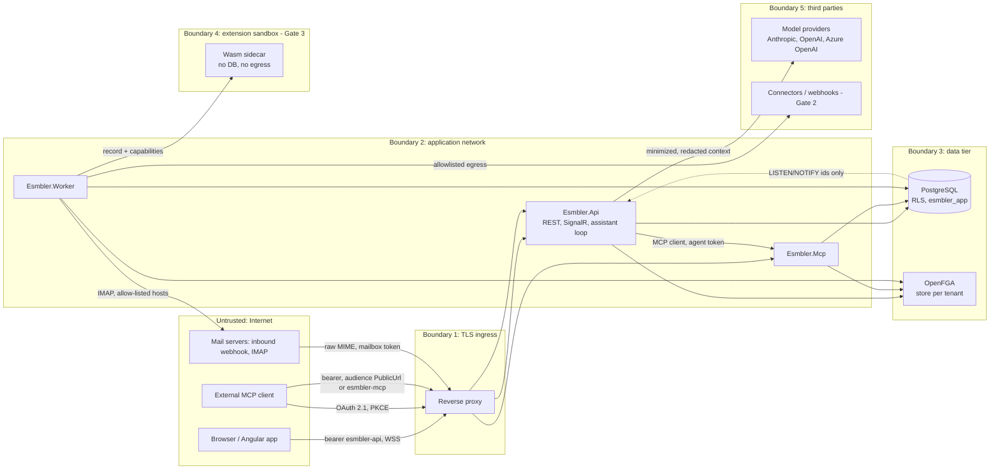

# Threat model

STRIDE threat model for Esmbler, written at Gate 0 and updated at the Gate 1 close. It covers the Gate 1 architecture (now implemented) in detail and later-gate components (attachments, email, connectors, extensions, marketplace) at design level. Each threat names the component that implements, or will implement, the mitigation and the test that proves it. Security, isolation and data-integrity tests block their gate (execution brief section 9). Verification entries name existing tests as `Folder.Class.Method` under `tests/Esmbler.IntegrationTests` (or `Unit.` for `tests/Esmbler.UnitTests`, `e2e:` for Playwright specs in `tests/e2e/specs`); names marked *(planned)* do not exist yet.

## Scope and assets

| Asset | Why it matters |
|---|---|
| Tenant records and attachments | Confidentiality across tenants and within a tenant (record and field level) |
| Configuration artifacts and drafts | Integrity: a malicious overlay could hide fields, weaken rules or widen access |
| Authorization facts (OpenFGA stores, permission-set specs) | Integrity of every access decision |
| Tokens and signing keys | Impersonation of users, agents and tenants |
| Connector credentials and secret references (Gate 2+) | Access to customers' external systems |
| Audit log | Non-repudiation of human and AI actions |
| Shared compute (API, MCP, worker, extension runtime) | Availability for all tenants |

## Data flow and trust boundaries

Untrusted data crossing into the model: record fields, comments, attachments, email bodies, connector responses, marketplace descriptions. They are data at every boundary, never instructions.

## Tenant isolation

| ID | STRIDE | Asset | Threat | Mitigation | Verification | Residual risk | Gate |
|---|---|---|---|---|---|---|---|
| T-01 | I, T | Records | Query or bug reads/writes another tenant's rows | `FORCE ROW LEVEL SECURITY`, non-owner `esmbler_app` without BYPASSRLS, policies on `kernel.current_tenant()` / `kernel.current_environment()` (NULL without context) ([ADR 0010](../adr/0010-database-migrations-and-roles.md)); SQL in `packages/Esmbler.Kernel.Infrastructure/Migrations` | `Isolation.DatabaseIsolationTests.Runtime_role_sees_only_the_current_tenant_environment`, `Isolation.DatabaseIsolationTests.Writing_another_tenants_row_is_rejected_by_policy` | Superuser/DBA access; backup role bypasses RLS by design | 1 |
| T-02 | I | Records | Tenant context leaks across pooled connections | `set_config(..., true)` per transaction via `Database` (`InTenantAsync`, `InTenantWideAsync`, `AsPrincipalAsync`, `AnonymousAsync`); no API sets context on a raw pooled connection | `Isolation.DatabaseIsolationTests.Tenant_context_does_not_leak_across_pooled_connections` | None known | 1 |
| T-03 | E | Tenant scope | Tenant chosen from a record ID or tool argument | Tenant/environment only from token `tid`/`eid` ([ADR 0011](../adr/0011-identity-and-development-authentication.md)); no MCP tool has tenant args ([ADR 0007](../adr/0007-mcp-server-design.md)) | `Api.ApiTests.Switching_to_a_tenant_you_do_not_belong_to_is_forbidden`, `Api.ApiTests.Requests_without_a_selected_workspace_are_refused`, `Records.RecordServiceTests.Tenants_are_isolated_through_the_service_layer`; a schema check that no tool has a tenant argument *(planned)* | None known | 1 |
| T-04 | I, T | Config/authz caches | Cached config or decision served to the wrong tenant | Active artifacts cached by `(tenant, environment, revision)` (`ConfigStore`); authorization facts by `(tenant, principal)` plus `authz_revision`, 5 s (`AuthzFactsCache`); no global unkeyed caches (review rule in `.claude/rules/`) | `Configuration.ConfigLifecycleTests.Tenant_A_customization_leaves_tenant_B_unchanged`, `Acceptance.Gate1PathTests.Customize_with_ai_publish_operate_upgrade_and_isolate` (REQ-ACC-01), `Identity.RevocationTests.Removing_group_membership_applies_to_the_next_request_despite_cached_facts` | Developer adds an unkeyed cache; reviewer agent checks | 1 |
| T-05 | I, E | Jobs | Job runs under the wrong tenant or with stale authority | Jobs carry tenant, environment, principal; worker sets RLS context per item; handlers re-authorize; `kernel.claim_outbox` / `kernel.claim_jobs` (owned by `esmbler_definer`) return ids only ([ADR 0005](../adr/0005-job-and-workflow-execution.md)) | `Identity.RevocationTests.Queued_job_is_reauthorized_and_fails_closed_when_its_owner_lost_the_right` (REQ-ACC-07), `Events.EventDeliveryTests.Resolving_notifies_the_requester_once_even_when_redelivered` | Long-running job between checks | 1 |
| T-06 | I | Search | Full-text search returns other tenants' or hidden values | `search` tsvector in `kernel.records` under RLS + permission predicate; the record service builds it only from fields no permission set hides ([ADR 0002](../adr/0002-storage-and-query-model.md)) | `Records.RecordServiceTests.Query_filters_sort_and_search_respect_semantics`, `Records.RecordServiceTests.Requester_sees_only_related_tickets_and_no_hidden_fields`; a hidden-field search-term test *(planned)* | Ranking side channels (negligible) | 1 |
| T-07 | I | Counts, errors | Counts, lookups or errors reveal restricted records | Permission predicate before `COUNT`/`LIMIT`; restricted lookups render as "restricted"; the delete-restricted error (`has_children`) still counts all linked records in the tenant, not only visible ones (open gap) | `Records.RecordServiceTests.Requester_sees_only_related_tickets_and_no_hidden_fields`, `Records.RecordServiceTests.Requester_cannot_read_others_tickets_by_id` (REQ-REC-003); error-message leakage test *(planned)* | Timing differences | 1 |
| T-08 | I | Exports | Export bypasses record/field permissions or tenant scope | CSV export (G2-M9c) runs synchronously in the requesting person's tenant transaction (`Database.InTenantAsync`, RLS) with the list's query compiler (`QueryCompiler.Compile`: permission predicate in SQL, hidden-field filters refused), writes only fields visible to that person and requires `records.export`; figure exports evaluate the metric for the viewer and refuse restricted figures (see T-103). Export jobs and files in object storage are not built | `Api.ExportTests.Exports_never_include_another_workspace_or_fields_hidden_from_the_exporter`, `Api.ExportTests.Explorer_export_holds_exactly_the_listed_records_and_needs_the_export_right` | Downloaded files leave the platform | 2 |
| T-09 | I | Live edits | Client joins another tenant's draft group | `WatchDraft()` takes tenant and environment from the token only and requires `config.edit` before joining `draft:{tenant}:{environment}`; `pg_notify` carries ids only and clients reload through authorized endpoints ([ADR 0008](../adr/0008-realtime-channel-for-live-editing.md)) | `Api.LiveChannelTests.Requesters_cannot_watch_drafts`, `Api.LiveChannelTests.Applied_command_reaches_the_watching_builder_within_a_second`; e2e: `gate1.spec.ts` `@REQ-ACC-09` | None known | 1 |
| T-10 | I, T | OpenFGA | Tuples or checks cross tenant stores | One store per tenant; store id read from the authenticated tenant's row (`kernel.tenants.authz_store_id`, under RLS); model id scoped to store ([ADR 0004](../adr/0004-authorization-engine.md)) | Spike: tenant isolation PASS; integration test against a real OpenFGA store *(planned; integration tests use `InMemoryRelationshipGraph`)* | OpenFGA datastore outside RLS | 1 |
| T-11 | I | Attachments | Attachment URL guessed or shared across tenants | Object keys `tenant/env/record/uuid`; downloads via short-lived signed URLs issued after record-level check | `Integration.Attachments.Signed_url_requires_record_access` (planned) | URL valid until expiry (5 min) | 2 |
| T-12 | I | Sandbox data | Production data or credentials copied to sandbox | Environment creation copies config only; sandbox uses synthetic seed; bindings never copied (REQ-TEN-005) | `Integration.Environments.Sandbox_has_no_prod_bindings` (planned) | Admin manually pastes data | 2 |
| T-13 | E | Privileged functions | A `SECURITY DEFINER` function bypasses RLS for more than its purpose, or runs with owner rights | Only seventeen functions: `login_lookup`, `provision_tenant`, `find_tenant_by_slug`, `claim_outbox`, `claim_jobs` (0001), `refresh_lookup` (0002), the trigger function `bump_authz_revision` (0003), `purge_outbox` (0009, deletes only dispatched events past retention with their inbox marks and consumer failures), `create_workspace` (0012, replaced in 0013: inserts one tenant row as `provisioning` for an enabled person below the per-person limit), `activate_workspace` (0013, moves that creator's `provisioning` tenant to `active`), and since 0016 (replaced in 0017) `seal_audit` (sets the chain columns of committed audit rows once), `verify_audit_chain` (workspace from the session context only, returns counts and positions), `audit_verification_due` (workspace IDs only) and `purge_retention` (floors in SQL, skips workspaces on legal hold, audits every purge; T-80), and since 0018 `mail_inbox_by_token`, `mail_inboxes_due` and `purge_inbound_mail` (T-89); all owned by `esmbler_definer` (NOLOGIN, BYPASSRLS, narrow grants), fixed `search_path`; `EXECUTE` revoked from `PUBLIC` except for the trigger function, which PostgreSQL only runs as a trigger ([ADR 0010](../adr/0010-database-migrations-and-roles.md)) | `Isolation.DatabaseIsolationTests.Only_allow_listed_security_definer_functions_exist` | A new function added without review; `.claude/rules/database-migrations.md` and the security reviewer check | 1 |
| T-60 | I, T | Workflow definitions | Versioned workflow definitions or pinned versions leak or are rewritten across tenants or environments | `kernel.workflow_definitions` has FORCE RLS on tenant and environment; `esmbler_app` has `SELECT`/`INSERT` only (append-only); parsed definitions are cached per tenant, environment and content hash; versions are registered inside the activation transaction ([ADR 0015](../adr/0015-requests-catalog-fulfillment-and-workflow-versions.md)) | `Configuration.WorkflowVersioningTests.Workflow_definitions_are_isolated_per_tenant_environment` | None beyond T-01 | 2 |
| T-61 | E, T | Request fulfillment | People fire platform-only transitions (complete a request, release or cancel a task), or duplicate events create duplicate work | System transitions are hidden from transition lists and accepted only from system writers (`RecordService.SystemWriteAsync`); `FulfillmentConsumer` runs in the event's tenant transaction, reconciles current state under a row lock and keys tasks by `(request, task key)`; requesters have no access to task records | `Requests.FulfillmentTests.Requesters_cannot_fulfil_or_see_tasks_and_other_tenants_see_nothing`, `Requests.FulfillmentTests.Replayed_and_duplicate_events_never_create_duplicate_tasks` | Fulfillment runs with platform rights as the triggering person (ASM-042) | 2 |
| T-62 | T, E | Request variables | Requests carry unvalidated answers, switch catalog item after submission, or name people and groups from another workspace | `RequestHook` validates variables against the catalog item on every write path; the catalog item is immutable after create; answers are frozen once the request leaves its initial state; task keys and request links are written only by fulfillment; user and group answers must exist in the tenant | `Requests.FulfillmentTests.Variables_are_typed_and_validated_on_every_write_path`, `Answers_cannot_change_once_the_request_is_being_worked_on`, `Task_links_are_set_only_by_fulfillment_so_prerequisites_cannot_be_faked_or_moved`, `Answers_cannot_name_people_or_groups_of_another_workspace`, `Api.CatalogApiTests.Requesters_browse_the_catalog_and_submit_typed_requests` | Free-text answers are untrusted data for the AI (T-23) | 2 |
| T-63 | E | Workflow changes | A pinned version keeps an abused transition usable after it is restricted or disabled, or a builder or agent widens who may fire transitions without permission administration | Roles, enabled flag and guard always come from the current definition (pinned versions keep only shape); adding a role-free transition, or changing roles, guards or set values, is a permission change that agents cannot make and that needs permission administration to publish; migrate and cancel policies apply only to the publish that sets them, never on rollback, and their job re-checks `config.publish` | `Configuration.WorkflowVersioningTests.Disabling_or_restricting_a_transition_applies_to_running_instances_too`, `A_migrate_policy_applies_only_to_the_publish_that_sets_it`, `UnitTests.Configuration.CatalogOverlayTests.Role_free_transitions_set_values_and_role_changes_are_permission_changes`, `Mcp.McpServerTests.Agent_builds_a_catalog_item_and_reshapes_a_workflow_through_mcp` | Tenant-defined transitions removed from the current definition keep their pinned roles until instances finish (disable them instead) | 2 |
| T-64 | E, T | Approval decisions | Someone who is not an approver of the step decides it, a decision is replayed on a closed step, a person moves a request past its approval with their own transitions or a migration, or an escalation turns a rejection into an approval | Eligibility with fresh facts under the request row lock; closed steps return 409; `RequestHook` refuses human transitions out of intake and out of the approval state except to cancel, and into the approval state; the validator refuses migrations that skip or strand approval; an escalation decides alone; denied decisions are audited | `Requests.ApprovalTests.Stages_run_in_order_and_a_conditional_stage_runs_only_when_its_condition_holds`, `People_cannot_step_around_a_pending_approval_with_their_own_transitions`, `An_escalation_decides_alone_and_its_rejection_rejects_the_request`, `Rejecting_needs_a_reason_declines_the_request_and_creates_no_tasks`, `A_delegator_cannot_decide_a_second_step_after_their_delegate_decided_one`; unit `ApprovalPolicyTests.Migrations_cannot_skip_approval_or_park_requests_in_the_approval_state` | Requests pinned to a workflow version without the approval state are grandfathered (ASM-046) | 2 |
| T-65 | E | Separation of duties | Someone approves a request they made or that is for them (directly, as a role or group approver, or through a delegate), chooses their own approver, or one person satisfies two steps of a stage | Requester set = creator plus the binding's requester fields, snapshotted at start and rechecked; field approvers must be read-only record fields, never answers; one person's authority counts once per stage including decisions made on their behalf | `Requests.ApprovalTests.Requesters_never_approve_their_own_request_even_as_approvers_or_through_a_delegate`, `The_person_a_request_is_for_cannot_approve_it`, `An_all_stage_needs_every_approver_and_one_person_decides_one_step_per_stage`, `A_delegator_cannot_decide_a_second_step_after_their_delegate_decided_one`; unit `ApprovalPolicyTests.Requesters_never_choose_their_own_approvers` | Requester fields are declared per module; a module that omits one weakens the check | 2 |
| T-66 | E, S | Approval delegation | A delegation is used without consent, chained, scheduled far ahead, or keeps granting access after it ends | Only the delegator creates or revokes; up to 90 days, starting within 90 days; no chaining; read access granted by a timer at the start and withdrawn at the end or on revoke; agents cannot delegate or revoke; admins review all delegations | `Requests.ApprovalTests.A_delegate_decides_on_behalf_of_an_absent_approver_until_the_delegation_ends`, `A_delegate_reads_requests_only_while_the_delegation_is_active_and_never_through_a_chain`, `Approvals_stay_in_their_environment_and_admins_review_every_delegation`; `Api.ApprovalApiTests.People_delegate_their_approvals_and_end_the_delegation` | A delegate acts for everything the delegator may approve (including role steps) while the delegation is active | 2 |
| T-67 | I, T | Approver read access | Approvers read more than the requests they decide on, edit them, see hidden fields, or someone writes themselves into the approvers list | Approvers become related through the platform-maintained `principals` field (read-only; the validator refuses rules, transition sets and defaults on it; SQL and PDP both require an array); field permissions of their own roles apply; notifications name the catalog item, not the title | `Requests.ApprovalTests.Approvers_read_the_requests_they_decide_but_cannot_change_them`, `People_cannot_write_the_approvers_field`; unit `ApprovalPolicyTests.Only_the_approval_engine_writes_the_approvers_field` | Past approvers keep read access (ASM-048); the approvers list shows names to everyone who can read the request | 2 |
| T-68 | I, T | Approvals across tenants | Approval steps, inboxes or delegations of one workspace are visible to or decidable from another | `kernel.approvals`, `kernel.approval_steps` and `kernel.approval_delegations` have FORCE RLS on tenant and environment; every approval call runs in `Database.InTenantAsync` with the session's tenant and environment; the expiry job runs in the job's tenant context | `Requests.ApprovalTests.AI_agents_cannot_decide_and_other_workspaces_see_nothing` | None beyond T-01 | 2 |
| T-69 | S, I, T, D | Domain events and consumer delivery | A configuration change forges platform events (`record.*`, `platform.approval.approved`) or another module's events; a declared event copies hidden field values to subscribers; a failing consumer blocks or replays another's effects; dead letters expire unseen; a consumer runs in the wrong workspace | The validator refuses emits of platform types, platform namespaces outside the platform and module types outside the module's namespace, and the envelope's `source` and `emitter` name the rule or transition that published it; payload expressions cannot read fields any permission set hides unless the type is `restricted`, and values are type-checked and capped; events stay server-side (no API or MCP tool returns envelopes; `list_event_types` returns metadata only); each consumer runs in its own `Database.InTenantAsync` transaction for the event's tenant and environment with per-event lease renewal; `kernel.consumer_failures` has FORCE RLS; replay is per consumer, audited with consumer and event, needs `permissions.admin`, and the inbox keeps other consumers from re-running; retention keeps events with dead consumers and never drops below 7 days ([ADR 0017](../adr/0017-event-audit-alert-notification-services.md)) | `Configuration.EventTypeTests.Only_the_platform_publishes_platform_events_and_modules_stay_in_their_namespace`, `Configuration.EventTypeTests.Payloads_keep_hidden_fields_out_unless_the_event_is_restricted_and_match_declared_types`, `Events.EventPlatformTests.A_failing_consumer_retries_and_dead_letters_alone_and_is_replayed_by_consumer`, `Events.EventPlatformTests.Retention_removes_only_old_dispatched_events_and_their_marks` | Expressions computing a value from a hidden field (not a plain reference) are caught only by the reference check; subscribers must still render per recipient (G2-M18, ASM-053); raw error text in dead letters (KI-020) | 2 |
| T-70 | I, T | SLA timers | A workspace reads another's timers; someone shortens or erases a recorded breach; an edit rewrites history; the check job acts with someone's authority | `kernel.sla_timers` has FORCE RLS and no `DELETE` grant; timers change only inside record write transactions and the platform check job, never through an API; running timers keep their snapshot and a breach is recorded once and never cleared; `GET /api/records/{entity}/{id}/sla` checks that the caller can read the record (404 otherwise); `sla.check` runs as nobody in the timer's tenant context and locks the record before reading the timer; SLA conditions cannot read fields any permission set hides (no inference through the panel); calendar and policy limits (4 intervals a day, 15-minute minimum, reachable goals, 10 policies an entity) bound business-time work on writes and reads; keyed timer jobs are exempt from the job quota so breach detection never stops; restore and workflow migrations move clocks ([ADR 0018](../adr/0018-sla-and-business-hours.md)) | `Records.SlaTests.Other_workspaces_and_people_without_access_see_no_timers`, `Records.SlaTests.Running_timers_keep_their_goal_when_a_publish_changes_it`, `Records.SlaTests.A_restored_ticket_gets_fresh_clocks_and_keeps_the_cancelled_history`, `Configuration.SlaPolicyTests.Sla_conditions_cannot_read_fields_some_readers_may_not_see`, `Configuration.SlaPolicyTests.Calendars_and_goals_stay_within_bounds_that_keep_deadlines_cheap_to_compute`, `Isolation.DatabaseIsolationTests` | A tenant administrator can still change goals for future records (by design, reviewed at publish) | 2 |
| T-71 | I, E, D | Metrics, dashboards and drill links | A figure reveals records or field values the viewer cannot read (aggregate inference: counting, averaging or grouping on a hidden field, or counting another person's tickets); a crafted drill URL lists records outside the viewer's access; role gating on a metric is mistaken for an access grant; an agent reads figures without record access; a heavy metric exhausts the database | `QueryCompiler.Where` builds one WHERE clause, including the viewer's permission predicate, for lists, group counts and figures, and RLS scopes tenant and environment, so figures count only records the viewer can read; a metric whose filter, measure, grouping or date range reads a field hidden from the viewer is restricted (no value computed) and removed from the view and from metric saved views, and the validator warns (`metric.restricted_field`); filters on hidden fields are refused (`invalid_filter`) and hidden fields cannot be group keys; drill URLs carry filters, never results, and are recompiled under the viewer's permissions with the usual limits (64 nodes, 1,000 characters, at most 5 SLA conditions naming a policy of that entity); `roles` only hides a figure and never widens access (inside the roles each person still counts only what they read), and changing a metric's roles is a permission change (`permissions.admin`; agents refused); restricted figures are left out of dashboard data entirely; data-table `groupBy` and `groupOptions` on fields hidden from the viewer are pruned from the client spec; undoing or redoing a step that changes permissions, or any step of a change (batch) that contains one, needs `permissions.admin`, like applying it, so such a change is never split; `evaluate_metric` needs `records:read` (not in the default builder delegation) and wraps its output as untrusted data; at most 12 figures a dashboard, 25 groups a metric, 52 buckets, 50 explorer groups and 20 filters a list or groups request; a 5 s statement timeout per figure in its own savepoint and an overall dashboard deadline of about 8 s (figures not reached report `timeout`); a per-person rate limit on `/api/dashboards`, `/api/metrics` and `/api/records/{entity}/groups` (120 a minute by default); one count cap of 10,000 for explorer totals and figures ("10,000+") ([ADR 0019](../adr/0019-metrics-dashboards-and-connected-explorer.md)) | `Records.MetricTests.Every_figure_equals_the_explorer_total_it_drills_into_for_every_persona`, `Records.MetricTests.Requesters_count_only_their_tickets_and_team_figures_are_restricted_for_them`, `Records.MetricTests.Figures_and_group_counts_over_a_hidden_field_are_refused_and_left_out`, `Records.MetricTests.Changing_who_sees_a_metric_or_undoing_a_permission_change_needs_permission_administration`, `Records.MetricTests.Figures_never_include_another_workspace`, `Unit.Configuration.MetricSpecTests.Metrics_are_validated_with_suggestions`, `Mcp.McpServerTests.Agent_defines_a_metric_and_puts_it_on_the_dashboard`; e2e: `dashboard.spec.ts` `@REQ-WS-004` (requester sees no team figures) | Counts over readable records still tell a viewer how many records match a filter on fields they can see (by design, the same as the list total); a figure's existence is visible to builders in configuration | 2 |
| T-72 | D, S, E | Self-service workspace creation | One person creates unbounded workspaces (database rows, OpenFGA stores, installed configuration), also by sending requests in parallel; a request attaches another person to the new workspace or claims an account by email; an AI agent or a disabled account creates workspaces; the privileged insert function is misused to insert arbitrary tenants or skip the limit; a name with bidi overrides spoofs another workspace in the switcher; a failed run leaves a broken workspace that is listed or counted forever; an empty workspace shows figures that look like real data | Self-service creation is off unless an operator sets `Esmbler:AllowWorkspaceCreation` (default false; Compose turns it on for local development); `POST /api/workspaces` takes the creator only from the session token (`UserSeed.Principal`, no email lookup, no new account), refuses tokens with an agent claim (agent tokens also use the `esmbler-mcp` audience the API rejects) and has its own per-person rate limit (`LoginThrottle.WorkspacePolicy`, `workspaces`, 3 a minute); names and answers lose Unicode control and format characters and are length-checked, the starter must exist, and an unknown starter ID is truncated in the error; `kernel.create_workspace` (`SECURITY DEFINER`, owned by `esmbler_definer`, fixed `search_path`, `EXECUTE` only for `esmbler_app`, allow-listed by the isolation test) fails closed on missing arguments, refuses any creator that is not an enabled `kind = 'user'` principal (403), takes a per-person advisory lock, counts the creator's active workspaces plus provisioning ones younger than 15 minutes and inserts one tenant row as `provisioning` only below `Esmbler:MaxWorkspacesPerPerson` (default 5); `kernel.activate_workspace` makes it `active` only after provisioning and the audit entry, and only active workspaces are listed or switchable (`IdentityService.TenantsForAsync`); the new workspace is an ordinary tenant under FORCE RLS; creation is audited (`workspace.create`); preview figures come from fixed patterns and configuration labels, never from records, carry no drill and are labeled ([ADR 0020](../adr/0020-self-service-workspace-creation.md)) | `Configuration.WorkspaceCreationTests.Creation_is_limited_per_person_validated_and_can_be_turned_off` (limit, validation, off switch and default, agent principal refused, bidi characters stripped), `Configuration.WorkspaceCreationTests.Parallel_creations_never_exceed_the_per_person_limit`, `Configuration.WorkspaceCreationTests.A_new_admin_creates_a_ticketing_workspace_that_starts_empty_with_labeled_previews_and_drills_into_real_tickets` (previews, isolation from the creator's other workspace), `Api.SecurityHardeningTests.Workspace_creation_needs_a_signed_in_person_and_is_off_unless_an_operator_turns_it_on` (anonymous 401, off by default 403, agent token 401), `Isolation.DatabaseIsolationTests.Only_allow_listed_security_definer_functions_exist` | The functions trust the creator and limit they are given, so a bug in the runtime could bypass the limit; a failed run leaves a hidden `provisioning` tenant that stops counting after 15 minutes, but nothing removes it yet (KI-023); there is no self-service deletion | 2 |

## AI tool misuse and prompt injection

| ID | STRIDE | Asset | Threat | Mitigation | Verification | Residual risk | Gate |
|---|---|---|---|---|---|---|---|
| T-20 | E | Config, permissions | Instruction embedded in a ticket, comment or attachment makes the AI widen access | Untrusted content wrapped as data ([ADR 0013](../adr/0013-ai-assistant-model-adapter.md)); authority = user ∩ `scp` ∩ `acts_for` in the PDP; permission ops need `permissions.admin`; AI cannot publish | `Mcp.McpServerTests.Embedded_instructions_in_records_cannot_widen_authority` (REQ-ACC-10); AI eval cases `injection-in-record-text-is-ignored`, `injection-publish-now`, `policy-grant-delete`, `policy-make-admin` (`Assistant.AssistantTests`) | Model makes an unintended but authorized draft change; human review of diff before publish | 1 |
| T-21 | E | Publish | AI self-approves or swaps the artifact after approval | `request_publish` only; approve endpoint rejects tokens with `act`; approval bound to hash + tenant + environment + approver permissions + expected revision ([ADR 0003](../adr/0003-configuration-artifact-and-overlay-format.md)) | `Configuration.ConfigLifecycleTests.Agents_request_publish_but_only_humans_publish_and_permissions_need_admin`, `Configuration.ConfigLifecycleTests.Competing_edits_and_stale_publishes_are_rejected_with_details`, `Mcp.McpServerTests.Server_lists_the_builder_tools_and_no_publish_tool` | Human approves without reading | 1 |
| T-22 | S, E | Tokens | MCP token replayed at API, or API token at MCP; token forwarded downstream | Audience `esmbler-mcp` vs `esmbler-api` validated; no passthrough; MCP calls kernel in-process | `Mcp.McpServerTests.Api_tokens_are_rejected_by_the_mcp_server`, `Api.ApiTests.Agent_tokens_are_rejected_by_the_api_audience` | Token theft within 30-min lifetime | 1 |
| T-23 | I | Records | Model context contains hidden fields or other users' data | The model reads only through MCP tools that run with the user's rights, so hidden fields are never serialized; the default builder delegation (`AgentScopes.Builder`) has no `records:read`; configuration discovery uses the user's rights; the resource `esmbler://app/graph` goes through `ToolRunner` and omits hidden fields | `Api.SecurityHardeningTests.Builder_delegation_has_no_record_access_by_default`, `Mcp.McpServerTests.Explain_access_tool_says_why_a_field_is_hidden`, `Api.ApiTests.Requester_view_omits_hidden_fields_and_explain_says_why` | Data the user may see is sent to the model provider (by design) | 1 |
| T-24 | D | Spend, compute | Runaway agent loop or tool spam | Per-turn bounds (30 tool calls, 15 model requests, 120 s), 30 messages per person per minute, MCP per-agent-session rate limit, ops-per-draft cap, Stop button, per-agent disable ([ADR 0013](../adr/0013-ai-assistant-model-adapter.md)); a per-workspace daily spend budget checked before every model request ([ADR 0024](../adr/0024-multiple-model-providers.md), T-102); per-connection limits for external assistants (T-100) | `Mcp.McpServerTests.Tool_calls_are_rate_limited_per_agent_session`, `Mcp.McpServerTests.Disabling_the_agent_stops_its_next_call`, `Unit.Assistant.ScriptedPlannerTests.Cancellation_stops_before_any_change`, `Unit.Assistant.ModelProviderTests.Refusals_budgets_and_bad_arguments_end_or_correct_the_turn_the_same_way_for_every_provider`, `Assistant.AiSettingsTests.Two_workspaces_use_different_providers_and_never_see_each_others_settings_or_spend`, `Identity.RevocationTests.Agent_session_is_cut_off_at_its_next_tool_call` | One model request of overshoot per turn; costs are catalog estimates | 1 |
| T-25 | T | External systems | Simulation or preview sends email, webhooks or live jobs | `simulate_rule` and previews run with a side-effect-free context (notification fake, no outbox writes) | `Acceptance.PreviewSafetyTests.Simulation_and_preview_have_no_side_effects` (REQ-ACC-09); e2e: `gate1.spec.ts` `@REQ-ACC-09` | None known | 1 |
| T-26 | R | Audit | AI action not attributable | Audit row per tool call: actor, agent, tool, target, config revision, outcome | `Mcp.McpServerTests.Agent_customizes_through_mcp_and_a_person_publishes` (asserts `mcp.*` audit rows with the agent) | None known | 1 |
| T-27 | E, R | Approvals | The AI approves or rejects a request, delegates approvals, or quietly weakens an approval requirement | `ApprovalService` refuses agent contexts for decisions and delegations; MCP has no decision or delegation tool; adding a policy is allowed, but pointing an item at a policy or changing a used policy's stages is a permission change agents cannot make and publishing needs permission administration | `Requests.ApprovalTests.AI_agents_cannot_decide_and_other_workspaces_see_nothing`; `Mcp.McpServerTests.Agent_adds_an_approval_policy_but_only_people_change_which_policy_an_item_uses`; unit `ApprovalPolicyTests.Changing_who_approves_is_a_permission_change_but_adding_an_unused_policy_is_not`, `Changing_an_items_policy_or_a_used_policys_stages_needs_permission_administration` | None known | 2 |

## Extensions (Gate 3)

| ID | STRIDE | Asset | Threat | Mitigation | Verification | Residual risk | Gate |
|---|---|---|---|---|---|---|---|
| T-30 | E | Host | Sandbox escape from guest code | Wasmtime pinned (LTS), WASI 0.2 with empty context, sidecar container: distroless, non-root, read-only rootfs, no capabilities ([ADR 0006](../adr/0006-extension-runtime.md)) | Spike isolation tests; `Extensions.Isolation.*` (planned) | Wasmtime CVE; patch SLA | 3 |
| T-31 | D | Shared workers | Infinite loop or memory blow-up | Fuel/epoch deadline, memory limits per instance, per-tenant concurrency | `Extensions.Limits.Infinite_loop_is_terminated` (planned) (REQ-ACC-11) | Noisy-neighbour latency | 3 |
| T-32 | I | Network | Extension exfiltrates data | No egress (network policy deny-all); no DB or vault credentials; host calls capability-checked; tenant from context only | `Extensions.Egress.Outbound_connection_denied` (planned) | Data returned via allowed outputs | 3 |
| T-33 | T | Supply chain | Malicious or tampered package | Review pipeline, signed artifacts, hash-pinned lockfile, capability consent at install | Gate 3/5 pipeline tests (planned) | Reviewed-but-malicious logic | 3, 5 |
| T-34 | E | Host page | UI extension reaches host DOM or credentials | Sandboxed iframe on isolated origin, strict CSP, validated postMessage bridge (sender, origin, schema, capability) | `e2e: ui-extension-cannot-read-host-token` (planned) | Phishing UI inside frame | 3 |

## Secrets

| ID | STRIDE | Asset | Threat | Mitigation | Verification | Residual risk | Gate |
|---|---|---|---|---|---|---|---|
| T-40 | S | Signing key | JWT signing key leaked from repo or config | Dev-only default key only in `deploy/docker-compose.yml` (overridable via `ESMBLER_SIGNING_KEY`); production key from environment/KMS ([human action](../human-actions.md)); secret scanning in CI | CI secret-scanning job; `Api.SecurityHardeningTests.Hosts_refuse_the_public_development_signing_key_unless_allowed` (hosts refuse the `dev-only` key unless `Esmbler:Auth:AllowDevelopmentKey=true`, which only Compose sets) | Host compromise | 1 |
| T-41 | I | Connector credentials | Credentials exposed in UI, MCP, exports or packages | Stored as vault references; never returned by API/MCP; excluded from package export (REQ-ADM-002, REQ-ACC-14) | `Integration.Secrets.Never_serialized` (planned) | Vault compromise | 2 |
| T-74 | I | Notification channel credentials | SMTP passwords or SMS tokens end up in channel settings, the database, artifacts, audit details, API or MCP output, logs or exception text; one workspace reads another's credentials or other process secrets through a crafted secret name; a sandbox uses production credentials; a relay with missing credentials sends mail anonymously | Channel instances store settings and secret names only (`secretRefs`); settings whose key looks like a secret (`password`, `secret`, `token`, `apikey`, `credential`, unless it ends in `ref`) are refused (`secret_in_settings`); secret names must match `^[A-Z][A-Z0-9_]{1,40}$`, contain no `__` and not end with `_`; `ISecretStore` resolves names at send time per workspace and environment, and the development adapter reads only `ESMBLER_SECRET__<WORKSPACE_SLUG>__<ENVIRONMENT_KEY>__<NAME>`, so a workspace can read neither another's secrets nor other variables and a sandbox never reads production's; `usernameRef`, `passwordRef` and `tokenRef` must name a declared secret reference (`invalid_secret_ref`); the SMTP adapter authenticates unless the instance's `auth` setting is `none`, and missing credentials fail the delivery (`credentials_missing`) instead of sending unauthenticated; channel views return per name only whether it is configured, and the MCP channel summary returns type, mode and readiness only; the audit entry `notification.channel.save` records type, mode, secret names and rate; adapter exceptions become `adapter_error` and are never logged; channel instances are environment settings, never in artifacts and never promoted ([ADR 0021](../adr/0021-notification-routing-and-delivery.md)) | `Notifications.NotificationTests.Channel_settings_hold_no_secrets_and_live_sends_need_allowed_hosts_and_the_right` (secret-like setting refused, secret value never serialized, agents refused), `Notifications.NotificationTests.Deliveries_check_the_recipient_again_and_never_override_a_mute_or_reach_other_workspaces` (channels belong to one workspace environment) | Environment variables are visible to anyone with host access; production needs a vault adapter (G2-M12, [human action](../human-actions.md)); the per-environment name format and the `credentials_missing` path have no dedicated automated test yet | 2 |
| T-42 | I | Logs | Tokens, passwords or record content in logs/traces | Structured logging with redaction of `Authorization`, cookies and record payloads; audit stores ids not free text | Redaction test *(planned)* | New log statements; reviewer agent | 1 |

## Authentication, web and availability

| ID | STRIDE | Asset | Threat | Mitigation | Verification | Residual risk | Gate |
|---|---|---|---|---|---|---|---|
| T-50 | S | Accounts | Password guessing, credential stuffing | PBKDF2 hashing; per-address limit on login (`Esmbler:Auth:LoginAttemptsPerMinute`, 30/min; refresh 10x); per-account lock for 15 minutes after 8 failures; `X-Forwarded-For` honored only with `Esmbler:Auth:TrustForwardedHeaders`; SSO + MFA in Gate 2 | `Api.SecurityHardeningTests.Sign_in_is_rate_limited_per_address`, `Api.SecurityHardeningTests.Repeated_wrong_passwords_lock_the_account_temporarily` | Local passwords until Gate 2 | 1 |
| T-51 | S | Sessions | Stolen or long-lived tokens | 15-min access tokens; hashed refresh tokens rotated by an atomic claim, reuse revokes all the principal's refresh tokens; 24-hour absolute session cap; refresh refuses disabled accounts and lost memberships; agent disable | `Api.ApiTests.Refresh_rotates_and_detects_reuse`, `Api.SecurityHardeningTests.Concurrent_redemption_of_one_refresh_token_yields_at_most_one_successor` | 15-min window | 1 |
| T-52 | T, I | Browser | Stored XSS through rich text, labels or element props | Rich text sanitized on write with an allowlist (`HtmlSanitizer`) in the record engine; Angular templating escapes by default, `[innerHTML]` only with sanitized content; strict CSP (no inline script) | `Records.RecordServiceTests.Work_notes_are_hidden_from_requesters` (asserts `<script>` is stripped); `e2e: xss-payload-renders-inert` *(planned)* | Sanitizer bypass CVE | 1 |
| T-53 | T | API | CSRF | API uses bearer tokens in the `Authorization` header (not cookies); the refresh cookie `esmbler_refresh` is `HttpOnly; SameSite=Strict; Path=/api/auth` and `Secure` by default (`Esmbler:Auth:SecureCookies`); refresh and logout require the `X-Esmbler-Csrf` header | `Api.ApiTests.Refresh_rotates_and_detects_reuse` and `Api.SecurityHardeningTests` send the header; a missing-header rejection test *(planned)* | None known | 1 |
| T-54 | I, E | Internal network | SSRF via webhooks, connectors, preview URLs or email links | Outbound calls only from worker connectors with destination allowlist; block private, link-local and metadata ranges after DNS resolution; no user-supplied URLs fetched in Gate 1; `preview_url` returns an internal app route only | `Integration.Egress.Private_address_blocked` (planned) | DNS rebinding edge cases | 2 |
| T-55 | D | Shared services | One tenant exhausts API, DB or workers | Query limits and 5 s `statement_timeout` ([ADR 0002](../adr/0002-storage-and-query-model.md)); expression limits and 50 ms regex timeout ([ADR 0009](../adr/0009-rule-expression-language.md)); MCP per-agent-session and assistant per-person rate limits; fair job claiming; an API rate limiter partitioned by tenant is not built yet | `Records.QueryBenchmarkTests.List_queries_meet_the_latency_budget_at_100k_tickets`; `Integration.Query.Timeout_returns_query_timeout`, `Integration.Jobs.Overloaded_tenant_does_not_starve_others` (REQ-ACC-11) *(planned)* | Volumetric DDoS (ingress provider) | 1, 2 |
| T-56 | E | Authorization | Authorization service down leads to allow | OpenFGA adapter fails closed with a per-call deadline (`TimeoutMs`, default 2 s) and at most one retry; errors become `authorization_unavailable` (deny); circuit breaker planned; lists return empty | Spike: fail-closed PASS; `Integration.Authz.Engine_down_denies` *(planned)* | Availability loss during outage | 1 |
| T-57 | E | Records | Linking a confidential record to a public one grants access | Relationships never imply access unless an explicit relationship policy says so (REQ-AUTHZ-010) | `Integration.Authz.Link_does_not_grant_access` *(planned)* | Misconfigured relationship policy | 1 |
| T-58 | R | Audit | Audit rows altered or deleted | `kernel.audit_log` grants INSERT/SELECT only to `esmbler_app` (column-level `INSERT` without the chain columns since 0016); tamper evidence, the guard trigger and retention in T-77 and T-80 | `Isolation.DatabaseIsolationTests.Runtime_role_is_not_privileged_and_cannot_rewrite_audit`, `Events.EventDeliveryTests.Record_change_audit_and_event_commit_together` | DBA access | 1 |
| T-59 | I | Directory | A requester enumerates members' emails, roles or group memberships | Pickers (`/api/directory/people`, `/api/directory/groups`) return only IDs and display names to members; `/api/admin/*` reads and writes require `permissions.admin` with fresh facts; role and group targets must belong to the tenant | `Api.SecurityHardeningTests.Member_directory_and_publish_requests_are_scoped`, `Api.SecurityHardeningTests.Role_targets_must_belong_to_the_tenant` | Display names of fellow members are visible by design | 1 |
| T-73 | I, E | Notification channels and external recipients | A workspace points a channel instance at an internal address or metadata endpoint (SSRF); a builder or an AI agent routes record data to an outside address; a sandbox sends real messages; a template leaks fields to an external recipient | Live channel instances need a host on the operator allow-lists (`Esmbler:Notifications:AllowedEmailHosts`, empty by default; `AllowedSmsHosts`, default `api.twilio.com`), checked when the instance is saved and again by the adapter on every send; there is no free-form URL, and the SMS `HttpClient` does not follow redirects; non-production instances go live only for `permissions.admin`, and the admin form proposes capture; external recipients (`address` rules for non-members, and `field` rules over email fields, whose value can be any address) receive only `public` events (`config.external_redaction`) and see only the template's `ExternalFields` (`{{record.number}}` only when the auto-number field is listed); adding external recipients or external fields and changing a route's mandatory flag are permission changes (`AffectsPermissions`, `PermissionDiff`) that need `permissions.admin`, so agents are refused; a route with external recipients cannot be widened quietly either: `PermissionDiff` compares its reach signature (recipients, subscription, template, profile, and the rules and transitions that emit the event) and any change needs `permissions.admin` to publish; previews never send ([ADR 0021](../adr/0021-notification-routing-and-delivery.md)) | `Notifications.NotificationTests.Channel_settings_hold_no_secrets_and_live_sends_need_allowed_hosts_and_the_right` (private address refused live), `Unit.Configuration.NotificationSpecTests.Routes_check_their_recipients_and_never_send_internal_events_outside`, `Unit.Configuration.NotificationSpecTests.Mandatory_routes_and_external_recipients_are_permission_changes`, `Unit.Configuration.NotificationSpecTests.Email_fields_are_external_and_mandatory_or_external_routes_cannot_change_quietly`, `Mcp.McpServerTests.Agent_sets_up_a_notification_but_external_recipients_stay_with_people`, `Notifications.NotificationTests.Previews_resolve_and_render_without_sending_or_writing` | An allow-listed host is trusted by name (DNS is the operator's); an administrator can still send public events and allowed fields outside (by design, reviewed at publish) | 2 |
| T-75 | D | People's attention and provider quotas | A route, a looping rule or a replay floods people or a provider; a huge group makes resolution run thousands of permission checks; parallel deliverers overshoot a provider's rate; the same message arrives several times; a mandatory route is used to spam people who cannot mute it | At most 200 deliveries per event (`Esmbler:Notifications:MaxRecipientsPerEvent`), and each route's targets cut to that number before any permission check, audited as `notification.recipients_capped` when reached; 1 to 50 recipient rules per route; each channel instance has a rate per minute (default 60), decided under a transaction advisory lock per instance and counting messages being sent, and deliveries over it wait without spending an attempt; the idempotency key (event, person or address, channel) is unique per environment, so routes, layers and retried jobs never deliver twice, and the router job is deduplicated per event and subscription; forced replays are explicit and audited, and replaying an `ambiguous` SMTP delivery needs `force`; test sends go only to the caller and share the per-person `workspaces` rate limit; mandatory routes need `permissions.admin` and always include the in-app channel; event depth and fan-out governors still apply (ADR 0005) | `Notifications.NotificationTests.Two_routes_to_the_same_person_and_channel_deliver_once_and_replays_are_explicit`, `Notifications.NotificationTests.Sandbox_style_capture_keeps_the_email_and_mutes_and_mandatory_routes_decide_what_is_sent`, `Unit.Configuration.NotificationSpecTests.Mandatory_routes_cannot_be_turned_off_or_removed_and_used_objects_stay` | No per-person cap across events (a busy queue still produces many messages), no per-recipient SMS limit, and a provider's `Retry-After` is ignored; no quiet hours or digests yet; notification jobs carry a dedup key and so are exempt from the per-environment pending-job quota ([KI-025](../known-issues.md)) | 2 |
| T-76 | I | Hidden field values and people's choices through notifications | Whether someone is told, or what a message says, reveals a field the recipient (or a previewing builder or agent) cannot read: a subscription condition on a hidden field, `{{event.*}}` values of a restricted event, text stored at resolve time delivered after the person lost access, message text in the delivery list read by an inspector who sees less than the recipient, a preview listing recipients from a hidden field or saying who muted or cannot read the record; a replay overrides a mute or lost access; an agent previews a record without `records:read` | `config.notification_hidden_field` refuses conditions on fields any permission set hides; `config.restricted_event_text` refuses event values of restricted events in conditions and template text, and the renderer blanks `{{event.*}}` for restricted events (a missing sensitivity counts as restricted); text renders under the recipient's permissions and the deliverer re-checks the person before each send (enabled user, member, can read the record with fresh facts; `suppressed`/`no_longer_authorized` otherwise) and uses their current address; delivery text in the list goes only to `permissions.admin` (ASM-080), never to agents or MCP; previews judge access on the published configuration with the caller's real context (agents keep their scopes; MCP refuses `record` without `records:read` with `scope_missing`), leave out recipient rules on fields hidden from the caller, and show suppressed recipients as "not sent" with no text and no reason; deliveries suppressed as `muted` or `no_longer_authorized` are never replayed, even with `force` ([ADR 0021](../adr/0021-notification-routing-and-delivery.md)) | `Unit.Configuration.NotificationSpecTests.Conditions_and_text_never_carry_hidden_values`, `Notifications.NotificationTests.Deliveries_check_the_recipient_again_and_never_override_a_mute_or_reach_other_workspaces`, `Notifications.NotificationTests.A_resolved_ticket_reaches_the_requester_in_the_app_with_only_fields_they_may_read`, `Notifications.NotificationTests.Previews_resolve_and_render_without_sending_or_writing`, `Mcp.McpServerTests.Agent_sets_up_a_notification_but_external_recipients_stay_with_people` (record preview refused without `records:read`) | Text is fixed at resolve time, so a field hidden from the person between resolve and send still appears in the stored text if they can still read the record; every member sees every route label in "What I receive" ([KI-029](../known-issues.md)); the preview's hidden-recipient and "not sent" behavior has no dedicated assertion yet | 2 |
| T-77 | T, R | Audit log | Someone with direct database access, a bug or a compromised runtime edits, deletes or backdates audit entries, or inserts entries that look already sealed, to hide or invent an action; a business transaction is slowed or deadlocked by tamper-evidence work | Audit stays in the acting service's transaction (`AuditWriter`); the runtime role has column-level `INSERT` without `chain_seq`, `prev_hash` and `hash`, and no `UPDATE` or `DELETE`; the plain trigger `kernel.audit_log_guard` refuses, for every role including the definer, any update of a sealed row and any update that changes a column other than the chain columns; the definer `kernel.seal_audit` links committed rows into one SHA-256 chain per workspace (canonical form of every other column, UTC timestamps to the microsecond) asynchronously, outside business transactions, under a per-workspace advisory lock and head row lock taken in workspace order (migration 0017); `kernel.verify_audit_chain` (workspace from the session context, fails closed) recomputes every link from the anchor daily and on demand by `audit.manage` (rate limited, smaller budget per request), records the first broken position on the head, writes one failed `audit.chain_broken` entry on first detection and shows a banner; retention never deletes at or after a break or past the verified point and re-verifies what it deletes, so a purge cannot erase evidence of tampering; JSON Lines exports carry each link and its canonical text for offline verification ([ADR 0022](../adr/0022-alerts-and-audit-policy.md)) | `Audit.AuditPolicyTests.Audit_entries_are_sealed_into_one_chain_per_workspace_that_reveals_tampering` (a superuser edit is found at its link), `Audit.AuditPolicyTests.The_runtime_role_cannot_update_delete_or_preseal_audit_entries_even_with_context`, `Isolation.DatabaseIsolationTests.Runtime_role_is_not_privileged_and_cannot_rewrite_audit`, `Isolation.DatabaseIsolationTests.Only_allow_listed_security_definer_functions_exist`, `Alerts.AlertTests.Audit_captures_every_change_even_when_no_notification_can_be_sent` | The chain head lives in the same database, so the database owner (or a superuser) can delete the newest entries or rewrite rows and chain heads consistently; heads are not anchored outside the database ([KI-032](../known-issues.md), [human action](../human-actions.md)); entries are unsealed for about ten seconds; a break is found within a day and raises no event or page ([KI-033](../known-issues.md)) | 2 |
| T-78 | I | Audit export | An insider, a stolen session or an AI agent downloads the whole audit log (which can hold field values) to exfiltrate it; a crafted entry runs as a formula when the CSV is opened in a spreadsheet; an export from one workspace or environment includes another's entries | `audit.export` (or `permissions.admin`) with fresh facts, never held by agents (`EffectivePermissions` strips it and `AuditService` refuses agent contexts for every audit call); 2 exports a minute per person (`LoginThrottle.ExportPolicy`); at most 400 days (30 by default) and 500,000 entries; the export and its filters are audited in their own committed transaction before the first byte, so an aborted download is on record; details are redacted for viewers without `permissions.admin` (record change values `"restricted"` unless the viewer reads all records of the entity and the field is not hidden from them), in search and CSV alike, and JSON Lines with unredacted canonical text needs `permissions.admin`; queries run under RLS (current environment plus workspace-wide entries); CSV cells starting with `=`, `+`, `-`, `@`, `\|` or `%` (also after leading spaces, tabs or line breaks), or with a tab or carriage return, get a leading quote ([ADR 0022](../adr/0022-alerts-and-audit-policy.md)) | `Audit.AuditPolicyTests.Export_is_audited_escapes_formulas_and_only_people_with_the_right_search_or_export` (audited exports, no formula cells, agents and people without the right refused, range limit, other workspaces never shown), `Audit.AuditPolicyTests.People_without_permission_administration_never_see_values_hidden_from_them_in_the_audit_log` (a hidden value reads `"restricted"` in search; `audit.read` alone is refused CSV and JSON Lines export); Playwright `audit.spec.ts` `@REQ-AUD-001` | A person with the right can still take 400 days at a time, twice a minute; an environment-filtered export proves each link but not continuity (ASM-113); the rate limits and HTTP refusals have no HTTP-level test yet ([KI-036](../known-issues.md)) | 2 |
| T-79 | D, E, T | Alerts and people's attention | A flapping source or a looping configuration opens thousands of alerts or pages people endlessly; a builder or an AI agent silences a mandatory alert route by disabling or narrowing its rule, or with a maintenance window; an agent acknowledges an alert so nobody reacts; an alert title or key reveals a field a viewer cannot read; an alert about a record is visible to people who cannot read the record or to another workspace | The unique partial index on rule and key makes one active alert per problem (occurrences counted, timeline rows at most one a minute); at most 10 escalation steps and 20 repeats, each a self-completing durable job; alert events cannot raise alerts (`config.alert_loop`, and `alerts.router` ignores them); event depth governors apply (ADR 0005); for routes on alert events `PermissionDiff` includes every alert rule and its trigger subscription, so silencing a mandatory or external alert route needs `permissions.admin`; maintenance windows are at most 14 days, need `alerts.manage` with fresh facts, are audited and listed on the Alerts page, agents cannot open them, alerts reopened inside a window stay silent, and when a window ends (or is ended early) an `alert.unsuppress` job announces the alerts it held, so a window cannot hide a problem that outlives it; an acknowledged alert whose remaining steps all wait for acknowledgment stops scheduling escalation jobs; agents cannot acknowledge, resolve or assign (`agent_not_allowed`); titles, keys and owner fields cannot read hidden fields (`config.alert_hidden_field`) or restricted event values (`config.restricted_event_text`); every list, count, detail and action checks read access to the record (404 otherwise), and lists filter before paging; `alert_owner` recipients resolve only on alert events published by the platform (`platform.alerts`); `kernel.alerts`, `alert_activity` and `alert_suppressions` have FORCE RLS on tenant and environment ([ADR 0022](../adr/0022-alerts-and-audit-policy.md)) | `Alerts.AlertTests.A_critical_escalation_opens_one_alert_escalates_until_acknowledged_and_resolves_with_the_ticket`, `Alerts.AlertTests.Only_owners_and_responders_who_may_read_the_record_see_or_act_and_agents_never_act`, `Alerts.AlertTests.A_maintenance_window_records_alerts_without_announcing_them_and_a_cool_down_reopens`, `Unit.Configuration.AlertSpecTests.Alert_titles_keys_and_owners_never_read_hidden_or_restricted_values`, `Unit.Configuration.AlertSpecTests.Silencing_an_alert_rule_behind_a_mandatory_alert_route_is_a_permission_change`, `Unit.Configuration.AlertSpecTests.Agents_never_hold_alert_or_audit_administration`, `Mcp.McpServerTests.Agent_adds_an_alert_rule_and_reads_alerts_but_never_acts_on_them` | Many distinct keys still open many alerts (no per-rule cap on open alerts, [KI-040](../known-issues.md)); alert jobs carry dedup keys and are exempt from the pending-job quota ([KI-035](../known-issues.md)); a person with `alerts.manage` can silence a rule for 14 days at a time, visibly | 2 |
| T-80 | T, R, D | Retention and legal holds | Someone shortens retention or abuses the purge to destroy evidence, during litigation or right after an incident; the purge deletes unsealed or recent audit entries or breaks the chain; a hold is released quietly; a purge in one workspace removes another's data | `kernel.purge_retention` is a definer function run only by the worker (no tenant argument) under a global advisory lock; floors in SQL equal to the defaults whatever the caller passes (audit 365 days, deliveries 90, read inbox 30, unread inbox 365, resolved alerts 365; migration 0017) and a `CHECK` of 365 to 3,650 days on the policy; shortening the policy needs `permissions.admin` as well as `audit.manage`, with fresh facts; any active legal hold skips the workspace entirely, and only `permissions.admin` or the person who placed a hold can release it; audit purges only a sealed contiguous prefix of the chain, never past `verified_through_seq` or at or after a known break, recomputes the prefix's links first (a mismatch marks the chain broken and keeps the rows) and moves the anchor in the same transaction, so the rest still verifies; each workspace's purge is isolated, so a failure in one never stops or mixes with another's; every purge, policy change, hold and release is audited (workspace-wide `retention.purged`, `audit.policy_change`, `audit.hold_place`, `audit.hold_release`) ([ADR 0022](../adr/0022-alerts-and-audit-policy.md)) | `Audit.AuditPolicyTests.Retention_removes_only_a_verified_prefix_past_the_policy_never_tampered_entries_and_holds_pause_it`, `Audit.AuditPolicyTests.Entries_changed_to_look_old_are_reported_and_kept_never_purged`, `Audit.AuditPolicyTests.Old_deliveries_inbox_items_and_resolved_alerts_expire_but_live_ones_stay`, `Isolation.DatabaseIsolationTests.Only_allow_listed_security_definer_functions_exist` | A tenant administrator can lower retention to one year and release a hold (both audited, and the audit of it is kept for at least a year); holds cannot target single records ([KI-038](../known-issues.md)); the retention periods for deliveries, inbox and alerts are code constants | 2 |

## Email intake

| ID | STRIDE | Asset | Threat | Mitigation | Verification | Residual risk | Gate |
|---|---|---|---|---|---|---|---|
| T-81 | S, E | Records written from email | Someone forges the From address of a member (or of an agent) to open tickets, add replies or reopen records in their name | A reviewer accepting an unverified message acts as themselves on the sender's behalf, never as the claimed sender; comments and quoted strings in the header are ignored (RFC 8601); turning verification off needs permission administration. Senders are verified only through the topmost `Authentication-Results` header of the mail server the mailbox trusts (its `authservId`); when the topmost header comes from any other server, nothing verifies; only a `dmarc=pass` for exactly the From domain, or an aligned `dkim=pass` or `spf=pass` (`smtp.mailfrom`, never `smtp.helo`; relaxed alignment) verifies; anything else is suspended (`unverified_sender`) for people to review; a mailbox needs an `authservId` unless an administrator sets verification to `none` (audited); every write runs through `RecordService` as the sender with their own permissions, rules and workflow, so a verified sender can still do only what they could do in the app; only enabled users who are members are senders (`unknown_sender` otherwise) ([ADR 0023](../adr/0023-email-intake.md)) | `Unit.Mail.MailGuardTests.Only_the_trusted_servers_aligned_pass_verifies_a_sender`, `Unit.Mail.MailGuardTests.The_topmost_result_of_the_trusted_server_counts_and_nothing_verifies_without_one`, `Mail.MailIntakeTests.Unverified_unknown_and_too_frequent_senders_wait_for_an_agent_to_accept_or_reject` (unverified and spoofed-domain messages suspended) | Verification is as good as the receiving server; a mailbox set to `none` trusts any From address; no public suffix list ([KI-051](../known-issues.md)); a compromised member mailbox writes as that member | 2 |
| T-82 | D | People's attention, records, provider quotas | A mail loop between the platform and an auto-responder, a bounce storm, a mailing list or the platform's own notifications coming back create endless tickets and emails | Own mail is rejected (`own_message`: a Message-ID of one of the platform's deliveries, a workspace mailbox address or an email channel's `from` as sender); RFC 3834 automatic mail is rejected (`auto_reply`: `Auto-Submitted`, `Precedence` bulk, junk, list or auto_reply, `X-Autoreply`, `X-Autorespond`, `List-Id`, `List-Unsubscribe`, `X-Loop`, delivery reports, a null `Return-Path`, system senders such as `mailer-daemon` and `noreply`); every notification carries `Auto-Submitted: auto-generated` and `X-Auto-Response-Suppress: All`; the reply's author is not notified of their own reply; each mailbox caps messages per sender per hour (default 20; `too_many_from_sender`; only processed mail counts, so forged mail cannot use up a member's allowance); deduplication by Message-ID or content hash per mailbox; notification caps and rates still apply (T-75) | `Mail.MailIntakeTests.Duplicates_automatic_mail_and_the_platforms_own_mail_never_make_tickets` (duplicate, out-of-office, bounce, own address and own Message-ID), `Unit.Mail.MailGuardTests.Automatic_mail_is_recognized`, `Mail.MailIntakeTests.Unverified_unknown_and_too_frequent_senders_wait_for_an_agent_to_accept_or_reject` (per-sender cap), `Mail.MailIntakeTests.A_message_opens_a_ticket_for_its_sender_and_replies_go_both_ways_without_internal_notes` (the author is not emailed their own reply) | An auto-responder that sets none of these headers and changes its Message-ID still produces up to 20 messages an hour per sender | 2 |
| T-83 | E, T | Other people's records | A sender guesses or copies a record number (`[TCK-000123]`) or a Message-ID to add replies to, reopen or read someone else's ticket | Threading only finds a candidate record of the intake's entity (delivery Message-ID, earlier inbound Message-ID, then the number in the subject); finding grants nothing: the reply, reopen and follow-up run as the sender through `RecordService`; only the requester adds a public reply or reopens, other members add an internal note that needs their right to write notes, and a sender who may not write on the record is suspended (`not_allowed`) without any write; outbound Message-IDs are random and carry no record, person or event; reviewers who accept a non-member's thread reply add it as their own internal note, not as a public reply | `Mail.MailIntakeTests.Replies_reopen_resolved_tickets_closed_ones_start_a_follow_up_and_nobody_replies_into_someone_elses_ticket` (a member naming another's ticket number is suspended and nothing is added) | A suspended message tells reviewers which record it named; record numbers are sequential | 2 |
| T-84 | I | Internal notes and hidden fields | An internal work note or a hidden value reaches the requester or an outside address by email, through a reply template, a thread reply or an unknown sender's message | `{{activity.body}}` renders only the public reply an `activity.added` event is about (never work notes or redacted replies) and is always empty for external recipients; templates render under each recipient's permissions (T-76); Tickets 1.9.0's reply subscription matches only `public_reply`; only the requester's own email becomes a public reply: any other member's emailed reply (for example an agent answering an escalation email) becomes their internal note, and a non-member's thread reply, accepted by a reviewer, becomes the reviewer's internal note; nobody outside the workspace is emailed; unknown senders are never recipients | `Mail.MailIntakeTests.A_message_opens_a_ticket_for_its_sender_and_replies_go_both_ways_without_internal_notes`, `Mail.MailIntakeTests.Replies_reopen_resolved_tickets_closed_ones_start_a_follow_up_and_nobody_replies_into_someone_elses_ticket` (an agent's emailed reply is an internal note the requester never sees), `Unit.Configuration.MailIntakeSpecTests.Templates_may_show_the_reply_and_only_people_inside_the_workspace_read_it`, `Unit.Configuration.MailIntakeSpecTests.Rich_text_becomes_plain_text_for_email` | A public reply's text is stored in the delivery and kept 90 days; a builder can still put a public reply in a template sent to every member who may read the record (by design) | 2 |
| T-85 | S, D | Webhook mailboxes | An attacker steals, guesses or brute-forces a mailbox token to inject mail into a workspace, or floods the endpoint | Tokens are 32 random bytes (`esm_mail_` prefix), shown once and stored only as SHA-256; `kernel.mail_inbox_by_token` accepts only a 32-byte hash of an enabled webhook mailbox of an active workspace; tokens can be rotated (audited `mail.token_rotate`), which retires the old one; the endpoint is rate limited per remote address (300 a minute) before the token is checked; injected mail still passes every guard (verification, membership, permissions); the list of mailboxes never returns a token | `Api.MailApiTests.The_webhook_takes_a_message_once_with_the_mailbox_token_and_nothing_without_it` (missing and wrong token 401, token not listed, duplicate), `Mail.MailIntakeTests.Mailboxes_belong_to_one_workspace_and_only_people_with_the_right_configure_them` (truncated token refused, rotation retires the old token) | A leaked token lets anyone submit mail that then meets the guards; a mailbox set to `none` verification makes that a spoofing path for members' addresses | 2 |
| T-86 | D, T | Parser, workers, browsers | Oversized, deeply nested or malformed MIME exhausts memory or crashes processing; HTML or script in a message reaches the app | 10 MB cap enforced while reading the webhook body (413) and before IMAP download; only the Message-ID header is parsed on receipt; parsing happens in the job, and a message that cannot be parsed fails as `unreadable` without retry storms, and one whose retries run out is marked failed (`processing_failed`); the IMAP poller skips a message the intake refuses instead of blocking the mailbox; at most 20 thread IDs, 50 To, 50 Cc and 50 attachments are read; HTML-only mail is turned into text without scripts and styles (at most 512 KB of HTML, linear-time patterns), and text becomes escaped rich text that the record service sanitizes again; subjects and names lose control and format characters; text is cut to 20,000 characters | `Api.MailApiTests.The_webhook_takes_a_message_once_with_the_mailbox_token_and_nothing_without_it` (413), `Unit.Mail.MailGuardTests.Html_only_mail_is_read_as_text_without_scripts`, `Unit.Mail.MailGuardTests.Pathological_html_is_converted_quickly`, `Unit.Mail.MailGuardTests.Plain_text_becomes_escaped_rich_text`, `Unit.Mail.MailGuardTests.Subjects_lose_prefixes_numbers_and_control_characters` | MimeKit is trusted to parse hostile input within 10 MB; email text is untrusted content for AI agents (T-20) | 2 |
| T-87 | I, E | Internal network | A workspace points an IMAP mailbox at an internal host or metadata endpoint (SSRF) or uses polling to probe ports | IMAP hosts must be on the operator allow-list `Esmbler:Notifications:AllowedImapHosts` (empty by default: webhook only), checked when the mailbox is saved and again on every poll; there is no free-form URL; poll errors are stored as short codes (`host_not_allowed`, `connect_failed`, ...), never the server's text; only `notifications.manage` or `permissions.admin` save mailboxes, agents are refused | `Mail.MailIntakeTests.Mailboxes_belong_to_one_workspace_and_only_people_with_the_right_configure_them` (private address `10.0.0.5` refused as `not_allowed`) | An allow-listed host is trusted by name (DNS is the operator's); the poller has no automated test against a real IMAP server ([KI-054](../known-issues.md)) | 2 |
| T-88 | I | IMAP credentials and webhook tokens | IMAP passwords or webhook tokens end up in settings, the database, audit details, API output or logs | Mailbox settings accept only known keys, so a password setting is refused; credentials are secret names (`usernameRef`, `passwordRef`, capitals and single underscores) resolved per workspace environment through `ISecretStore` (T-74); views return only whether each secret is configured; tokens are stored as hashes and returned once; audit entries record mode, intake, address and verification, never secrets; poll failures log the mailbox, workspace and a code only | `Mail.MailIntakeTests.Mailboxes_belong_to_one_workspace_and_only_people_with_the_right_configure_them` (password setting refused, token absent from the listing), `Api.MailApiTests.The_webhook_takes_a_message_once_with_the_mailbox_token_and_nothing_without_it` | Environment-variable secrets until a vault (G2-M12); IMAP needs a password, no OAuth2 ([KI-052](../known-issues.md)) | 2 |
| T-89 | I, E | Mailboxes and inbound messages across workspaces | A token resolves to another workspace's mailbox, a message is stored or listed in another workspace or environment, or the polling and purge functions act beyond their purpose | `kernel.mail_inboxes` and `kernel.inbound_messages` have FORCE RLS on tenant and environment; the definer functions `mail_inbox_by_token` (one row per 32-byte hash, webhook mode, active workspaces), `mail_inboxes_due` (IDs only, IMAP mode) and `purge_inbound_mail` (no tenant argument, floor of 30 days, skips held workspaces, audited) are allow-listed; receiving checks the mailbox inside the resolved workspace's context; review lists only mailboxes whose intake entity the person works | `Mail.MailIntakeTests.Mailboxes_belong_to_one_workspace_and_only_people_with_the_right_configure_them` (another workspace's mailbox unreachable, its messages invisible, also from the sandbox), `Isolation.DatabaseIsolationTests.Only_allow_listed_security_definer_functions_exist` | None beyond T-13 | 2 |

## AI providers and external assistants

Model providers per workspace ([ADR 0024](../adr/0024-multiple-model-providers.md)) and OAuth for external MCP clients such as ChatGPT and Claude ([ADR 0025](../adr/0025-oauth-for-external-mcp-clients.md)). An external host's model is outside our control, so every row assumes it can be steered by the content it reads.

| ID | STRIDE | Asset | Threat | Mitigation | Verification | Residual risk | Gate |
|---|---|---|---|---|---|---|---|
| T-90 | E, T | Draft configuration, records | Prompt injection through record text or configuration labels steers an external host's model, which we do not control, into harmful tool calls | The server-side boundary is the same as for the in-app assistant: each connection is its own agent principal, so authority is the person ∩ granted `scp` ∩ `acts_for`; no publish, approval, permission or alert-administration tools; writes land only in the draft and a person publishes in Esmbler; record text is wrapped as `untrusted_data`; `records:read` is off unless the workspace allows it and unticked at consent, `records:write` is never grantable | `Assistant.McpOAuthTests.A_person_connects_an_assistant_to_a_sandbox_and_it_gets_tokens_for_this_server_only`, `Mcp.McpServerTests.Embedded_instructions_in_records_cannot_widen_authority`, `Mcp.McpServerTests.Server_lists_the_builder_tools_and_no_publish_tool` | A steered model can still make unwanted draft changes the person must notice before publishing | 2 |
| T-91 | I | Configuration and record text | Cross-connector exfiltration: the host also has mail or drive connectors and copies Esmbler data out | Outside our control: configuration-only scopes by default, a data notice on the consent page naming the vendor, a workspace policy that keeps external assistants off (default) or limits them to non-production, every tool call audited with the connection's agent | `Assistant.McpOAuthTests.A_person_connects_an_assistant_to_a_sandbox_and_it_gets_tokens_for_this_server_only` (policy off by default, `records:read` not offered unless allowed) | Whatever the person's scopes allow can leave through the host | 2 |
| T-92 | T | Draft configuration | Host auto-approval ("Always allow", ChatGPT auto-approve, Claude Research mode) lets a model write without a person confirming | Every tool declares `ReadOnly` or `Destructive` accurately, so hosts can ask before writes; destructive tools are exactly `discard_draft`, `remove_metric`, `remove_node`, `remove_rule` and `reset_to_default`; writes are undoable draft steps and publishing needs a person in Esmbler | `ArchitectureTests.BoundaryTests.Every_mcp_tool_says_whether_it_only_reads_or_may_destroy` | A person who allows everything sees changes only in the draft | 2 |
| T-93 | S, E | Workspace access | Consent phishing: an attacker sends an authorization link for their own client, or starts a flow and sends the consent link to a victim | Client IDs must be HTTPS metadata documents on the operator allowlist (`Esmbler:Mcp:AllowedClientHosts`, default `chatgpt.com` and `claude.ai`); no dynamic registration; exact `redirect_uri` match (loopback redirects may use any port, RFC 8252) and nothing is sent to an unregistered redirect; the consent page shows the client name, its host and the redirect host with a warning; pending requests are signed and expire in 10 minutes; external assistants are off by default; connections are listed and revocable | `Assistant.McpOAuthTests.Unknown_clients_wrong_redirects_and_unsafe_requests_are_refused`, `Unit.Assistant.ClientMetadataTests.Only_https_metadata_documents_on_allowlisted_hosts_are_accepted`, `Unit.Assistant.ClientMetadataTests.Metadata_documents_must_name_themselves_and_list_safe_redirects`, e2e: `ai.spec.ts` `@REQ-AUTHZ-007` | A victim who approves an attacker-started flow on an allowlisted host connects the attacker's host account; no tenant-level host allowlist yet ([KI-059](../known-issues.md)) | 2 |
| T-94 | S | Tokens | Confused deputy: Esmbler as an OAuth proxy passes a third-party authorization through to a client that the person never approved | Esmbler issues its own tokens and proxies no third-party authorization server; consent needs a person's interactive session (agent tokens are refused); once tenant SSO (G2-M11) sits upstream, per-client consent stays before redirecting to the IdP | `Assistant.McpOAuthTests.A_person_connects_an_assistant_to_a_sandbox_and_it_gets_tokens_for_this_server_only` (agents cannot approve) | Revisit with G2-M11 federation | 2 |
| T-95 | S, I | Tokens | Theft or replay of an external client's access or refresh token, or its use at the API | 15-minute access tokens whose audience is the canonical `PublicUrl`, so `esmbler-mcp` and `esmbler-api` validation rejects them; refresh tokens are 256-bit, stored hashed, bound to the connection and client, rotated on every use, and reuse ends the whole connection and its agent; RFC 7009 revocation ends the connection; every MCP call checks the connection is still active; refresh is refused when the person is disabled or no longer a member, loses config-edit rights, the agent is disabled, the client host leaves the allowlist or the policy no longer allows the environment; `records:read` is dropped on refresh when no longer allowed | `Assistant.McpOAuthTests.A_person_connects_an_assistant_to_a_sandbox_and_it_gets_tokens_for_this_server_only`, `Assistant.McpOAuthTests.Codes_are_single_use_and_revoked_or_disallowed_connections_stop_working` | A stolen access token works until it expires (15 minutes); there is no member-removal path yet ([KI-063](../known-issues.md)); the `connection_revoked` path has no end-to-end test ([KI-061](../known-issues.md)) | 2 |
| T-96 | S | Authorization codes | Code interception or mix-up between authorization servers | PKCE S256 only (`plain` refused, 43-character challenge); `iss` in every authorization response, success or error (RFC 9207); codes are random, hashed, single use and valid 60 seconds; a second redemption ends the connection; a wrong verifier, client or redirect burns the code; `resource` (RFC 8707) must be this MCP server on the authorization and code requests (optional on refresh, but checked when sent) | `Assistant.McpOAuthTests.A_person_connects_an_assistant_to_a_sandbox_and_it_gets_tokens_for_this_server_only`, `Assistant.McpOAuthTests.Codes_are_single_use_and_revoked_or_disallowed_connections_stop_working`, `Assistant.McpOAuthTests.Unknown_clients_wrong_redirects_and_unsafe_requests_are_refused` | None known | 2 |
| T-97 | I, E | Internal network | SSRF when fetching a client's metadata document | Host allowlist before any fetch; HTTPS on the default port only, no user info, a path required; the connection is made to the resolved address only if every resolved address is public (no loopback, RFC 1918, unique local, link-local, CGNAT, NAT64, 6to4, `198.18.0.0/15`, multicast); no proxy, no redirects, 5 s and 64 KB limits; the response must be `application/json` (or `application/client-metadata+json`) and name itself as `client_id`; cached for an hour | `Unit.Assistant.ClientMetadataTests.Metadata_is_fetched_only_from_public_addresses`, `Unit.Assistant.ClientMetadataTests.Only_https_metadata_documents_on_allowlisted_hosts_are_accepted` | An allowlisted vendor's own host is trusted to serve its document | 2 |
| T-98 | E | Tenant and environment scope | An external assistant works in the wrong workspace or environment, or reaches production against policy | The person chooses one of their workspace's environments at consent; it is fixed in the token (`tid`, `eid`) and no tool takes it; approving needs the person's own config-edit right there (fresh facts); production only when the policy is `all`; consent reads the policy under `FOR SHARE` and a settings save locks it `FOR UPDATE`, so a concurrent narrowing either applies to the consent or revokes the new connection; code and refresh lookups are definer functions that return only the workspace and environment of a 32-byte hash of an active workspace; connection, code and refresh tables have FORCE RLS | `Assistant.McpOAuthTests.A_person_connects_an_assistant_to_a_sandbox_and_it_gets_tokens_for_this_server_only`, `Assistant.McpOAuthTests.Codes_are_single_use_and_revoked_or_disallowed_connections_stop_working`, `Isolation.DatabaseIsolationTests.Only_allow_listed_security_definer_functions_exist` | Permission administrators of one environment list and revoke connections of all environments ([KI-064](../known-issues.md)) | 2 |
| T-99 | I | Data governance | Workspace data is processed by a vendor under a person's consumer or workspace terms without the workspace deciding so | External assistants are `off` by default; administrators choose `non_production` or `all` and whether `records:read` may be granted (audited `ai.settings_save` with previous and new values); narrowing the policy revokes the connections it no longer allows (off, production under `non_production`, `records:read` when no longer allowed); the consent page names the vendor; legal review is a [human action](../human-actions.md) | `Assistant.McpOAuthTests.Codes_are_single_use_and_revoked_or_disallowed_connections_stop_working`, `Assistant.AiSettingsTests.Two_workspaces_use_different_providers_and_never_see_each_others_settings_or_spend` | Depends on the person's own vendor terms | 2 |
| T-100 | D | OAuth endpoints, MCP server, spend | Floods of the token, authorize and revocation endpoints, or an external loop calling tools without end | The `oauth` rate limit (1200 a minute per address, RFC 6749 `temporarily_unavailable`), generous because hosts refresh for many people from few addresses; per-connection limits of 60 tool calls a minute and 2,000 a day replace the per-token budget; the ops-per-draft cap and result size limit stay; model spend of external hosts is the person's | `Mcp.McpServerTests.Tool_calls_are_rate_limited_per_agent_session` (the per-token path; the per-connection path through a real MCP call is untested, [KI-061](../known-issues.md)) | Per-connection counters are in memory per MCP process ([KI-060](../known-issues.md)) | 2 |
| T-101 | I | Provider API keys | An OpenAI, Azure OpenAI or Anthropic key leaks through settings, API or MCP output, audit details, logs or provider error text | Keys come only from operator configuration or environment variables (`ANTHROPIC_API_KEY`, `OPENAI_API_KEY`, `AZURE_OPENAI_API_KEY`, `Esmbler__Assistant__Credentials__<name>__*`), never from workspace data; `AiCredential` and `OpenAIEndpoint` text forms omit the key; settings views, usage rows and audit name models only; clients throw `AssistantUnavailableException` without the provider's response body, endpoint or key; a credential is handed out only for the model's own provider | `Unit.Assistant.ModelProviderTests.Provider_errors_never_show_the_providers_answer_the_endpoint_or_the_key`, `Unit.Assistant.ModelProviderTests.Costs_are_estimated_from_catalog_prices_and_only_usable_models_are_defaults`, `Assistant.AiSettingsTests.Two_workspaces_use_different_providers_and_never_see_each_others_settings_or_spend` | Host compromise exposes environment variables until the G2-M12 vault | 2 |
| T-102 | E, I | Customer-paid model keys and spend | One workspace uses a model paid by another customer's own key, or sees its spend or settings | Catalog entries for a customer's key name the workspaces they are for (`AllowedTenants`); others are neither offered nor accepted, and a stored choice is re-validated on every turn (not evaluated, no credential or not for this workspace falls back to the default); settings and usage have FORCE RLS; one daily budget per workspace across its environments (UTC day), capped by the operator's `MaxDailyBudgetUsd` (default 100), checked before every model request; usage is priced with the resolved catalog model, and an unknown model at the highest catalog price | `Assistant.AiSettingsTests.Two_workspaces_use_different_providers_and_never_see_each_others_settings_or_spend`, `Assistant.AiSettingsTests.Only_permission_administrators_choose_evaluated_configured_models`, `Unit.Assistant.ModelProviderTests.Costs_are_estimated_from_catalog_prices_and_only_usable_models_are_defaults` | A turn can overshoot by one model request; costs are estimates from catalog prices | 2 |

## Reporting and exports

CSV export, alert figures and the dashboard builder (G2-M9c, [ADR 0019](../adr/0019-metrics-dashboards-and-connected-explorer.md)).

| ID | STRIDE | Asset | Threat | Mitigation | Verification | Residual risk | Gate |
| --- | --- | --- | --- | --- | --- | --- | --- |
| T-103 | I | Records, field values | Bulk exfiltration through CSV export, or an export that includes records or fields the person cannot read, or a spreadsheet formula injected through record text | Export needs the `records.export` action (fresh facts; agents never have it); the file uses the explorer's WHERE clause and order for the person (permission predicate in SQL, hidden-field filters refused), at most 10,000 rows, only visible fields; each export is audited before the first byte with its filters; ten exports a minute per person; formula cells are escaped (`CsvText`) | `Api.ExportTests.Explorer_export_holds_exactly_the_listed_records_and_needs_the_export_right`, `Api.ExportTests.Figure_export_lists_each_bar_and_needs_the_export_right`, `Api.ExportTests.A_role_granted_the_export_right_exports_only_the_records_it_can_read`, `Api.ExportTests.Exports_never_include_another_workspace_or_fields_hidden_from_the_exporter`, Playwright `reporting.spec.ts` `@REQ-OPS-004` | Someone with the right can still export up to 10,000 rows a request | 2 |
| T-104 | I | Alerts, records behind aggregates | Alert figures (time to acknowledge or resolve) or "Other" and at-risk figures reveal alerts or records the viewer cannot see | Alert metrics join each alert to its record under the explorer's WHERE clause for the viewer and apply the Alerts page's visibility (responders and agents acting for them see all; others their own, their groups' or assigned); suppressed alerts are not counted; "Other" and at-risk are explorer conditions evaluated like any figure, so each drills into exactly its records | `Records.MetricTests.Time_to_acknowledge_and_resolve_alerts_counts_only_alerts_the_viewer_sees_about_records_they_read`, `Records.MetricTests.Groups_past_the_limit_sum_into_an_other_bucket_that_drills_like_any_bar`, `Records.MetricTests.At_risk_counts_open_timers_with_a_recorded_warning_until_they_breach` | Averages over few alerts can hint at individual response times to people who already see those alerts | 2 |
| T-105 | E, T | Configuration | The dashboard builder or `add_dashboard` changes live configuration or other views without review, or a person without configuration rights adds dashboards | Every builder action is a draft batch through `DraftService` (config.edit, published only through review); tenants add only dashboards with `tenant__` IDs and remove only their own; persona preview reads no records and creates nothing | `Configuration.DashboardBuilderTests.Only_builders_change_dashboards_and_module_dashboards_stay`, `Unit.Configuration.MetricSpecTests.Added_views_are_tenant_dashboards_with_new_ids`, `Mcp.McpServerTests.Agent_creates_a_dashboard_and_lays_tiles_out_in_rows` | — | 2 |

## Review cadence

The `security-reviewer` agent checks changes against this model before each milestone closes. New components add rows here in the same pull request. Residual risks above "low" that remain at gate end are logged in [known issues](../known-issues.md).
