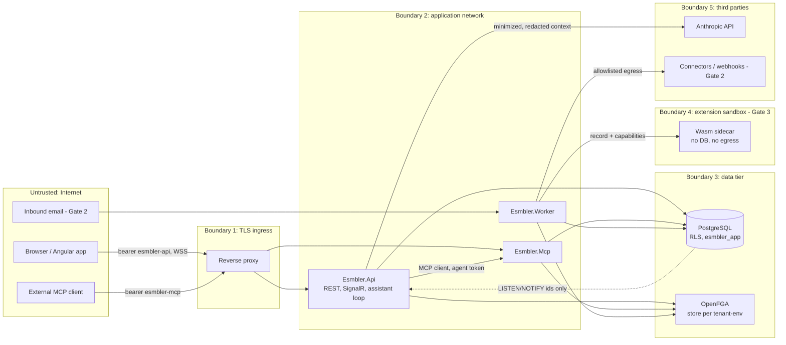

# Threat model

STRIDE threat model for Esmbler at Gate 0, covering the Gate 1 architecture in detail and later-gate components (attachments, email, connectors, extensions, marketplace) at design level. Each threat names the component that implements, or will implement, the mitigation and the test that proves it. Security, isolation and data-integrity tests block their gate (execution brief section 9).

## Scope and assets

| Asset | Why it matters |
|---|---|
| Tenant records and attachments | Confidentiality across tenants and within a tenant (record and field level) |
| Configuration artifacts and drafts | Integrity: a malicious overlay could hide fields, weaken rules or widen access |
| Authorization facts (OpenFGA stores, permission-set specs) | Integrity of every access decision |
| Tokens and signing keys | Impersonation of users, agents and tenants |
| Connector credentials and secret references (Gate 2+) | Access to customers' external systems |
| Audit log | Non-repudiation of human and AI actions |
| Shared compute (API, MCP, worker, extension runtime) | Availability for all tenants |

## Data flow and trust boundaries

Untrusted data crossing into the model: record fields, comments, attachments, email bodies, connector responses, marketplace descriptions. They are data at every boundary, never instructions.

## Tenant isolation

| ID | STRIDE | Asset | Threat | Mitigation | Verification | Residual risk | Gate |
|---|---|---|---|---|---|---|---|
| T-01 | I, T | Records | Query or bug reads/writes another tenant's rows | `FORCE ROW LEVEL SECURITY`, non-owner `esmbler_app` without BYPASSRLS, policy on `NULLIF(current_setting('app.tenant_id', true), '')::uuid` ([ADR 0010](../adr/0010-database-migrations-and-roles.md)); SQL in `packages/Esmbler.Kernel.Infrastructure/Migrations` | `Integration.Rls.Tenant_a_cannot_read_or_write_tenant_b`, `Integration.Rls.Missing_context_returns_no_rows` | Superuser/DBA access; backup role bypasses RLS by design | 1 |
| T-02 | I | Records | Tenant context leaks across pooled connections | `set_config(..., true)` per transaction via `TenantSessionInterceptor`; no-transaction access throws | `Integration.Rls.Context_does_not_leak_across_pooled_connections` | None known | 1 |
| T-03 | E | Tenant scope | Tenant chosen from a record ID or tool argument | Tenant/environment only from token `tid`/`eid` ([ADR 0011](../adr/0011-identity-and-development-authentication.md)); no MCP tool has tenant args ([ADR 0007](../adr/0007-mcp-server-design.md)) | `Mcp.Auth.No_tool_accepts_tenant_argument`, `Integration.Auth.Switch_to_non_member_tenant_is_forbidden` | None known | 1 |
| T-04 | I, T | Config/authz caches | Cached config or decision served to the wrong tenant | Cache keys include `(tenant, environment, config revision)` and `(store, principal, authz_revision)`; no global unkeyed caches (review rule in `.claude/rules/`) | `Unit.Caching.Config_cache_key_includes_tenant_env_revision`, `Integration.Isolation.Tenant_b_unchanged_after_tenant_a_publish` (REQ-ACC-01) | Developer adds an unkeyed cache; reviewer agent checks | 1 |
| T-05 | I, E | Jobs | Job runs under the wrong tenant or with stale authority | Jobs carry tenant, environment, principal; worker sets RLS context per item; handlers re-authorize; `kernel.claim_work` returns ids only ([ADR 0005](../adr/0005-job-and-workflow-execution.md)) | `Integration.Jobs.Job_runs_in_its_tenant_context`, `Integration.Jobs.Revoked_principal_job_is_denied` (REQ-ACC-07) | Long-running job between checks | 1 |
| T-06 | I | Search | Full-text search returns other tenants' or hidden values | `search` column in `kernel.records` under RLS + permission predicate; only unrestricted fields searchable ([ADR 0002](../adr/0002-storage-and-query-model.md)) | `Integration.Search.Hidden_field_terms_do_not_match`, `Integration.Search.Results_respect_record_permissions` | Ranking side channels (negligible) | 1 |
| T-07 | I | Counts, errors | Counts, lookups or errors reveal restricted records | Permission predicate before `COUNT`/`LIMIT`; restricted lookups render as "restricted"; delete-restricted errors count only visible references | `Integration.Query.Count_excludes_unreadable_records`, `Integration.Query.Error_does_not_name_hidden_record` (REQ-REC-003) | Timing differences | 1 |
| T-08 | I | Exports | Export bypasses record/field permissions or tenant scope | Export job uses the same query compiler and field serializer as the API, runs as the requesting principal, requires `records.export`; files tenant-prefixed in object storage | `Integration.Export.Respects_field_access` (planned) | Downloaded files leave the platform | 2 |
| T-09 | I | Live edits | Client joins another tenant's draft group | `JoinDraft` checks token `tid`/`eid` against draft and `config.edit`; `pg_notify` carries ids only ([ADR 0008](../adr/0008-realtime-channel-for-live-editing.md)) | `Integration.Live.Join_other_tenant_draft_is_forbidden` | None known | 1 |
| T-10 | I, T | OpenFGA | Tuples or checks cross tenant stores | One store per tenant-environment; store id resolved from RLS-protected mapping; model id scoped to store ([ADR 0004](../adr/0004-authorization-engine.md)) | Spike: tenant isolation PASS; `Integration.Authz.Store_resolved_from_context_only` | OpenFGA datastore outside RLS | 1 |
| T-11 | I | Attachments | Attachment URL guessed or shared across tenants | Object keys `tenant/env/record/uuid`; downloads via short-lived signed URLs issued after record-level check | `Integration.Attachments.Signed_url_requires_record_access` (planned) | URL valid until expiry (5 min) | 2 |
| T-12 | I | Sandbox data | Production data or credentials copied to sandbox | Environment creation copies config only; sandbox uses synthetic seed; bindings never copied (REQ-TEN-005) | `Integration.Environments.Sandbox_has_no_prod_bindings` (planned) | Admin manually pastes data | 2 |

## AI tool misuse and prompt injection

| ID | STRIDE | Asset | Threat | Mitigation | Verification | Residual risk | Gate |
|---|---|---|---|---|---|---|---|
| T-20 | E | Config, permissions | Instruction embedded in a ticket, comment or attachment makes the AI widen access | Untrusted content wrapped as data ([ADR 0013](../adr/0013-ai-assistant-model-adapter.md)); authority = user ∩ `scp` ∩ `acts_for` in the PDP; permission ops need `permissions.admin`; AI cannot publish | `AiEval.Injection.Embedded_instruction_cannot_grant_permissions` (REQ-ACC-10) | Model makes an unintended but authorized draft change; human review of diff before publish | 1 |
| T-21 | E | Publish | AI self-approves or swaps the artifact after approval | `request_publish` only; approve endpoint rejects tokens with `act`; approval bound to hash + tenant + environment + approver permissions + expected revision ([ADR 0003](../adr/0003-configuration-artifact-and-overlay-format.md)) | `Mcp.Lifecycle.Agent_cannot_approve_publish`, `Integration.Publish.Changed_draft_voids_approval` | Human approves without reading | 1 |
| T-22 | S, E | Tokens | MCP token replayed at API, or API token at MCP; token forwarded downstream | Audience `esmbler-mcp` vs `esmbler-api` validated; no passthrough; MCP calls kernel in-process | `Mcp.Auth.Api_audience_token_is_rejected`, `Integration.Auth.Mcp_token_rejected_by_api` | Token theft within 30-min lifetime | 1 |
| T-23 | I | Records | Model context contains hidden fields or other users' data | Field permissions and redaction applied before context; no record data by default; resources filtered by user permissions | `Integration.Assistant.Hidden_fields_not_in_model_context` | Data the user may see is sent to the model provider (by design) | 1 |
| T-24 | D | Spend, compute | Runaway agent loop or tool spam | Per-turn tool/model/time bounds; MCP rate limits and ops-per-draft cap; stop button; per-agent disable | `Mcp.Limits.Rate_limit_returns_limit_exceeded`, `Integration.Assistant.Stop_cancels_remaining_tool_calls` | Budget set too high by tenant | 1 |
| T-25 | T | External systems | Simulation or preview sends email, webhooks or live jobs | `simulate_rule` and previews run with a side-effect-free context (notification fake, no outbox writes) | `Integration.Preview.Simulation_writes_no_outbox_rows` (REQ-ACC-09) | None known | 1 |
| T-26 | R | Audit | AI action not attributable | Audit row per tool call: actor, agent, tool, target, config revision, outcome | `Integration.Audit.Mcp_call_records_actor_and_agent` | None known | 1 |

## Extensions (Gate 3)

| ID | STRIDE | Asset | Threat | Mitigation | Verification | Residual risk | Gate |
|---|---|---|---|---|---|---|---|
| T-30 | E | Host | Sandbox escape from guest code | Wasmtime pinned (LTS), WASI 0.2 with empty context, sidecar container: distroless, non-root, read-only rootfs, no capabilities ([ADR 0006](../adr/0006-extension-runtime.md)) | Spike isolation tests; `Extensions.Isolation.*` (planned) | Wasmtime CVE; patch SLA | 3 |
| T-31 | D | Shared workers | Infinite loop or memory blow-up | Fuel/epoch deadline, memory limits per instance, per-tenant concurrency | `Extensions.Limits.Infinite_loop_is_terminated` (planned) (REQ-ACC-11) | Noisy-neighbour latency | 3 |
| T-32 | I | Network | Extension exfiltrates data | No egress (network policy deny-all); no DB or vault credentials; host calls capability-checked; tenant from context only | `Extensions.Egress.Outbound_connection_denied` (planned) | Data returned via allowed outputs | 3 |
| T-33 | T | Supply chain | Malicious or tampered package | Review pipeline, signed artifacts, hash-pinned lockfile, capability consent at install | Gate 3/5 pipeline tests (planned) | Reviewed-but-malicious logic | 3, 5 |
| T-34 | E | Host page | UI extension reaches host DOM or credentials | Sandboxed iframe on isolated origin, strict CSP, validated postMessage bridge (sender, origin, schema, capability) | `e2e: ui-extension-cannot-read-host-token` (planned) | Phishing UI inside frame | 3 |

## Secrets

| ID | STRIDE | Asset | Threat | Mitigation | Verification | Residual risk | Gate |
|---|---|---|---|---|---|---|---|
| T-40 | S | Signing key | JWT signing key leaked from repo or config | Dev key only in `appsettings.Development.json`; production key from environment/KMS ([human action](../human-actions.md)); secret scanning in CI | CI secret-scanning job; `Unit.Config.Production_rejects_dev_signing_key` | Host compromise | 1 |
| T-41 | I | Connector credentials | Credentials exposed in UI, MCP, exports or packages | Stored as vault references; never returned by API/MCP; excluded from package export (REQ-ADM-002, REQ-ACC-14) | `Integration.Secrets.Never_serialized` (planned) | Vault compromise | 2 |
| T-42 | I | Logs | Tokens, passwords or record content in logs/traces | Structured logging with redaction of `Authorization`, cookies and record payloads; audit stores ids not free text | `Unit.Logging.Authorization_header_redacted` | New log statements; reviewer agent | 1 |

## Authentication, web and availability

| ID | STRIDE | Asset | Threat | Mitigation | Verification | Residual risk | Gate |
|---|---|---|---|---|---|---|---|
| T-50 | S | Accounts | Password guessing, credential stuffing | PBKDF2 hashing; per-IP and per-account login rate limits; lockout backoff; SSO + MFA in Gate 2 | `Integration.Auth.Login_rate_limited` | Local passwords until Gate 2 | 1 |
| T-51 | S | Sessions | Stolen or long-lived tokens | 15-min access tokens; rotated hashed refresh tokens with reuse detection; agent disable | `Integration.Auth.Refresh_reuse_revokes_family` | 15-min window | 1 |
| T-52 | T, I | Browser | Stored XSS through rich text, labels or element props | Rich text sanitized on write with an allowlist (`HtmlSanitizer`) in the record engine; Angular templating escapes by default, `[innerHTML]` only with sanitized content; strict CSP (no inline script) | `Unit.RichText.Script_and_event_handlers_stripped`, `e2e: xss-payload-renders-inert` | Sanitizer bypass CVE | 1 |
| T-53 | T | API | CSRF | API uses bearer tokens in the `Authorization` header (not cookies); the refresh cookie is `HttpOnly; Secure; SameSite=Strict; Path=/api/auth/refresh` and requires a custom header | `Integration.Auth.Refresh_without_custom_header_rejected` | None known | 1 |
| T-54 | I, E | Internal network | SSRF via webhooks, connectors, preview URLs or email links | Outbound calls only from worker connectors with destination allowlist; block private, link-local and metadata ranges after DNS resolution; no user-supplied URLs fetched in Gate 1; `preview_url` returns an internal app route only | `Integration.Egress.Private_address_blocked` (planned) | DNS rebinding edge cases | 2 |
| T-55 | D | Shared services | One tenant exhausts API, DB or workers | Query limits and 5 s timeout ([ADR 0002](../adr/0002-storage-and-query-model.md)); expression limits and 50 ms regex timeout ([ADR 0009](../adr/0009-rule-expression-language.md)); ASP.NET Core rate limiter partitioned by tenant; request size limits; fair job claiming | `Integration.Query.Timeout_returns_query_timeout`, `Integration.Jobs.Overloaded_tenant_does_not_starve_others` (REQ-ACC-11) | Volumetric DDoS (ingress provider) | 1, 2 |
| T-56 | E | Authorization | Authorization service down leads to allow | PDP fails closed with ~250 ms deadline and circuit breaker; lists return empty | Spike: fail-closed PASS; `Integration.Authz.Engine_down_denies` | Availability loss during outage | 1 |
| T-57 | E | Records | Linking a confidential record to a public one grants access | Relationships never imply access unless an explicit relationship policy says so (REQ-AUTHZ-010) | `Integration.Authz.Link_does_not_grant_access` | Misconfigured relationship policy | 1 |
| T-58 | R | Audit | Audit rows altered or deleted | `kernel.audit` grants INSERT/SELECT only to `esmbler_app` | `Integration.Rls.Audit_log_rejects_update_and_delete` | DBA access | 1 |

## Review cadence

The `security-reviewer` agent checks changes against this model before each milestone closes. New components add rows here in the same pull request. Residual risks above "low" that remain at gate end are logged in [known issues](../known-issues.md).
